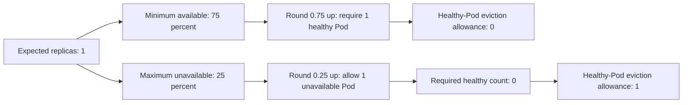

# How Percentage PDBs Round at Small Replica Counts

Author: [nawazdhandala](https://www.github.com/nawazdhandala)

Tags: Kubernetes, PodDisruptionBudget, High Availability, Troubleshooting

Description: Understand why complementary PDB percentages allow different evictions, calculate small-replica outcomes, and choose an explicit policy for single-replica workloads.

Keeping 75% of a service available sounds equivalent to allowing 25% to be unavailable. With a Kubernetes PodDisruptionBudget, or PDB, those policies can produce different results because a fraction of a Pod must become a whole number.

At one replica, `minAvailable: "75%"` protects the only healthy Pod from a normal budgeted eviction. `maxUnavailable: "25%"` can allow that same Pod to be evicted. The second policy permits a temporary loss of every replica, despite the apparently conservative percentage.

This article explains the arithmetic using Kubernetes v1.34.1. The examples were checked against its source and the actual `k8s.io/apimachinery` v0.34.1 rounding helper. Local calculations and YAML checks were performed; no live Pod evictions were run.

## Both percentages round up, but they count different things

Kubernetes rounds a fractional percentage upward for both PDB settings. The difference is what the resulting integer means: a minimum count that must remain healthy, or a maximum count that may be unavailable. [PDB percentage rounding](https://v1-34.docs.kubernetes.io/docs/tasks/run-application/configure-pdb/).

Let R be the controller's expected replica count. For the complementary policies in this example:

```text
minAvailable: "75%"
    required healthy Pods = round_up(75 * R / 100)

maxUnavailable: "25%"
    permitted unavailable Pods = round_up(25 * R / 100)
    required healthy Pods = R - permitted unavailable Pods
```

Here, `round_up` means the smallest integer at least as large as the calculated value. For example, both 0.25 and 0.75 round up to one. An exact integer stays unchanged.

The PDB controller calls the same upward-rounding helper for both settings, then subtracts the unavailable count only for `maxUnavailable`. [Controller calculation](https://github.com/kubernetes/kubernetes/blob/v1.34.1/pkg/controller/disruption/disruption.go), [version-pinned rounding helper](https://github.com/kubernetes/apimachinery/blob/v0.34.1/pkg/util/intstr/intstr.go).



## Compare a range of replica counts

The following table assumes all R replicas are healthy, the PDB has reconciled, and no eviction reservation is outstanding. It compares alternative policies for the same workload; do not attach both policies to the Pods.

| Replicas | Healthy required by minimum 75% | Evictions allowed | Healthy required by maximum unavailable 25% | Evictions allowed |
|---|---|---|---|---|
| 1 | 1 | 0 | 0 | 1 |
| 2 | 2 | 0 | 1 | 1 |
| 3 | 3 | 0 | 2 | 1 |
| 4 | 3 | 1 | 3 | 1 |
| 5 | 4 | 1 | 3 | 2 |
| 6 | 5 | 1 | 4 | 2 |
| 7 | 6 | 1 | 5 | 2 |
| 8 | 6 | 2 | 6 | 2 |

At five replicas, allowing two Pods to be unavailable is 40% of the workload. That exceeds the written 25%, but it follows the rounding rule: 25% of five is 1.25, rounded upward to two.

For complementary whole-number percentages, these policies agree when the percentage produces whole Pods. Otherwise, the maximum-unavailable policy permits one more unavailable Pod than the minimum-available policy. This is a mathematical consequence of rounding before subtraction, not a separate Kubernetes exception for small Deployments.

## Calculate the table before changing a manifest

This Python 3 program runs locally and requires no cluster credentials or third-party packages. Save it as `pdb-rounding.py` and run `python3 pdb-rounding.py`. Adjust the two percentage constants and replica range to examine your intended settings.

```python
MIN_PERCENT = 75
MAX_UNAVAILABLE_PERCENT = 25

def round_up_percent(percent, replicas):
    if not 0 <= percent <= 100 or replicas < 1:
        raise ValueError("Use percentages 0..100 and positive replicas")
    return (percent * replicas + 99) // 100

print("replicas min_required min_allow max_required max_allow")
for replicas in range(1, 9):
    minimum = round_up_percent(MIN_PERCENT, replicas)
    unavailable = round_up_percent(MAX_UNAVAILABLE_PERCENT, replicas)
    maximum_floor = replicas - unavailable
    print(replicas, minimum, replicas - minimum,
          maximum_floor, unavailable)
```

Adding 99 before integer division implements upward rounding for these nonnegative integer inputs. The first data row should be `1 1 0 0 1`, and the fourth should be `4 3 1 3 1`. The program models a healthy, settled workload; it does not query current Pod health or approve an eviction.

We compared this calculation with the official v0.34.1 helper for every integer percentage from zero through 100 across replica counts one through 32. That validates the local arithmetic over those inputs, not every operational condition of a Kubernetes cluster.

## Keep the manifest's intent visible

Suppose an existing Deployment in `payments` uses the Pod label `app.kubernetes.io/name: checkout`. This example expresses the minimum-available alternative:

```yaml
apiVersion: policy/v1
kind: PodDisruptionBudget
metadata:
  name: checkout
  namespace: payments
spec:
  minAvailable: "75%"
  selector:
    matchLabels:
      app.kubernetes.io/name: checkout
```

To examine the other policy, replace the `minAvailable` line with `maxUnavailable: "25%"` in the same proposed manifest. Do not retain both fields or create an overlapping second PDB. The API rejects a specification containing both minimum and maximum settings. [PDB validation rules](https://github.com/kubernetes/kubernetes/blob/v1.34.1/pkg/apis/policy/validation/validation.go).

Keep a percent sign in a percentage value. `minAvailable: 75` means 75 Pods, not 75%. Use an unquoted integer for a count and a quoted percentage string for a proportion. [PDB API specification](https://github.com/kubernetes/kubernetes/blob/v1.34.1/staging/src/k8s.io/api/policy/v1/types.go).

## Decide explicitly what one replica is allowed to do

For a service that must retain one healthy replica, an integer `minAvailable: 1` states that floor directly. At one healthy replica it blocks a normal healthy-Pod eviction. It cannot make that single instance redundant, and it cannot stop hardware failure.

If an interruption is acceptable during a scheduled maintenance window, a policy permitting the only Pod's eviction should be a documented availability choice. A small nonzero `maxUnavailable` percentage is not a promise of partial availability: for one replica, even 1% rounds up to one unavailable Pod.

If maintenance must proceed while traffic continues, provide additional usable capacity before the eviction. For a suitable stateless application, that might mean scaling to two replicas, confirming that both are Ready on appropriate nodes, and protecting one with an integer minimum. Verify sessions, dependency capacity, shutdown behavior, and traffic distribution as well. PDBs govern eviction allowance, not end-to-end application availability. [Disruption boundaries](https://kubernetes.io/docs/concepts/workloads/pods/disruptions/).

## Inspect actual health before trusting the table

Percentages use the expected workload scale, not just the number of currently healthy Pods. If the desired count is five and only four are healthy, the minimum-75% policy requires four and has no spare healthy-Pod allowance. The maximum-unavailable-25% alternative requires three and can have one. [Controller expected-scale and status logic](https://github.com/kubernetes/kubernetes/blob/v1.34.1/pkg/controller/disruption/disruption.go).

With the appropriate read permissions, replace the context and names and inspect the live objects:

```bash
CTX=staging-context
kubectl --context="$CTX" -n payments get deployment checkout
kubectl --context="$CTX" -n payments get pdb checkout -o yaml
kubectl --context="$CTX" -n payments get pods \
  -l app.kubernetes.io/name=checkout -o wide
```

Compare `expectedPods`, `currentHealthy`, `desiredHealthy`, and `disruptionsAllowed`, and ensure `observedGeneration` agrees with the PDB's generation. The computed table is a planning aid; the current status and eviction response govern the actual operation. [PDB status reference](https://kubernetes.io/docs/reference/kubernetes-api/policy/pod-disruption-budget-v1/), [kubectl get](https://kubernetes.io/docs/reference/kubectl/generated/kubectl_get/).

Finally, do not carry this rounding rule over to a Deployment's rolling-update settings. Deployment `maxUnavailable` percentages round down, while PDB `maxUnavailable` percentages round up. They are different controls used by different operations. Review the owning resource and field path whenever a chart exposes a setting named `maxUnavailable`. [Deployment rolling-update settings](https://kubernetes.io/docs/concepts/workloads/controllers/deployment/).
