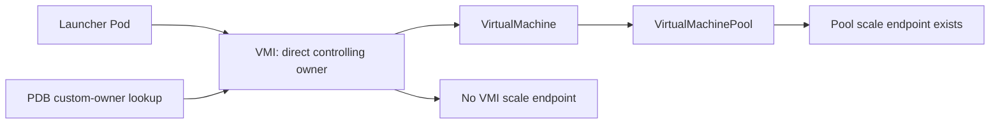

# Diagnose KubeVirt VMPool Evictions Blocked by PDB Scale Lookups

Author: [nawazdhandala](https://www.github.com/nawazdhandala)

Tags: Kubernetes, KubeVirt, PodDisruptionBudget, Troubleshooting

Description: Trace KubeVirt Pod ownership to diagnose PDB scale failures, distinguish migration delays, and assess an integer availability floor without bypassing VM safety.

A VirtualMachinePool has healthy virtual machines, yet its custom PodDisruptionBudget allows no evictions. The pool even has a working scale endpoint. Why does the budget complain that `virtualmachineinstances.kubevirt.io` cannot be scaled?

The answer is in the ownership chain. The Kubernetes Pod runs a virtual machine instance, not the pool itself. The disruption controller's custom-resource lookup does not automatically climb through every owner to find a scalable ancestor.

This guide reviews **Kubernetes 1.34.0** controller behavior and **KubeVirt 1.6.0** definitions and eviction code. The versions are source-review anchors, not a claim that this combination was installed with running virtual machines. Check your deployed versions before relying on the same implementation details.

## Identify which component is refusing eviction

A PDB limits voluntary removal of selected Pods through the eviction API. KubeVirt adds its own logic because removing a `virt-launcher` Pod can interrupt a running guest operating system.

Do not diagnose solely from an HTTP `429` response or a drain that keeps retrying. Capture the response message and inspect the affected budget. Replace `staging`, `guests`, and `checkout-vms` with your context, namespace, and custom PDB name. The commands require `kubectl`, `jq`, and read access.

```bash
kubectl --context staging -n guests describe pdb checkout-vms
kubectl --context staging -n guests get pdb checkout-vms -o json |
  jq '{generation: .metadata.generation,
       observedGeneration: .status.observedGeneration,
       spec, status}'
```

Use the evidence to choose the next step:

| Evidence | What to investigate |
|---|---|
| `CalculateExpectedPodCountFailed` mentioning the VMI scale subresource | Budget calculation and direct Pod ownership |
| Eviction message says evacuation was triggered or is in progress | KubeVirt migration progress and destination capacity |
| Message says the VMI is not live-migratable | Guest configuration and migration prerequisites |
| More than one matching PDB | Overlapping selectors and policy ownership |
| Valid, current PDB status with zero allowance | Healthy capacity relative to the floor |

KubeVirt 1.6.0's eviction webhook can mark an instance for evacuation and deny the request, including while evacuation is already in progress. That is different from Kubernetes failing to calculate a custom budget. [Pinned eviction webhook](https://github.com/kubevirt/kubevirt/blob/v1.6.0/pkg/virt-api/webhooks/validating-webhook/admitters/pod-eviction-admitter.go)

## Follow the owner that Kubernetes actually sees

A VirtualMachinePool manages VirtualMachine objects. Each running VirtualMachineInstance, or VMI, represents an instance of a VM, and its launcher Pod hosts the running guest.



Start with one affected launcher Pod. Replace the Pod name and then use the returned owner names for the subsequent reads:

```bash
kubectl --context staging -n guests get pod virt-launcher-checkout-0 -o json |
  jq '.metadata.ownerReferences[]? | select(.controller == true)'
kubectl --context staging -n guests get virtualmachineinstances.kubevirt.io checkout-0 -o json |
  jq '.metadata.ownerReferences[]? | select(.controller == true)'
kubectl --context staging -n guests get virtualmachines.kubevirt.io checkout-0 -o json |
  jq '.metadata.ownerReferences[]? | select(.controller == true)'
```

Do not assume names alone prove ownership: compare the owner kind, API version, and UID, Kubernetes' unique object identifier. The pool controller's source establishes the VM ownership relationship. [Pool controller](https://github.com/kubevirt/kubevirt/blob/v1.6.0/pkg/virt-controller/watch/pool/pool.go)

In Kubernetes 1.34's generic custom-controller path, the scale request targets the Pod's controller reference. A scalable pool further up this particular chain does not satisfy a request for VMI scale. The built-in handling of a ReplicaSet owned by a Deployment is a specific case, not arbitrary ancestor traversal. [Disruption-controller source](https://github.com/kubernetes/kubernetes/blob/v1.34.0/pkg/controller/disruption/disruption.go)

Inspect the installed custom resource definitions, or CRDs:

```bash
kubectl --context staging get crd virtualmachineinstances.kubevirt.io \
  virtualmachinepools.pool.kubevirt.io -o json |
  jq '.items[] | {resource: .metadata.name,
    versions: [.spec.versions[] | {name, served, subresources}]}'
```

The reviewed KubeVirt definition gives the pool a scale mapping but does not give one to VMI. This confirms an API distinction; it does not justify editing the installed VMI definition to invent replica fields. [KubeVirt CRD generation](https://github.com/kubevirt/kubevirt/blob/v1.6.0/pkg/virt-operator/resource/generate/components/crds.go)

## Choose an integer floor only after checking its meaning

Both `maxUnavailable` and percentage `minAvailable` need expected controller scale in the reviewed Kubernetes version. Integer `minAvailable` avoids that lookup. Therefore, changing `maxUnavailable: 1` to `minAvailable: "50%"` does not solve this failure. [Arbitrary-workload PDB rules](https://kubernetes.io/docs/tasks/run-application/configure-pdb/#arbitrary-workloads-and-arbitrary-selectors)

For an application that needs at least two healthy launcher Pods, a candidate policy is:

```yaml
apiVersion: policy/v1
kind: PodDisruptionBudget
metadata:
  name: checkout-vms
  namespace: guests
spec:
  minAvailable: 2
  selector:
    matchLabels:
      kubevirt.io: virt-launcher
      workload.example.com/pool: checkout
```

`workload.example.com/pool` is an example label that must already be present on the intended launcher Pods. A label placed only on the pool object is insufficient. Inspect the running Pods and the relevant templates rather than assuming propagation. Preserve the existing policy's verified selector when correcting its budget field.

The floor is an application decision. Three healthy selected Pods can leave room for one ordinary disruption; five can leave room for three. A fixed integer does not track pool scaling or enforce a fixed concurrency limit. A floor above the remaining healthy population will correctly block further voluntary removals.

There is another VM-specific trap: PDBs count Pods, not distinct guests. During migration, source and target launcher Pods can exist for the same VMI. Inspect that relationship before translating a Pod floor into a guest-availability promise. [Migration status and source/target Pods](https://kubevirt.io/user-guide/compute/live_migration/#migration-status)

```bash
kubectl --context staging -n guests get pods \
  -l 'kubevirt.io=virt-launcher,workload.example.com/pool=checkout' \
  -o json > launcher-pods.json
jq '.items | map({pod: .metadata.name,
  vmi: ([.metadata.ownerReferences[]? |
    select(.controller == true and .kind == "VirtualMachineInstance") |
    .uid][0] // "NO_VMI_OWNER")}) |
  sort_by(.vmi) | group_by(.vmi) |
  map({vmiUID: .[0].vmi, pods: map(.pod)})' launcher-pods.json
```

Multiple Pod names under one VMI UID require migration-aware interpretation. `NO_VMI_OWNER` means the selector or ownership assumption needs investigation. Even one healthy launcher per VMI does not prove the application inside each guest is serving successfully.

## Keep the repair separate from migration protection

Save the reviewed policy as `checkout-pdb.yaml` and preview it:

```bash
kubectl --context staging apply --dry-run=server -f checkout-pdb.yaml
kubectl --context staging -n guests get pdb -o yaml
```

The preview checks API acceptance without storing the proposed change. If the result retains both availability fields, correct the owning configuration and its field-removal behavior before proceeding. Review all selectors and ownership before applying through your normal configuration system. Kubernetes 1.34's eviction handler rejects a Pod selected by multiple PDBs; stacking a group budget over another matching policy is not a way to combine their limits. [Eviction implementation](https://github.com/kubernetes/kubernetes/blob/v1.34.0/pkg/registry/core/pod/storage/eviction.go)

KubeVirt's protection has changed across releases. In the reviewed 1.6.0 source, the disruption-budget controller removes VMI-owned PDBs, while the eviction webhook handles evacuation decisions. Do not infer installed behavior from an older diagram, delete every PDB, or attach a VMI controller owner reference to a manually managed group policy. [Pinned PDB controller](https://github.com/kubevirt/kubevirt/blob/v1.6.0/pkg/virt-controller/watch/drain/disruptionbudget/disruptionbudget.go)

After the budget correction reconciles, confirm its observed generation, healthy count, desired floor, and allowance. Review VMI migration conditions and guest health separately. If maintenance still waits, preserve the exact new error: a resolved scale failure can reveal an independent migration or scheduling problem. Resume maintenance only when both the application capacity requirement and the VM evacuation path have been verified in staging.
