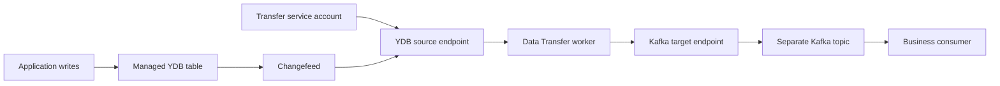

# Deliver Managed YDB Changes to Kafka with Data Transfer

Author: [nawazdhandala](https://www.github.com/nawazdhandala)

Tags: Database, Kafka, Data Pipeline, Cloud

Description: Connect Managed YDB to a separate Kafka cluster with Data Transfer, choose explicit event formats, and verify inserts, updates, and deletes safely.

An application writes orders to Managed YDB, while another service needs those changes in Apache Kafka. Polling the table repeatedly adds work and makes deletes difficult to discover. Change data capture, or CDC, records database changes so another system can consume them.

Yandex Data Transfer provides the managed bridge in this design. Its [YDB-to-Kafka tutorial](https://yandex.cloud/en/docs/data-transfer/tutorials/cdc-ydb) documents this route and the YDB 22.5 minimum for CDC support. The destination is a separate Kafka cluster; this is different from connecting a Kafka client directly to YDB's own topic service.

This walkthrough uses an isolated table and topic to establish the data contract before connecting business consumers. Managed-service settings reflect documentation reviewed in November 2026. SQL syntax is checked against YDB 26.2.1.16 documentation, and the inspection command targets kcat 1.7.1. No cloud transfer was executed for this article.

## Decide what must arrive

Start with two questions: do consumers need existing rows, and how will they recognize a repeated change?

The [transfer lifecycle reference](https://yandex.cloud/en/docs/data-transfer/concepts/transfer-lifecycle) distinguishes three modes:

| Mode | What it delivers | Suitable starting point |
| --- | --- | --- |
| Snapshot | A copy of existing data | A bounded export |
| Replication | Ongoing changes without initial row synchronization | The empty test table below |
| Snapshot and increment | Existing rows followed by changes | A consumer that needs current state before continuing |

Do not choose Replication and then diagnose the absence of old rows as a delivery failure. For an existing production table, plan the historical load explicitly.



The source identity, transfer network, Kafka producer credentials, and business consumer credentials are separate dependencies. A successful application query proves only one part of this chain.

## Prepare access and connectivity

Use a dedicated service account for the source endpoint. The current [YDB endpoint reference](https://yandex.cloud/en/docs/data-transfer/operations/endpoint/source/ydb) specifies `ydb.editor` for the normal setup that creates its consumer. It also documents a narrower `ydb.viewer` option when a pre-created consumer is supplied. Follow that documented path only after preparing the required feed and consumer; changing the role alone does not prepare those objects.

For this small walkthrough, let Data Transfer manage its default consumer and leave the pre-created changefeed field blank. Include only `transfer_probe` in the source path list. Replication requires an explicit list; a blank list is not shorthand for every table.

Before activation, have the Kafka owner prepare a dedicated `cdc.transfer_probe` topic and a producer identity allowed to write it. Give the inspection identity read access separately. Store credentials in the endpoint's supported credential fields or connection-management mechanism, not in SQL, source control, or shell arguments.

Check connectivity from the transfer's network, not just your laptop. The [networking reference](https://yandex.cloud/en/docs/data-transfer/concepts/network) describes subnet selection, DNS resolution, security groups, and the requirement that selected endpoint subnets share an availability zone. Allow the required source and target ports between the appropriate groups. Public broker access is unnecessary when the transfer and your inspection host have suitable private connectivity.

## Create a small source table

In a staging database, run this statement once through its SQL editor. Choose a new table name if `transfer_probe` already exists; do not overwrite an unfamiliar object.

```sql
CREATE TABLE transfer_probe (
    probe_id Utf8 NOT NULL,
    revision Uint64,
    state Utf8,
    PRIMARY KEY (probe_id)
);
```

The text identifier makes a test easy to find. The revision records successive states of that identifier. This uses ordinary [YDB table creation syntax](https://github.com/ydb-platform/ydb/blob/26.2.1.16/ydb/docs/en/core/yql/reference/syntax/create_table/index.md), with no special Kafka columns.

Create the YDB source endpoint using the database and service account prepared above. For the target, choose **Managed Service for Apache Kafka cluster**, select the intended destination, and provide its producer authentication. Choose **Topic full name** and enter `cdc.transfer_probe`.

A self-managed Kafka deployment instead uses **Custom installation**, with broker addresses, TLS settings, a trusted CA certificate, and reachable network interfaces. These are documented separately in the [Kafka target reference](https://yandex.cloud/en/docs/data-transfer/operations/endpoint/target/kafka). Do not substitute YDB's Kafka authentication syntax for the destination cluster's authentication.

Using one explicit topic makes this first test unambiguous. When expanding to several tables, review topic-prefix routing and permissions before enabling them. Do not assume similarly named tables from different directories will automatically match your naming convention.

## Make serialization explicit

Serialization converts each change into the bytes written to Kafka. Select **Debezium** serialization and, for this JSON inspection exercise, use these documented settings:

```properties
key.converter=org.apache.kafka.connect.json.JsonConverter
value.converter=org.apache.kafka.connect.json.JsonConverter
key.converter.schemas.enable=true
value.converter.schemas.enable=true
dt.batching.max.size=0
```

Enter these as serialization key/value settings in the target endpoint, not as broker properties. The [serialization reference](https://yandex.cloud/en/docs/data-transfer/concepts/serializer) documents the converter names, schema switches, and batching setting. JSON with embedded schemas lets the reviewer inspect both the event structure and its values without introducing a schema registry. Disabled batching keeps this exercise focused on individual logical events.

Create a **Replication** transfer between the two endpoints, activate it, and wait for **Replicating**. Record its identifier, selected table, destination topic, and activation time. A healthy status is necessary, but the following data check is the acceptance evidence.

## Follow one row through its changes

Use a new probe identifier for each run. After activation, execute:

```sql
UPSERT INTO transfer_probe (probe_id, revision, state)
VALUES ('cdc-review-20261124-a'u, 1ul, 'created'u);
```

This [UPSERT](https://github.com/ydb-platform/ydb/blob/26.2.1.16/ydb/docs/en/core/yql/reference/syntax/upsert_into.md) creates the previously absent key. Inspect the dedicated Kafka topic from a host with network access. Prepare a private `kafka-reader.conf` containing the approved SASL mechanism, reader username/password, and `ssl.ca.location`; restrict its file permissions and keep it outside the repository. Replace the broker placeholder with the actual TLS listener.

```bash
kcat -F /secure/path/kafka-reader.conf \
  -b '<broker-host>:<tls-port>' \
  -X security.protocol=SASL_SSL \
  -X ssl.endpoint.identification.algorithm=https \
  -C -t cdc.transfer_probe -o beginning -e -J
```

In [kcat 1.7.1](https://github.com/edenhill/kcat/blob/1.7.1/kcat.c), `-C` consumes, `-o beginning` starts from the retained beginning, `-e` exits after reaching the partition ends, and `-J` includes Kafka metadata in a JSON envelope. This reads a small dedicated topic without joining the production consumer group. It can exit before a delayed event arrives; rerun after checking transfer progress. Do not use this unbounded historical read on a large production topic.

Find the probe key and its initial state, then run the following statements **separately**, inspecting the corresponding event after each:

```sql
UPDATE transfer_probe
SET revision = 2ul, state = 'confirmed'u
WHERE probe_id = 'cdc-review-20261124-a'u;

DELETE FROM transfer_probe
WHERE probe_id = 'cdc-review-20261124-a'u;
```

The exact-key predicates limit the [update](https://github.com/ydb-platform/ydb/blob/26.2.1.16/ydb/docs/en/core/yql/reference/syntax/update.md) and [delete](https://github.com/ydb-platform/ydb/blob/26.2.1.16/ydb/docs/en/core/yql/reference/syntax/delete.md) to the disposable row. Save sanitized key/value examples, partition and offset, and observed delay. Verify the consumer distinguishes a delete event from a malformed value and handles any configured tombstone records.

## Accept the bridge, then the consumer

Pass the staging check only when the initial state, changed revision, and deletion all reach the intended topic and your decoder understands them. If nothing arrives, inspect transfer errors and source paths first. If writing fails, inspect destination permissions and routing. If bytes arrive but decoding fails, compare the actual converter settings with the consumer's expected format.

Data Transfer documents [at-least-once delivery](https://yandex.cloud/en/docs/data-transfer/concepts/delivery-configuration), so receiving an event again must be safe. A Kafka offset identifies a stored record, but a resent logical event can occupy another offset. Design application deduplication or idempotent state updates accordingly, and rehearse consumer restarts before enabling side effects such as billing or notifications.

Keep the sanitized evidence as a deployment check. A transfer marked Replicating, plus verified state transitions and safe repeated processing, gives a much stronger operational basis than a screenshot of a green status alone.
