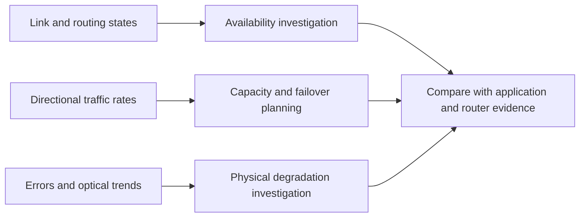

# Monitor Direct Connect Health and Capacity with CloudWatch

Author: [nawazdhandala](https://www.github.com/nawazdhandala)

Tags: AWS, Direct Connect, CloudWatch, Monitoring, Alerting

Description: Build Direct Connect monitoring with the right metric dimensions, directional utilization, error statistics, optical baselines, and explicit missing-data handling.

A single “connection up” tile cannot tell you whether Direct Connect is carrying useful traffic, approaching capacity, or accumulating physical errors. A useful monitoring view answers separate questions: is the link available, is routing healthy, is traffic behaving normally, and is the physical path degrading?

This guide builds an ongoing monitoring approach rather than a cable-troubleshooting checklist. The examples target a dedicated connection and were checked against **AWS CLI 2.42.1**. Hosted-service customers should first discover which metrics their account receives and arrange provider visibility for the rest. No CloudWatch requests or alarms were executed during preparation.

## Choose the signal for each question

Start with this small measurement set:

| Question | Metric | Useful starting statistic |
|---|---|---|
| Did a sampled link state go down? | `ConnectionState` | Minimum; 0 is down, 1 is up |
| Is either direction approaching capacity? | `ConnectionBpsIngress`, `ConnectionBpsEgress` | Average, graphed separately |
| Are physical-interface errors accumulating? | `ConnectionErrorCount` | Sum |
| Are optical readings moving away from baseline? | `ConnectionLightLevelRx`, `ConnectionLightLevelTx` | Minimum and Maximum per lane |
| Is routing alive? | `VirtualInterfaceBgpStatus` | Minimum per reported peer dimension set |

AWS measures ingress toward AWS and egress away from AWS. `ConnectionErrorCount` reports errors since the previous datapoint; the obsolete `ConnectionCRCErrorCount` should not be used. The [Direct Connect metric reference](https://docs.aws.amazon.com/directconnect/latest/UserGuide/monitoring-cloudwatch.html) defines these measurements and their dimensions.

The statistic is a deliberate interpretation. Minimum exposes an observed zero in a state series; Average describes typical rate within the period; Sum adds interval error counts. CloudWatch's [statistics definitions](https://docs.aws.amazon.com/AmazonCloudWatch/latest/monitoring/Statistics-definitions.html) explain these aggregations. None reconstructs a brief event that the source never sampled.



## Discover the actual metric identities

A **dimension** is a name/value identifying a metric series. An optical lane or address family can distinguish series that share the same metric name. Guessing dimensions often produces an empty graph rather than an obvious configuration error.

With a profile authorized to read CloudWatch metrics, replace the example Region and connection ID:

```bash
aws cloudwatch list-metrics \
  --profile network-readonly --region us-east-1 \
  --namespace AWS/DX \
  --dimensions Name=ConnectionId,Value=dxcon-EXAMPLE \
  --query 'Metrics[].{Metric:MetricName,Dimensions:Dimensions}' \
  --output json
```

This returns series identities, not current values. Preserve each complete dimension set when creating queries. [`list-metrics`](https://docs.aws.amazon.com/cli/latest/reference/cloudwatch/list-metrics.html) can return series with additional dimensions beyond the filter, and excludes metrics that have not reported within two weeks. A new series can also take time to appear.

For physical measurements, inspect `ConnectionId` and reported `OpticalLaneNumber` values. For VIF routing measurements, preserve the reported `VirtualInterfaceId`, connection, and `IpAddressFamily` dimensions. Keep IPv4 and IPv6 visible separately rather than allowing one working family to hide another failure.

If a series is absent, check account ownership, resource Region, permissions, and whether that connection type publishes it. `ConnectionState` is available for dedicated and hosted connections, but do not assume every physical-port metric is exposed to a hosted customer. Use the [availability notes](https://docs.aws.amazon.com/directconnect/latest/UserGuide/monitoring-cloudwatch.html) to set expectations with the partner.

## Calculate utilization without changing the units twice

Bitrate metrics are already rates. Do not apply a counter derivative or divide them by the period again. For a dedicated 10 Gbps port, calculate each direction as:

`utilization_percent = 100 × bits_per_second / 10000000000`

For example, 6 billion bits per second is 60%, not 6% and not 60 gigabytes per second. A full-duplex link has separate directional capacity; adding ingress and egress percentages creates a misleading single number.

Save this as `dx-utilization.json`, replacing the connection ID and denominator for your actual capacity. It assumes discovery showed the single `ConnectionId` dimension for these series:

```json
[
  {
    "Id": "rx",
    "MetricStat": {
      "Metric": {
        "Namespace": "AWS/DX",
        "MetricName": "ConnectionBpsIngress",
        "Dimensions": [{"Name": "ConnectionId", "Value": "dxcon-EXAMPLE"}]
      },
      "Period": 300,
      "Stat": "Average"
    },
    "ReturnData": false
  },
  {
    "Id": "tx",
    "MetricStat": {
      "Metric": {
        "Namespace": "AWS/DX",
        "MetricName": "ConnectionBpsEgress",
        "Dimensions": [{"Name": "ConnectionId", "Value": "dxcon-EXAMPLE"}]
      },
      "Period": 300,
      "Stat": "Average"
    },
    "ReturnData": false
  },
  {"Id": "rxpct", "Expression": "100*rx/10000000000", "Label": "Toward AWS percent", "ReturnData": true},
  {"Id": "txpct", "Expression": "100*tx/10000000000", "Label": "Away from AWS percent", "ReturnData": true}
]
```

Retrieve a recent window, replacing these illustrative UTC timestamps:

```bash
aws cloudwatch get-metric-data \
  --profile network-readonly --region us-east-1 \
  --metric-data-queries file://dx-utilization.json \
  --start-time 2026-11-24T10:00:00Z \
  --end-time 2026-11-24T11:00:00Z \
  --scan-by TimestampAscending \
  --output json
```

Inspect returned timestamps, values, status codes, and messages before trusting the lines. The [metric-data API](https://docs.aws.amazon.com/cli/latest/reference/cloudwatch/get-metric-data.html) supports the batch and [metric math](https://docs.aws.amazon.com/AmazonCloudWatch/latest/monitoring/using-metric-math.html) expressions. Empty results need investigation; do not fill them with zero merely to make the dashboard look healthy.

For a hosted service or VIF limiter, use the relevant service capacity when assessing that service. A shared physical port's capacity is not the bandwidth available to one tenant. Keep VIF usage and port usage in separate panels.

## Build an alarm with an explicit observation window

Direct Connect normally publishes five-minute data. Requesting a one-minute aggregation does not guarantee fresh samples every minute; AWS documents this [publication limitation](https://docs.aws.amazon.com/directconnect/latest/UserGuide/viewing-metrics.html). Use router monitoring and synthetic checks when you need faster detection.

The following example creates a new link-state alarm with actions disabled for review. Replace the name and dimension, and use a profile with alarm-management permission:

```bash
aws cloudwatch put-metric-alarm \
  --profile network-alarms --region us-east-1 \
  --alarm-name dx-example-observed-link-down \
  --alarm-description 'Observed link-down samples; investigate missing telemetry separately' \
  --namespace AWS/DX --metric-name ConnectionState \
  --dimensions Name=ConnectionId,Value=dxcon-EXAMPLE \
  --statistic Minimum --period 300 \
  --evaluation-periods 2 --datapoints-to-alarm 2 \
  --threshold 1 --comparison-operator LessThanThreshold \
  --treat-missing-data missing \
  --no-actions-enabled
```

With complete data, this requires two evaluated periods containing a sampled down state. It does not promise an exact ten-minute detection delay or prove continuous downtime. CloudWatch can use additional real datapoints in its evaluation range when some are missing.

Choose an unused name: [`put-metric-alarm`](https://docs.aws.amazon.com/cli/latest/reference/cloudwatch/put-metric-alarm.html) overwrites an existing alarm's configuration. Once reviewed, configure approved notification actions and enable them. An alarm with actions disabled is observation only.

`missing` avoids treating absent measurements as healthy by default; when the entire evaluation range lacks data, the alarm becomes `INSUFFICIENT_DATA`. Route that condition to an appropriate telemetry investigation. The [missing-data rules](https://docs.aws.amazon.com/AmazonCloudWatch/latest/monitoring/alarms-and-missing-data.html) differ from simply substituting zero.

## Use baselines for errors, optics, and capacity

For errors, graph the interval total alongside traffic and router counters. A burst at a particular time is useful evidence, but the count alone does not identify which party owns the faulty component. Define warning and paging conditions from observed behavior and service impact rather than inventing a universal acceptable count.

For optics, compare each lane with its historical operating range and the installed optic's limits. Watch both weak received light and unexpectedly high power. Avoid averaging all lanes into one reassuring value. Use trend changes to schedule an inspection before an outage, then correlate any incident with measurements from both ends.

For capacity, include the failure scenario. Two links at 45% may leave little headroom if one must absorb both loads. Record whether each application can tolerate that reduced capacity and whether bursty traffic needs finer-grained router measurements than CloudWatch supplies.

AWS recommends establishing a normal-performance baseline in its [monitoring plan](https://docs.aws.amazon.com/directconnect/latest/UserGuide/monitoring-overview.html). Make the baseline operational: attach owners, expected traffic windows, and a clear investigation path to every alarm.

## Verify that monitoring reaches a person

Before relying on the dashboard, verify metric identities against the selected circuit, compare a known traffic interval with router data, and review alarm history for unexpected missing-data transitions. Test notification delivery through an approved test alarm without interrupting the circuit.

A notification test validates delivery, not the metric threshold. A graph validates data retrieval, not application availability. Complete acceptance by checking a representative application transaction and confirming that the notified owner can identify the affected connection and its alternate path.
