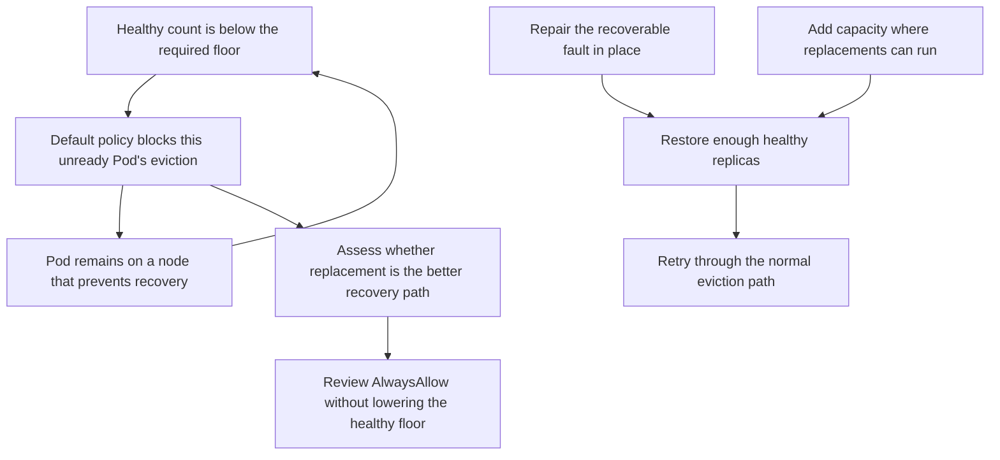

# Recover a Node Drain Blocked by an Unready Pod

Author: [nawazdhandala](https://www.github.com/nawazdhandala)

Tags: Kubernetes, PodDisruptionBudget, Troubleshooting, High Availability

Description: Diagnose a drain blocked by an unready Pod, separate budget protection from recovery failures, and restore usable capacity before relaxing maintenance safeguards.

A maintenance drain stops at an unready Pod. The application is already degraded, the Pod cannot move, and the node cannot be taken out of service. This often gets called a “deadlocked PDB,” but the PodDisruptionBudget is usually one part of a larger recovery problem.

The useful question is what would make a replacement healthy. If it would encounter the same bad image, unavailable database, or storage restriction, permitting eviction alone will not resolve the incident.

This guide follows a practical recovery sequence. Inspection commands use Kubernetes v1.34.0-compatible syntax. The scale dry-run example was exercised against an isolated v1.34.0 API server; no live node drain or application recovery was performed.

## Stabilize the maintenance operation

Pause additional drain attempts and coordinate with any automation that might start another node operation. Keep the application's incident owner informed of the current healthy capacity and the maintenance objective.

A drain makes a node unschedulable before removing eligible Pods. A failure partway through does not mean that nothing changed. Some Pods may have left while the node remains cordoned, meaning ordinary scheduling to that node is disabled. [Safe node draining](https://kubernetes.io/docs/tasks/administer-cluster/safely-drain-node/).

Record the error from the blocked operation. A message about violating a disruption budget is different from an error about unmanaged Pods, local storage, or authorization. Solve the observed failure rather than adding flags until the command advances.

## Establish the exact Pod, node, and budget

Use a context you have verified and an identity permitted to read the relevant resources. Replace these example identifiers with those named in the drain output:

```bash
CTX=staging-context
NS=payments
POD=checkout-example
NODE=maintenance-node
PDB=checkout

kubectl --context="$CTX" get node "$NODE" -o yaml
kubectl --context="$CTX" -n "$NS" get pod "$POD" -o yaml
kubectl --context="$CTX" -n "$NS" get pdb "$PDB" -o yaml
```

These commands do not change the cluster. Check the Pod's node assignment, labels, owner references, phase, readiness condition, and deletion timestamp. Then confirm that the PDB selector actually matches it. [kubectl get](https://kubernetes.io/docs/reference/kubectl/generated/kubectl_get/).

“NotReady Pod” here means the Pod does not have `Ready=True`. That is different from a node's Ready condition. A Running Pod can be unready while the node itself is healthy; a node problem can also make many unrelated Pods unavailable. Keep those two observations separate. [Pod lifecycle](https://kubernetes.io/docs/concepts/workloads/pods/pod-lifecycle/), [node status](https://kubernetes.io/docs/reference/node/node-status/).

For the PDB, compare `observedGeneration` with `metadata.generation`, then read the condition reason, `currentHealthy`, `desiredHealthy`, and pending `disruptedPods`. A stale observation or `SyncFailed` condition requires investigation before treating the reported allowance as a settled capacity calculation. [PDB status definition](https://github.com/kubernetes/kubernetes/blob/v1.34.0/staging/src/k8s.io/api/policy/v1/types.go).

## Explain the apparent deadlock

Consider three selected Pods with `minAvailable: 2`. Only one is healthy. The Pod targeted by the drain is Running but unready.

Under the default `IfHealthyBudget` policy, that unready Pod can be held while the workload remains below its required healthy count. The policy preserves its chance to recover. Once two selected Pods are healthy, the unready Pod may be evicted without removing counted healthy capacity. [Unhealthy-Pod eviction policy](https://v1-34.docs.kubernetes.io/docs/tasks/run-application/configure-pdb/).

A real recovery cycle arises if the Pod cannot become healthy on its current node, while the default policy prevents moving it. That requires evidence about the node or application; the PDB does not diagnose the cause.



## Find the recovery blocker

Start with the Pod's events and container state:

```bash
kubectl --context="$CTX" -n "$NS" describe pod "$POD"
kubectl --context="$CTX" -n "$NS" logs "$POD" \
  -c application --previous --tail=100
```

Replace `application` with the container name. The second command is useful when that container restarted and a previous instance's logs are available. It may fail when no previous instance exists; that is not evidence of a PDB fault. [Pod debugging](https://kubernetes.io/docs/tasks/debug/debug-application/debug-pods/), [kubectl logs](https://kubernetes.io/docs/reference/kubectl/generated/kubectl_logs/).

Use the evidence to select the next investigation:

| Observation | Recovery question |
|---|---|
| Replacement remains Pending with scheduling errors | Are resources, topology, affinity, taints, or storage preventing placement? |
| Image pull fails | Can eligible nodes reach the registry and use the required credentials and image? |
| The process repeatedly exits | Would a replacement use the same failing configuration or dependency? |
| Readiness fails while the process continues | Is it warming up, recovering, or unable to reach something essential? |
| Several unrelated Pods fail on the same node | Is node repair or moving workloads away the appropriate recovery path? |

Do not weaken readiness merely to make the PDB see another healthy Pod. The readiness signal must continue to mean that the application can perform its intended work. [Readiness probes](https://kubernetes.io/docs/tasks/configure-pod-container/configure-liveness-readiness-startup-probes/).

## Restore capacity where possible

Repairing a dependency or configuration may let the Pod recover in place. Adding usable capacity can instead let another replica become Ready elsewhere, restoring the healthy count without changing the protected minimum.

For a stateless Deployment whose additional replicas are safe, consider a temporary increase from three to four. Coordinate the desired count with its autoscaler and configuration owner first. A manual scale change may otherwise be overwritten, and stateful membership changes need application-specific handling. [Horizontal Pod Autoscaling](https://kubernetes.io/docs/concepts/workloads/autoscaling/horizontal-pod-autoscale/).

This command checks a proposed scale operation without saving it:

```bash
kubectl --context="$CTX" -n "$NS" scale deployment/checkout \
  --current-replicas=3 --replicas=4 --dry-run=server
```

The precondition requires the current desired count to be three; it is not a requirement that three Pods be Ready. Server dry run leaves the persisted replica count unchanged. If the precondition fails, re-read the workload rather than blindly removing the check. [kubectl scale](https://kubernetes.io/docs/reference/kubectl/generated/kubectl_scale/).

After the approved configuration change, wait for actual scheduling and application readiness. A fourth desired replica that stays Pending has not restored capacity. In the three-Pod example, recovering from one to two healthy replicas can unblock the unready Pod under the default policy, even though the healthy-Pod disruption allowance may remain zero.

## Change eviction policy only for a justified replacement path

If the Pod cannot recover in place and replacement is the reviewed recovery plan, assess `unhealthyPodEvictionPolicy: AlwaysAllow`. This permits eviction of Running but unready Pods below the healthy floor while retaining ordinary protection for healthy Pods. It gives up the unready Pod's opportunity to finish recovering in place. [Pinned policy definition](https://github.com/kubernetes/kubernetes/blob/v1.34.0/staging/src/k8s.io/api/policy/v1/types.go).

Preserve the existing minimum and selector when reviewing that change. Confirm replacement placement, storage handling, shutdown requirements, and whether initialization progress will be lost. A policy change cannot fix a replacement that is doomed to fail for the same reason.

Lowering the healthy floor, deleting the PDB, or using `--disable-eviction` is a different decision: it relaxes availability protection. Drain's `--force` does not itself bypass a budget. Treat any intentional bypass as an explicit incident decision rather than a routine troubleshooting step. [Drain flags](https://kubernetes.io/docs/reference/kubectl/generated/kubectl_drain/).

## Close the incident with recovery evidence

Retry the approved maintenance operation after the identified condition is resolved. Verify application errors and latency, healthy replica count, replacement placement, and any workload-specific integrity checks. Check whether the node should remain cordoned for maintenance or return to service; a successful Pod replacement alone does not decide that.

Record what broke the cycle: a repaired dependency, additional healthy capacity, corrected placement, or a reviewed policy change. Remove temporary capacity only after the service has enough headroom for the intended steady state. The durable fix is a recovery path that works under the budget, not simply a drain command that eventually exits.
