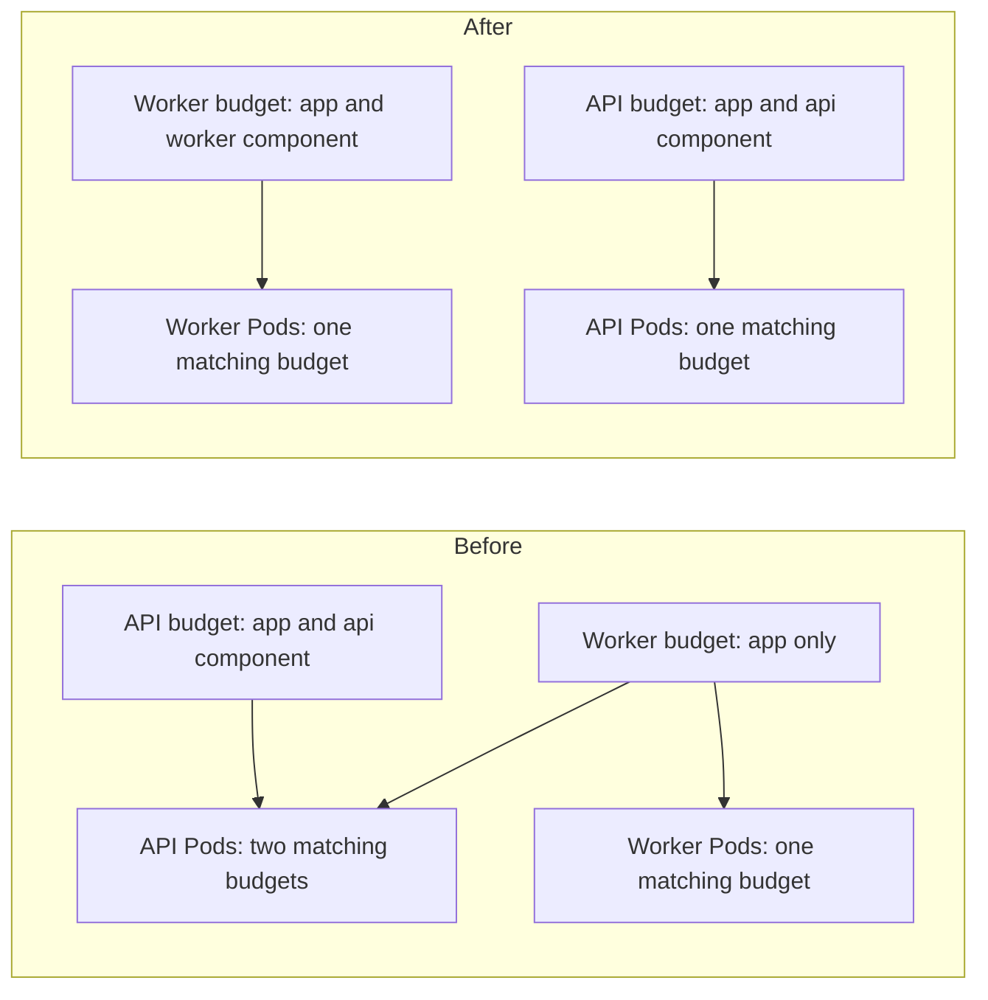

# Fix Overlapping PDBs That Reject Pod Evictions

Author: [nawazdhandala](https://www.github.com/nawazdhandala)

Tags: Kubernetes, PodDisruptionBudget, Troubleshooting, High Availability

Description: Find Pods selected by multiple disruption budgets, distinguish overlap from exhausted capacity, and repair selectors while retaining the intended protection.

Two PodDisruptionBudgets can each show a positive disruption allowance while an eviction still fails. If both select the same Pod, the eviction API does not combine their allowances or choose the stricter one. In the Kubernetes v1.34.0 behavior examined here, that overlap is unsupported for the normal budget-checking path.

This commonly happens when a platform-wide or older application budget remains after a chart adds a more specific one. The resource names look different, but the selectors intersect. Start with the selected Pods, not the names of the budgets. [PDB selector constraints](https://v1-34.docs.kubernetes.io/docs/tasks/run-application/configure-pdb/).

## Recognize an overlap error

For a Running, Ready Pod selected by more than one PDB, the v1.34.0 eviction handler returns an error with HTTP status 500 and a message containing `more than one PodDisruptionBudget`. It performs this check before evaluating the selected budget's allowance. This differs from a normal exhausted-budget rejection. [Pinned eviction implementation](https://github.com/kubernetes/kubernetes/blob/v1.34.0/pkg/registry/core/pod/storage/eviction.go).

Do not assume every 500 response is this problem; retain the actual message. Also do not interpret two allowed-disruption counters as independent permission to remove the Pod. They describe separate objects, not a supported combined policy.

Lifecycle exceptions exist for some Pods, so use the state of the actual failed target when reproducing the issue. This walkthrough uses Running, Ready targets to isolate overlapping selectors.

## Work through a concrete collision

Suppose namespace `payments` contains two API Pods and two worker Pods. All carry `app: checkout`. Their `component` label is either `api` or `worker`.

The namespace contains these budgets:

| PDB | Existing selector | Minimum healthy count | Actual population |
|---|---|---|---|
| `checkout-workers` | `app=checkout` | 1 | Both API Pods and both workers |
| `checkout-api` | `app=checkout,component=api` | 1 | Both API Pods |

The worker budget's name does not narrow its scope. Each API Pod matches both selectors. Each worker matches only the first.

With all four Pods healthy and settled status, the broad budget can report three allowed disruptions and the API budget one. The API Pod's eviction still encounters the overlap check. Raising either allowance will not resolve the selector collision.



## Inspect all candidate budgets in the Pod's namespace

Use a verified context and an identity with permission to read PDBs and Pods. Replace the example namespace and target Pod name:

```bash
CTX=staging-context
NS=payments
POD=checkout-api-example

kubectl --context="$CTX" -n "$NS" get pod "$POD" --show-labels
kubectl --context="$CTX" -n "$NS" get pdb -o yaml
kubectl --context="$CTX" -n "$NS" get pods --show-labels
```

Read every candidate selector, including `matchExpressions`. A budget from another chart or operator may not share an obvious name with the workload. PDB selection is namespace-scoped and based on Pod labels. [Controller selection logic](https://github.com/kubernetes/kubernetes/blob/v1.34.0/pkg/controller/disruption/disruption.go), [kubectl get](https://kubernetes.io/docs/reference/kubectl/generated/kubectl_get/).

For the exact selectors in this example, these queries expose the two populations:

```bash
kubectl --context="$CTX" -n "$NS" get pods -l 'app=checkout' -o name
kubectl --context="$CTX" -n "$NS" get pods \
  -l 'app=checkout,component=api' -o name
```

Both API Pod names should appear in both outputs. If the real selector has additional requirements, include all of them. Requirements are combined with AND; omitting one can manufacture an overlap that the real selector does not have. [Label selector rules](https://kubernetes.io/docs/concepts/overview/working-with-objects/labels/).

The controller source also includes a `MultiplePodDisruptionBudgets` warning path. Such an event is useful supporting evidence, but its absence is not proof that selectors are disjoint. Base the diagnosis on the actual matching objects and eviction response. [Controller warning path](https://github.com/kubernetes/kubernetes/blob/v1.34.0/pkg/controller/disruption/disruption.go).

## Decide which object should protect each population

Inspect the PDB metadata and configuration source before changing anything. Ownership references, chart labels, annotations, and deployment configuration can help identify which team or system maintains it. Kubernetes owner references describe object ownership; they are separate from the label selector determining which Pods a PDB covers. [Owners and dependents](https://kubernetes.io/docs/concepts/overview/working-with-objects/owners-dependents/).

Agree on one intended budget for each population. There are two common repairs:

- If both objects are accidental duplicates for the same workload, retain the intended owner and remove the obsolete declaration through its source configuration.
- If the budgets protect different components, narrow their selectors so each covers its intended Pods without intersecting the other.

Do not delete a broad budget until you have accounted for every workload it currently covers. It may be the only budget protecting Pods outside the incident's immediate target.

## Make a narrow selector correction

In this example, preserve both budgets and their minimums. Add `component: worker` to the existing worker selector. The resulting pair is:

```yaml
apiVersion: policy/v1
kind: PodDisruptionBudget
metadata:
  name: checkout-workers
  namespace: payments
spec:
  minAvailable: 1
  selector:
    matchLabels:
      app: checkout
      component: worker
---
apiVersion: policy/v1
kind: PodDisruptionBudget
metadata:
  name: checkout-api
  namespace: payments
spec:
  minAvailable: 1
  selector:
    matchLabels:
      app: checkout
      component: api
```

This is a complete example for the stated four-Pod fixture. In a real configuration, retain any other intentional fields and use the actual application labels and availability floors. Avoid changing Pod labels merely to escape the collision; that may also affect Services or workload selectors.

Save the reviewed example as `checkout-budgets.yaml` and validate the API changes without persisting them:

```bash
kubectl --context="$CTX" -n "$NS" apply \
  --dry-run=server -f checkout-budgets.yaml
```

A successful dry run checks whether those resource requests are accepted. It does not prove non-overlap: the API can accept two individually valid PDB objects whose selectors intersect. Population comparison remains a separate check. [Server dry-run behavior](https://kubernetes.io/docs/reference/using-api/api-concepts/#dry-run), [kubectl apply](https://kubernetes.io/docs/reference/kubectl/generated/kubectl_apply/).

## Verify both coverage and eviction behavior

Before the change, record each Pod's matching budgets. After applying the reviewed correction through its owning configuration, compare again: each API Pod should match only `checkout-api`, and each worker only `checkout-workers`. Confirm that no intended Pod has become uncovered.

Wait for each changed PDB's observed generation to catch up. Re-read health and allowance; removing overlap does not manufacture spare healthy capacity. A disjoint budget can still correctly reject eviction if its minimum cannot be preserved.

In an isolated v1.34.0 API-server test, we created the four-Pod fixture with supplied Ready conditions and PDB status. A server dry-run eviction of an API Pod failed with the overlap error despite positive allowances. After narrowing the worker selector and updating fixture status, API and worker eviction dry runs succeeded without deleting Pods or consuming allowance.

That test verifies the API distinction, not a live drain. It had no kubelet, scheduler, or disruption controller and did not exercise application availability. Rehearse the complete maintenance procedure in your own staging environment, then record the selector ownership rule so another chart update does not reintroduce the collision.
