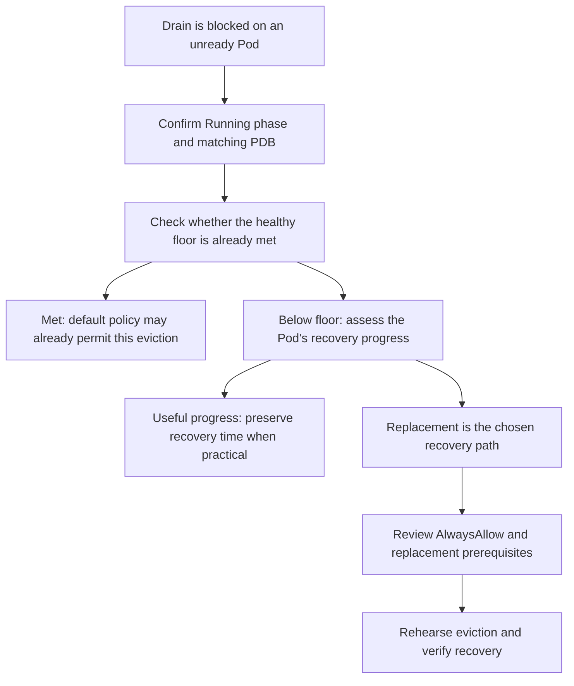

# PDB AlwaysAllow: Unblock Drains and Understand the Recovery Tradeoff

Author: [nawazdhandala](https://www.github.com/nawazdhandala)

Tags: Kubernetes, PodDisruptionBudget, High Availability, Troubleshooting

Description: Use unhealthyPodEvictionPolicy deliberately: learn when AlwaysAllow permits unready Pod eviction, what remains protected, and how to assess recovery before maintenance.

A node drain can wait on a Pod that is already failing readiness. The application has too few healthy replicas, so the default PodDisruptionBudget policy gives that unready Pod an opportunity to recover instead of immediately allowing its eviction.

`unhealthyPodEvictionPolicy: AlwaysAllow` changes that decision. It can let maintenance move past a Running but unready Pod without reducing the budget's protected healthy count. The tradeoff is that a recovering Pod may be removed before it becomes useful again.

This walkthrough uses Kubernetes v1.34.0 behavior. Unhealthy-Pod eviction policy has been stable since v1.31. Check the API supported by your actual cluster rather than copying historical feature-gate instructions from the feature's alpha release. [Versioned PDB documentation](https://v1-34.docs.kubernetes.io/docs/tasks/run-application/configure-pdb/).

## Understand which Pods the setting affects

For this policy, a healthy Pod has a `Ready` condition with status `True`. A Pod can have phase `Running` while readiness is false, for example while its application is initializing or failing checks. The phase describes lifecycle state; it is not a complete application health assessment. [Pod lifecycle and conditions](https://kubernetes.io/docs/concepts/workloads/pods/pod-lifecycle/).

The default, including when the field is omitted, is `IfHealthyBudget`. For the positive healthy floor used here, it permits eviction of a Running, unready Pod when the guarded workload already meets that floor. If the workload is below the floor, that Pod retains a chance to become healthy.

`AlwaysAllow` permits eviction of Running, unready Pods regardless of whether the healthy floor has been reached. Healthy Pods still go through the ordinary budget check. The setting is not equivalent to deleting the PDB or disabling eviction checks for every Pod. [Policy type definitions](https://github.com/kubernetes/kubernetes/blob/v1.34.0/staging/src/k8s.io/api/policy/v1/types.go).

## Read the behavior through a three-Pod example

Assume one PDB selects three Pods and has `minAvailable: 2`. All target Pods in this table have phase `Running`, and the status has reconciled:

| Healthy Pods | Target Pod Ready? | Default / IfHealthyBudget | AlwaysAllow |
|---|---|---|---|
| 1 | No | Reject eviction | Allow eviction |
| 2 | No | Allow eviction | Allow eviction |
| 2 | Yes | Reject eviction | Reject eviction |
| 3 | Yes | Allow eviction | Allow eviction |

Only the first row changes. Two healthy Pods and one unready Pod can already permit eviction of the unready Pod under the default policy, even when `disruptionsAllowed` is zero. Removing it does not remove one of the counted healthy Pods.

The v1.34.0 eviction handler implements this distinction separately from decrementing healthy-Pod allowance. Therefore, zero allowance is not by itself evidence that `AlwaysAllow` is needed. [Eviction handler](https://github.com/kubernetes/kubernetes/blob/v1.34.0/pkg/registry/core/pod/storage/eviction.go).

We checked these four cases against an isolated v1.34.0 API server with the field omitted, explicitly `IfHealthyBudget`, and explicitly `AlwaysAllow`: twelve server dry-run requests. The outcomes matched the table, and the requests left Pods and budgets unchanged. Pod readiness and PDB counters were supplied as fixtures; no application recovery or node drain was simulated.

## Decide whether waiting preserves something useful

An unready Pod is not necessarily a worthless Pod. Consider three different situations:

| Situation | What to investigate before eviction |
|---|---|
| A stateless worker repeatedly crashes because of bad configuration | Whether replacement on another node would start with the same broken configuration |
| A service is slowly warming a large cache | Whether restarting it discards progress and delays readiness further |
| A stateful member is catching up or recovering local state | The application's recovery, storage attachment, membership, and shutdown requirements |

These are operational examples, not special cases understood by the PDB controller. The controller sees readiness; it does not know whether a database is seconds away from completing recovery.

The feature's design explicitly balances letting unhealthy Pods recover with allowing a drain to proceed when they cannot. Choose the policy with the workload owner, based on what unready means for that application. [Kubernetes unhealthy-Pod eviction design explanation](https://kubernetes.io/blog/2023/01/06/unhealthy-pod-eviction-policy-for-pdbs/).

Before enabling the policy, establish a bounded observation period and a recovery signal. For example, use progress in replay position or completed initialization stages rather than waiting indefinitely for an unchanged Ready condition. If progress is continuing and the maintenance window allows it, waiting may be the better action. If the Pod is stuck on a failing node and replacement capacity is available, relocation may be more promising.



## Configure the intended workload, not the whole namespace

For an existing three-replica workload named `checkout` in `payments`, the proposed PDB can be:

```yaml
apiVersion: policy/v1
kind: PodDisruptionBudget
metadata:
  name: checkout
  namespace: payments
spec:
  minAvailable: 2
  unhealthyPodEvictionPolicy: AlwaysAllow
  selector:
    matchLabels:
      app.kubernetes.io/name: checkout
```

Replace the example names and labels with the actual workload. Preserve its reviewed healthy floor and full selector when editing an existing budget. Do not create a second PDB that overlaps the original or replace a narrow selector with an empty one. [PDB selector guidance](https://v1-34.docs.kubernetes.io/docs/tasks/run-application/configure-pdb/).

With read permission, inspect support and current state first:

```bash
CTX=staging-context
NS=payments
kubectl --context="$CTX" explain \
  poddisruptionbudget.spec.unhealthyPodEvictionPolicy --api-version=policy/v1
kubectl --context="$CTX" -n "$NS" get pdb checkout -o yaml
kubectl --context="$CTX" -n "$NS" get pods \
  -l app.kubernetes.io/name=checkout -o wide
```

`explain` retrieves the field's schema documentation. The other commands show the policy, status, and selected Pod placement. For an individual unready Pod, inspect its full conditions and events rather than relying only on the short table. [kubectl explain](https://kubernetes.io/docs/reference/kubectl/generated/kubectl_explain/), [kubectl get](https://kubernetes.io/docs/reference/kubectl/generated/kubectl_get/).

Save the reviewed object as `checkout-pdb.yaml`. Check it against the staging API without persisting it:

```bash
kubectl --context="$CTX" -n "$NS" apply \
  --dry-run=server -f checkout-pdb.yaml
```

A successful server dry run establishes that the proposed API change is accepted in that environment. It does not demonstrate that an eviction or replacement will succeed. Deploy the reviewed change through your normal configuration process before testing its runtime effect. [kubectl apply dry run](https://kubernetes.io/docs/reference/kubectl/generated/kubectl_apply/).

## Test recovery, not merely permission to evict

In an isolated staging rehearsal, reproduce the actual reason for unready status and the expected healthy count. First inspect the eviction decision with a server dry run. Then, under the approved test procedure, exercise the real replacement path and measure time to restored capacity.

A useful acceptance record includes the target Pod's readiness and owner, the PDB's observed generation and counters, the eviction result, replacement scheduling, application readiness, and service error or latency measurements. For stateful software, include its own integrity and membership checks.

AlwaysAllow does not fix an image-pull failure, create spare nodes, repair storage access, or correct a faulty readiness probe. It also does not authorize requests that fail security policy. If removal succeeds but the replacement never becomes useful, maintenance has advanced without solving recovery.

Changing the policy back to `IfHealthyBudget` affects future decisions; it cannot bring back an already removed Pod's initialization progress. Keep that distinction in the rollback plan. The objective is to choose a better recovery path while keeping healthy replicas protected, not simply to make the drain command finish.
