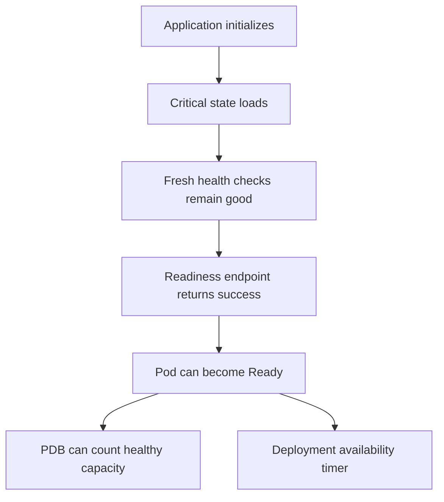

# Account for Application Warm-Up in PodDisruptionBudgets

Author: [nawazdhandala](https://www.github.com/nawazdhandala)

Tags: Kubernetes, PodDisruptionBudget, Python, Troubleshooting

Description: Make readiness reflect application warm-up instead of relying on Deployment minReadySeconds, with a tested stability window and a guarded probe preview.

A replacement Pod starts accepting connections before its cache is loaded. Its readiness probe succeeds, the PodDisruptionBudget sees healthy capacity again, and another member is evicted. Setting `minReadySeconds: 30` on the Deployment does not necessarily slow that maintenance sequence.

The missing distinction is between **Ready**, a Pod condition, and **available**, a controller's interpretation of readiness over time. A PDB uses the former. To protect warm-up during voluntary maintenance, make the Pod remain unready until it can actually carry its share of work.

This guide follows Kubernetes **1.34.0** behavior. The Python readiness component was checked with **Python 3.15.0**; it uses standard-library timing and locking rather than a web-framework-specific interface.

## Understand what each control measures

A Deployment's `minReadySeconds` determines how long a newly ready Pod must remain ready before the controller counts it as available. That matters to rollout progress. It does not delay the Pod's own Ready condition or automatically keep it out of ordinary Service routing. [Deployment availability](https://kubernetes.io/docs/concepts/workloads/controllers/deployment/#min-ready-seconds)

The reviewed PDB controller counts Pods whose Ready condition is true, while excluding terminating Pods and relevant in-flight disruption reservations. It does not consult the Deployment's `minReadySeconds`. The ReplicaSet controller uses a separate availability check that includes the readiness age. [PDB calculation](https://github.com/kubernetes/kubernetes/blob/v1.34.0/pkg/controller/disruption/disruption.go), [ReplicaSet availability calculation](https://github.com/kubernetes/kubernetes/blob/v1.34.0/pkg/controller/replicaset/replica_set_utils.go)

| Control | Question it answers |
|---|---|
| Startup probe | Has initial startup progressed far enough to enable the other probes? |
| Readiness probe | Can this container contribute to a Ready Pod now? |
| Liveness probe | Should Kubernetes restart this container because it is stuck? |
| Deployment `minReadySeconds` | Has this Pod been ready long enough to count as available for the rollout? |
| PDB | Can another voluntary eviction occur given current healthy capacity? |

Do not add a guessed `minReadySeconds` field to a PDB. It is not a field in the Kubernetes 1.34 PDB API.



## Define useful readiness before choosing a timer

Choose the work that makes the instance usable: loading a required index, warming essential caches, establishing a usable connection pool, or finishing recovery. A listening TCP socket only proves that something accepted a connection. It does not prove that representative requests will complete within the service's target latency.

Keep the check bounded and cheap. For expensive work, maintain a health snapshot updated by a background task rather than making every probe rebuild state. Decide which failures require removing this instance from traffic; tying readiness to every optional dependency can make an otherwise usable fleet disappear simultaneously.

If the service needs a stability window after warm-up, enforce that window before readiness succeeds. The following component records healthy samples, resets after a failure, and rejects stale information:

```python
import threading
import time


class WarmupReadiness:
    def __init__(self, hold=20.0, max_age=3.0, clock=time.monotonic):
        if hold < 0 or max_age <= 0:
            raise ValueError("hold must be nonnegative; max_age must be positive")
        self.hold, self.max_age, self.clock = hold, max_age, clock
        self.since = self.last = None
        self.lock = threading.Lock()

    def update(self, healthy):
        with self.lock:
            now = self.clock()
            if self.last is None or now - self.last > self.max_age:
                self.since = None
            if not healthy:
                self.since = None
            elif self.since is None:
                self.since = now
            self.last = now

    def ready(self):
        with self.lock:
            now = self.clock()
            fresh = self.last is not None and now - self.last <= self.max_age
            return (fresh and self.since is not None
                    and now - self.since >= self.hold)
```

Create one instance for the serving process. Have your health worker call `update()` about once a second with the result of meaningful, bounded checks; on a check exception, report `False`. Have `/readyz` return HTTP `200` when `ready()` is true and `503` otherwise. The snippet supplies the state logic, not an HTTP server or the application-specific health checks.

Here the process needs twenty seconds of sufficiently fresh healthy observations. A failed observation resets that interval; a worker that stops reporting makes the snapshot stale after three seconds. A later successful check after a long gap starts a new interval. This samples health rather than proving nothing failed between samples. Pick intervals from observed startup and recovery behavior, not from these example numbers.

The monotonic clock measures elapsed time without following wall-clock adjustments, and the lock coordinates the background updater with the probe handler. With multiple serving processes, aggregate their actual readiness rather than assuming one process's memory represents them all. [Python monotonic time](https://docs.python.org/3/library/time.html#time.monotonic), [Lock objects](https://docs.python.org/3/library/threading.html#lock-objects)

## Connect the endpoint to the existing Deployment

This patch assumes an existing Deployment `checkout` in namespace `retail`, with a container named `api` listening on port `8080`. The application must already implement `/startupz` and `/readyz` as described. Save it as `probe-preview.yaml`:

```yaml
spec:
  minReadySeconds: 30
  template:
    spec:
      containers:
        - name: api
          startupProbe:
            $patch: replace
            httpGet:
              path: /startupz
              port: 8080
            periodSeconds: 5
            timeoutSeconds: 2
            failureThreshold: 30
          readinessProbe:
            $patch: replace
            httpGet:
              path: /readyz
              port: 8080
            periodSeconds: 5
            timeoutSeconds: 2
            failureThreshold: 1
            successThreshold: 1
```

The startup probe gives initial startup a failure budget of roughly 150 seconds; readiness and liveness probes wait for it to succeed. The readiness endpoint then controls usable capacity, including the application's stability window. The Deployment's thirty-second availability timer remains a separate rollout constraint. [Startup and readiness probes](https://kubernetes.io/docs/tasks/configure-pod-container/configure-liveness-readiness-startup-probes/)

`$patch: replace` prevents an existing executable probe from being merged with an HTTP handler. The container name is the strategic-merge key, so inspect the preview carefully: a misspelled name can target the wrong structure. Keep liveness focused on process recovery; do not automatically turn a temporary dependency failure into a restart loop.

```bash
kubectl --context staging -n retail patch deployment checkout --type=strategic \
  --patch-file probe-preview.yaml --dry-run=server -o yaml > preview.yaml
```

This checks API acceptance without changing the Deployment. Verify the image, ports, other containers, and existing configuration in `preview.yaml`, then commit the reviewed change to your normal deployment source. [Strategic merge and patch behavior](https://kubernetes.io/docs/tasks/manage-kubernetes-objects/update-api-object-kubectl-patch/)

Increasing readiness `successThreshold` can require consecutive successful probes, but do not equate it with an exact duration: Kubernetes may run readiness probes more frequently while the container is unready. Use explicit application timing when the duration itself is part of the requirement. [Probe timing rules](https://v1-34.docs.kubernetes.io/docs/tasks/configure-pod-container/configure-liveness-readiness-startup-probes/#configure-probes)

## Test the maintenance sequence in staging

Use a representative load and a controlled replacement, then observe the actual Pod conditions and budget:

```bash
kubectl --context staging -n retail get pods -l app=checkout -w
```

In a separate terminal:

```bash
kubectl --context staging -n retail get pdb checkout -w
```

For three replicas with a PDB requiring two healthy members, the warming replacement should remain unready while the two established members serve traffic. The budget should not regain an extra slot merely because the new process opened its port. Once meaningful readiness succeeds and the controller reconciles, the replacement can contribute healthy capacity even while the Deployment's additional availability timer is still running.

Test a health failure during warm-up, a stopped background checker, and a recovery after stale observations. Also test a member that never becomes ready: the blocked budget should prompt diagnosis, not removal of the safety policy. Correlate condition transitions with latency and error rates, because configuration validation cannot demonstrate that the health signal represents real service capacity.

For readiness information owned outside the application, a controller-managed Pod readiness gate can supply an additional condition. That requires a real condition publisher; declaring a gate without one leaves it false. [Pod readiness gates](https://kubernetes.io/docs/concepts/workloads/pods/pod-lifecycle/#pod-readiness-gate)

The useful boundary is the moment a replacement can safely take over work. Put that boundary into readiness, keep `minReadySeconds` for its separate rollout purpose, and let the PDB operate on a health signal that matches the application's behavior.
