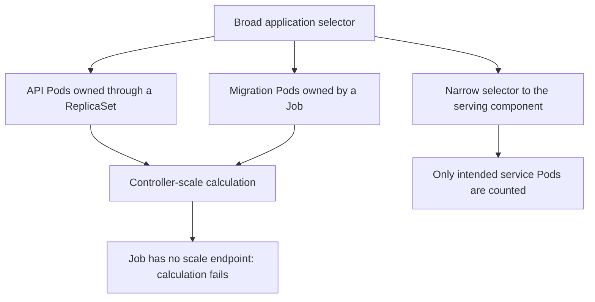

# Fix PDB Expected-Pod-Count Errors Caused by Job Pods

Author: [nawazdhandala](https://www.github.com/nawazdhandala)

Tags: Kubernetes, PodDisruptionBudget, Kubernetes jobs, Troubleshooting

Description: Diagnose CalculateExpectedPodCountFailed when a PDB selects Job Pods, trace controller ownership, and narrow the policy without creating a protection gap.

A service's PodDisruptionBudget suddenly reports `CalculateExpectedPodCountFailed` after a migration Job starts. The API Pods still look healthy. The problem may be that the Job and service share a broad application label, so the budget now selects both.

The PDB controller needs more than a list of running Pods for some budget forms. It also needs the intended scale of the controllers behind them. A Job does not expose the same scaling interface as a Deployment.

This guide follows Kubernetes **1.34.0** behavior and uses read-only inspection plus a server-side patch preview. The repair is to establish the intended selection boundary, then verify it before changing the live policy.

## Read the warning as a calculation failure

Look at the full event message, not just its reason. In this scenario it can identify `jobs.batch` as not implementing the scale subresource. A subresource is an API endpoint representing a specific part of an object; `/scale` exposes the desired and observed replica information used by scaling-aware clients.

In the reviewed controller, `maxUnavailable` and percentage `minAvailable` require controller scale information. This includes integer `maxUnavailable: 0`: zero does not skip the lookup. Integer `minAvailable` takes a different counting path. A calculation error emits the warning and causes the controller's failure handling to set disruption allowance to zero. [Kubernetes 1.34 disruption controller](https://github.com/kubernetes/kubernetes/blob/v1.34.0/pkg/controller/disruption/disruption.go)

| Budget form | Needs controller scale in this version? |
|---|---|
| `maxUnavailable: 1` | Yes |
| `maxUnavailable: 0` | Yes |
| `minAvailable: "75%"` | Yes |
| `minAvailable: 2` | No; it uses the selected Pod population |

A Job's parallelism describes concurrent work, while completions describe finished work. Neither should be silently substituted for the long-running service's desired replica count. [Job execution model](https://v1-34.docs.kubernetes.io/docs/concepts/workloads/controllers/job/)



## Confirm the affected object and selected owners

The examples use context `staging`, namespace `retail`, and PDB `checkout-api`. Replace them with the investigated object. Start with its current specification and events:

```bash
kubectl --context staging -n retail describe pdb checkout-api
kubectl --context staging -n retail get pdb checkout-api -o yaml
```

Check the warning's timestamp and the PDB's UID when correlating records. An old event can remain after a repair, and a recreated PDB with the same name is a different object. Inspect `status.conditions`, the calculated counts, and whether the controller has observed the current metadata generation. [PDB inspection guidance](https://kubernetes.io/docs/tasks/run-application/configure-pdb/)

Suppose the PDB selector contains only `app.kubernetes.io/name: checkout`. Capture that exact selection and display its controller owners:

```bash
set -euo pipefail
kubectl --context staging -n retail get pods \
  -l app.kubernetes.io/name=checkout -o json > selected-pods.json
jq -r '
  .items[] |
  [.metadata.name,
   ([.metadata.ownerReferences[]? |
      select(.controller == true) | (.kind + "/" + .name)] | join(",")),
   .status.phase] | @tsv
' selected-pods.json
```

This prints a row per selected Pod. For this example, expect service Pods with a ReplicaSet owner and a migration Pod with a Job owner. A Deployment usually owns a ReplicaSet, which in turn owns its Pods, so follow the ReplicaSet's owner reference when confirming the service. [Ownership relationships](https://kubernetes.io/docs/concepts/overview/working-with-objects/owners-dependents/) and [Deployments](https://kubernetes.io/docs/concepts/workloads/controllers/deployment/)

The example label query is appropriate only for that simple selector. If your PDB contains more labels or `matchExpressions`, translate the complete selector. Otherwise your diagnostic list may differ from what the controller actually counts.

You can also inspect API discovery without changing the cluster:

```bash
set -euo pipefail
kubectl --context staging get --raw /apis/batch/v1 |
  jq '.resources[] | select(.name == "jobs" or .name == "jobs/scale") |
      {name, kind}'
```

On the tested API, this returns the Job resource and no `jobs/scale` entry. It is a direct check of the scaling interface available on that cluster. [kubectl raw requests](https://kubernetes.io/docs/reference/kubectl/generated/kubectl_get/)

## Establish a label boundary that already exists on Pods

Assume the current Pod labels are:

| Workload | Application label | Component label |
|---|---|---|
| Checkout API | `checkout` | `api` |
| Checkout migration Job | `checkout` | `migration` |

The full keys are `app.kubernetes.io/name` and `app.kubernetes.io/component`. The repaired selector should require both `checkout` and `api`. Component labels belong on the workload's **Pod template**, not just its top-level metadata. [Labels and selectors](https://kubernetes.io/docs/concepts/overview/working-with-objects/labels/)

Before narrowing the PDB, verify every service Pod that needs protection already has the component label. If it does not, update the Deployment template through the application's normal rollout process and wait for the intended Pods. Narrowing first can leave old service Pods outside protection.

Do not try to relabel an existing Job into a service controller. Correct the Job or CronJob template for future executions, and account for already running Pods during the transition. Keep eviction-based maintenance paused until the intended policy and Pod population agree.

## Preview a guarded selector change

For the exact broad selector described above, save this as `selector-patch.json`:

```json
[
  {
    "op": "test",
    "path": "/spec/selector",
    "value": {"matchLabels": {"app.kubernetes.io/name": "checkout"}}
  },
  {
    "op": "replace",
    "path": "/spec/selector",
    "value": {
      "matchLabels": {
        "app.kubernetes.io/name": "checkout",
        "app.kubernetes.io/component": "api"
      }
    }
  }
]
```

The first operation requires the existing selector to match the reviewed assumption. If another label or expression is present, the request fails instead of silently discarding it. The second operation proposes the narrower selector.

```bash
kubectl --context staging -n retail patch pdb checkout-api \
  --type=json --patch-file selector-patch.json \
  --dry-run=server -o yaml
```

Expected output contains the two-label selector, while the stored PDB remains unchanged. This preview checks the API change, not the resulting controller status. Apply the correction through the system that owns the resource, such as the Helm chart or GitOps manifest, after reviewing the selected Pods. [kubectl patch](https://kubernetes.io/docs/reference/kubectl/generated/kubectl_patch/)

After the approved change, verify that Job Pods are excluded, service Pods remain included, and fresh PDB status reflects the current generation. Investigate a continuing zero allowance using readiness and budget size; fixing the calculation error does not guarantee there is spare capacity for eviction.

## Avoid repairs that only hide the mismatch

Switching to integer `minAvailable` can avoid this scale lookup, but it does not correct an overly broad selector. A healthy migration Pod could then contribute toward the service's health floor even though it cannot serve requests. That changes the policy's meaning while making the warning disappear.

If the intent really is to protect a batch Job, design its interruption and retry behavior separately. A fixed integer PDB needs a deliberate lifecycle and count policy; it is not a generic promise that all Job work will finish uninterrupted. PDBs also cannot prevent every involuntary disruption or direct deletion. [Kubernetes disruption limits](https://kubernetes.io/docs/concepts/workloads/pods/disruptions/)

The local checks verified Job API discovery, selector matching, owner inspection, and the exact guarded patch preview. They did not run the disruption controller or reproduce its warning event. The calculation and failure-handling explanation was reviewed against the tagged controller source; no Job execution, application rollout, or drain was performed.
