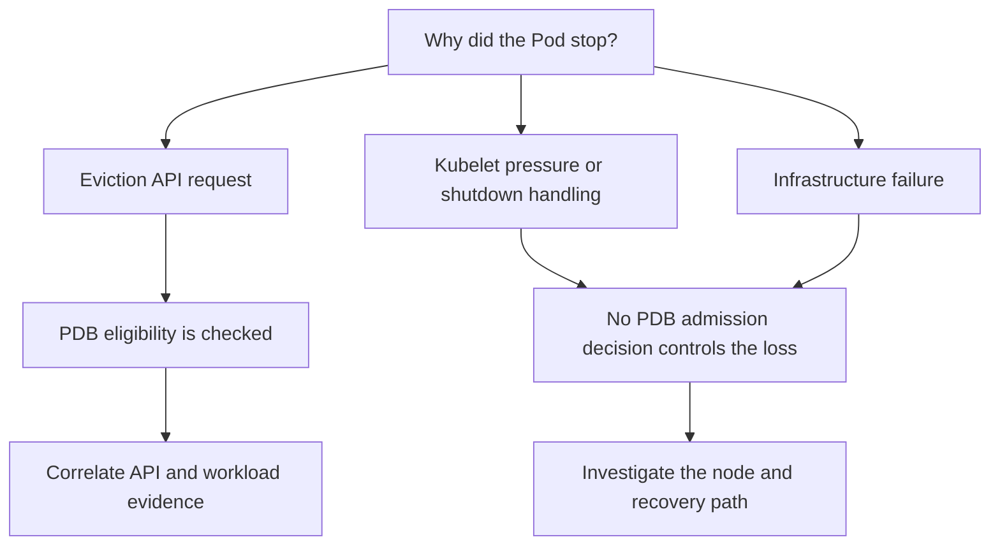

# Why PDBs Cannot Block Node Pressure, Shutdown, or Hardware Failure

Author: [nawazdhandala](https://www.github.com/nawazdhandala)

Tags: Kubernetes, PodDisruptionBudget, Troubleshooting, High Availability

Description: Identify why a Pod stopped despite its disruption budget, distinguish kubelet termination from API eviction, and address resource pressure, shutdown policy, or infrastructure failure.

A Pod can disappear while its PodDisruptionBudget reports zero allowed disruptions. That does not automatically mean Kubernetes ignored the budget on a covered request. The process may have stopped through a path that never asks the Eviction API for permission.

The word “eviction” is particularly confusing: a node-pressure eviction performed by the kubelet is different from an API-initiated eviction used by an ordinary drain. Identify the termination path before changing the PDB. This guide uses Kubernetes v1.34.0 implementation details and read-only diagnostic examples.

## Know where the budget is consulted

| Event | Does the PDB gate this action? | What controls the immediate outcome? |
|---|---|---|
| Covered Eviction API request | Yes | Budget eligibility and other API checks |
| Kubelet node-pressure eviction | No | Local resource signals and eviction policy |
| Kubelet graceful node shutdown | No | Shutdown detection and configured termination time |
| Hardware loss or sudden power failure | No | The underlying failure and later recovery processes |

A PDB is useful for coordinating supported voluntary disruption. It cannot force a machine with exhausted resources or no power to keep serving. Involuntary losses still reduce the healthy population, which can cause the budget to block *additional* covered evictions afterward. [Disruption scope](https://kubernetes.io/docs/concepts/workloads/pods/disruptions/).



## Node pressure is a local survival mechanism

The kubelet, the agent running on each node, monitors resources such as memory, filesystem space, inodes, and process identifiers. When pressure crosses configured thresholds, it can reclaim resources and terminate selected Pods to protect the node. The pressure path does not honor a PDB as an eviction admission limit. [Node-pressure eviction](https://v1-34.docs.kubernetes.io/docs/concepts/scheduling-eviction/node-pressure-eviction/).

In the pinned source, the eviction manager invokes the Pod termination function and writes a failed Pod status with its eviction reason and message. It does not submit a `policy/v1` Eviction request and wait for budget permission. [Eviction-manager implementation](https://github.com/kubernetes/kubernetes/blob/v1.34.0/pkg/kubelet/eviction/eviction_manager.go).

This also affects termination timing. Normal Pod grace settings are not an unlimited right to keep consuming scarce resources. Pressure policy, including hard versus soft thresholds and configured grace limits, determines the applicable behavior. Increasing a PDB minimum cannot lengthen that local survival window.

Pod priority, resource requests, and usage influence victim selection; they are not immunity from node failure. Investigate the actual resource signal rather than assuming every evicted Pod ran out of memory. Disk space and inode exhaustion require different remedies from memory pressure.

## Graceful shutdown means time to stop, not permission to stay

Graceful node shutdown gives the kubelet an opportunity to terminate local Pods before the operating system completes shutdown. It does not transform shutdown into a node drain that waits indefinitely for PDB allowance.

The v1.34.0 shutdown manager invokes the termination function directly for groups of local Pods. Its status message identifies imminent node shutdown, and its reason for terminated Pods is `Terminated`. The separate `NodeShutdown` admission reason concerns rejecting a Pod while shutdown is in progress; these strings describe different points in the workflow. [Shutdown-manager source](https://github.com/kubernetes/kubernetes/blob/v1.34.0/pkg/kubelet/nodeshutdown/nodeshutdown_manager.go).

For the default two-phase configuration, `shutdownGracePeriod` is the overall shutdown delay and `shutdownGracePeriodCriticalPods` allocates time for critical Pods. Their default zero values do not activate that graceful-shutdown configuration. Inspect your platform's effective kubelet settings and shutdown integration; do not assume that a feature-gate default proves a useful shutdown window exists. [Graceful shutdown configuration](https://v1-34.docs.kubernetes.io/docs/concepts/cluster-administration/node-shutdown/).

For planned host maintenance, complete the supported drain procedure while the host is still healthy, then shut it down. A last-minute operating-system shutdown notification is not a substitute for application maintenance coordination.

## Hardware failure may leave incomplete evidence

A failed machine cannot always publish its final Pod status or run shutdown hooks. The control plane can later detect missing node heartbeats and take recovery actions, but a previously healthy Pod may already be unreachable before those records catch up.

`NotReady` or an unknown node condition is a signal to investigate, not proof of a particular hardware defect. Network partitions, kubelet failure, and host failure can produce related symptoms. Correlate Kubernetes records with the provider's instance events and host monitoring. [Node heartbeats and health](https://kubernetes.io/docs/concepts/architecture/nodes/).

## Capture the Pod evidence before it is removed

Use a verified context, read permissions, and jq 1.6 or later. Replace the namespace and Pod name with the affected object. These commands capture a local snapshot without changing the cluster:

```bash
CTX=staging-context
NS=payments
POD=replace-with-affected-pod
if ! kubectl --context="$CTX" -n "$NS" get pod "$POD" -o json > pod-failure.json; then
  exit 1
fi
jq '{
  namespace: .metadata.namespace,
  name: .metadata.name,
  uid: .metadata.uid,
  node: .spec.nodeName,
  phase: .status.phase,
  reason: .status.reason,
  message: .status.message,
  conditions: [.status.conditions[]?
    | select(.type == "Ready" or .type == "DisruptionTarget")
    | {type, status, reason, message}],
  containers: [.status.containerStatuses[]?
    | {name, restartCount, state, lastState}]
}' pod-failure.json
```

Keep the UID so you do not confuse a replacement with the original Pod. This summary includes regular container status; inspect the full snapshot for init or ephemeral container details when relevant. A missing Pod requires historical events or logs, not a fabricated conclusion from the replacement's status. [kubectl get](https://kubernetes.io/docs/reference/kubectl/generated/kubectl_get/), [jq filters](https://jqlang.org/manual/v1.6/).

Read the result with the following distinctions:

- A failed Pod with reason `Evicted` and a resource-specific message supports a pressure-related investigation.
- A shutdown-related termination message points toward the host shutdown timeline.
- `OOMKilled` in a container's state or last state records an out-of-memory termination. A container restart inside the same Pod is not automatically a node-pressure eviction.
- Missing or ambiguous status needs more evidence; the absence of a PDB rejection is not proof that an eviction was allowed.

Container state, Pod phase, and the human-readable `kubectl` status column are related but different views. [Pod and container lifecycle](https://kubernetes.io/docs/concepts/workloads/pods/pod-lifecycle/).

## Join the Pod snapshot to node evidence

Use the node name recorded in the snapshot:

```bash
NODE=replace-with-recorded-node-name
kubectl --context="$CTX" describe node "$NODE"
kubectl --context="$CTX" -n "$NS" describe pod "$POD"
kubectl --context="$CTX" -n "$NS" get pdb -o yaml
```

Compare timestamps, node conditions, relevant events, resource allocation, and the budget's selected population. If pressure has already cleared, today's node condition may differ from the condition at termination. Preserve monitoring history and node logs as part of the timeline. [Diagnostic object descriptions](https://kubernetes.io/docs/reference/kubectl/generated/kubectl_describe/).

A PDB that now reports zero allowance may be responding correctly to the loss. For example, three replicas with a healthy floor of two lose one member to node pressure; the remaining two leave no spare healthy replica for another covered eviction. Lowering the floor would permit more disruption without repairing the pressure.

## Fix the failure mechanism and test it honestly

For pressure, use measured resource requests, capacity planning, appropriate limits, and storage housekeeping to address the exhausted resource. Limits do not reserve capacity, and changing requests can affect placement. Review the application and node together. [Container resource management](https://kubernetes.io/docs/concepts/configuration/manage-resources-containers/).

For shutdown, verify the platform's supported shutdown configuration and application termination behavior in staging. For infrastructure loss, test replica placement, spare capacity, recovery time, and data protection. Use a scoped failure rehearsal; do not exhaust production nodes to prove that a PDB cannot stop them.

Keep the PDB for the operations it can coordinate. Record which path caused the loss, which evidence established it, and which recovery checks passed. That avoids weakening availability protection in response to a failure the budget was never designed to prevent.
