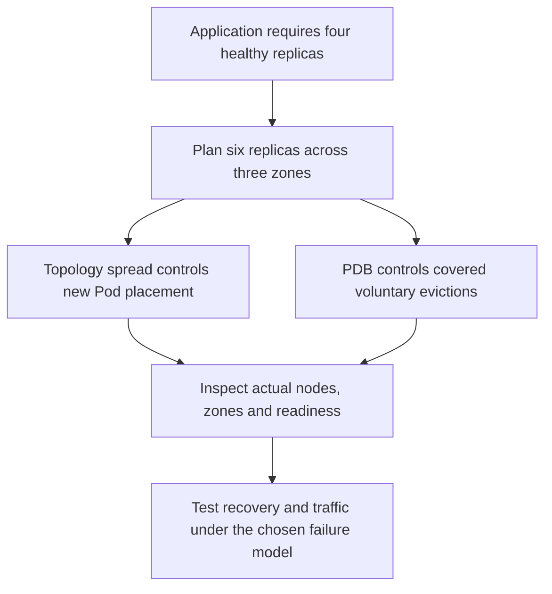

# Pair PDBs with Topology Spread for Node and Zone Resilience

Author: [nawazdhandala](https://www.github.com/nawazdhandala)

Tags: Kubernetes, PodDisruptionBudget, High Availability, Topology Spread

Description: Combine eviction budgets with deliberate node and zone placement, understand hard-spread scheduling tradeoffs, and verify the actual failure-domain layout before maintenance.

Six healthy replicas are not necessarily six independent sources of availability. If all six run in one zone, a zone outage can remove every instance even when a PodDisruptionBudget requires four to remain healthy.

A PDB limits covered voluntary evictions. It cannot reject a power failure, prevent a network partition, or move existing Pods into separate zones. Topology spread constraints address placement when the scheduler assigns Pods to nodes. You need both controls, plus enough capacity and an application that works across the chosen failure domains. [Kubernetes disruption boundaries](https://kubernetes.io/docs/concepts/workloads/pods/disruptions/).

This guide uses Kubernetes v1.34.0 fields and a six-replica stateless application. The example assumes three eligible zones with two eligible worker nodes in each. It is a configuration design exercise, not a claim that this layout was tested through a real zone outage.

## Start with the loss you intend to tolerate

A failure domain is a set of resources that can fail together, such as a node or zone. Suppose the service needs four healthy replicas after losing any one zone, with no maintenance already consuming capacity.

| Placement across three zones | Largest zone loss | Replicas remaining after that loss | Meets the four-replica requirement? |
|---|---:|---:|---|
| 6, 0, 0 | 6 | 0 | No |
| 4, 1, 1 | 4 | 2 | No |
| 2, 2, 2 | 2 | 4 | Yes, for this replica-count model |

All three layouts could initially report six healthy Pods and the same PDB allowance. The budget does not encode where those healthy Pods run.

The model also has boundaries. Four survivors must actually handle traffic, reach dependencies, and retain required data. If maintenance removes a replica first and a different zone then fails, the surviving count can fall below four. Size for combined failures separately; the six-replica example does not promise a zone reserve during arbitrary concurrent maintenance.



## Verify the labels that define your domains

Topology constraints use node labels, not a cloud diagram. Inspect the actual labels before writing the policy:

```bash
CTX=staging-context
kubectl --context="$CTX" get nodes -L topology.kubernetes.io/zone,kubernetes.io/hostname
kubectl --context="$CTX" -n payments get pods -l app=checkout -o wide
```

`topology.kubernetes.io/zone` identifies the zone domain, and `kubernetes.io/hostname` supplies the node-level domain. Check that relevant nodes have consistent values and that Pods can use them under their affinity, taints, resource requests, and volume restrictions. A labeled node with insufficient capacity does not become a usable destination just because the topology policy includes it. [Topology domains and eligibility](https://v1-34.docs.kubernetes.io/docs/concepts/scheduling-eviction/topology-spread-constraints/).

The `NODE` column in the Pod inventory lets you map each replica to the node-label inventory. Count actual Ready replicas by zone as well as total replicas. Keep Pending and terminating Pods separate from serving capacity.

## Pair a healthy floor with explicit placement

For an existing `checkout` Deployment in `payments`, assume all intended Pod templates carry `app: checkout`. A PDB for four healthy replicas is straightforward:

```yaml
apiVersion: policy/v1
kind: PodDisruptionBudget
metadata:
  name: checkout
  namespace: payments
spec:
  minAvailable: 4
  selector:
    matchLabels:
      app: checkout
```

With six healthy matching Pods and fresh controller status, this permits up to two covered disruptions before recovery. It does not promise that an additional zone failure will be survivable during those disruptions. [PDB healthy-floor semantics](https://v1-34.docs.kubernetes.io/docs/tasks/run-application/configure-pdb/).

The following separate file, `topology-preview.yaml`, is a merge patch for that Deployment, not a complete Deployment manifest:

```yaml
spec:
  replicas: 6
  template:
    spec:
      topologySpreadConstraints:
        - maxSkew: 1
          minDomains: 3
          topologyKey: topology.kubernetes.io/zone
          whenUnsatisfiable: DoNotSchedule
          nodeAffinityPolicy: Honor
          nodeTaintsPolicy: Honor
          labelSelector:
            matchLabels:
              app: checkout
        - maxSkew: 1
          topologyKey: kubernetes.io/hostname
          whenUnsatisfiable: DoNotSchedule
          nodeAffinityPolicy: Honor
          nodeTaintsPolicy: Honor
          labelSelector:
            matchLabels:
              app: checkout
```

The zone constraint limits skew, the difference used to compare matching Pod populations across eligible domains. `maxSkew: 1` prevents a newly scheduled matching Pod from creating a larger permitted imbalance. The hostname constraint applies another placement check at node level. Both constraints must be satisfied; node spreading is not a permanent one-Pod-per-node limit.

The selectors count matching Pods in the incoming Pod's namespace. Use stable application labels covering both old and new rollout replicas if you intend to spread the application as one population. The explicit `Honor` policies make node affinity and untolerated taints relevant when determining domains for these calculations. [Pinned scheduler constraint processing](https://github.com/kubernetes/kubernetes/blob/v1.34.0/pkg/scheduler/framework/plugins/podtopologyspread/common.go).

Preview the resulting Deployment through the API server:

```bash
kubectl --context="$CTX" -n payments patch deployment checkout --type=merge --patch-file=topology-preview.yaml --dry-run=server -o yaml
```

Review the full output. Merge patch replaces the `topologySpreadConstraints` list, so preserve other required constraints when preparing the actual change. The patch also sets the desired count to six; coordinate any HPA or operator that owns replicas. A successful preview does not prove scheduler feasibility. [Merge-patch behavior](https://kubernetes.io/docs/tasks/manage-kubernetes-objects/update-api-object-kubectl-patch/).

Deploy the reviewed change through your normal workflow. Changing a Deployment Pod template triggers a rollout, so schedule that change separately from node maintenance and watch application health. Existing Pods are not instantaneously redistributed by editing a constraint. [Deployment rollouts](https://v1-34.docs.kubernetes.io/docs/concepts/workloads/controllers/deployment/).

## Understand the hard-spread recovery tradeoff

`DoNotSchedule` makes the constraint mandatory. `ScheduleAnyway` would make spreading a preference instead, trading strict separation for placement flexibility.

`minDomains: 3` does not create three zones. When fewer than three domains are eligible, the scheduler uses zero as the global minimum for this constraint. If only two eligible zones remain and each already has two matching Pods, adding another to either would exceed a skew of one. That replacement can remain Pending even though spare CPU exists. [Pinned minimum-domain and skew calculation](https://github.com/kubernetes/kubernetes/blob/v1.34.0/pkg/scheduler/framework/plugins/podtopologyspread/filtering.go).

This can be the correct policy when placing more replicas in surviving zones would violate the application's required separation. It can also conflict with a disaster-recovery plan that prioritizes restoring replica count in fewer zones. Decide the degraded-mode policy in advance rather than weakening constraints during an incident without understanding the new exposure.

Zone eligibility itself is affected by cluster state and labels. Do not assume a failed zone immediately disappears from the scheduler's domain calculation. Inspect the actual nodes, taints, and scheduling events for the affected Pods.

## Validate placement and eviction separately

After the rollout settles, rebuild the node-to-zone map and verify the expected distribution and readiness. Inspect the PDB's observed generation, healthy count, and allowance. A balanced but unready application and a healthy but concentrated application are different failures.

In staging, test a planned eviction through the Eviction API and observe replacement placement and recovery. Separately rehearse the chosen infrastructure failure model using a controlled, scoped test plan. Do not simulate a zone outage by blindly disabling a production zone.

Record which domains remained available, whether replacements became Pending, whether surviving replicas sustained traffic, and how the PDB allowance changed. Once a failure reduces healthy capacity to the floor, the budget should block further covered healthy-Pod evictions; it cannot reverse the failure already in progress.

The useful outcome is an observed relationship between placement, capacity, and application behavior. A PDB plus a topology stanza is the starting configuration, not evidence that the service meets its availability target.
