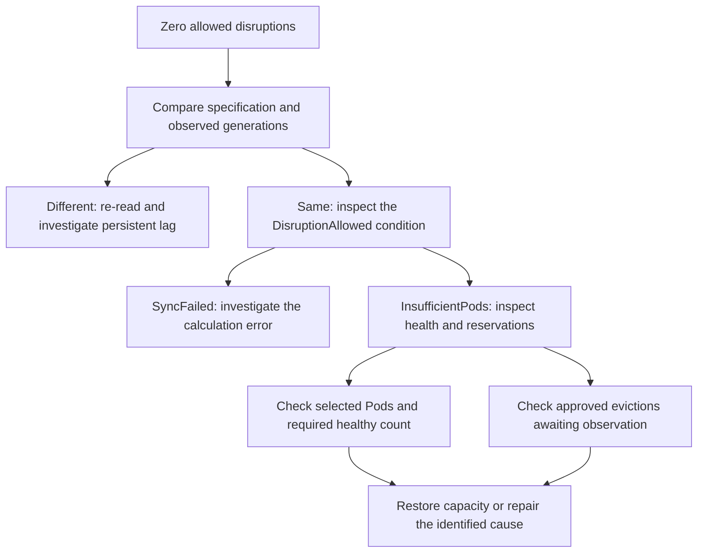

# Why a PodDisruptionBudget Shows Zero Allowed Disruptions

Author: [nawazdhandala](https://www.github.com/nawazdhandala)

Tags: Kubernetes, PodDisruptionBudget, Troubleshooting, High Availability

Description: Read every PodDisruptionBudget status field to distinguish exhausted capacity, pending evictions, stale observations, and controller errors before changing a budget.

Your node drain is waiting, and `kubectl get pdb` reports zero under `ALLOWED DISRUPTIONS`. That is useful evidence, but it does not identify the cause. The workload might be exactly at its protected minimum, a previous eviction might have reserved the last allowance, or the disruption controller might have failed to calculate a valid budget.

Start by reading the complete object. Changing the minimum before understanding the status can turn a blocked maintenance task into an application outage.

The explanations below are checked against Kubernetes v1.34.1 source. The inspection examples are read-only, and their JSON projection was tested locally with fixtures. They were not run against a live cluster.

## Capture the budget and its current status together

You need a configured Kubernetes context, permission to read PDBs and Pods in the target namespace, and `jq` 1.6 or later for the local JSON view. Replace the context, namespace, and PDB name before running:

```bash
CTX=staging-context
NS=payments
PDB=checkout

kubectl --context="$CTX" -n "$NS" get pdb "$PDB" -o json > pdb.json
```

This writes a local snapshot without changing the cluster. Check that the command succeeded before examining the file. A PDB snapshot can contain internal labels or annotations; handle it under your normal diagnostic-data policy. [kubectl get reference](https://kubernetes.io/docs/reference/kubectl/generated/kubectl_get/).

The following view keeps the entire status while exposing the generation, selector, and configured budget:

```bash
jq '{
  name: .metadata.name,
  generation: .metadata.generation,
  selector: .spec.selector,
  budget: {
    minAvailable: .spec.minAvailable,
    maxUnavailable: .spec.maxUnavailable,
    unhealthyPodEvictionPolicy: .spec.unhealthyPodEvictionPolicy
  },
  status: .status
}' pdb.json
```

An omitted optional setting appears as `null` in this projection; that is not the same as a configured numeric zero. The filter uses object construction and field selection, leaving status values intact. [jq manual](https://jqlang.org/manual/v1.6/).

## Read the seven status fields

These are the top-level fields in the v1.34.1 `PodDisruptionBudgetStatus` type:

| Field | What it tells you |
|---|---|
| `observedGeneration` | Which version of the PDB specification the status reflects |
| `currentHealthy` | How many selected Pods the controller currently counts as healthy |
| `desiredHealthy` | The minimum healthy count calculated from the budget |
| `expectedPods` | The population used by the controller's budget calculation |
| `disruptionsAllowed` | The current allowance for disruptions subject to the budget |
| `disruptedPods` | Pod names and timestamps associated with approved evictions awaiting controller observation |
| `conditions` | The controller's explanation of whether disruptions are allowed |

Compare `status.observedGeneration` with `metadata.generation` before interpreting the counters. When they differ, the status does not describe the current specification. Re-read after reconciliation; investigate persistent lag rather than calculating permission from an old snapshot. [Pinned API type definitions](https://github.com/kubernetes/kubernetes/blob/v1.34.1/staging/src/k8s.io/api/policy/v1/types.go).

`expectedPods` deserves particular care. In v1.34.1, an integer `minAvailable` uses the number of matching Pods. A percentage minimum or `maxUnavailable` uses the scale of the relevant workload controllers. It is therefore not universally a copy of `Deployment.spec.replicas`. [Expected-count implementation](https://github.com/kubernetes/kubernetes/blob/v1.34.1/pkg/controller/disruption/disruption.go).

Similarly, `currentHealthy` is not simply a count of Pods whose phase is `Running`. The controller checks readiness and excludes terminating Pods and recently approved disruptions still covered by its reservation window. A Pod may be Running while its readiness check fails. [Healthy-count implementation](https://github.com/kubernetes/kubernetes/blob/v1.34.1/pkg/controller/disruption/disruption.go).

## Separate an exhausted budget from a failed calculation

Within `conditions`, inspect the entry whose `type` is `DisruptionAllowed`. Do not assume it is always the first array element.

| Reason | Usual interpretation | Next action |
|---|---|---|
| `SufficientPods` with `status: "True"` | Some allowance exists | Check the current numeric allowance and the specific eviction response |
| `InsufficientPods` with `status: "False"` | No allowance remains | Compare health, minimum, selected Pods, and pending disruptions |
| `SyncFailed` with `status: "False"` | Calculation failed | Read `message` and investigate controller events or workload ownership |

The condition also carries `observedGeneration`, `lastTransitionTime`, and `message`. The transition time records a condition-status change, not a timestamp for every successful health recount. An unchanged timestamp alone does not prove that the controller stopped working. [Condition type definition](https://github.com/kubernetes/kubernetes/blob/v1.34.1/staging/src/k8s.io/apimachinery/pkg/apis/meta/v1/types.go).

Normal successful reconciliation maps a positive allowance to `SufficientPods`; zero maps to `InsufficientPods`. A controller error instead follows a failure path that sets the allowance to zero and records `SyncFailed`. [Condition helper](https://github.com/kubernetes/kubernetes/blob/v1.34.1/staging/src/k8s.io/component-helpers/apps/poddisruptionbudget/helpers.go), [controller failure path](https://github.com/kubernetes/kubernetes/blob/v1.34.1/pkg/controller/disruption/disruption.go).

Treat the error message as a lead. For example, investigate a failed scale lookup or missing owning controller through the relevant workload objects. Do not substitute a guessed replica count into status.



## Work through a normal zero

Suppose `minAvailable` is the integer two and the selector matches three Pods. This illustrative output fragment shows a settled state; it is not a manifest to apply:

```yaml
metadata:
  generation: 7
status:
  observedGeneration: 7
  currentHealthy: 2
  desiredHealthy: 2
  expectedPods: 3
  disruptionsAllowed: 0
  disruptedPods: {}
  conditions:
    - type: DisruptionAllowed
      status: "False"
      observedGeneration: 7
      lastTransitionTime: "2026-11-24T09:00:00Z"
      reason: InsufficientPods
      message: ""
```

There is no spare healthy Pod. The third Pod might be starting, failing readiness, or terminating. The status does not tell you which; inspect the matching Pods.

After successful reconciliation, the usual allowance is healthy count minus desired healthy count, bounded at zero. A zero expected population also produces zero allowance. [Controller status calculation](https://github.com/kubernetes/kubernetes/blob/v1.34.1/pkg/controller/disruption/disruption.go).

For a selector you have verified contains only `app.kubernetes.io/name: checkout`, inspect that exact population:

```bash
kubectl --context="$CTX" -n "$NS" get pods \
  -l app.kubernetes.io/name=checkout -o wide
kubectl --context="$CTX" -n "$NS" describe pdb "$PDB"
```

If your selector contains additional labels or expressions, translate all of them; this example is not a universal selector converter. Inspect individual unhealthy Pods with `kubectl describe pod` to find readiness, scheduling, or image-pull problems. `describe` also exposes relevant events when available. [kubectl describe reference](https://kubernetes.io/docs/reference/kubectl/generated/kubectl_describe/).

## Explain counters that briefly appear inconsistent

You might see `currentHealthy: 3`, `desiredHealthy: 2`, but `disruptionsAllowed: 0`. Do not immediately conclude that the subtraction is broken.

When approving a normal budgeted eviction, the API server decrements the allowance and adds the Pod to `disruptedPods`. It does not recompute every health counter in that operation. The disruption controller subsequently reconciles the object. This reservation prevents another requester from spending the same allowance. [Eviction implementation](https://github.com/kubernetes/kubernetes/blob/v1.34.1/pkg/registry/core/pod/storage/eviction.go).

The map is temporary coordination state, not a history of every eviction. Entries disappear after controller observation or timeout handling. Persistently growing or old entries warrant investigation of deletion progress and controller health; they are not a reason to manually erase the map. [Status semantics](https://kubernetes.io/docs/reference/kubernetes-api/policy/pod-disruption-budget-v1/).

Also avoid reading zero as “no Pod can ever be evicted.” Unhealthy-Pod eviction policy and a Pod's lifecycle state affect eligibility. For example, `AlwaysAllow` permits eviction of Running but unready Pods without spending healthy-Pod allowance. Its recovery tradeoff needs separate review. [Unhealthy Pod policy](https://v1-34.docs.kubernetes.io/docs/tasks/run-application/configure-pdb/).

## Finish with evidence of recovery

Re-read the PDB after fixing the identified problem. Confirm that generations agree, the condition no longer reports a calculation error, the selector covers the intended workload, and healthy capacity supports the next planned eviction. Then retry the approved maintenance procedure while watching the application.

If the budget intentionally protects every available replica, zero is the correct answer. Add and verify capacity or change the maintenance plan. Editing status, deleting the PDB, or switching to direct Pod deletion would remove the evidence or protection without restoring service capacity.
