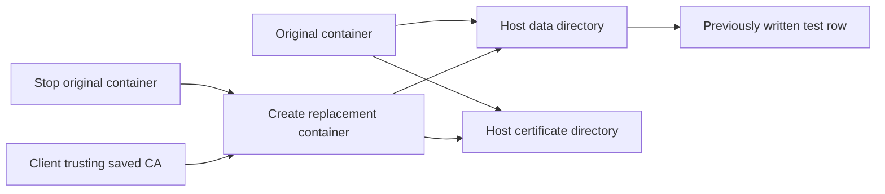

# Preserve Local YDB Data Across Docker Container Recreation

Author: [nawazdhandala](https://www.github.com/nawazdhandala)

Tags: Database, Docker, Storage, Development

Description: Preserve local YDB data and TLS files outside the container, recreate a pinned development instance, and verify the same saved row afterward.

Restarting a container and replacing it are different tests. A restart can succeed because files remain in that container's writable layer. A replacement starts with a new layer, so database files must live in storage attached independently of the container.

For local YDB, preserve the data directory and the certificate directory, keep file-backed storage enabled, and verify the same row after replacement. This walkthrough uses a new disposable lab. If you already have valuable data in a container without suitable mounts, back it up through a supported YDB procedure before changing that deployment.

The example pins local YDB **26.2.1.16**, its Linux AMD64 image digest, and YDB CLI **2.35.0** for client commands. Official source and CLI help were reviewed; no Docker replacement or database recovery was executed here.

## Know what survives

YDB's [Docker startup guide](https://ydb.tech/docs/en/reference/docker/start) mounts `/ydb_data` and `/ydb_certs` separately. A bind mount connects a directory on the Docker host to a path inside the container. Docker documents that these files [exist independently of the container](https://docs.docker.com/engine/storage/bind-mounts/).

| Item | Location in this lab | Why preserve it |
| --- | --- | --- |
| Disk files and generated database state | Host `data/`, mounted at `/ydb_data` | Holds the initialized database |
| Generated TLS material | Host `certs/`, mounted at `/ydb_certs` | Keeps the lab's certificate trust consistent |
| Launch settings | `run-lab.sh` | Reuses the same image, hostname, ports, and disk mode |
| Test evidence | Saved query output | Proves data survived rather than being recreated |

Keeping a stopped old container is useful for comparing configuration, but it is not a backup of the mounted files. Both old and new containers point to the same directories. Never run them simultaneously against those files.



## Use a repeatable launch command

Use Docker with a local daemon, Bash, and unused ports 2135 and 8765. Persistent local YDB disks require the supported x86-64 environment or appropriate emulation described in the [configuration guide](https://ydb.tech/docs/en/reference/docker/configuration). In-memory mode is unsuitable for this test.

Save this script as `run-lab.sh`. Its argument must be the absolute lab directory, without commas because Docker uses commas to separate mount options.

```bash
#!/usr/bin/env bash
set -euo pipefail
lab_root=${1:?Pass the absolute existing lab directory}
case "$lab_root" in
  /*) ;;
  *) printf '%s\n' 'Use an absolute directory path' >&2; exit 1 ;;
esac
case "$lab_root" in
  *,*) printf '%s\n' 'Use a path without commas' >&2; exit 1 ;;
esac
test -d "$lab_root/data"
test -d "$lab_root/certs"

image='ydbplatform/local-ydb:26.2.1.16@sha256:b5ccc8fa737321094f17963193c2e4213694a3bda261742ea582cadece63bb09'
docker run -d \
  --name ydb-persistence-lab \
  --hostname localhost \
  --platform linux/amd64 \
  --publish 127.0.0.1:2135:2135 \
  --publish 127.0.0.1:8765:8765 \
  --mount "type=bind,src=$lab_root/data,dst=/ydb_data" \
  --mount "type=bind,src=$lab_root/certs,dst=/ydb_certs" \
  --env YDB_USE_IN_MEMORY_PDISKS=false \
  --env YDB_GRPC_ENABLE_TLS=true \
  --env YDB_GRPC_TLS_DATA_PATH=/ydb_certs \
  --env GRPC_TLS_PORT=2135 \
  --env MON_PORT=8765 \
  "$image"
```

The image digest is verified in the [official registry metadata](https://hub.docker.com/v2/repositories/ydbplatform/local-ydb/tags/26.2.1.16). The explicit `false` disk-mode value matches the tagged [local launcher](https://github.com/ydb-platform/ydb/blob/26.2.1.16/ydb/public/tools/lib/cmds/__init__.py). The [image entrypoint](https://github.com/ydb-platform/ydb/blob/26.2.1.16/.github/docker/files/initialize_local_ydb) manages its working directory and TLS path; preserve the whole data directory rather than selecting just the largest disk file.

Create the directories once, then launch:

```bash
lab_root="$PWD/ydb-persistence-lab"
mkdir "$lab_root"
mkdir "$lab_root/data" "$lab_root/certs"
bash run-lab.sh "$lab_root"
```

The first `mkdir` fails if that directory already exists. Resolve that collision before continuing; do not turn this into a cleanup command. Retain the same absolute `lab_root` value for the rest of the test.

## Write evidence before replacing anything

Wait for initialization, inspect logs, and establish a normal TLS connection. Use a clean local CLI configuration without unrelated cloud credentials or an active production profile. The [CLI connection reference](https://ydb.tech/docs/en/reference/ydb-cli/connect) explains endpoint, database, and CA-file selection.

In the same Bash session, define the connection arguments:

```bash
ydb_args=(
  --endpoint grpcs://localhost:2135
  --database /local
  --ca-file "$lab_root/certs/ca.pem"
)
```

The certificate authenticates the local server. Do not bypass verification if this fails; check the generated CA, hostname, and mounted certificate directory.

Save this as `create-probe.sql` and run `ydb "${ydb_args[@]}" sql --file create-probe.sql` once:

```sql
CREATE TABLE persistence_probe (
    id Uint64 NOT NULL,
    marker Utf8,
    PRIMARY KEY (id)
);
```

Save this separate statement as `seed-probe.sql`, replacing the marker with a value unique to your run. Execute it with the same command and that filename:

```sql
UPSERT INTO persistence_probe (id, marker)
VALUES (1ul, 'before-recreation-20261124-a'u);
```

These use ordinary [CREATE TABLE](https://github.com/ydb-platform/ydb/blob/26.2.1.16/ydb/docs/en/core/yql/reference/syntax/create_table/index.md) and [UPSERT](https://github.com/ydb-platform/ydb/blob/26.2.1.16/ydb/docs/en/core/yql/reference/syntax/upsert_into.md) syntax. Now save the read result:

```bash
ydb "${ydb_args[@]}" sql --script \
  'SELECT marker FROM persistence_probe WHERE id = 1ul;' \
  > before-recreation.txt
docker container inspect --format '{{.Id}}' ydb-persistence-lab
docker container inspect --format '{{json .Mounts}}' ydb-persistence-lab
```

Confirm the output contains your marker and record the container ID. The [mount inspection](https://docs.docker.com/reference/cli/docker/container/inspect/) must show your intended absolute host paths, not merely the right container-side destination names.

## Replace only the container

Pause lab writers and ensure the previous SQL request completed. Stop the container with a bounded grace period, then inspect its state:

```bash
docker container stop --timeout 60 ydb-persistence-lab
docker container inspect --format '{{.State.Status}} {{.State.ExitCode}}' \
  ydb-persistence-lab
```

Docker's [stop command](https://docs.docker.com/reference/cli/docker/container/stop/) sends the configured stop signal and can kill the process after the timeout. A timeout-forced stop is not evidence of a clean database shutdown. If shutdown was unexpected, preserve logs and investigate before treating the run as a successful planned replacement.

Once it is stopped, retain it under a different name and run the same launch script against the same directories:

```bash
docker container rename ydb-persistence-lab ydb-persistence-lab-previous
bash run-lab.sh "$lab_root"
```

The [rename operation](https://docs.docker.com/reference/cli/docker/container/rename/) frees the original name without deleting the old container. This example expects the `-previous` name to be unused. It does not change the image version, disk size, or data directory during the replacement.

After startup, repeat the read query and record the new container ID. **Do not rerun the table creation or UPSERT.** Re-seeding would conceal a persistence failure.

## Interpret the result correctly

The test passes when the container ID changed, the new instance uses the same mounts, TLS verification still works, and the original marker is returned without rewriting it.

If the database looks empty, check the absolute mount source and database path first. Relative directory changes commonly create a different lab. If certificates fail, check the certificate mount and client CA selection. If initialization reports storage errors, retain the logs and compare architecture, disk mode, permissions, and image digest before making changes.

This verifies one planned replacement, not host-loss recovery or upgrade compatibility. Bind mounts remain vulnerable to deletion or failure of the host storage. Keep separate backups, test their restoration, and handle image upgrades as their own operation. Preserving files and proving that a replacement can read them are complementary checks; neither turns the host directory into a backup system.
