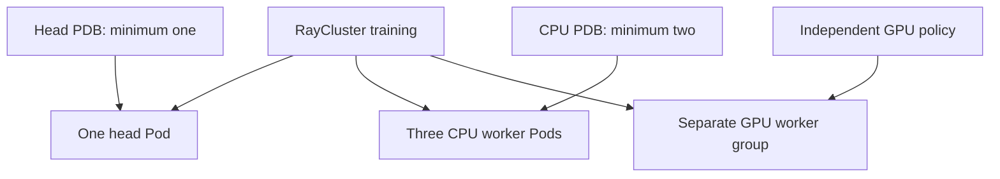

# Configure RayCluster PDBs Without a Scale Subresource

Author: [nawazdhandala](https://www.github.com/nawazdhandala)

Tags: Kubernetes, KubeRay, PodDisruptionBudget, Troubleshooting

Description: Protect RayCluster head and worker Pods with integer availability floors, verify their selectors, and understand autoscaling and maintenance limits.

A node rotation stalls, and a RayCluster PodDisruptionBudget reports that `rayclusters.ray.io` does not implement the scale subresource. Changing the percentage or setting `maxUnavailable: 0` does not address the missing API. The budget needs a counting method that does not depend on that endpoint.

A PodDisruptionBudget, or PDB, limits voluntary Pod removals requested through Kubernetes' eviction API. For RayCluster Pods, an integer `minAvailable` can provide that protection without a scale endpoint. The important design decision is which Pods belong in each budget and how many of those Pods must remain healthy.

This example uses **KubeRay 1.4.2** source and its RayCluster custom resource definition with **Kubernetes 1.34.0**. These versions define the reviewed behavior, rather than a recommendation to install an older release. Inspect your installed definition before applying the same reasoning.

## Why the scale lookup fails

A scale subresource exposes a controller's desired and observed replica counts through a standardized API. The reviewed RayCluster definition exposes `status`, but not `scale`, for its served versions. Its head and worker Pods are directly owned by the RayCluster. [KubeRay 1.4.2 definition](https://github.com/ray-project/kuberay/blob/v1.4.2/ray-operator/config/crd/bases/ray.io_rayclusters.yaml), [Pod creation and ownership](https://github.com/ray-project/kuberay/blob/v1.4.2/ray-operator/controllers/ray/raycluster_controller.go)

In Kubernetes 1.34, `maxUnavailable` and percentage `minAvailable` need controller scale information. Integer `minAvailable` instead uses the selected Pod population and an absolute healthy-Pod floor. An integer `maxUnavailable: 0` still takes the scale-lookup path. A calculation failure can leave zero disruption allowance, but that is not a successfully calculated policy. [Disruption-controller implementation](https://github.com/kubernetes/kubernetes/blob/v1.34.0/pkg/controller/disruption/disruption.go)

The same symptom appears in the [KubeRay issue about node rotation](https://github.com/ray-project/kuberay/issues/2662). Kubernetes documents integer `minAvailable` as the supported budget form for arbitrary workloads without the required controller interface. [PDB restrictions](https://kubernetes.io/docs/tasks/run-application/configure-pdb/#arbitrary-workloads-and-arbitrary-selectors)

Do not add a guessed scale mapping to the installed definition. One scalar replica count cannot automatically express a head Pod plus several independently sized worker groups. Changing an operator-managed API definition also creates an upgrade responsibility.

## Establish the actual selection boundary

The following read-only commands require `kubectl`, `jq`, and permission to read the definition and API discovery. Replace the `staging` context with your reviewed cluster context.

```bash
kubectl --context staging get crd rayclusters.ray.io -o json |
  jq '.spec.versions[] | {name, served, subresources}'
kubectl --context staging get --raw /apis/ray.io/v1 |
  jq '[.resources[].name | select(startswith("rayclusters"))]'
```

For the pinned definition, expect `rayclusters` and `rayclusters/status`, with no `rayclusters/scale`. A permission error is not evidence that the endpoint is absent.

Next inspect the intended cluster. Here `ml`, `training`, and `cpu-workers` are example namespace, RayCluster, and worker-group names.

```bash
kubectl --context staging -n ml get pods -l ray.io/cluster=training \
  -L ray.io/node-type,ray.io/group
kubectl --context staging -n ml get pods -l ray.io/cluster=training -o json |
  jq '.items[] | {name: .metadata.name,
    owners: [.metadata.ownerReferences[]? |
      select(.controller == true) | {kind, name}]}'
```

Confirm each selected Pod's controlling owner and labels. KubeRay 1.4.2 generates `ray.io/cluster`, `ray.io/node-type`, and `ray.io/group` labels and prevents Pod-template overrides of those keys. Use their observed values; do not select every Pod in the namespace or every application labeled `kuberay`. [Label generation](https://github.com/ray-project/kuberay/blob/v1.4.2/ray-operator/controllers/ray/common/pod.go)

## Give the head and each worker group separate policies

Suppose the cluster has one head, three CPU workers, and a separate GPU worker group. A single minimum across all of them could permit head eviction while enough workers remain healthy. Separate selectors express the operational boundary:



Save this as `ray-pdbs.yaml`, after changing the example names to match your inspected Pods:

```yaml
apiVersion: policy/v1
kind: PodDisruptionBudget
metadata:
  name: training-head
  namespace: ml
spec:
  minAvailable: 1
  selector:
    matchLabels:
      ray.io/cluster: training
      ray.io/node-type: head
---
apiVersion: policy/v1
kind: PodDisruptionBudget
metadata:
  name: training-cpu-workers
  namespace: ml
spec:
  minAvailable: 2
  selector:
    matchLabels:
      ray.io/cluster: training
      ray.io/node-type: worker
      ray.io/group: cpu-workers
```

The numbers are integers, not quoted percentages. With three healthy CPU workers and no in-flight disruption reservations, the worker policy can allow one eviction. With only two healthy workers, it allows none. With five healthy workers, it can allow three: this is a minimum-capacity policy, not a permanent “one at a time” limit.

The head policy blocks ordinary voluntary eviction of the sole healthy head. That intentionally requires a separate head-maintenance plan. It does not create a second head or protect against hardware failure. Ray's Global Control Service, or GCS, holds cluster control state; its fault-tolerance configuration is a separate concern. [GCS fault tolerance](https://docs.ray.io/en/latest/cluster/kubernetes/user-guides/kuberay-gcs-ft.html)

The GPU group is deliberately absent from the CPU selector. Give it a separately justified policy if it needs protection. Also inspect existing PDBs for overlapping selectors before introducing these objects.

## Preview the objects, then verify controller results

```bash
kubectl --context staging apply --dry-run=server -f ray-pdbs.yaml
kubectl --context staging -n ml get pdb -o yaml
```

The first command submits an API preview without storing the proposed objects. It checks admission and schema handling; it does not run the disruption controller or prove that Pods are selected correctly. The second command helps review existing policies for overlap. Apply the reviewed file through the system that normally owns your cluster configuration.

After reconciliation, inspect the two installed budgets:

```bash
kubectl --context staging -n ml get pdb training-head training-cpu-workers \
  -o custom-columns='NAME:.metadata.name,GEN:.metadata.generation,OBSERVED:.status.observedGeneration,HEALTHY:.status.currentHealthy,DESIRED:.status.desiredHealthy,ALLOWED:.status.disruptionsAllowed'
kubectl --context staging -n ml describe pdb training-cpu-workers
```

Require the observed generation to match the current generation. In the healthy three-worker scenario, expect desired healthy workers of two and allowance of one; the head allowance should be zero. Investigate warnings, missing Pods, readiness failures, terminating Pods, and outstanding disruption reservations when the numbers differ. The actual status is more useful than assuming the YAML has already taken effect.

## Keep autoscaling and maintenance consistent

A worker floor of two becomes operationally awkward if the autoscaler routinely leaves only one worker. Choose worker-group `minReplicas` and the PDB floor together. If planned worker eviction must remain possible at the autoscaling minimum, retain spare healthy capacity above the floor, with room to schedule replacements. Multi-host worker groups need additional care because group replicas and individual Pod counts are not interchangeable. [RayCluster configuration](https://docs.ray.io/en/latest/cluster/kubernetes/user-guides/config.html)

Do not expect a PDB to veto every operator action. The reviewed KubeRay controller directly deletes worker Pods in scale-down paths; those operations do not become eviction requests merely because a PDB exists. Ray autoscaling decides resource demand, while the PDB controls a different maintenance boundary. [Worker reconciliation](https://github.com/ray-project/kuberay/blob/v1.4.2/ray-operator/controllers/ray/raycluster_controller.go), [Ray autoscaling model](https://docs.ray.io/en/latest/cluster/kubernetes/user-guides/k8s-autoscaler.html)

Rehearse maintenance with representative Ray work: verify worker recovery and application progress, and prepare a deliberate recovery procedure for the head. Do not bypass the head budget just to make a drain finish. A useful policy gives operators an explicit stopping point and enough information to decide what must recover before maintenance continues.
