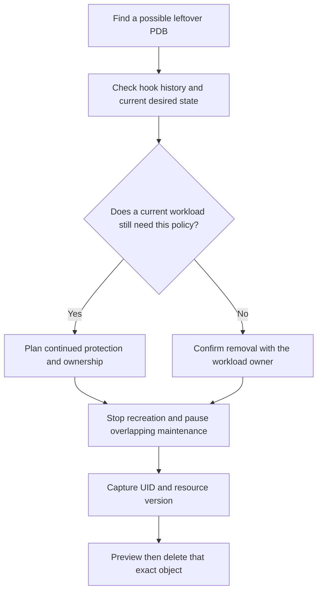

# Remove Orphaned PDBs Left Behind by Helm Hooks

Author: [nawazdhandala](https://www.github.com/nawazdhandala)

Tags: Kubernetes, Helm, PodDisruptionBudget, Troubleshooting

Description: Identify PDBs left by Helm hooks, verify their current protection role, and remove one reviewed object using identity and version preconditions.

A Helm release is gone, but its PodDisruptionBudget still exists. Later, another workload reuses the same labels and unexpectedly encounters that old policy during maintenance. Deleting every PDB with a Helm annotation would be an overreaction: some of those policies may still be intentional.

The useful sequence is to establish ownership, decide whether protection must continue, stop the source from recreating the object, and remove only the reviewed PDB. This guide uses Helm 3.17.3 and Kubernetes/kubectl 1.34.0 behavior. The deletion example also uses jq 1.6 and curl 8.7.1.

## Understand why uninstall left the object

A Helm hook is a template assigned to a release lifecycle event, such as `post-install`. Hook resources have a different lifecycle from ordinary resources in the release manifest. Helm documents that they are not tracked and managed as normal release resources, so uninstalling a release does not reliably clean them up. [Helm hook lifecycle](https://helm.sh/docs/v3/topics/charts_hooks/)

For example, this annotation pair can leave a PDB after uninstall:

```yaml
metadata:
  annotations:
    helm.sh/hook: post-install,post-upgrade
    helm.sh/hook-delete-policy: before-hook-creation
```

`before-hook-creation` removes the previous hook resource before the hook is created again. It is not an uninstall cleanup instruction. In Helm 3.17.3, it is also the default hook deletion policy when none is specified. [Hook execution source](https://github.com/helm/helm/blob/v3.17.3/pkg/action/hooks.go)

Do not add `hook-succeeded` reflexively to a persistent PDB. Helm's hook readiness check treats resources other than Jobs and Pods as ready without waiting for application availability. A success cleanup policy can therefore remove the budget just created for ongoing protection. [Hook readiness implementation](https://github.com/helm/helm/blob/v3.17.3/pkg/kube/client.go)



## Establish provenance and current impact

For the examples, `staging` is the kubeconfig context, `retail` is the namespace, `checkout` is the release, and `checkout-legacy` is the candidate PDB. Replace these identifiers consistently after review.

```bash
kubectl --context staging -n retail get pdb checkout-legacy -o yaml
helm --kube-context staging get hooks checkout -n retail
helm --kube-context staging get manifest checkout -n retail
```

The first command shows the live policy, annotations, labels, owner references, and status. The other commands distinguish saved hooks from the ordinary release manifest. Use `helm get hooks --revision` when examining a specific retained historical revision. A missing release record is a limit on the available evidence, not proof that deleting the PDB is safe. [Hook inspection](https://helm.sh/docs/v3/helm/helm_get_hooks/) and [manifest inspection](https://helm.sh/docs/v3/helm/helm_get_manifest/)

Compare the candidate with the current chart, GitOps repository, and application owner's intended policy. Treat `helm.sh/hook`, release annotations, and labels as clues rather than authoritative ownership by themselves. Also inspect any `helm.sh/resource-policy` annotation and Kubernetes owner references; those can explain a different retention mechanism.

Determine which Pods the PDB currently selects. Match its selector against **Pod labels in the same namespace**, including all selector expressions. A policy with no selected Pods today can still match a future deployment. An empty `policy/v1` selector is particularly broad: it selects the namespace's Pods. [PDB selector guidance](https://kubernetes.io/docs/tasks/run-application/configure-pdb/)

## Decide how protection will continue

There are three common outcomes:

| Finding | Next step |
|---|---|
| Application is retired and no intended workload depends on the policy | Review removal of the leftover object |
| Application is active and this is its only intended budget | Migrate ownership or establish an appropriate replacement first |
| Another intended budget overlaps the old one | Review selectors and the transition before removing the obsolete policy |

Keep eviction-based maintenance paused during a handover. Two overlapping PDBs can temporarily block eviction; removing the old one first can instead create a protection gap. Decide the order explicitly, verify the replacement's selector and current status, and then complete the approved transition.

Fix the source chart or reconciliation configuration before deleting the leftover. Otherwise the next install, upgrade, or reconciliation may recreate it. For a persistent application PDB, an ordinary chart template is usually easier to manage than a lifecycle hook. Changing the template classification does not by itself solve ownership of an already existing object; review that migration in staging.

## Capture the exact object you approved

Work in an empty review directory. The following saves the candidate and builds Kubernetes deletion preconditions:

```bash
set -euo pipefail
umask 077
kubectl --context staging -n retail get pdb checkout-legacy -o json \
  > candidate.json
jq -e '
  .metadata as $m |
  if .kind == "PodDisruptionBudget" and .apiVersion == "policy/v1"
     and $m.namespace == "retail" and $m.name == "checkout-legacy"
     and (($m.uid // "") | length) > 0
     and (($m.resourceVersion // "") | length) > 0
  then {
    apiVersion: "v1", kind: "DeleteOptions",
    preconditions: {uid: $m.uid, resourceVersion: $m.resourceVersion}
  }
  else error("Unexpected candidate identity")
  end
' candidate.json > delete-options.json
```

The UID is the object's unique identity. `resourceVersion` identifies the version you inspected. Including both means a delete request must fail if the named PDB was replaced or changed since capture. jq's error behavior prevents an unexpected capture from producing a usable request. [Deletion preconditions](https://github.com/kubernetes/apimachinery/blob/v0.34.0/pkg/apis/meta/v1/types.go) and [jq manual](https://jqlang.org/manual/v1.6/)

Retain `candidate.json` with the review evidence. If protection must be restored later, reconstruct a reviewed declarative PDB; do not blindly reapply an old exported object with stale metadata and status.

## Preview through the API, then remove one PDB

In a separate terminal, start a proxy bound only to the local computer:

```bash
kubectl --context staging proxy --address=127.0.0.1 --port=18001
```

Wait for its listening message. The proxy uses that context's authentication and TLS settings for the Kubernetes connection. Keep it local and stop it when finished. [kubectl proxy](https://kubernetes.io/docs/reference/kubectl/generated/kubectl_proxy/)

From the review directory, submit a server-side dry-run:

```bash
jq '. + {dryRun: ["All"]}' delete-options.json > delete-preview.json
curl --fail-with-body --silent --show-error \
  --request DELETE --header 'Content-Type: application/json' \
  --data-binary @delete-preview.json \
  'http://127.0.0.1:18001/apis/policy/v1/namespaces/retail/poddisruptionbudgets/checkout-legacy'
```

The request checks API permission, admission, and preconditions without persisting deletion. A successful preview does not reserve the object or certify application safety. The API route is the namespaced PDB deletion endpoint. [PDB API reference](https://kubernetes.io/docs/reference/generated/kubernetes-api/v1.34/#delete-poddisruptionbudget-v1-policy) and [dry-run semantics](https://kubernetes.io/docs/reference/using-api/api-concepts/#dry-run)

With a `DeleteOptions` body, put `dryRun` in that body. In the reviewed API handler, query parameters are decoded only when the request body is empty; a query-only dry-run flag must not be relied on here. [Deletion handler](https://github.com/kubernetes/apiserver/blob/v0.34.0/pkg/endpoints/handlers/delete.go)

After the reviewed transition is ready, this command performs deletion using the original options file without `dryRun`:

```bash
curl --fail-with-body --silent --show-error \
  --request DELETE --header 'Content-Type: application/json' \
  --data-binary @delete-options.json \
  'http://127.0.0.1:18001/apis/policy/v1/namespaces/retail/poddisruptionbudgets/checkout-legacy'
```

`--fail-with-body` gives a failing exit status for HTTP errors while retaining the error response. If you receive a conflict, re-read and re-review the changed object instead of dropping the preconditions. Even a controller status update can change the resource version. [curl option reference](https://curl.se/docs/manpage.html)

Confirm the candidate is gone, the intended remaining PDBs are present, and application health is unchanged. If finalizers delay deletion, investigate their owner rather than forcing their removal. Stop the proxy with Ctrl-C and verify the obsolete hook cannot recreate the policy.

In a disposable local API fixture, a real Helm hook-created PDB survived uninstall. The exact deletion flow preserved it during dry-run, removed it on the actual request, and rejected stale identity/version requests. No running application, node drain, or production policy was changed. The operational decision about which protection to retain remains essential even when the API mechanics are correct.
