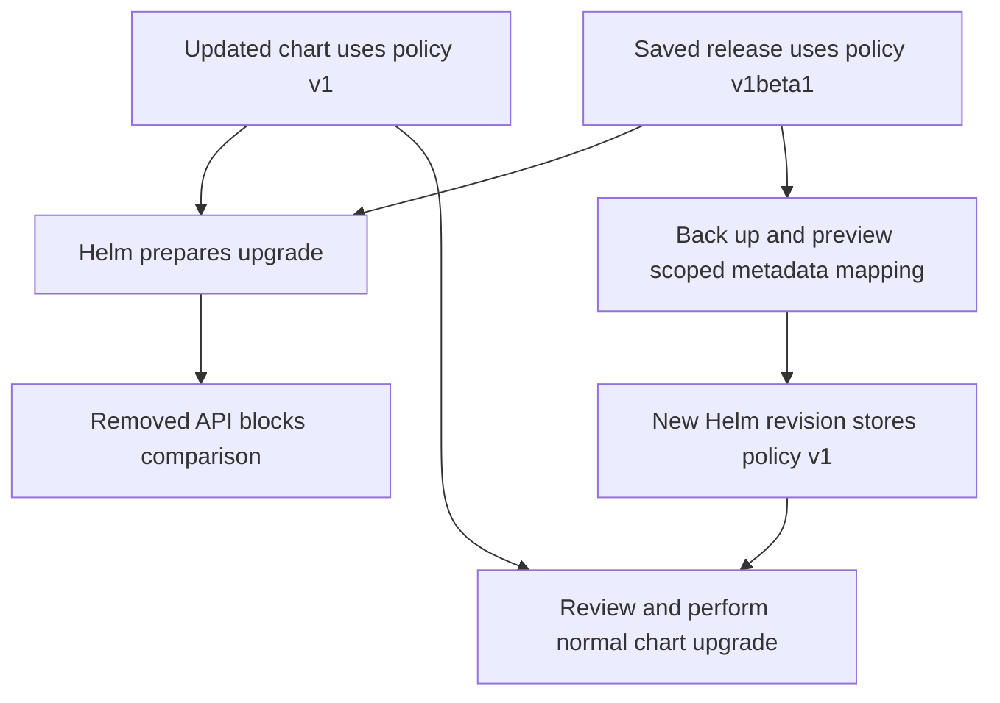

# Repair Helm Release Metadata with Old PDB API References

Author: [nawazdhandala](https://www.github.com/nawazdhandala)

Tags: Kubernetes, Helm, PodDisruptionBudget, Troubleshooting

Description: Repair stored Helm manifests that reference policy/v1beta1 PDBs, using a scoped mapping, protected backups, and checks that separate metadata from live resources.

You updated a chart to `policy/v1`, but `helm upgrade` still reports that it cannot find `PodDisruptionBudget` in `policy/v1beta1`. The error can come from Helm's saved release manifest, not the chart you just rendered.

Helm needs the previous manifest when preparing an upgrade. If that manifest names an API the cluster no longer serves, fixing only the next chart does not remove the old reference. Helm documents this failure and the need to repair the stored release representation. [Deprecated APIs in Helm releases](https://helm.sh/docs/v3/topics/kubernetes_apis/)

This guide uses Helm **3.17.3**, the **mapkubeapis v0.6.1 release binary**, and a local Kubernetes **1.34.0** API fixture. The commands assume Helm's **Secret storage backend**. ConfigMap or SQL storage needs a corresponding backup and review procedure.

## Separate the three things that need checking

| Object | What to inspect |
|---|---|
| Chart source and rendered next release | Uses supported API versions and correct selectors |
| Helm release records | Previous manifest still contains removed API references |
| Live PDB | Actual selector, health floor, status, and identity |

Kubernetes stopped serving `policy/v1beta1` PDBs in 1.25. The supported `policy/v1` API has been available since 1.21. A live PDB can be readable through the supported API while an older Helm record still stores the beta spelling. [Kubernetes API migration guide](https://kubernetes.io/docs/reference/using-api/deprecation-guide/#poddisruptionbudget-v125)



The mapping step changes Helm's records. It does not perform the application upgrade or exercise the PDB through an eviction.

## Freeze the release and capture evidence

Pause the deployment job or GitOps reconciliation that writes this release. Confirm the cluster context and release namespace. Inspect the **latest** revision and require it to be in the expected deployed state before following this workflow.

Do not select an older deployed revision merely because a newer one is pending or failed. Investigate that transaction first. Removing revision Secrets to make the history look convenient can destroy the evidence needed for recovery.

For a release named `checkout` in namespace `retail`, the following read-only capture uses context `staging`. Replace all three identifiers with your approved target:

```bash
set -euo pipefail
umask 077
RELEASE_BACKUP=$(mktemp -d ./checkout-release.XXXXXX)

helm --kube-context staging history checkout -n retail -o yaml \
  > "$RELEASE_BACKUP/history.yaml"
helm --kube-context staging get manifest checkout -n retail \
  > "$RELEASE_BACKUP/manifest.yaml"
kubectl --context staging -n retail get secrets \
  -l 'owner=helm,name=checkout' -o yaml \
  > "$RELEASE_BACKUP/release-secrets.yaml"
kubectl --context staging -n retail get pdb checkout -o yaml \
  > "$RELEASE_BACKUP/live-pdb.yaml"
```

The directory contains the history, current stored manifest, release Secret records, and one live PDB snapshot. If the release has several PDBs, capture each one. Verify the files contain the intended objects and retain them in approved protected storage. Release records can contain sensitive chart values and manifests; they are not application database backups. [Helm history](https://helm.sh/docs/v3/helm/helm_history/), [manifest inspection](https://helm.sh/docs/v3/helm/helm_get_manifest/), and [kubectl get](https://kubernetes.io/docs/reference/kubectl/generated/kubectl_get/)

Read the saved manifest as YAML and identify the affected PDB documents. Inspect hooks separately if the chart creates PDBs through hooks: the version examined here maps `Release.Manifest`, not every separately stored hook manifest. [Release mapping implementation](https://github.com/helm/helm-mapkubeapis/blob/v0.6.1/pkg/v3/release.go)

## Use the intended binary and a narrow map

Obtain the archive for your operating system and architecture from the official [v0.6.1 release](https://github.com/helm/helm-mapkubeapis/releases/tag/v0.6.1). Verify it against that release's `checksums.txt`, then extract it into a dedicated working directory. In the commands below, `./mapkubeapis` means that extracted executable.

This direct invocation avoids a version ambiguity: the v0.6.1 source tag's `plugin.yaml` declares `0.5.2`, and its installer uses that value to choose a download. Do not assume that selecting the Git tag proves which binary an install hook fetched. [Tagged plugin metadata](https://github.com/helm/helm-mapkubeapis/blob/v0.6.1/plugin.yaml) and [installer implementation](https://github.com/helm/helm-mapkubeapis/blob/v0.6.1/scripts/install_plugin.sh)

The executable supports direct use with explicit namespace, context, kubeconfig, and map-file flags. It does not require changing your existing Helm plugin installation. [Command implementation](https://github.com/helm/helm-mapkubeapis/blob/v0.6.1/cmd/mapkubeapis/map.go)

Save this PDB-only mapping as `pdb-map.yaml` in that working directory:

```yaml
mappings:
  - deprecatedAPI: "apiVersion: policy/v1beta1\nkind: PodDisruptionBudget\n"
    newAPI: "apiVersion: policy/v1\nkind: PodDisruptionBudget\n"
    deprecatedInVersion: "v1.21"
    removedInVersion: "v1.25"
```

These fields come from the official [API mapping format](https://github.com/helm/helm-mapkubeapis/blob/v0.6.1/config/Map.yaml). A custom file keeps this repair focused instead of applying every mapping shipped with the tool. If the release contains other removed APIs, review those separately; this file will not repair them.

The match is literal text, including field order and line endings. If the saved manifest has `kind` before `apiVersion`, adapt the mapping to its exact header after review. A successful run reporting no matches is not proof that the entire release is compatible. [Replacement implementation](https://github.com/helm/helm-mapkubeapis/blob/v0.6.1/pkg/common/common.go)

## Preview, review, then change metadata

With the same kubeconfig available to both tools, preview the operation:

```bash
HELM_DRIVER=secret ./mapkubeapis checkout \
  --kube-context staging --namespace retail \
  --mapfile ./pdb-map.yaml --dry-run
```

Expected output identifies the old PDB API and its replacement. Dry-run reads the release and server version but does not create or update release records. Check the number of matches against your manifest review. It is not a complete YAML diff or a server-side validation of the future chart.

Review selector semantics before proceeding. In `policy/v1beta1`, an empty `{}` selector selected no Pods; in `policy/v1`, it selects all Pods in the namespace. The mapping changes API text, not selector intent. Correct and review the next chart's selector explicitly before allowing a later upgrade to apply it.

Once the preview, backup, selector review, and release state are satisfactory, the same command without `--dry-run` performs the metadata mutation:

```bash
HELM_DRIVER=secret ./mapkubeapis checkout \
  --kube-context staging --namespace retail \
  --mapfile ./pdb-map.yaml
```

The tool supersedes the previous revision and creates a new deployed revision containing the mapped manifest. These are separate storage operations. If the operation fails partway through, stop and inspect history and the saved records before retrying; do not assume it was atomic or blindly apply a backup over newer state.

## Verify the repair before resuming deployment

Read the history and latest manifest again:

```bash
helm --kube-context staging history checkout -n retail
helm --kube-context staging get manifest checkout -n retail
kubectl --context staging -n retail get pdb checkout -o yaml
```

Confirm the additional revision, the expected description, and the changed PDB API reference. Compare the live PDB with the earlier snapshot. Metadata repair should not itself change that object's selector or availability policy. Then use the corrected chart through your usual reviewed upgrade process.

Record the compatibility boundary in the release runbook. Older revisions still exist, but rolling back to a manifest with removed APIs can recreate the original failure. Choose a supported rollback artifact rather than treating every historical revision as usable.

In the local API fixture, dry-run left the release Secret unchanged. The actual mapping superseded revision one, created revision two with `policy/v1`, and left the live PDB's UID and resource version unchanged. A repeat mapping created no extra revision, and Helm read both history entries. No application upgrade, hook migration, workload recovery, or node drain was tested.
