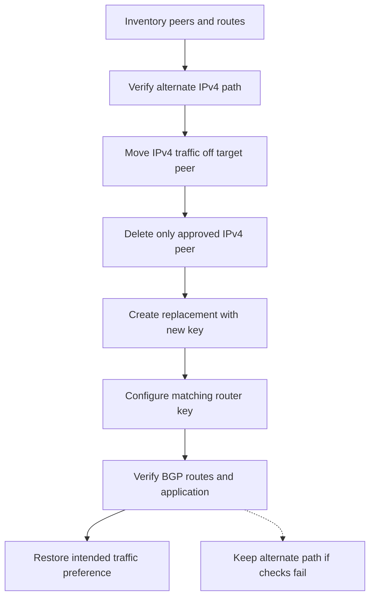

# Rotate a Direct Connect BGP Key with a Controlled Peer Replacement

Author: [nawazdhandala](https://www.github.com/nawazdhandala)

Tags: AWS, Direct Connect, Networking, Security, Routing

Description: Plan Direct Connect BGP key rotation around peer replacement, alternate-path validation, protected key input, and explicit recovery checks.

Changing a Direct Connect BGP authentication key requires more planning than updating a password on the customer router. Both ends must use the same key, and the public AWS API does not expose an in-place key update in `UpdateVirtualInterfaceAttributes`. Seeing `authKey` in that operation's response does not make it an accepted request parameter. Check the [request schema](https://docs.aws.amazon.com/directconnect/latest/APIReference/API_UpdateVirtualInterfaceAttributes.html) before designing automation around an assumed update flag.

The supported building blocks are peer creation and deletion. This guide combines them into a controlled replacement procedure for an existing private VIF with IPv4 and IPv6 peers. A VIF is a virtual interface; BGP, the Border Gateway Protocol, exchanges network routes. The procedure is derived from the documented APIs, not a claim that AWS provides an atomic rotation operation.

## Choose the right replacement boundary

AWS prevents deleting the last BGP peer on a VIF. Therefore, a single-peer interface cannot use the deletion step below. Plan a replacement VIF and traffic migration, or obtain an AWS-supported plan for your specific topology. Do not discover the last-peer restriction after changing the router key. See [DeleteBGPPeer](https://docs.aws.amazon.com/directconnect/latest/APIReference/API_DeleteBGPPeer.html).

This example assumes an existing IPv4 peer is being replaced while an existing IPv6 peer remains. That remaining peer preserves the VIF's other peering; **it does not provide IPv4 failover**. Ordinary dual-stack operation has separate IPv4 and IPv6 sessions. The [peer configuration guide](https://docs.aws.amazon.com/directconnect/latest/UserGuide/add-peer-to-vif.html) explains this distinction.

Use a separate, already tested IPv4 path for continuity. Otherwise, explicitly schedule an IPv4 outage. Do not add an unused IPv6 peer merely to treat a single-peer production interface as eligible for this example.



The session reset is expected. The safety measure is controlling where traffic goes while that session is unavailable.

## Capture the facts without printing the key

Use an authenticated profile with permission to inspect the VIF. Replace the profile, Region, and interface ID. Commands were checked against the [AWS CLI 2.42.1 service model](https://github.com/aws/aws-cli/blob/2.42.1/awscli/botocore/data/directconnect/2012-10-25/service-2.json); no live rotation was performed.

```bash
aws directconnect describe-virtual-interfaces \
  --profile network-change --region us-east-1 \
  --virtual-interface-id dxvif-EXAMPLE \
  --query 'virtualInterfaces[].{Vif:virtualInterfaceId,Owner:ownerAccount,Connection:connectionId,Vlan:vlan,Gateway:directConnectGatewayId,Peers:bgpPeers[].{Id:bgpPeerId,Family:addressFamily,Asn:asnLong,Amazon:amazonAddress,Customer:customerAddress,State:bgpPeerState,Status:bgpStatus}}' \
  --output json --no-cli-pager
```

This [read-only inspection](https://docs.aws.amazon.com/cli/latest/reference/directconnect/describe-virtual-interfaces.html) keeps peer IDs, addresses, ASN, and state while omitting authentication fields. ASN means autonomous system number, the identifier used by the router's BGP routing domain.

Record the exact IPv4 peer ID. Preserve its customer and Amazon addresses, masks, ASN, route filters, and the router configuration through your approved secure backup process. Keep the old key accessible only to authorized operators if policy permits rollback to it. A general incident ticket should contain a secret reference, not the key.

Write measurable acceptance conditions: expected prefixes, application transaction, maximum acceptable packet loss, observation interval, and the point at which traffic stays on the alternate path. These are local operating decisions, not fixed AWS recovery guarantees.

## Prepare the new request before the outage

Use a supported Python 3 installation on a trusted Linux or macOS administration workstation. Save the following as `prepare-peer.py`, replacing the VIF, ASN, and **both addresses with the recorded values**. The addresses shown are illustrative private peer addresses.

```python
import getpass
import json
import os
import warnings

warnings.simplefilter("error", getpass.GetPassWarning)
key = getpass.getpass("New approved BGP key: ")
if not 6 <= len(key) <= 80:
    raise SystemExit("BGP key must contain 6 to 80 characters")
if key != getpass.getpass("Repeat the key: "):
    raise SystemExit("Keys do not match")

request = {
    "virtualInterfaceId": "dxvif-EXAMPLE",
    "newBGPPeer": {
        "asnLong": 65010,
        "addressFamily": "ipv4",
        "amazonAddress": "192.168.250.1/30",
        "customerAddress": "192.168.250.2/30",
        "authKey": key,
    },
}
fd = os.open("new-peer.json", os.O_WRONLY | os.O_CREAT | os.O_EXCL, 0o600)
with os.fdopen(fd, "w", encoding="utf-8") as output:
    json.dump(request, output, indent=2)
    output.write("\n")
print("Created protected request file")
```

Run `python3 prepare-peer.py` in a private working directory outside source control. The script prompts without echo, rejects mismatched entries, and refuses to overwrite an existing request. If hidden input is unavailable, it stops instead of falling back to visible input. These behaviors use Python's documented [getpass](https://docs.python.org/3/library/getpass.html) and [file-opening flags](https://docs.python.org/3/library/os.html).

The API specifies a 6–80 character key; also follow your router's supported character set and your organization's secret-generation policy. The script does not generate a strong key or validate router compatibility. The request fields come from [NewBGPPeer](https://docs.aws.amazon.com/directconnect/latest/APIReference/API_NewBGPPeer.html).

The file still contains plaintext secret material. Restrictive permissions do not encrypt it. Keep it out of shared folders, backups that are not approved for secrets, and command output. Arrange its removal under your secret-handling procedure after the change.

## Drain, remove, and recreate one peer

First move the affected IPv4 traffic to the alternate path using your reviewed routing procedure. Verify the return path as well as outbound traffic, and run the application check before removing anything. AWS's [Resiliency Toolkit](https://docs.aws.amazon.com/directconnect/latest/UserGuide/resiliency_toolkit.html) can support a separately planned failover rehearsal; it is not a key-rotation service.

Only after the alternate path is carrying the workload, and the other peer is confirmed present, run this disruptive operation with the exact approved IPv4 peer ID:

```bash
aws directconnect delete-bgp-peer \
  --profile network-change --region us-east-1 \
  --virtual-interface-id dxvif-EXAMPLE \
  --bgp-peer-id dxpeer-REPLACE-IPV4-PEER \
  --query 'virtualInterface.{Vif:virtualInterfaceId,Peers:bgpPeers[].{Id:bgpPeerId,Family:addressFamily,State:bgpPeerState,Status:bgpStatus}}' \
  --output json --no-cli-pager
```

This removes a peer, not the whole VIF. Use the original inspection command until the target has completed deletion and is absent from the active peers; do not race creation against a `deleting` state. The [delete command](https://docs.aws.amazon.com/cli/latest/reference/directconnect/delete-bgp-peer.html) accepts a specific peer ID.

Then create the replacement:

```bash
aws directconnect create-bgp-peer \
  --profile network-change --region us-east-1 \
  --cli-input-json file://new-peer.json \
  --query 'virtualInterface.{Vif:virtualInterfaceId,Peers:bgpPeers[].{Id:bgpPeerId,Family:addressFamily,Amazon:amazonAddress,Customer:customerAddress,State:bgpPeerState,Status:bgpStatus}}' \
  --output json --no-cli-pager
```

The [create operation](https://docs.aws.amazon.com/cli/latest/reference/directconnect/create-bgp-peer.html) creates a new peer; do not expect the old peer ID to survive. Configure the identical new key on the customer router through its documented, approved change procedure. Avoid debug logging or dumping full AWS responses during this step.

## Verify before restoring normal preference

Wait for the replacement peer to become available and its BGP status to become `up`. Confirm the expected advertised and received prefixes, then test application traffic over the restored path under controlled routing. Check that the unaffected IPv6 session still works.

If BGP remains down, compare ASN, peer addresses, exact key characters, and TCP connectivity. AWS specifically calls out accidental spaces in authentication keys in its [layer 3 troubleshooting guide](https://docs.aws.amazon.com/directconnect/latest/UserGuide/ts-layer-3.html). Repeatedly clearing every BGP session can widen the outage without correcting a mismatch.

Keep traffic on the alternate path if recovery checks fail. Restoring the old router key alone cannot undo creation of a new AWS peer with a different key. A rollback requires a coordinated plan for both ends and may involve another peer replacement; a compromised old key should not be restored merely for convenience.

Finally, update the inventory with the new peer ID and approved secret reference, remove temporary secret copies, and restore normal routing preferences only after the agreed observation period. Rotate another path in a separate change after the first is proven healthy.
