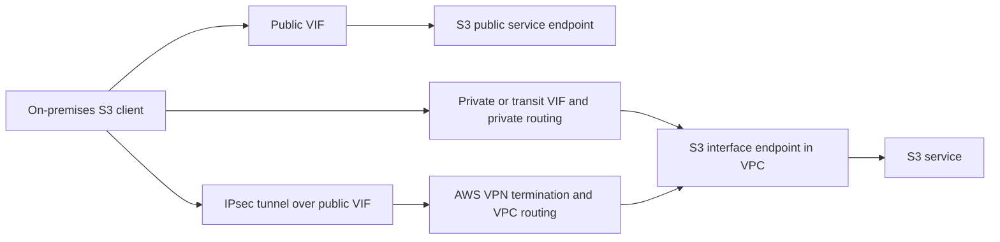

# Reach S3 over Direct Connect: Public VIF, PrivateLink, or VPN?

Author: [nawazdhandala](https://www.github.com/nawazdhandala)

Tags: AWS, Direct Connect, S3, Networking, Security

Description: Compare public VIF access, S3 interface endpoints, and VPN over Direct Connect, then verify DNS, routing, encryption boundaries, and object access.

An on-premises backup server can reach Amazon S3 through several Direct Connect designs. The right choice depends on what you mean by private access: avoiding the internet, using private destination addresses, or adding network-layer encryption. Those are separate requirements.

A public virtual interface can reach S3's public service addresses over Direct Connect. An S3 interface endpoint exposes private addresses inside a VPC. A VPN over a public VIF adds an encrypted tunnel to a VPC, where the client still needs a valid route to S3. Choosing a VPN does not, by itself, choose the S3 endpoint.

This guide compares those paths for general-purpose S3 buckets and provides read-only checks for an existing deployment.

## Compare the complete paths

A VIF is a virtual interface on a Direct Connect connection. PrivateLink is the AWS service behind interface VPC endpoints. IPsec is the network-layer encryption used by AWS Site-to-Site VPN.

| Design | Destination seen by the S3 client | Additional components | Useful when |
| --- | --- | --- | --- |
| Public VIF to S3 | S3 public service addresses | Public BGP addressing and route policy | You want direct access to AWS public services over Direct Connect |
| Private routing to S3 PrivateLink | Interface endpoint addresses in your VPC | Interface endpoint, security groups, routing, DNS plan | You require private destination addresses and endpoint-based controls |
| VPN over public VIF, then PrivateLink | Interface endpoint addresses inside the tunnel | VPN gateways/tunnels plus the interface endpoint | You require an IPsec overlay for the on-premises-to-VPC segment |

The Direct Connect [VIF overview](https://docs.aws.amazon.com/directconnect/latest/UserGuide/WorkingWithVirtualInterfaces.html) distinguishes public-service access from private VPC connectivity. The S3 [PrivateLink guide](https://docs.aws.amazon.com/AmazonS3/latest/userguide/privatelink-interface-endpoints.html) confirms that interface endpoints can be reached from on premises through Direct Connect or VPN.



The bottom path combines VPN and PrivateLink. It does not send ordinary on-premises traffic through an S3 gateway endpoint.

## Public VIF: public addresses do not mean an internet path

A public VIF provides routes to AWS public services. It does not give you general internet transit, and it does not make your bucket publicly readable. Bucket authorization remains a separate decision. Review the [public VIF routing policies](https://docs.aws.amazon.com/directconnect/latest/UserGuide/routing-and-bgp.html) with the network team.

For IPv4, prepare the public peering addresses and prefixes required by AWS and your provider. Do not substitute arbitrary private LAN addresses into a public-VIF design. The [public interface setup documentation](https://docs.aws.amazon.com/directconnect/latest/UserGuide/using-cli.html) lists the required peering and advertised-prefix inputs.

Continue using HTTPS with certificate verification. Direct Connect connectivity alone is not a reason to send unencrypted HTTP or relax TLS checks. TLS, Transport Layer Security, protects the application connection to S3; AWS's [S3 security guidance](https://docs.aws.amazon.com/AmazonS3/latest/userguide/security-best-practices.html) recommends encrypted transport.

The acceptance test must verify the selected route to the resolved S3 address. A successful S3 request could still have used an internet fallback. Confirm the router's next hop and interface counters while generating a small, identifiable request.

## PrivateLink: route to endpoint addresses and plan DNS

An S3 interface endpoint places network interfaces in selected VPC subnets. On-premises clients need routes to those subnet addresses and a working return path. Use a private VIF through an appropriate gateway design, or a transit VIF through a Direct Connect gateway and Transit Gateway.

Allow the required HTTPS traffic in the endpoint security groups and network controls. DNS must resolve the endpoint name to addresses reachable over that private path. Creating an endpoint without arranging routing, DNS, and permissions leaves three independent opportunities for failure. AWS's [interface endpoint creation guide](https://docs.aws.amazon.com/vpc/latest/privatelink/create-interface-endpoint.html) covers subnets, security groups, and DNS prerequisites.

For an initial test, an endpoint-specific DNS name avoids changing every application's resolver behavior. S3 uses a service prefix such as the literal `bucket` for bucket operations. Obtain the endpoint's generated name rather than inventing an endpoint ID. See [S3 endpoint names](https://docs.aws.amazon.com/AmazonS3/latest/userguide/privatelink-interface-endpoints.html).

For normal Regional S3 names, configure private DNS and an inbound Route 53 Resolver endpoint that your on-premises DNS servers can query. The S3 option **private DNS only for inbound endpoints** allows on-premises requests to use the interface endpoint while in-VPC requests use a gateway endpoint. That option requires an S3 gateway endpoint in the VPC. The [AWS private DNS walkthrough](https://aws.amazon.com/blogs/storage/introducing-private-dns-support-for-amazon-s3-with-aws-privatelink/) explains the split.

An inbound Resolver endpoint is an actual DNS dependency to provision and secure. Enabling a checkbox on the S3 endpoint does not configure your corporate DNS forwarders.

## A gateway endpoint cannot be borrowed from on premises

S3 gateway endpoints are useful for workloads inside a VPC and have no additional endpoint charge. However, they cannot be extended to on-premises clients through Direct Connect, VPN, or Transit Gateway. Adding a route on your office router does not remove this restriction. See the [gateway endpoint limitations](https://docs.aws.amazon.com/vpc/latest/privatelink/vpc-endpoints-s3.html).

This remains true when a VPN terminates at the VPC. For the private-address design in this guide, use an S3 interface endpoint after VPN termination. A proxy application inside the VPC would be a different architecture with its own operational responsibilities.

## VPN over a public VIF: separate inner and outer routes

The public VIF carries traffic to AWS's public VPN tunnel endpoints. Inside the IPsec tunnel, private application packets reach the VPC routing environment. AWS documents this layered path in its [VPN-over-public-VIF architecture](https://docs.aws.amazon.com/reference-architecture-diagrams/latest/traffic-encryption-direct-connect/encryption-vpn-to-vpc.html).

Verify two routing decisions independently: the outer tunnel traffic must use the intended Direct Connect path, and the inner traffic must reach the S3 interface endpoint. A VPN status of `UP` proves neither that the outer path avoided an internet fallback nor that the endpoint's security group permits the client.

The encrypted boundary ends at the VPN termination. Continue HTTPS to S3 beyond it. Plan VPN capacity, both tunnels, and packet-size limits separately from the Direct Connect port speed. Consult the [current VPN quotas](https://docs.aws.amazon.com/vpn/latest/s2svpn/vpn-limits.html); do not assume a large physical port translates into identical tunnel throughput.

## Verify an existing endpoint and a known object

Use AWS CLI 2.42.1-compatible commands with authorized profiles. These examples were source-checked and locally validated for request shape; no AWS requests or live network tests were executed. Replace every resource placeholder and use the bucket's actual Region.

First inspect the endpoint through an administrative profile with EC2 describe permission:

```bash
aws ec2 describe-vpc-endpoints \
  --profile network-read --region us-east-1 \
  --vpc-endpoint-ids vpce-REPLACE \
  --query 'VpcEndpoints[].{Id:VpcEndpointId,Type:VpcEndpointType,State:State,Service:ServiceName,PrivateDns:PrivateDnsEnabled,DnsOptions:DnsOptions,DnsNames:DnsEntries[].DnsName,Interfaces:NetworkInterfaceIds}' \
  --output json --no-cli-pager
```

Expect an available `Interface` endpoint for the intended S3 service. Inspect its generated DNS names and endpoint interfaces. This [describe operation](https://docs.aws.amazon.com/cli/latest/reference/ec2/describe-vpc-endpoints.html) checks configuration, not client reachability.

From the actual on-premises client environment, use a known test object and an identity authorized to read it:

```bash
aws s3api head-object \
  --profile s3-test --region us-east-1 \
  --bucket REPLACE-BUCKET --key network-checks/probe.txt \
  --expected-bucket-owner 111122223333 \
  --query '{Bytes:ContentLength,Modified:LastModified}' \
  --output json --no-cli-pager
```

This retrieves object metadata without downloading or modifying the object. The expected owner is a placeholder account ID; replace it too. Normal DNS determines the path for this request. See [head-object](https://docs.aws.amazon.com/cli/latest/reference/s3api/head-object.html).

To test a specific interface endpoint, repeat the command with the following option, replacing the entire generated endpoint portion with your real endpoint's name:

```bash
--endpoint-url 'https://bucket.vpce-REPLACE.s3.us-east-1.vpce.amazonaws.com'
```

This is an additional command option, not a standalone shell command. The leading `bucket` is literal; the actual bucket still goes in `--bucket`. Keep TLS verification enabled and validate the resolved addresses against the endpoint interfaces.

## Interpret failures without weakening access controls

A timeout points toward DNS, routing, firewall, endpoint security-group, or tunnel investigation. An S3 authorization error means a service response was received, but it does not identify the path or prove that the intended permissions are correct. A `HEAD` error can also hide whether an object exists, depending on permissions.

Review identity permissions, bucket policy, and endpoint policy together. An [endpoint policy](https://docs.aws.amazon.com/vpc/latest/privatelink/vpc-endpoints-access.html) adds a control boundary; it does not replace bucket authorization. Avoid applying a blanket endpoint-only deny to a production bucket before reviewing service integrations, administrative access, and recovery paths.

Compare the extra endpoint hours and data processing in [PrivateLink pricing](https://aws.amazon.com/privatelink/pricing/) and the connection/tunnel charges in [VPN pricing](https://aws.amazon.com/vpn/pricing/). These sit alongside applicable Direct Connect and S3 charges; a private IP address does not imply a free path.

Finally, repeat the same object check during a controlled failure rehearsal and record route evidence. Choose the design whose addressing, encryption boundary, cost, and recovery behavior meet your requirements, then verify those properties independently instead of treating one successful S3 response as proof of all four.
