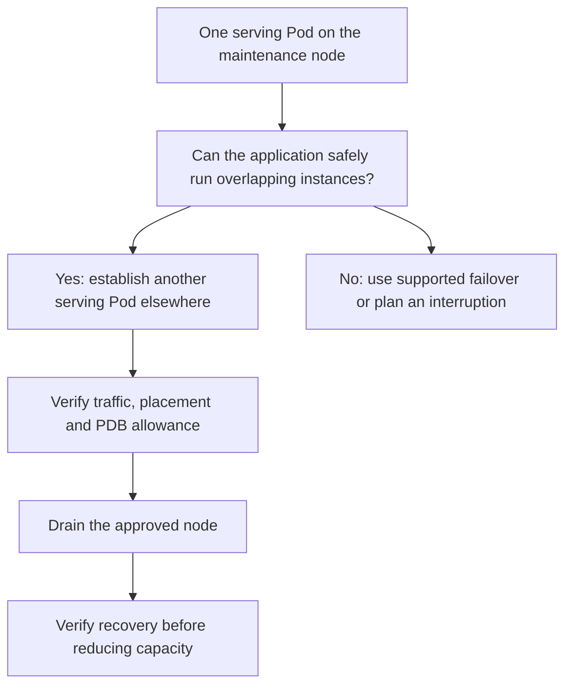

# Can a Single-Replica App Survive a Drain Without Downtime?

Author: [nawazdhandala](https://www.github.com/nawazdhandala)

Tags: Kubernetes, PodDisruptionBudget, High Availability, Deployment

Description: Understand why a PDB cannot keep a lone Pod serving during eviction, why rollout surge does not solve node drains, and when temporary replicas provide a safe maintenance path.

If a service has exactly one serving Pod and that Pod must stop before another can serve, there is a service gap. A PodDisruptionBudget (PDB) can prevent the eviction from starting, but it cannot keep the process running while its node is unavailable.

A drain without an application outage may be possible if you first establish another working instance elsewhere. That changes the maintenance situation from one replica to overlapping service capacity. Whether the overlap is safe depends on the application's storage, ownership rules, and traffic handling, not only on Kubernetes accepting a scale request.

## See what each one-replica policy actually permits

For one healthy Pod, an integer `minAvailable: 1` leaves no healthy-Pod eviction allowance. A budget with `maxUnavailable: 1` can permit the sole Pod to be evicted, leaving no healthy instance. Neither policy creates replacement capacity before eviction. [PDB configuration](https://v1-34.docs.kubernetes.io/docs/tasks/run-application/configure-pdb/).

This is a choice between preserving the running instance and permitting an interruption, unless you add another serving instance first. Do not reinterpret a blocked drain as evidence that the budget should simply be removed.

Also inspect percentage policies. `minAvailable: "100%"` continues to require every replica after you scale from one to two. If the plan is to retain one healthy instance while moving another, review the budget's intended healthy floor rather than assuming any extra replica unlocks maintenance.

## Why rollout surge is not a drain reserve

A Deployment's `maxSurge` controls additional Pods during a rolling update. With `maxSurge: 1` and `maxUnavailable: 0`, a rollout can create replacement capacity before removing an old Pod, subject to readiness and scheduling. Those settings belong to the rollout process. [Deployment rolling-update strategy](https://v1-34.docs.kubernetes.io/docs/concepts/workloads/controllers/deployment/#strategy).

A node drain does not initiate a Deployment rollout just because the Pod is selected for eviction. A stable Deployment with one desired replica does not automatically start a second replica in anticipation of a blocked eviction. Triggering an unrelated rollout to borrow its temporary surge capacity also couples maintenance to another operation that can fail or finish before you need it.

Treat temporary maintenance capacity as an explicit, observed prerequisite. A rollout strategy can still be useful, but it is not a standing spare.



## Decide whether a second replica is valid

For a stateless HTTP service with shared external state, running two instances may be routine. For a single-writer database, local scheduler, or worker that performs non-idempotent jobs, it can duplicate work or corrupt application state unless the software supports coordination.

Inspect storage as well. `ReadWriteOnce` means a volume can be mounted read-write by one node; it can still be used by multiple Pods on that node. `ReadWriteOncePod` restricts the volume to one Pod. Neither mode is a promise that two application instances can safely share data across two nodes. [Persistent-volume access modes](https://kubernetes.io/docs/concepts/storage/persistent-volumes/#access-modes).

If concurrency is unsupported, use the application's documented standby promotion, replication, or active/passive failover procedure. A second Pod that cannot become an independent serving instance does not meet the maintenance prerequisite.

## Rehearse temporary capacity in staging

The following Kubernetes v1.34.0 example assumes an existing stateless Deployment and Service named `single-api` in `maintenance-lab`. The Pod label is `app: single-api`. The application supports concurrent instances, uses a meaningful readiness probe, and has capacity on another eligible node.

Coordinate replica ownership first. If an HPA or operator controls this Deployment, adjust its supported configuration for the maintenance window. Otherwise it can undo a manual increase. Keep unrelated rollouts and replica changes out of the rehearsal.

Use a reviewed budget with an integer healthy floor of one:

```yaml
apiVersion: policy/v1
kind: PodDisruptionBudget
metadata:
  name: single-api
  namespace: maintenance-lab
spec:
  minAvailable: 1
  selector:
    matchLabels:
      app: single-api
```

Manage this manifest through the fixture's normal configuration workflow. Check that it selects only the intended application and does not overlap another PDB. Initially, one healthy replica means the allowance should be zero.

Preview a change from one desired replica to two:

```bash
CTX=staging-context
NS=maintenance-lab
kubectl --context="$CTX" -n "$NS" scale deployment single-api --current-replicas=1 --replicas=2 --dry-run=server
```

The current-replica precondition rejects the request if the Deployment is no longer at one. The dry run does not start another Pod or test capacity. For this approved staging fixture, make the actual change after reviewing the preview:

```bash
kubectl --context="$CTX" -n "$NS" scale deployment single-api --current-replicas=1 --replicas=2
kubectl --context="$CTX" -n "$NS" get pods -l app=single-api -o wide
kubectl --context="$CTX" -n "$NS" get pdb single-api -o yaml
```

Wait for two nonterminating Ready Pods and confirm at least one is on a different node from the maintenance target. If both land on that target, stop and correct the workload's placement policy. If the second is Pending or unready, the additional desired replica has not solved the problem. [Scale command behavior](https://kubernetes.io/docs/reference/kubectl/generated/kubectl_scale/).

With two healthy matching Pods and current PDB status, expect `desiredHealthy: 1` and `disruptionsAllowed: 1`. Verify the real traffic path too:

```bash
kubectl --context="$CTX" -n "$NS" get service single-api -o yaml
kubectl --context="$CTX" -n "$NS" get endpointslices -l kubernetes.io/service-name=single-api -o yaml
```

Confirm the Service selector, endpoint identities, and endpoint conditions. For a normal Service, look for the surviving Pod as a ready, nonterminating endpoint. If `publishNotReadyAddresses` is enabled, endpoint `ready` alone is not evidence of Pod readiness. External load balancers and meshes may need their own checks. [EndpointSlice conditions](https://kubernetes.io/docs/concepts/services-networking/endpoint-slices/#conditions).

## Drain only after service overlap is proven

Define the outcome before testing: acceptable request error rate, latency, and behavior for long-lived connections. Run application requests throughout the transition. A PDB admission decision is not an end-to-end zero-error guarantee.

For a staging node already approved for maintenance, including review of its other workloads, run the ordinary eviction-based drain:

```bash
NODE=replace-with-approved-staging-node
kubectl --context="$CTX" drain "$NODE" --ignore-daemonsets --timeout=10m
```

This command marks the node unschedulable and attempts to remove eligible workloads. `--ignore-daemonsets` allows the drain to proceed around DaemonSet Pods; it does not remove them. The ten-minute timeout is an illustrative observation limit, not a recovery promise. Other workloads, unmanaged Pods, or local storage can still stop the drain. Investigate those findings instead of adding bypass flags. [Drain reference](https://kubernetes.io/docs/reference/kubectl/generated/kubectl_drain/).

Verify the original instance terminates gracefully, the surviving instance keeps serving, and replacement capacity becomes healthy where expected. If the drain times out, inspect the node's scheduling state and workload health; a timeout does not undo the preceding maintenance steps.

After maintenance, verify the node is ready for service before uncordoning it through the runbook. Restore the intended replica policy only after application recovery is confirmed. Reducing desired replicas is another workload change, and a PDB does not make arbitrary scale-down safe. [Safe drain and return-to-service procedure](https://kubernetes.io/docs/tasks/administer-cluster/safely-drain-node/).

If the application cannot support overlap or failover, the honest plan includes a maintenance interruption. Changing PDB values can change whether eviction is allowed; it cannot change that application constraint.
