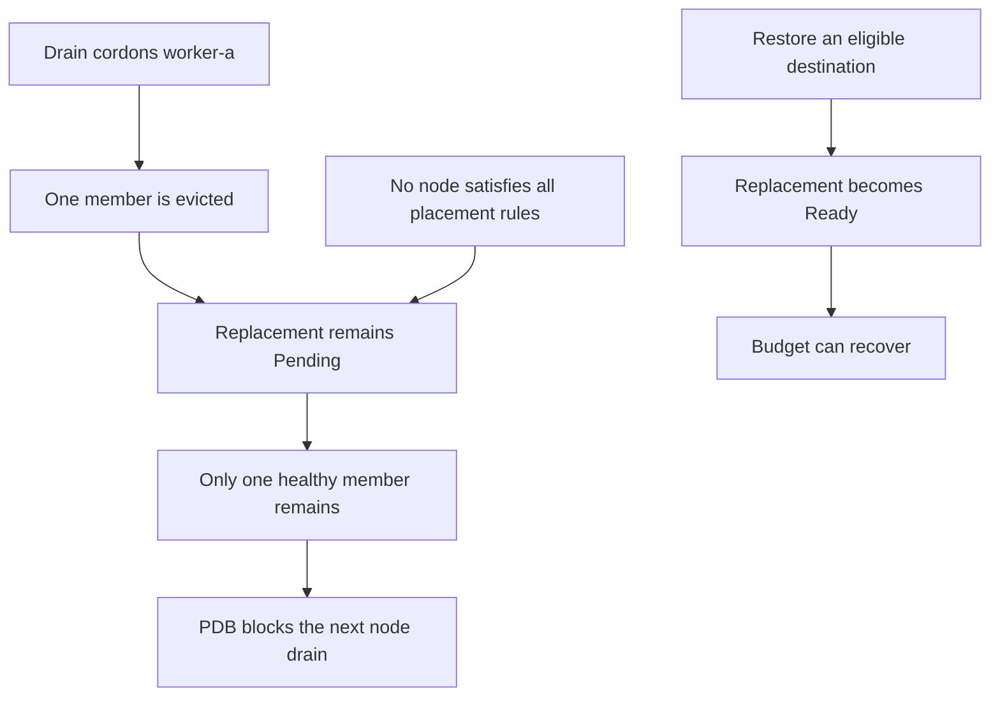

# Unblock StatefulSet Drains Stalled by Node Affinity

Author: [nawazdhandala](https://www.github.com/nawazdhandala)

Tags: Kubernetes, StatefulSet, Node Affinity, PodDisruptionBudget, Troubleshooting

Description: Find why a StatefulSet replacement stays Pending during drain, check node and volume constraints, and preview a narrow affinity repair without weakening its PDB.

A node-maintenance sequence removes one StatefulSet Pod, then cannot evict the next member. The replacement stays Pending, and the PodDisruptionBudget reports no remaining allowance. Retrying the next drain cannot fix a replacement that has no eligible node.

The recovery sequence is to restore a valid placement, let the replacement become healthy, and then continue maintenance. Keep the disruption budget in place while investigating: it may be the only thing preventing another removal before capacity recovers.

This walkthrough uses Kubernetes **1.34.0** API behavior. The examples are inspection commands and a server-side patch preview, not instructions to experiment on a production StatefulSet.

## Recognize the dependency that is blocking progress

Consider a two-replica StatefulSet named `store`, protected by `minAvailable: 1`. Its rules allow only `worker-a` and `worker-b`, with required Pod anti-affinity keeping its two members on different hosts. Anti-affinity is a scheduling rule that prevents selected Pods from sharing a placement domain, here a hostname.

After `worker-a` is cordoned and its member is evicted, one healthy member remains on `worker-b`. The replacement cannot use either original host. A third suitable node exists, but its hostname is missing from the required node-affinity list. The first drain may finish; the next drain of `worker-b` must wait for healthy capacity to recover. This example assumes one member can provide service; choose the actual floor from your application requirements.

| Node | Why the replacement cannot use it |
|---|---|
| `worker-a` | Cordoned for maintenance |
| `worker-b` | Already hosts a member excluded by required anti-affinity |
| `worker-c` | Not included in the required hostname list |



A PDB protects available capacity; it does not reserve a destination or override scheduling rules. Draining also marks the node unschedulable, which is why having the original node in the allowed list is not enough. [Safe draining](https://kubernetes.io/docs/tasks/administer-cluster/safely-drain-node/), [Disruption budgets](https://kubernetes.io/docs/concepts/workloads/pods/disruptions/)

## Confirm that the replacement is really unscheduled

Replace `staging`, `data`, `store`, and the ordinal Pod name with your environment. These commands require `kubectl`, `jq`, and read access to the workload and nodes:

```bash
kubectl --context staging -n data get pods -l app=store -o wide
kubectl --context staging -n data describe pod store-1
kubectl --context staging -n data get pod store-1 -o json |
  jq '{name: .metadata.name, uid: .metadata.uid,
    deleting: .metadata.deletionTimestamp, node: .spec.nodeName,
    phase: .status.phase, conditions: .status.conditions}'
kubectl --context staging -n data describe pdb store
```

For this scenario, expect a replacement with no assigned node and scheduling events explaining why candidates were rejected. A Pod already assigned to a node but waiting for a volume mount has a different problem. Likewise, an old Pod still terminating needs termination diagnosis before assuming the replacement exists.

The PDB's expected result after losing one of two healthy members is one current healthy Pod, one desired healthy Pod, and zero allowed disruptions. Compare its observed generation with the current specification and read its events before relying on the count. [Kubernetes 1.34 disruption controller](https://github.com/kubernetes/kubernetes/blob/v1.34.0/pkg/controller/disruption/disruption.go)

## Read the complete scheduling rule

Inspect both the existing Pod and its controller template:

```bash
kubectl --context staging -n data get pod store-1 -o json |
  jq '.spec | {nodeSelector, affinity, tolerations, topologySpreadConstraints}'
kubectl --context staging -n data get statefulset store -o json |
  jq '{updateStrategy: .spec.updateStrategy,
    placement: (.spec.template.spec |
      {nodeSelector, affinity, tolerations, topologySpreadConstraints})}'
kubectl --context staging get nodes \
  -L kubernetes.io/hostname,topology.kubernetes.io/zone,disktype
```

A `requiredDuringSchedulingIgnoredDuringExecution` rule is mandatory when placing a Pod. “Ignored during execution” does not mean optional during scheduling. A preferred rule only affects scoring among candidates that pass mandatory checks. [Node-affinity rules](https://kubernetes.io/docs/concepts/scheduling-eviction/assign-pod-node/#node-affinity)

If both `nodeSelector` and required node affinity exist, both apply. Within one affinity term, expressions are combined with AND; alternative terms are combined with OR. Also account for taints, available resources, required anti-affinity, topology rules, and any scheduler-profile restrictions. Matching one label is not a successful scheduling simulation.

For the example repair below, assume the first required expression is a hostname allowlist for `worker-a` and `worker-b`. A second expression restricts the zone to `zone-a`, and `nodeSelector` requires `disktype: ssd`. Verify that `worker-c` really meets those requirements and has sufficient free capacity. Do not relabel an unsuitable node simply to make the selector pass.

## Check the bound storage before widening placement

A PersistentVolumeClaim, or PVC, is the workload's request for storage. Its bound PersistentVolume, or PV, may impose a separate placement restriction. Inspect the actual claim and volume names from the Pod:

```bash
kubectl --context staging -n data get pod store-1 -o json |
  jq '[.spec.volumes[]? | select(.persistentVolumeClaim) |
    .persistentVolumeClaim.claimName]'
kubectl --context staging -n data get pvc data-store-1 -o yaml
kubectl --context staging get pv store-volume-1 -o json |
  jq '{nodeAffinity: .spec.nodeAffinity,
    accessModes: .spec.accessModes,
    storageClassName: .spec.storageClassName,
    csi: .spec.csi, local: .spec.local}'
```

The example names are placeholders; do not assume every StatefulSet uses this claim naming pattern. A bound volume's node affinity must also permit the destination. Local storage can tie data to a particular host, while a remote volume may have zone or driver restrictions. Editing the Pod's hostname list cannot move data or make an inaccessible disk available. [PV node affinity](https://kubernetes.io/docs/concepts/storage/persistent-volumes/#node-affinity)

If storage excludes every safe destination, stop the maintenance plan and choose a storage-aware recovery procedure. Depending on the system, that may mean restoring the original healthy node to service, provisioning compatible capacity, or performing an application-approved data migration. Do not delete the PVC or rewrite its binding to bypass the scheduler.

## Preview a narrow change to the StatefulSet template

When `worker-c` is a verified destination, save this as `affinity-preview.json`:

```json
[
  {
    "op": "test",
    "path": "/spec/template/spec/affinity/nodeAffinity/requiredDuringSchedulingIgnoredDuringExecution/nodeSelectorTerms/0/matchExpressions/0",
    "value": {
      "key": "kubernetes.io/hostname",
      "operator": "In",
      "values": ["worker-a", "worker-b"]
    }
  },
  {
    "op": "replace",
    "path": "/spec/template/spec/affinity/nodeAffinity/requiredDuringSchedulingIgnoredDuringExecution/nodeSelectorTerms/0/matchExpressions/0/values",
    "value": ["worker-a", "worker-b", "worker-c"]
  }
]
```

The first operation checks the exact expression being edited. It refuses the patch if the key, operator, values, or array ordering differs. The second expands only that expression, preserving the zone condition, `nodeSelector`, and Pod anti-affinity.

```bash
kubectl --context staging -n data patch statefulset store --type=json \
  --patch-file affinity-preview.json --dry-run=server -o yaml > preview.yaml
```

Review `preview.yaml` against the saved configuration. A successful preview proves API acceptance, not scheduling, volume attachment, or application recovery. If the test fails, inspect the new structure and prepare a matching patch; do not remove the guard. [Patch options](https://kubernetes.io/docs/reference/kubectl/generated/kubectl_patch/)

For the persistent repair, update the configuration source that owns the StatefulSet. Over time, an appropriate node-pool label can be easier to maintain than a hostname list, but changing that policy requires the same storage and placement review.

## Recover the Pending member before resuming drain

Changing the StatefulSet template does not rewrite the affinity of the existing Pending Pod. Review the update strategy and any rolling-update partition, then use the workload's controlled replacement procedure to recreate only the intended unscheduled member from the corrected template. Confirm its UID and empty `nodeName` before acting; avoid accidentally targeting a newly running replacement. [StatefulSet update behavior](https://kubernetes.io/docs/concepts/workloads/controllers/statefulset/#update-strategies)

Wait for successful placement, storage attachment, application startup, and readiness. For replicated stateful systems, also verify data synchronization and actual application health. A green container alone may not mean the member can safely carry traffic or participate in quorum.

Resume the drain only after healthy capacity and PDB allowance recover. If node maintenance must be abandoned, restore scheduling on the original node only after confirming it is safe to use. Reducing the budget, forcing deletion, or repeatedly retrying the same drain does not create the missing destination; restoring that destination is what breaks the stall.
