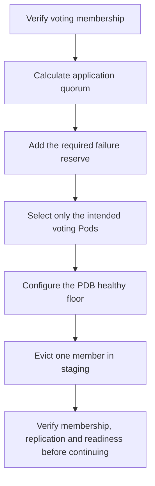

# Design a StatefulSet PDB That Preserves Quorum

Author: [nawazdhandala](https://www.github.com/nawazdhandala)

Tags: Kubernetes, PodDisruptionBudget, StatefulSet, High Availability

Description: Derive a StatefulSet disruption budget from voting membership, preserve a failure reserve during maintenance, and verify recovery beyond Kubernetes Pod readiness.

A StatefulSet gives Pods stable identities and storage relationships. It does not know how many database members must agree before a write can commit. A PodDisruptionBudget (PDB) adds a limit on covered evictions, but its healthy-Pod count is still not the same thing as the application's consensus state.

Design the budget from the application's voting membership, then verify that its selected Pods and readiness behavior represent that membership accurately. This guide uses Kubernetes v1.34.0 manifests and a majority-voting model such as etcd v3.6. Confirm your database's own quorum rules before applying the calculation to another system.

## Count voters before counting replicas

Quorum is the minimum set of members that must agree for a consensus group to make progress. For a simple majority of `N` voting members, the requirement is `floor(N / 2) + 1`. Three voters require two; five require three; seven require four. etcd documents these majority and failure-tolerance relationships. [etcd quorum guidance](https://etcd.io/docs/v3.6/faq/).

A Kubernetes replica count is not automatically the voting-member count. The application may have nonvoting learners, read replicas, witnesses, or several independent groups. In etcd, a learner is not a voting member until it has caught up and is promoted through the membership workflow. Adding a Pod alone does not complete that transition. [etcd membership changes](https://etcd.io/docs/v3.6/op-guide/runtime-configuration/).

For an etcd deployment, an operator with permission to inspect membership can use this read-only example, based on the etcdctl v3.6.0 command interface:

```bash
ENDPOINTS=https://etcd-0.internal.example:2379
CA_FILE=/path/to/cluster-ca.pem
CERT_FILE=/path/to/approved-client.pem
KEY_FILE=/path/to/approved-client-key.pem
etcdctl --endpoints="$ENDPOINTS" --cacert="$CA_FILE" --cert="$CERT_FILE" --key="$KEY_FILE" member list --write-out=table
```

Replace the endpoint and certificate paths with reviewed values; use a compatible client and trusted TLS certificates. Inspect member identities and the learner column, then map voters to their actual Pods. A successful member-list response establishes an inventory, not proof that every listed voter is healthy or communicating. Follow the application's health checks as well. [Pinned etcdctl reference](https://github.com/etcd-io/etcd/blob/v3.6.0/etcdctl/README.md#member-list).

## Choose a healthy floor above bare quorum when needed

A bare-quorum budget can leave no room for another failure during maintenance. With five voters and `minAvailable: 3`, two healthy-Pod evictions could be permitted when all five are healthy. Only three voters would remain, so another loss would remove the majority.

If maintenance should evict one member while preserving tolerance for one additional member failure, require four healthy voters after the planned eviction. That means five healthy voters before it begins and an integer PDB minimum of four.

| Voting members | Majority required | Healthy floor retaining one additional failure reserve | Initial allowance when all are healthy |
|---:|---:|---:|---:|
| 3 | 2 | 3 | 0 |
| 5 | 3 | 4 | 1 |
| 7 | 4 | 5 | 2 |

The three-member row exposes a real tradeoff: that group cannot simultaneously lose one member for maintenance and another to failure while retaining a majority. A PDB cannot manufacture an extra vote.

The seven-member row is an upper bound on eligible Pod disruptions, not a recommendation to maintain two members at once. Application policy can require stricter sequencing. Likewise, the reserve assumes one additional *member* loss; a zone failure that removes several voters is a different failure model.



## Write a budget for one verified consensus group

Assume an existing five-voter StatefulSet named `quorum-store` in `platform`. Its five Pod templates use the labels below, and the operator has confirmed all five are voting members of the same group. Save this as `quorum-pdb.yaml`:

```yaml
apiVersion: policy/v1
kind: PodDisruptionBudget
metadata:
  name: quorum-store-voters
  namespace: platform
spec:
  minAvailable: 4
  selector:
    matchLabels:
      app.kubernetes.io/name: quorum-store
      app.kubernetes.io/instance: east
      app.kubernetes.io/component: voter
```

The integer minimum makes the operating assumption explicit. It must be reviewed when membership changes. It does not automatically adapt to a new quorum after adding or removing voters. A percentage would also need review: its rounded healthy floor can change as the group size changes. [PDB configuration and rounding](https://v1-34.docs.kubernetes.io/docs/tasks/run-application/configure-pdb/).

Confirm the selector matches exactly the five intended Pods, then preview API admission:

```bash
CTX=staging-context
kubectl --context="$CTX" -n platform get pods -l 'app.kubernetes.io/name=quorum-store,app.kubernetes.io/instance=east,app.kubernetes.io/component=voter' -o wide
kubectl --context="$CTX" apply --dry-run=server -f quorum-pdb.yaml
```

A successful dry run validates the submitted object, not its quorum assumptions. Ensure another PDB does not also select these Pods. Manage labels through the operator or workload's configuration source; do not label a learner as a voter merely to improve the budget count. [Label selection](https://kubernetes.io/docs/concepts/overview/working-with-objects/labels/), [server dry-run apply](https://kubernetes.io/docs/reference/kubectl/generated/kubectl_apply/).

## Make readiness meaningful for this application

The disruption controller counts Ready Pods, excluding Pods already deleting or reserved for disruption. It does not inspect replication lag, voting membership, or whether the remaining members can communicate. [Pinned healthy-Pod calculation](https://github.com/kubernetes/kubernetes/blob/v1.34.0/pkg/controller/disruption/disruption.go).

Use the application's documented readiness checks and maintenance procedure. A listening TCP port is weak evidence of a recovered consensus member. Conversely, avoid inventing an expensive or unstable probe that causes every member to become unready during a brief election. The operator's supported probe and application diagnostics should be evaluated together.

StatefulSet `minReadySeconds` can delay rollout progression after a Pod becomes Ready. It does not add the same delay to PDB healthy counting. If recovery requires a longer catch-up period, explicitly gate the next maintenance action on the application's recovery criteria. [StatefulSet readiness timing](https://v1-34.docs.kubernetes.io/docs/concepts/workloads/controllers/statefulset/#minimum-ready-seconds).

Before maintenance, inspect both configuration and live status:

```bash
kubectl --context="$CTX" -n platform get statefulset quorum-store -o yaml
kubectl --context="$CTX" -n platform get pdb quorum-store-voters -o yaml
```

For the five-voter example, require five verified healthy members, a current observed PDB generation, `currentHealthy: 5`, `desiredHealthy: 4`, and an allowance of one before the first healthy-member eviction. A group with four healthy members has already used the reserve available for planned disruption under this policy; pause and recover it first.

## Rehearse one complete recovery cycle

In a dedicated staging group, use the Eviction API for one selected member. Observe the surviving group continuing to serve its required operations, the replacement reconnecting to the intended storage and identity, and replication catching up. Check that no new voting identity was accidentally created in place of the old member.

Do not begin the next operation merely because a Pod name reappears. Require the expected membership, healthy communication, application checks, readiness, and PDB allowance to recover. Record the duration so node-maintenance timeouts accommodate realistic recovery.

Keep rollouts and scaling separate from this eviction test. A StatefulSet rolling update deletes and recreates Pods through its own controller, so the PDB is not a general gate on that update path. Review the operator's upgrade sequencing and avoid overlapping membership changes with node maintenance. [StatefulSet update behavior](https://v1-34.docs.kubernetes.io/docs/concepts/workloads/controllers/statefulset/#rolling-updates).

Also inspect where voters and their volumes can run. Stable storage can help preserve identity, but volume attachment, zone restrictions, and lack of capacity can delay recovery. Spread voters according to the intended failure model; a Pod-count budget alone cannot preserve quorum through a correlated host or zone loss.

If the group has already lost quorum, stop treating the incident as an ordinary blocked drain. Follow the database's recovery procedure and verified backups. Removing a PDB or deleting persistent volumes does not restore the missing agreement between members.
