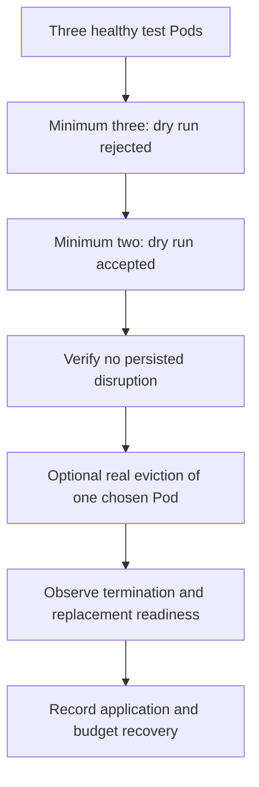

# Test a PDB Through the Eviction API Without Draining a Node

Author: [nawazdhandala](https://www.github.com/nawazdhandala)

Tags: Kubernetes, PodDisruptionBudget, Testing, High Availability

Description: Test PDB rejection, dry-run acceptance, and one controlled Pod eviction in a staging namespace while leaving other workloads on the shared node alone.

A node drain is an unnecessarily broad first test for a PodDisruptionBudget. It can attempt to evict several applications at once, making it difficult to tell which policy or workload caused the result. Instead, submit an eviction request for one explicitly selected Pod.

This guide separates three questions: does the budget reject a forbidden disruption, does the API accept an eligible request, and does the application recover from an actual eviction? Only the last question requires terminating a Pod. [API-initiated eviction](https://v1-34.docs.kubernetes.io/docs/concepts/scheduling-eviction/api-eviction/).

The request examples were exercised with Kubernetes and kubectl v1.34.0 in an isolated API-server fixture. That fixture tested admission decisions and persisted state, not application recovery or node behavior.

## Establish a bounded test workload

Use a dedicated staging namespace, `pdb-lab`, containing an existing test Deployment named `pdb-probe`. Require three healthy replicas, a stable `app: pdb-probe` Pod label, and an application-specific readiness probe. Use your reviewed, pinned application image and deployment configuration. Do not aim these examples at a production Deployment merely because it also has three replicas.

Keep the fixture steady: no rollout, autoscaling changes, parallel eviction tests, or scheduled maintenance during the experiment. Verify that exactly one PDB selects its Pods. An eviction test against a terminating, completed, or unready Pod can follow a different path from the healthy-Pod path being tested here. [Pinned eviction implementation](https://github.com/kubernetes/kubernetes/blob/v1.34.0/pkg/registry/core/pod/storage/eviction.go).

Use kubectl compatible with the cluster and jq 1.6 or later. Your identity needs read access, permission to manage the test PDB, and permission to create the `pods/eviction` subresource. Check the latter explicitly:

```bash
CTX=staging-context
NS=pdb-lab
kubectl --context="$CTX" -n "$NS" auth can-i create pods --subresource=eviction
kubectl --context="$CTX" -n "$NS" get pods -l app=pdb-probe -o wide
kubectl --context="$CTX" -n "$NS" get pdb -o yaml
```

Expect `yes` for the authorization check and three Ready, nonterminating test Pods. Authorization alone does not prove that admission policy will allow an eviction. [Authorization check reference](https://kubernetes.io/docs/reference/kubectl/generated/kubectl_auth/kubectl_auth_can-i/).

## Start with a rejection case

Save the following as `pdb-test.yaml`. It deliberately requires all three test replicas to stay healthy:

```yaml
apiVersion: policy/v1
kind: PodDisruptionBudget
metadata:
  name: pdb-probe
  namespace: pdb-lab
spec:
  minAvailable: 3
  selector:
    matchLabels:
      app: pdb-probe
```

Apply this only to the dedicated fixture, then inspect its status:

```bash
kubectl --context="$CTX" -n "$NS" apply -f pdb-test.yaml
kubectl --context="$CTX" -n "$NS" get pdb pdb-probe -o yaml
```

Before proceeding, require `status.observedGeneration` to match `metadata.generation`, `currentHealthy: 3`, `desiredHealthy: 3`, and `disruptionsAllowed: 0`. If they differ, diagnose the fixture instead of treating a timing race as a test result. [PDB status and configuration](https://v1-34.docs.kubernetes.io/docs/tasks/run-application/configure-pdb/).

Select one exact Pod name from the inventory. Capture its identity and generate a request from the captured object:

```bash
POD=replace-with-one-test-pod-name
if ! kubectl --context="$CTX" -n "$NS" get pod "$POD" -o json > pod-before.json; then
  exit 1
fi
jq -e --arg ns "$NS" --arg name "$POD" '
  select(.metadata.namespace == $ns and .metadata.name == $name)
  | select(.metadata.labels.app == "pdb-probe")
  | select(.metadata.deletionTimestamp == null and .status.phase == "Running")
  | select(any(.status.conditions[]?; .type == "Ready" and .status == "True"))
  | {
      apiVersion: "policy/v1", kind: "Eviction",
      metadata: {namespace: .metadata.namespace, name: .metadata.name},
      deleteOptions: {preconditions: {uid: .metadata.uid}}
    }
' pod-before.json > eviction.json || exit 1
```

The filter rejects the wrong namespace, label, or lifecycle state. The UID, an object's unique identifier, prevents the request from deleting a different Pod recreated under the same name. It does not freeze readiness or budget state. A resource-version precondition can additionally reject intervening object changes, but that stricter policy needs deliberate conflict handling. [Delete preconditions](https://github.com/kubernetes/apimachinery/blob/v0.34.0/pkg/apis/meta/v1/types.go), [jq manual](https://jqlang.org/manual/v1.6/).

Now submit a server dry run:

```bash
EVICTION_PATH="/api/v1/namespaces/$NS/pods/$POD/eviction"
kubectl --context="$CTX" create --raw "$EVICTION_PATH?dryRun=All" -f eviction.json
```

Expected result: an HTTP 429 error whose message identifies the PDB restriction. Verify that the Pod still has its original UID and no deletion timestamp. Record the response and PDB status together. A different error is a different test result, not a successful rejection test.

The query parameter makes this raw request a dry run. Do not assume that adding a client-side dry-run flag to an arbitrary raw request provides equivalent behavior. [kubectl raw creation](https://github.com/kubernetes/kubectl/blob/v0.34.0/pkg/cmd/create/create.go).

## Allow one disruption and repeat the dry run

Change only `minAvailable` in the test manifest from `3` to `2`, apply it again, and wait for the new generation to be observed. With all three replicas healthy, expect `desiredHealthy: 2` and `disruptionsAllowed: 1`.

Repeat the capture step to refresh `eviction.json`, then repeat the same dry-run request. Expect a successful API response, with the Pod and budget allowance unchanged afterward. Dry-run changes are not persisted. [Server dry-run semantics](https://kubernetes.io/docs/reference/using-api/api-concepts/#dry-run).

Two successful dry runs do not prove that two simultaneous real evictions are allowed. Each can observe the same unused allowance. They also do not test image pulls, replacement scheduling, startup, graceful shutdown, or application readiness.



## Perform one real eviction only when recovery is in scope

Continue only for the disposable test workload, with its owner aware that a Pod will terminate. Refresh the selected Pod snapshot and recheck health and allowance immediately beforehand. The following request **performs the eviction** because the dry-run query parameter is absent:

```bash
kubectl --context="$CTX" create --raw "$EVICTION_PATH" -f eviction.json
kubectl --context="$CTX" -n "$NS" get pods -l app=pdb-probe -o wide
kubectl --context="$CTX" -n "$NS" get pdb pdb-probe -o yaml
```

A successful response means the API accepted the eviction; it does not mean the replacement is ready. Observe the original UID terminating, a replacement UID appearing, and the replacement satisfying the real readiness probe. Track test requests or other application checks during this interval. [Deployment behavior](https://v1-34.docs.kubernetes.io/docs/concepts/workloads/controllers/deployment/), [readiness probes](https://kubernetes.io/docs/tasks/configure-pod-container/configure-liveness-readiness-startup-probes/).

Pass the recovery stage only when the Deployment has three nonterminating Ready replicas again, application checks pass, and the PDB has recovered to the expected healthy count and allowance. Record the elapsed time and compare it with your maintenance window. A replacement may run on the same node because this procedure never cordons it; node-relocation testing is a separate exercise.

## Interpret failures without bypassing the test

| Result | Interpretation and next action |
|---|---|
| 403 Forbidden | Fix test identity permissions or admission restrictions; do not count it as PDB enforcement |
| 404 Not Found or UID conflict | Refresh the inventory and identify what changed; do not blindly retry a stale request |
| 429 with a budget restriction | Compare health, observed generation, and outstanding disruptions with the intended test stage |
| Error describing multiple PDBs | Repair fixture selector overlap before testing allowances |
| Eviction accepted but replacement stays Pending or unready | Investigate capacity, scheduling, startup, and readiness; API acceptance alone did not pass recovery |

Keep the original manifests, snapshots, responses, and recovery timings as evidence. Restore the fixture's reviewed policy afterward. Never use direct Pod deletion or a fail-open policy change to make an eviction acceptance test appear successful.
