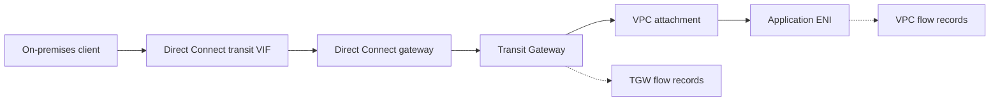

# Trace Direct Connect Traffic with TGW and VPC Flow Logs

Author: [nawazdhandala](https://www.github.com/nawazdhandala)

Tags: AWS, Direct Connect, Networking, Troubleshooting, Observability

Description: Correlate a Direct Connect application flow across Transit Gateway and VPC logs using exact field formats, attachment IDs, and careful evidence checks.

An application timeout does not identify where packets stopped. Direct Connect can have an established BGP session while a Transit Gateway route, VPC security rule, or application listener prevents the request from succeeding.

Flow logs help narrow the search by recording observations at different points. This guide follows an on-premises client through a transit VIF, Direct Connect gateway, **Transit Gateway**, abbreviated TGW, and destination VPC. It does not apply the TGW steps to a private VIF connected only to a virtual private gateway.

The examples use explicit custom log formats and CloudWatch Logs Insights queries. A read-only inventory command was reviewed against **AWS CLI 2.42.1**. Local fixtures checked field alignment and flow selection; no AWS queries or network traffic were executed.

## Start with the actual path

Map the TGW attachment associated with the Direct Connect gateway and the attachment for the destination VPC. Also identify the application's **elastic network interface**, or ENI. An ENI is a virtual network card, and its flow logs provide a different observation point from the TGW attachment logs.



AWS describes [TGW flow visibility for Direct Connect traffic](https://aws.amazon.com/blogs/networking-and-content-delivery/introducing-vpc-flow-logs-for-aws-transit-gateway/) at the gateway or individual attachment level. These records do not inspect the physical fiber or replace on-premises router evidence.

If the path includes a load balancer, firewall appliance, proxy, or address translation, draw those additional hops. A proxy creates another connection; it is not necessarily the same five-tuple all the way to the application.

## Confirm collection before interpreting absence

Coordinate with the TGW owner and VPC owner to enable the relevant subscriptions. For this workflow, publish to separate CloudWatch log groups and capture both accepted and rejected traffic on the VPC subscription. Follow AWS's [TGW CloudWatch creation procedure](https://docs.aws.amazon.com/vpc/latest/tgw/flow-logs-cwl-create-flow-log.html), including its delivery-role permissions. Choose retention and a collection scope appropriate to the investigation.

Inspect each known flow-log ID with a profile allowed to describe it:

```bash
aws ec2 describe-flow-logs \
  --profile network-readonly --region us-east-1 \
  --flow-log-ids fl-REPLACE_ME \
  --query 'FlowLogs[].{ID:FlowLogId,Resource:ResourceId,State:FlowLogStatus,Delivery:DeliverLogsStatus,Error:DeliverLogsErrorMessage,Destination:LogDestination,Group:LogGroupName,Format:LogFormat}' \
  --output json --no-cli-pager
```

Replace the Region, profile, and flow-log ID. The [API response](https://docs.aws.amazon.com/cli/latest/reference/ec2/describe-flow-logs.html) separates subscription state from delivery status and delivery errors. A subscription that exists but cannot publish records is not useful evidence of network silence.

Flow logs are delayed, aggregated observations. Allow collection and delivery time and select a query window wider than the test. Check `log-status`: `SKIPDATA` means coverage is incomplete. AWS documents [VPC logging exclusions](https://docs.aws.amazon.com/vpc/latest/userguide/flow-logs-limitations.html), including traffic to the Amazon DNS server, so these logs cannot explain every missing dependency.

## Use known field orders

The queries below require these exact custom formats. Configure them when creating an investigation subscription, or adapt the parser to an existing format. Do not silently point the parser at default records with a different field order. Existing VPC flow-log formats cannot be edited in place; preserve an operational subscription while arranging any replacement.

For the TGW subscription, use this single-line format:

```text
${tgw-id} ${tgw-attachment-id} ${tgw-pair-attachment-id} ${srcaddr} ${dstaddr} ${srcport} ${dstport} ${protocol} ${start} ${end} ${log-status} ${packets-lost-no-route} ${packets-lost-blackhole} ${packets-lost-mtu-exceeded} ${packets-lost-ttl-expired} ${flow-direction}
```

The [TGW field reference](https://docs.aws.amazon.com/vpc/latest/tgw/tgw-flow-logs.html) defines attachment IDs, directions, timestamps, and packet-loss counters. The paired attachment identifies the other side according to flow direction. TGW records do not have the VPC `action` field.

For the application's VPC/ENI subscription, use:

```text
${interface-id} ${srcaddr} ${dstaddr} ${srcport} ${dstport} ${protocol} ${start} ${end} ${action} ${log-status} ${pkt-srcaddr} ${pkt-dstaddr} ${tcp-flags} ${flow-direction}
```

The [VPC field reference](https://docs.aws.amazon.com/vpc/latest/userguide/flow-log-records.html) distinguishes interface-level addresses from packet-level addresses. Preserve both when intermediate devices are involved. A dash means a value was unavailable or not applicable; it should not be converted into a success or a zero-loss assertion.

## Run one identifiable connection

Choose an approved application health request with a known destination. Record the UTC start/end time, resolved destination IP, client IP as seen on the relevant segment, protocol, and both ports. The five-tuple is source IP, destination IP, source port, destination port, and protocol.

For illustration, the following queries use client `10.20.1.10:51514` and server `10.80.2.25:443` over TCP, protocol number `6`. Replace every value with the observed test connection. Do not assume the operating system will choose the example source port.

In Logs Insights, select only the TGW log group and an appropriate time window:

```text
fields @timestamp, @message
| parse @message "* * * * * * * * * * * * * * * *" as tgId, attachment, paired, src, dst, sport, dport, proto, startS, endS, status, noRoute, blackhole, mtu, ttl, direction
| filter proto = "6" and (
    (src = "10.20.1.10" and dst = "10.80.2.25" and sport = "51514" and dport = "443") or
    (src = "10.80.2.25" and dst = "10.20.1.10" and sport = "443" and dport = "51514"))
| sort @timestamp asc
| display startS, endS, attachment, paired, direction, status, noRoute, blackhole, mtu, ttl
| limit 100
```

This uses the documented [glob parser](https://docs.aws.amazon.com/AmazonCloudWatch/latest/logs/CWL_QuerySyntax-Parse.html) and [Boolean filtering](https://docs.aws.amazon.com/AmazonCloudWatch/latest/logs/CWL_QuerySyntax-Filter.html). Each wildcard corresponds to one alias. Inspect raw messages first if the query returns nothing, because a format mismatch prevents fields from being extracted.

Run the corresponding query separately against the VPC log group:

```text
fields @timestamp, @message
| parse @message "* * * * * * * * * * * * * *" as eni, src, dst, sport, dport, proto, startS, endS, decision, status, packetSrc, packetDst, flags, direction
| filter proto = "6" and (
    (src = "10.20.1.10" and dst = "10.80.2.25" and sport = "51514" and dport = "443") or
    (src = "10.80.2.25" and dst = "10.20.1.10" and sport = "443" and dport = "51514"))
| sort @timestamp asc
| display startS, endS, eni, direction, decision, status, packetSrc, packetDst, flags
| limit 100
```

This second query assumes those addresses are visible at the application ENI. If translation changes them, use the mapped tuple for that segment and correlate with the translation device's evidence. Packet-level fields help explain address differences, but they are not a universal record of every earlier translation.

## Turn records into a bounded conclusion

| Observation | Next investigation |
| --- | --- |
| TGW `noRoute` is nonzero | Inspect the relevant attachment's routing configuration and destination coverage |
| TGW `blackhole` is nonzero | Check intentional blackhole routes and whether the selected path matches the design |
| TGW `mtu` or `ttl` is nonzero | Investigate packet size or routing loops, respectively |
| Destination ENI shows `REJECT` | Examine security groups, network ACLs, and connection timing |
| Destination ENI shows `ACCEPT` but no useful response | Inspect listener, host firewall, application, TLS, and return path |
| No matching record | Verify collection, time window, parser, tuple, and intervening translation before blaming routing |

These counters and decisions describe their observation points, not a complete packet trace. TCP flags can be combined during aggregation, so they are not an ordered handshake transcript. Use application logs or an approved packet capture when sequence or payload evidence is required.

Save the raw records, attachment map, collection settings, test tuple, and application result together. After correcting one issue, repeat the same controlled test and compare both directions. That gives the next operator a reproducible finding instead of a screenshot of an established BGP session.
