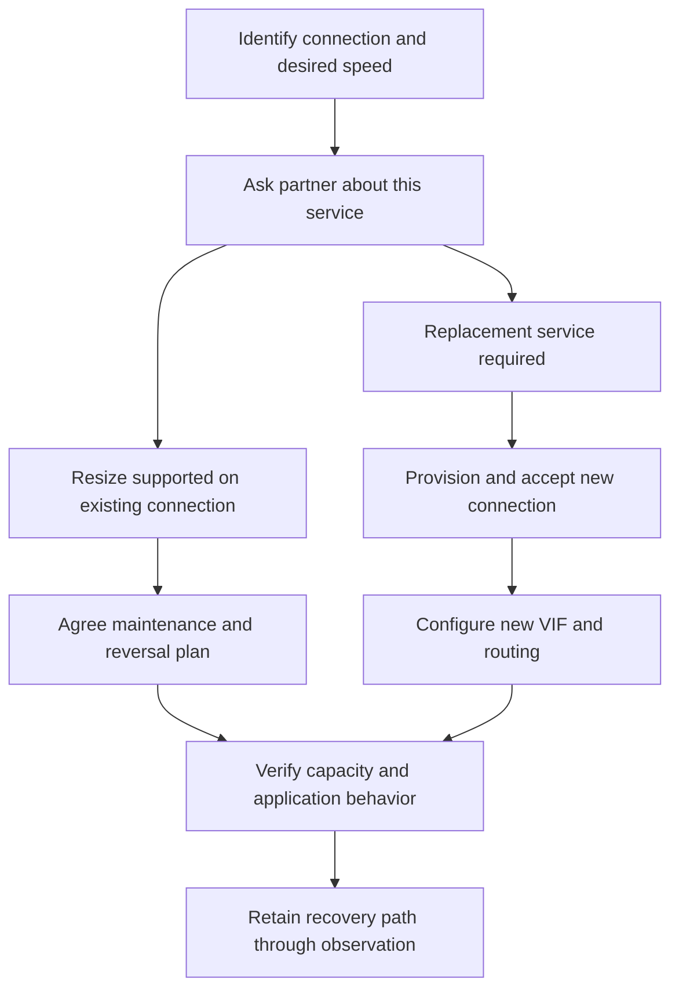

# Upgrade a Hosted Direct Connect Connection: Resize or Replace?

Author: [nawazdhandala](https://www.github.com/nawazdhandala)

Tags: AWS, Direct Connect, Networking, Performance, Routing

Description: Decide whether a partner can resize your hosted Direct Connect connection, prepare replacement when needed, and verify capacity without losing a recovery path.

Your hosted Direct Connect connection reaches its capacity during the nightly backup. The application team wants more bandwidth, but the AWS console does not offer a speed selector. That does not automatically mean you must delete the connection.

AWS allows a Direct Connect Partner to upgrade or downgrade an existing hosted connection when the partner supports that operation. The customer cannot change its speed directly. Ask the partner about the specific connection and target size before planning a replacement. This distinction is documented in the [hosted connection guide](https://docs.aws.amazon.com/directconnect/latest/UserGuide/hosted_connection.html).

Treat the upgrade as a change to an end-to-end service: AWS allocation, partner transport, customer handoff, router capacity, and routing all matter.

## Establish what is being upgraded

A hosted connection is provisioned by a partner for your AWS account. A hosted virtual interface, or VIF, is a different resource: an interface allocated to another account on an existing connection. Confirm that the service order refers to the actual hosted connection, with a `dxcon-...` ID. The [connection overview](https://docs.aws.amazon.com/directconnect/latest/UserGuide/WorkingWithConnections.html) describes the connection ownership model.

The ordinary Direct Connect `update-connection` API changes the connection name or MACsec encryption mode. It has no bandwidth request field. A `bandwidth` value in a response is descriptive, not evidence that the same field can be updated. Do not construct an invented resize command from response output. See [UpdateConnection](https://docs.aws.amazon.com/directconnect/latest/APIReference/API_UpdateConnection.html).

Here is the decision to make with your partner:



An in-place resize can reduce migration work, but do not translate that into a promise of zero interruption. The partner must describe its implementation and maintenance requirements.

## Capture a baseline before requesting the change

Use an authenticated AWS CLI profile in the account that owns the hosted connection. Replace the IDs and Region below. Examples are checked against the [AWS CLI 2.42.1 model](https://github.com/aws/aws-cli/blob/2.42.1/awscli/botocore/data/directconnect/2012-10-25/service-2.json), not executed against a live circuit.

```bash
aws directconnect describe-connections \
  --profile network-change --region us-east-1 \
  --connection-id dxcon-EXISTING \
  --query 'connections[].{Id:connectionId,Owner:ownerAccount,State:connectionState,Bandwidth:bandwidth,Location:location,Partner:partnerName,Provider:providerName,Vlan:vlan,Jumbo:jumboFrameCapable}' \
  --output json --no-cli-pager
```

This [read-only call](https://docs.aws.amazon.com/cli/latest/reference/directconnect/describe-connections.html) records the AWS view of the connection. Compare it with the provider order. A missing optional partner field does not establish that the service is dedicated; use the actual provisioning records.

Inspect the attached VIF as well:

```bash
aws directconnect describe-virtual-interfaces \
  --profile network-change --region us-east-1 \
  --connection-id dxcon-EXISTING \
  --query 'virtualInterfaces[].{Vif:virtualInterfaceId,Type:virtualInterfaceType,Vlan:vlan,Mtu:mtu,State:virtualInterfaceState,Gateway:directConnectGatewayId,VirtualGateway:virtualGatewayId,Peers:bgpPeers[].{Family:addressFamily,Status:bgpStatus}}' \
  --output json --no-cli-pager
```

The projection omits authentication keys. Preserve the full router configuration separately through your secure configuration-backup process. Record which IPv4 and IPv6 sessions are up, expected routes, application latency, and the backup path's available capacity. See [describe-virtual-interfaces](https://docs.aws.amazon.com/cli/latest/reference/directconnect/describe-virtual-interfaces.html).

A useful baseline covers the busy period, not just an idle afternoon. A backup that completes in 40 minutes with occasional errors is a different starting point from a stable backup limited only by bandwidth.

## Ask the partner for a concrete change plan

Send the connection ID and requested capacity, then settle these points:

| Question | Why it changes the plan |
| --- | --- |
| Can this exact service be resized in place? | Determines whether a new connection and VIF are needed |
| Will the connection ID, VLAN, handoff, or routing change? | Identifies configuration that must be rebuilt |
| What interruption or BGP reset should we expect? | Determines the maintenance window and failover preparation |
| Is capacity available across the full partner path? | Prevents buying a larger AWS allocation behind a smaller circuit |
| What is the reversal process and lead time? | Establishes whether rollback is immediate or another service order |
| When do new and overlapping charges begin? | Prevents premature deletion merely to stop duplicate billing |

AWS's currently documented hosted sizes run from 50 Mbps to 25 Gbps, with specific partner and location requirements for higher capacities. Check availability for your location; a listed AWS size is not a promise that your provider offers it. See [connection options](https://docs.aws.amazon.com/directconnect/latest/UserGuide/connection_options.html).

For example, moving from 500 Mbps to 2 Gbps does not make a 1 Gbps customer handoff carry 2 Gbps. Check interface speed, router forwarding capacity, firewall inspection, encryption overhead, and traffic shaping across your own network before blaming AWS for the shortfall.

## Follow the selected change path

For an in-place resize, retain the existing configuration unless the agreed plan says otherwise. Move traffic to a proven alternate path when required, let the partner complete the change, and repeat the connection and VIF inspections. Confirm the reported bandwidth and compare all fields that were supposed to remain unchanged. Stop if an unexplained VLAN or destination change appears.

For a replacement, request the new service while retaining the old one when the provider and your capacity allow it. Inspect the new connection's account, location, bandwidth, and VLAN before accepting it. Acceptance is a real change, not a connectivity test:

```bash
aws directconnect confirm-connection \
  --profile network-change --region us-east-1 \
  --connection-id dxcon-NEW-APPROVED \
  --output json --no-cli-pager
```

The partner-created connection initially waits for owner confirmation. The [confirm operation](https://docs.aws.amazon.com/cli/latest/reference/directconnect/confirm-connection.html) performs that acceptance; it does not create a working VIF or configure your router.

Build the required private, public, or transit VIF and gateway path using the approved design. A hosted connection supports only **one VIF**, so you cannot assume that a second migration interface can coexist on the original hosted connection. Review the [VIF quota](https://docs.aws.amazon.com/directconnect/latest/UserGuide/limits.html) and [interface prerequisites](https://docs.aws.amazon.com/directconnect/latest/UserGuide/WorkingWithVirtualInterfaces.html).

Introduce routes with deliberate preferences. Verify both traffic directions before moving production load. Keep the old connection available through the observation period instead of deleting it as soon as the new BGP session establishes.

## Prove the new capacity without confusing metrics

AWS polices hosted traffic at the configured rate, and the partner must also police the allocated capacity. Policing drops excess traffic; it does not patiently queue every burst. This makes a paced transfer more informative than an uncontrolled burst test. See the [hosted allocation contract](https://docs.aws.amazon.com/directconnect/latest/APIReference/API_AllocateHostedConnection.html).

Use a controlled transfer between endpoints you own, with an agreed traffic ceiling. Test each direction, application completion time, errors, and impact on other services. Increase load gradually within the maintenance plan. An application or disk bottleneck can prevent a transfer from reaching the network limit.

For the relevant VIF, discover the actual CloudWatch series rather than assuming dedicated-port metrics describe a hosted allocation:

```bash
aws cloudwatch list-metrics \
  --profile network-change --region us-east-1 \
  --namespace AWS/DX --metric-name VirtualInterfaceBpsIngress \
  --dimensions Name=VirtualInterfaceId,Value=dxvif-APPROVED \
  --query 'Metrics[].{Metric:MetricName,Dimensions:Dimensions}' \
  --output json --no-cli-pager
```

Keep the full returned dimensions when retrieving the series. AWS ingress means traffic entering AWS. Also inspect the egress direction and customer-router counters. [Direct Connect metrics](https://docs.aws.amazon.com/directconnect/latest/UserGuide/monitoring-cloudwatch.html) use aggregated intervals, so pair them with application measurements when diagnosing short bursts. The [list-metrics command](https://docs.aws.amazon.com/cli/latest/reference/cloudwatch/list-metrics.html) discovers series; it does not return throughput samples.

If a transfer remains at the old ceiling, check partner completion, customer shaping, and handoff limits before repeatedly resetting BGP. If the new connection is unstable, use the agreed recovery path and leave the old service intact.

Close the upgrade only after the busy-period workload meets its acceptance conditions, failover still works, and monitoring uses the new capacity denominator. Then coordinate retirement and billing with the provider. AWS [pricing](https://aws.amazon.com/directconnect/pricing/pay-as-you-go/) and the partner contract are separate parts of that final review.
