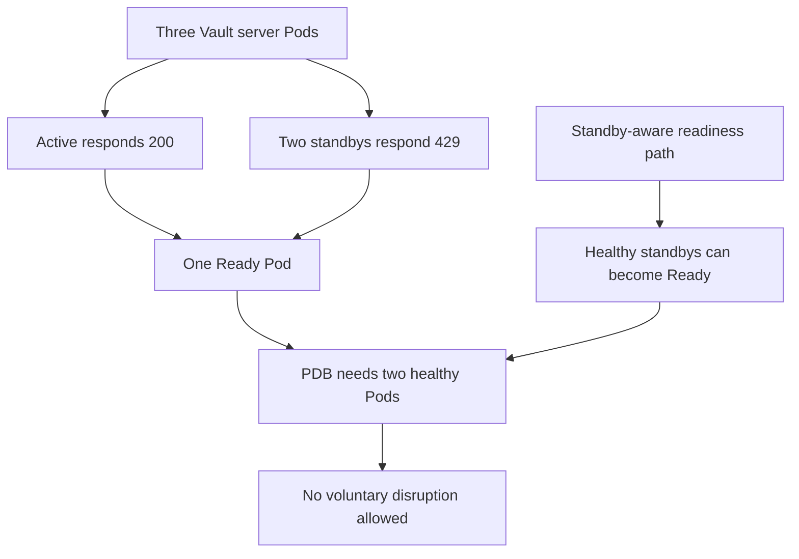

# Fix Vault Standby Readiness That Exhausts a PDB

Author: [nawazdhandala](https://www.github.com/nawazdhandala)

Tags: Kubernetes, Vault, Helm, PodDisruptionBudget, OpenShift

Description: Diagnose healthy Vault standbys marked unready, correct the Helm health-probe path, and restore meaningful disruption allowance without hiding sealed nodes.

A three-node Vault cluster has one active server and two unsealed standbys. All three appear healthy from Vault's perspective, but Kubernetes reports only one Ready Pod. A PodDisruptionBudget allows one unavailable replica, so node maintenance cannot proceed.

The budget may be doing exactly what it should. If the readiness probe treats a healthy standby response as failure, Kubernetes has already counted two unavailable Pods. Increasing the disruption allowance would hide the disagreement rather than repair it.

This guide uses the official Vault Helm chart **0.32.0**, whose application version is **Vault 1.21.2**, and Kubernetes **1.34** behavior. It addresses the HTTP readiness path, particularly the chart's OpenShift values overlay. [Pinned chart metadata](https://github.com/hashicorp/vault-helm/blob/v0.32.0/Chart.yaml)

## Connect the health response to the budget

Vault's `/v1/sys/health` endpoint describes server state through both JSON and an HTTP status. With default status settings:

| Server state | Default response | Ready with an ordinary HTTP probe? |
|---|---:|---|
| Active and healthy | 200 | Yes |
| Ordinary standby | 429 | No |
| Performance standby | 473 | No |
| Sealed | 503 | No |
| Not initialized | 501 | No |

A sealed Vault cannot access its protected data until it is unsealed. A standby, by contrast, can be a healthy member of a high-availability cluster. The endpoint's status is not simply a universal healthy/unhealthy boolean. [Vault health API](https://developer.hashicorp.com/vault/api-docs/system/health)

Kubernetes accepts HTTP probe responses from 200 through 399. Readiness failure removes the Pod's Ready status; it does not itself restart the container. Liveness is a separate probe with a different purpose. [Kubernetes probe behavior](https://kubernetes.io/docs/tasks/configure-pod-container/configure-liveness-readiness-startup-probes/)



For three expected replicas and `maxUnavailable: 1`, the desired healthy count is two. If only the active Pod is Ready, the controller sets disruption allowance to zero. [Kubernetes 1.34 disruption calculation](https://github.com/kubernetes/kubernetes/blob/v1.34.0/pkg/controller/disruption/disruption.go)

## Inspect the running probe before editing values

Replace the example context, namespace, release, and Pod names. These reads require `kubectl`, `jq`, and access to the Vault namespace:

```bash
kubectl --context staging -n vault get pod vault-1 -o json |
  jq '.spec.containers[] | select(.name == "vault") | .readinessProbe'
kubectl --context staging -n vault describe pod vault-1
kubectl --context staging -n vault get pdb vault -o json |
  jq '{spec, generation: .metadata.generation, status}'
```

Look for an HTTP probe, its exact path, and events reporting `429`. Check that the PDB actually selects the Vault server Pods and that its observed generation is current.

Chart 0.32.0 normally chooses an executable readiness check when no path is configured. Its OpenShift overlay instead supplies `/v1/sys/health?uninitcode=204`. That path does not accept ordinary standby responses, and it treats an uninitialized response as successful. The reported OpenShift failure used this chart version. [OpenShift overlay](https://github.com/hashicorp/vault-helm/blob/v0.32.0/values.openshift.yaml), [Chart issue](https://github.com/hashicorp/vault-helm/issues/1173)

Do not assume the base values are what the Pod received. Later values files, GitOps overrides, and command-line settings can change the rendered path. [Readiness template](https://github.com/hashicorp/vault-helm/blob/v0.32.0/templates/server-statefulset.yaml)

## Verify one standby directly

Use a known unsealed standby, not a load-balanced Service that might select the active node. For a TLS-enabled installation, start a loopback-only port forward in a separate terminal:

```bash
kubectl --context staging -n vault port-forward --address 127.0.0.1 \
  pod/vault-1 18200:8200
```

Keep that terminal open during the check. In another terminal, use the actual DNS name covered by the Pod's server certificate and the issuing CA bundle. A certificate authority, or CA, is the issuer that your client trusts.

```bash
vault_host='vault-1.vault-internal.vault.svc'
for query in '' '?standbyok=true'; do
  curl --silent --show-error --cacert ./vault-ca.pem \
    --resolve "${vault_host}:18200:127.0.0.1" \
    --write-out '\nHTTP %{http_code}\n' \
    "https://${vault_host}:18200/v1/sys/health${query}"
done
```

`--resolve` connects to the local forward while retaining the certificate hostname check. The CA file and hostname are placeholders for your environment. No Vault token is needed for this health request. Stop the forward afterward. [Port forwarding](https://kubernetes.io/docs/tasks/access-application-cluster/port-forward-access-application-cluster/), [curl TLS and name-resolution options](https://curl.se/docs/manpage.html)

For an ordinary healthy standby, expect the first response to be `429` and the second `200`, with JSON still reporting `standby: true` and `sealed: false`. The parameter changes the response classification; it does not promote the node. A certificate error, sealed state, or unhealthy high-availability connection needs its own repair. [Vault 1.21.2 health implementation](https://github.com/hashicorp/vault/blob/v1.21.2/http/sys_health.go)

## Render a narrow values correction

Save this as `readiness-fix.yaml`:

```yaml
server:
  readinessProbe:
    enabled: true
    path: "/v1/sys/health?standbyok=true"
```

This deliberately omits `uninitcode=204` and any successful sealed-status override. It accepts ordinary standbys while leaving those other failure states visible. If your Enterprise deployment deliberately counts performance standbys as ready capacity, review adding `&perfstandbyok=true`; `standbyok` alone does not cover them. Do not automatically treat disaster-recovery secondaries as ordinary serving capacity. [Health parameters](https://developer.hashicorp.com/vault/api-docs/system/health#parameters)

Here is a local rendering exercise with Helm 3.17.3. It downloads the pinned chart and renders only the StatefulSet and server PDB:

```bash
helm pull vault --repo https://helm.releases.hashicorp.com \
  --version 0.32.0 --untar --untardir ./charts
helm template vault ./charts/vault --namespace vault --kube-version 1.34.0 \
  -f ./charts/vault/values.openshift.yaml \
  --set server.ha.enabled=true --set server.ha.replicas=3 \
  --set global.tlsDisable=false \
  -f readiness-fix.yaml \
  --show-only templates/server-statefulset.yaml \
  --show-only templates/server-disruptionbudget.yaml > review.yaml
```

These flags make a rendering fixture, not a complete Vault installation: it does not provide your TLS listener configuration, mounted certificates, storage, or seal setup. For deployment, retain your approved environment values and add the readiness correction after the overlay that sets the old path. [Helm pull](https://helm.sh/docs/helm/helm_pull/), [Helm template](https://helm.sh/docs/helm/helm_template/)

In `review.yaml`, verify the Vault container has the corrected HTTP path, the intended port and scheme, and the existing timing settings. The example renders three replicas and PDB `maxUnavailable: 1`. Check that unrelated settings have not changed. The probe's HTTPS scheme is not proof of client certificate trust: Kubernetes HTTP probes do not verify the server certificate, which is why the separate verified TLS check matters. [HTTP probe details](https://kubernetes.io/docs/tasks/configure-pod-container/configure-liveness-readiness-startup-probes/#http-probes)

## Roll out the probe through a controlled Vault restart

The pinned chart defaults to StatefulSet update strategy `OnDelete`. Updating its Pod template therefore does not automatically replace existing Pods. Inspect both the template and each running Pod's probe after the configuration change. [Chart update-strategy setting](https://github.com/hashicorp/vault-helm/blob/v0.32.0/values.yaml)

Use the established Vault maintenance procedure to replace one verified standby at a time. Before each replacement, check actual storage health, quorum where applicable, the active server, and unseal readiness. Wait for the replacement to join and become genuinely healthy before touching another member. If the current budget blocks that operation, coordinate a controlled maintenance exception with the Vault owner; a bulk Pod deletion is not a readiness repair.

Acceptance requires more than a successful Helm update. All intended healthy members should become Ready, the PDB should reflect its current generation, and its healthy count should match the observed Pods. In the healthy three-member example, expect two desired healthy Pods and one allowed disruption. Confirm normal client operations as well. Leave sealed, uninitialized, and otherwise degraded members visibly unhealthy, so the restored budget continues to protect the cluster during the next real failure.
