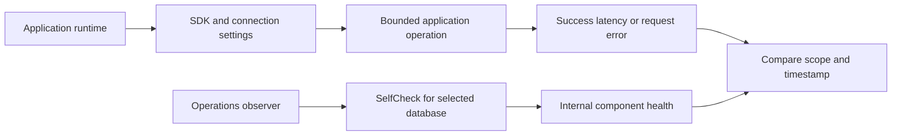

# Separate YDB Application Checks from Cluster SelfCheck

Author: [nawazdhandala](https://www.github.com/nawazdhandala)

Tags: Database, Monitoring, Troubleshooting, Reliability

Description: Distinguish YDB request-path failures from database health reports, inspect SelfCheck results correctly, and design useful application probes.

Your application reports database timeouts, while YDB's health report says `GOOD`. Alternatively, queries still succeed while SelfCheck reports `DEGRADED`. Neither observation automatically means a monitoring tool is wrong. They answer different questions.

An application check asks whether a particular client can complete a particular operation now. SelfCheck asks what YDB's internal diagnostic system knows about the selected database and its components. Keep both signals, record their scope and time, and use their disagreement to guide investigation.

The examples use **YDB CLI 2.35.0** flags checked against the installed binary, with response semantics and implementation reviewed in **YDB 26.2.1.16** source. No live database health request was made for this article.

## Start with two separate contracts

| Check | Evidence it can provide | What it cannot establish alone |
| --- | --- | --- |
| Open a network connection | A listener is reachable | Authentication or query success |
| Run a constant query | A client can execute that query | Access to an application table |
| Read a known row | That identity can read that object through that client path | Every table, write operation, or replica is healthy |
| SelfCheck | Internal health observations for the requested scope | The application's credentials, network, or business transaction works |

YDB documents [endpoint and database path](https://ydb.tech/docs/en/concepts/connect) as distinct connection settings. Two checks can reach the same host but select different databases. Record the full database path, client location, credential identity, TLS trust configuration, and request deadline with each result.



Use the actual application SDK and connection pool for the production request-path probe. A separate CLI command is valuable for diagnosis, but it cannot prove that an application's pool, discovery cache, or credential refresh is working.

## Make an application check meaningful and small

Choose a bounded operation that represents an essential dependency. For a read service, a point lookup in a small table can be sufficient. For a writer, a successful read does not establish write availability; design a controlled write/read check in a dedicated namespace if that capability must be monitored.

For this diagnostic example, assume an administrator has prepared `health_probe` with an Utf8 primary key `probe_id`, an Utf8 `status` column, and a stable row whose key is `reader` and value is `ready`. The application identity must have intentionally granted read access. Do not add broad privileges merely to turn the probe green.

Save this as `probe.sql`:

```sql
SELECT status
FROM health_probe
WHERE probe_id = 'reader'u;
```

The equality predicate uses the complete assumed primary key. The expected result is one row containing `ready`; an empty result is a failed fixture check, even if the query executed successfully. The query shape follows YDB's [SELECT reference](https://ydb.tech/docs/en/yql/reference/syntax/select/).

Run it from the application's network environment using a preconfigured `app-probe` profile that selects the intended database and authentication method:

```bash
ydb --profile app-probe sql --file probe.sql
```

The [CLI connection documentation](https://ydb.tech/docs/en/reference/ydb-cli/connect) explains profile selection and TLS CA configuration. Keep passwords and tokens in the supported credential mechanism rather than command arguments or captured output.

For a scheduled application probe, measure the whole operation, including pool acquisition and permitted retries, against an explicit time budget. Record error categories and retry counts. YDB's [error-handling guidance](https://ydb.tech/docs/en/reference/ydb-sdk/error_handling) distinguishes temporary failures from invalid operations and warns against endless retries. A probe that eventually succeeds after a minute can still violate a service that needs responses within a second.

## Collect SelfCheck as a diagnostic report

Use a separate operations profile, `ops-health`, configured for the same database and an identity permitted to call the monitoring service. From an appropriate observer location:

```bash
ydb --profile ops-health monitoring healthcheck \
  --timeout 10000 --format json > selfcheck.json
```

The [CLI healthcheck reference](https://ydb.tech/docs/en/reference/ydb-cli/commands/monitoring-healthcheck) documents the JSON output. The plain numeric timeout is milliseconds; the local CLI help also accepts duration suffixes. It bounds the healthcheck request, not every operation your application might perform.

If the command fails, retain its error separately and mark the collection attempt as failed. An empty or missing file is not a healthy report. Do not reuse yesterday's file as evidence that the current database is fine.

A successful command is also not sufficient. In the [tagged CLI implementation](https://github.com/ydb-platform/ydb/blob/26.2.1.16/ydb/public/lib/ydb_cli/commands/ydb_service_monitoring.cpp), successfully printing a valid JSON response returns success without requiring the reported health to be `GOOD`. Parse the response field as well as checking the command outcome.

## Read the status without hiding unknown results

The [Health Check API](https://ydb.tech/docs/en/reference/ydb-sdk/health-check-api) defines four meaningful overall outcomes:

| Outcome | Operational interpretation |
| --- | --- |
| `GOOD` | No issues were detected by this check |
| `DEGRADED` | A subsystem has degraded, while the database still functions |
| `MAINTENANCE_REQUIRED` | Significant degradation needs human attention |
| `EMERGENCY` | Complete or partial unavailability has been detected |

For a simple report gate, save this Python 3 helper as `check-selfcheck.py` and run it **only after the collection command succeeds**:

```python
import json
import sys
from pathlib import Path

known = {"GOOD", "DEGRADED", "MAINTENANCE_REQUIRED", "EMERGENCY"}
try:
    report = json.loads(Path("selfcheck.json").read_text())
    status = report.get("self_check_result") if isinstance(report, dict) else None
    if not isinstance(status, str) or status not in known:
        raise ValueError("Missing or unknown self_check_result")
except (OSError, ValueError) as error:
    print(f"UNKNOWN: {error}", file=sys.stderr)
    raise SystemExit(2)

print(status)
raise SystemExit(0 if status == "GOOD" else 1)
```

This helper reports `0` for GOOD, `1` for a recognized non-GOOD result, and `2` when it cannot interpret the report. These are the helper's exit-code conventions, not YDB server status codes. A missing field, `UNSPECIFIED`, or a future enum value must not silently become healthy. The [response schema](https://github.com/ydb-platform/ydb/blob/26.2.1.16/ydb/public/api/protos/ydb_monitoring.proto) is the source of those enum names.

Inspect `issue_log` when the overall result needs attention. Its `reason` references connect parent issues to more specific issues by ID. Preserve that hierarchy rather than counting each parent and child as a separate outage.

## Use disagreements to narrow the next step

If the application fails while SelfCheck is GOOD, compare client-side DNS, TLS trust, database path, authentication, table permissions, discovery reachability, pool pressure, and query deadlines. These are investigation branches, not a claim that every failure must be outside YDB.

If the application succeeds while SelfCheck is DEGRADED, keep serving according to your service policy while investigating the reported component. One successful point read does not cancel a storage warning or establish that the next failure is tolerable.

If both fail, correlate timestamps and issue locations, then investigate shared dependencies. If only the observer cannot collect SelfCheck, distinguish a monitoring-path failure from a reported database failure.

Keep application availability alerts and internal degradation alerts separate. Avoid restarting every application instance merely because a shared database reports degradation; restarting clients does not repair a storage group. Likewise, use the documented cache behavior deliberately: the [SelfCheck request schema](https://github.com/ydb-platform/ydb/blob/26.2.1.16/ydb/public/api/protos/ydb_monitoring.proto) includes a cache-bypass option, but routinely forcing fresh diagnostics from every process can add unnecessary work.

A useful incident record contains both observations: what the application could do, and what YDB reported internally, at known times and for the same intended database. That makes the next diagnostic step much more precise than a single undifferentiated healthy/unhealthy label.
