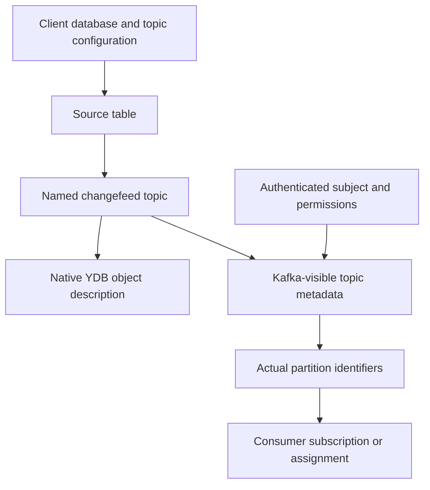

# Diagnose Unknown Topics and Partitions in YDB CDC Kafka Reads

Author: [nawazdhandala](https://www.github.com/nawazdhandala)

Tags: Database, Kafka, Troubleshooting

Description: Trace YDB CDC Kafka errors through database selection, changefeed paths, visible metadata, consumer identity, and partition assignments without recreating data.

A CDC consumer reports `UNKNOWN_TOPIC_OR_PARTITION`, but the source table exists and continues accepting writes. The source table is not the object the Kafka consumer reads. It reads the changefeed's topic, under a specific database and identity.

Apache Kafka defines error 3 as a request for a topic-partition that the responding server does not host. Its [protocol reference](https://kafka.apache.org/38/design/protocol/) classifies the error as retriable, but that does not make a wrong path or nonexistent partition correct after enough retries.

Begin by proving the identity of the requested object. Avoid creating a similarly named topic, deleting the changefeed, or resetting consumer offsets while the mismatch is still unexplained.

## Write down the complete object chain

Change Data Capture, or CDC, records changes to a table in a feed backed by a topic. The [YDB 26.2.1.16 CDC guide](https://github.com/ydb-platform/ydb/blob/26.2.1.16/ydb/docs/en/core/dev/cdc.md) identifies the feed through `table-path/changefeed-name`.

For an illustrative database, record these values separately:

| Setting | Example |
| --- | --- |
| Database path | `/Root/shop` |
| Source table | `/Root/shop/orders` |
| Changefeed name | `updates` |
| Full feed path | `/Root/shop/orders/updates` |
| Feed path relative to the database | `orders/updates` |
| Dedicated test consumer | `updates-review` |

The topic is not just `orders`, and `updates` alone omits its table path. Preserve spelling and case exactly. A topic name copied from another database can look reasonable while identifying a different object.



Use this chain as the investigation order. A healthy table at one point in the chain does not prove every later step is correct.

## Describe the feed through YDB first

Use YDB CLI 2.35.0 with a profile pointing to the intended database and an authorized inspection account:

```bash
ydb --profile staging scheme describe /Root/shop/orders
ydb --profile staging scheme describe /Root/shop/orders/updates \
  --stats --partition-stats
```

The first inspects the source table. The second targets the changefeed topic itself. Confirm the exact path, topic configuration, and partition information returned by your server. The profile name is a placeholder; its endpoint and database must be reviewed before interpreting the output.

If the table exists but the feed does not, check the schema deployment history. Was that feed created successfully? Was its name changed in application configuration? Was a table restored or recreated without the expected changefeed configuration?

Do not automatically run `CREATE TOPIC` using the missing name. A standalone topic is not a substitute for a CDC feed attached to the table and will not magically contain its changes.

## Confirm which database the Kafka client selects

For self-hosted username/password authentication, YDB's [Kafka authentication reference](https://github.com/ydb-platform/ydb/blob/26.2.1.16/ydb/docs/en/core/reference/kafka-api/auth.md) includes the database path in the SASL username. An endpoint can be reachable while the supplied credentials select a different database than expected.

Compare the Kafka endpoint, authenticated subject, and database path with the native CLI inspection. An administrator's successful `scheme describe` proves the object exists for that inspection context. It does not establish that the Kafka client's account has the same visibility or permissions.

YDB's [Kafka Connect example](https://github.com/ydb-platform/ydb/blob/26.2.1.16/ydb/docs/en/core/reference/kafka-api/connect/connect-step-by-step.md) documents full topic names and names relative to the database. For a nested CDC feed, retain the table component when forming the relative path. Inspect the name actually returned by Kafka metadata instead of repeatedly guessing different string combinations.

## Read metadata without inventing a new topic

With kcat 1.7.1, request general metadata using the same approved identity as the failing client:

```bash
kcat -F ./protected-kafka.conf \
  -b kafka.internal.example:9093 \
  -X security.protocol=SASL_SSL \
  -X ssl.endpoint.identification.algorithm=https \
  -L
```

Replace the endpoint with the actual TLS Kafka listener. The protected configuration file must already contain the appropriate SASL mechanism, credentials, and CA trust. This example keeps hostname verification explicit; it is not an anonymous-local-container command.

The [kcat 1.7.1 reference](https://github.com/edenhill/kcat/blob/1.7.1/README.md) documents metadata mode and configuration-file loading. Its [option-handling source](https://github.com/edenhill/kcat/blob/1.7.1/kcat.c) passes `-X` settings to the client library. This invocation requests general metadata without specifying a guessed topic to create or read.

Compare the visible topic names, partition identifiers, and broker addresses with your application configuration. Treat the output as operational information and keep it out of public logs.

If metadata itself fails, diagnose its concrete error first. If it succeeds but the expected feed is absent, compare identity, database, object existence, and the deployed Kafka API's supported features. Absence from one client's metadata alone is not sufficient evidence to delete or recreate anything.

## Check the actual partition assignment

A consumer using manual assignment can request a partition that does not exist. Do not assume partitions 0 through 7 exist because a previous deployment had eight partitions. Compare every configured identifier against current metadata.

Distinguish table partitions from topic partitions. They are related to CDC's architecture but are not interchangeable configuration inputs for a Kafka client. Use the identifiers published for the topic being read.

Check the release-specific compatibility boundary as well. The [YDB 26.2.1.16 Kafka constraints](https://github.com/ydb-platform/ydb/blob/26.2.1.16/ydb/docs/en/core/reference/kafka-api/constraints.md) document restrictions on Kafka access to autopartitioned topics. Do not assume that native Topic API support for a configuration guarantees Kafka API support for the same configuration.

If metadata changed after a controlled schema deployment, obtain fresh metadata and compare it before adjusting assignment. Keep retries bounded and retain the error context. Restarting a consumer may refresh its view, but it cannot repair an incorrect hardcoded partition list.

## Keep consumer and offset errors separate

For group-based reads, confirm the expected YDB consumer/group setup. The CDC guide documents consumers as part of reading a changefeed. A correct topic path is only one prerequisite.

An expired offset is a different diagnosis from an unknown topic-partition. If retention removed required history, changing the topic name or resetting offsets can conceal a data gap. Record the last durable consumer progress and available boundaries before choosing a recovery policy.

Likewise, CRC compatibility and deserialization errors occur after reaching a readable topic. Address them using their specific error evidence rather than adding every compatibility setting to an otherwise unresolved path problem.

## Finish with a traceable staging event

After correcting the demonstrated mismatch, use a dedicated staging consumer and a uniquely identifiable table change. Verify that the expected feed, partition metadata, consumer, and downstream observation all refer to the same database and event.

Local review checked the documented object-path rules, CLI flags, kcat options, and shell syntax. No YDB object, Kafka metadata response, consumer assignment, or CDC event was tested live.

Keep the before/after path mapping and exact error in the incident record. The useful result is an explained correction at one point in the object chain, followed by an observed CDC read, rather than a recreated feed whose earlier history can no longer be investigated.
