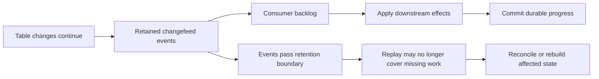

# Set YDB Changefeed Retention for Consumer Recovery

Author: [nawazdhandala](https://www.github.com/nawazdhandala)

Tags: Database, Data Pipeline, Troubleshooting

Description: Size YDB changefeed retention for outages and catch-up, update an existing feed safely, and detect when expired events require downstream reconciliation.

A changefeed consumer stops overnight. When it returns, the source table is healthy, but the consumer cannot replay every change it missed. Keeping the table does not mean keeping its entire change history.

Change Data Capture, or CDC, records table changes in a feed that consumers read. YDB's [CDC documentation](https://ydb.tech/docs/en/concepts/cdc) specifies a default changefeed retention of 24 hours and a configurable period up to 30 days. Ordinary expired records can be removed even if a consumer has not processed them.

Retention is therefore part of the consumer's recovery design. It must cover realistic interruptions and the time needed to make progress afterward, with storage capacity and a reconciliation plan to support it.

## Measure lag in time and work

An offset identifies a position within a topic partition. A consumer's committed position records its progress, but an offset difference alone does not tell you how old the backlog is or how quickly it can be processed.

Track the age of the oldest unprocessed event, backlog volume, incoming event rate, and sustained successful processing rate. Observe these per partition where possible: an average can hide one partition approaching expiry while others are current.



Distinguish records fetched into memory from records durably applied downstream. If a consumer commits before its downstream work is durable, a generous retention period does not automatically repair its checkpointing mistake.

## Include catch-up in the recovery budget

Suppose a feed receives 100 events per second. A six-hour outage creates about 2.16 million events of backlog. If the recovered consumer processes 300 events per second while new events continue arriving, its net drain rate is 200 per second. Clearing that backlog takes about three hours under those assumptions.

The calculation is:

```text
backlog = incoming_rate * outage_seconds
net_drain_rate = processing_rate - incoming_rate
catch_up_seconds = backlog / net_drain_rate
```

If processing capacity is at or below the incoming rate, no finite catch-up time exists in this steady-rate model. Increasing retention buys time but does not make the pipeline catch up.

Use a conservative planning budget that includes detection, repair, backlog drainage, and a margin for bursts or downstream throttling. The precise age of the oldest outstanding event depends on ordering and scheduling; the formula is a capacity estimate, not an expiry simulator.

Choose the retention period from measured recovery exercises. A 48-hour setting below is an example, not a recommendation for every workload. If the business requires replay farther back than the supported feed window, retain an appropriate independent history or design another recovery source.

## Configure a new feed deliberately

The following YDB 26.2.1.16 example creates a feed on an existing staging row table named `orders`:

```sql
ALTER TABLE `orders` ADD CHANGEFEED `recovery_feed` WITH (
    FORMAT = 'JSON',
    MODE = 'NEW_IMAGE',
    RETENTION_PERIOD = Interval('PT48H')
);
```

The [tagged changefeed syntax](https://github.com/ydb-platform/ydb/blob/26.2.1.16/ydb/docs/en/core/yql/reference/syntax/alter_table/changefeed.md) defines the interval setting and changefeed modes. `NEW_IMAGE` records the resulting column values for changes; choose a mode that supplies what your downstream process needs and account for its event size.

This statement creates a feed for subsequent changes. It does not request an initial scan of existing rows. If the consumer needs an initial copy, plan the documented initial-scan or another coordinated bootstrap workflow explicitly. Do not confuse creating a feed with obtaining a complete historical event archive.

The table must exist, the feed name must be available, and the operator must have suitable schema privileges. Save the reviewed statement as [create-feed.sql](./create-feed.sql) and execute it only against the intended staging database.

## Extend an existing feed in place

A changefeed's topic path includes the source table and feed name. Inspect that object with CLI 2.35.0:

```bash
ydb --profile staging scheme describe orders/recovery_feed \
  --stats --partition-stats
```

The profile is a placeholder for an approved connection and authentication configuration. Review the reported retention, storage limits, consumer configuration, and partition information. CLI help was checked locally; this command was not sent to a database during article review.

YDB 26.2.1.16 [CDC topic-settings documentation](https://github.com/ydb-platform/ydb/blob/26.2.1.16/ydb/docs/en/core/concepts/cdc.md#topic-settings) permits changing retention through `ALTER TOPIC` on the changefeed path:

```sql
ALTER TOPIC `orders/recovery_feed` SET (
    retention_period = Interval('PT48H')
);
```

This is included as [extend-retention.sql](./extend-retention.sql). Apply the reviewed file through the staging profile:

```bash
ydb --profile staging sql --file ./extend-retention.sql
```

Then repeat the description and verify the effective setting. There is no need to drop and recreate the feed just to change this supported property. Recreation introduces a new continuity problem and does not bring expired events back.

## Check the storage limit as well

Time retention is not the only constraint. The [ALTER TOPIC reference](https://github.com/ydb-platform/ydb/blob/26.2.1.16/ydb/docs/en/core/yql/reference/syntax/alter-topic.md) documents `retention_storage_mb`: exceeding a configured storage limit can clear older data. A longer time setting alone is insufficient when a smaller storage budget cuts the history short.

Estimate event volume using actual encoded messages and burst patterns. At 100 events per second and an average 2000 bytes per event, 48 hours represents about 34.56 GB of logical event payload before accounting for implementation overhead, replication, compression, or other storage use. Measure real disk consumption rather than treating that arithmetic as a capacity reservation.

Review any consumer-specific availability policy in your deployed version too. Do not assume that an uncommitted offset keeps records forever or that every consumer has identical retention protection.

Alert before the recovery margin is exhausted. A useful alert connects event age with the configured effective history window and current drain capacity; a static backlog count without context is often difficult to act on.

## Detect a gap and choose a recovery path

If the earliest available position has moved beyond the consumer's needed position, stop claiming continuous replay. Capture the affected partitions, last durable progress, available boundaries, and downstream state. Extending retention at that point protects remaining history but cannot restore removed records.

For a materialized current-state view, rebuilding or reconciling from a consistent source snapshot may be appropriate. For audit history or irreversible external effects, current table contents may not reconstruct intermediate changes. Those workflows need a separately retained history and an explicit recovery procedure.

Test replay protection as part of recovery. Restarting from a conservative earlier checkpoint can repeat events, so downstream effects must tolerate that or detect previously applied work.

## Prove the window with a controlled outage

The local review checked the documented SQL and CLI flags, shell syntax, and the arithmetic above. The six-hour scenario produced 2.16 million queued events and three hours of drainage; the 48-hour payload estimate produced 34.56 billion bytes. No feed was created, altered, paused, expired, or consumed.

In staging, pause a dedicated consumer, continue identifiable writes, and resume it within the intended window. Verify every expected downstream change and durable progress. Separately rehearse an expired-history case using disposable data and confirm that monitoring detects the gap instead of reporting a clean catch-up.

Retain the measurements from that exercise. A retention setting is useful when the consumer can recover within it and the team can recognize when that promise no longer holds.
