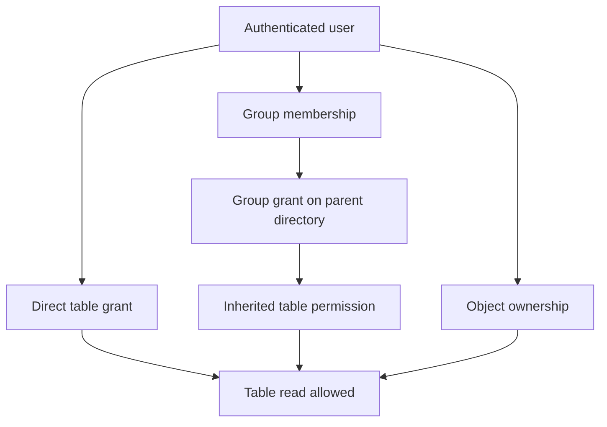

# Trace YDB Access That Survives a Direct Permission Revoke

Author: [nawazdhandala](https://www.github.com/nawazdhandala)

Tags: Database, Security, Troubleshooting

Description: Trace YDB permissions through parent objects, group memberships, and ownership before changing the grant that actually keeps access available.

You revoke a user's direct table permission, repeat the query, and the user can still read the table. The revoke may have worked exactly as requested. Another grant can provide the same access through a parent directory or a group.

The investigation should identify every relevant source of access before making another change. Clearing more entries at random can interrupt unrelated applications while leaving the original access path intact.

This guide uses YDB 26.2.1.16 reference material and CLI 2.35.0. The examples are for a staging database; no live permission changes were performed during their review.

## Think in terms of access paths

An access control list, or ACL, records permissions on an object. YDB's [authorization guide](https://ydb.tech/docs/en/security/authorization) describes default inheritance from parent objects, group membership, and object ownership. Each can matter when explaining why an operation succeeds.



Removing the direct grant removes one route. It does not necessarily remove the group route. An owner also needs separate consideration: deleting an ordinary ACL entry is not equivalent to changing ownership.

Write down the exact operation you want to disallow, the exact table path, and the identity that performed it. “Remove access” is too vague if the user should retain directory navigation or continue reading other tables.

## Confirm the identity used by the successful query

Use the application's credentials in a dedicated profile:

```bash
ydb --profile app-staging discovery whoami --groups
```

Record the returned subject and groups. Check that the query was not accidentally run through an administrator profile, another service account, or a different database. A local username and an externally sourced identity with a suffix are different subjects; match the returned identifier exactly.

If a membership change is part of the investigation, verify the identity and group information used by the new test request. Do not assume that changing an external directory entry and running an existing client proves the expected identity mapping has changed.

Keep tokens and passwords out of the evidence. Subject identifiers, object paths, permission names, and timestamps are usually enough to correlate the checks.

## Compare direct and effective permissions

Inspect the target with an authorized administrative profile:

```bash
ydb --profile admin-staging scheme permissions list \
  /Root/shop/reports/orders
```

The [CLI permission reference](https://ydb.tech/docs/en/reference/ydb-cli/commands/scheme-permissions) documents three output sections: owner, directly assigned permissions, and effective permissions after inheritance. The effective list can contain group entries; it is not automatically a personalized explanation of every privilege held by the user you are investigating.

For an illustrative case, suppose the direct user entry disappears after revocation but an effective `reportreaders` read permission remains. If the authenticated user belongs to that group, the result is consistent with continued access. This is an example to reason through, not captured output from a test cluster.

Next inspect the ancestors:

```bash
ydb --profile admin-staging scheme permissions list /Root/shop/reports
ydb --profile admin-staging scheme permissions list /Root/shop
```

Follow the actual hierarchy in your deployment, including higher applicable ancestors when necessary. Find where the relevant permission is directly assigned rather than stopping at the first effective occurrence.

## Use system views to organize the evidence

YDB 26.2.1.16 documents separate system views for direct permissions, inherited effective permissions, and group memberships. Their columns and visibility rules are in the [tagged system-view reference](https://github.com/ydb-platform/ydb/blob/26.2.1.16/ydb/docs/en/core/dev/system-views.md).

As an authorized reviewer, this read-only query lists direct assignments for two known subjects:

```sql
SELECT Path, Sid, Permission
FROM `.sys/auth_permissions`
WHERE Sid IN ('reportuser'u, 'reportreaders'u)
ORDER BY Path, Sid, Permission;
```

Replace the two illustrative subject identifiers with the exact ones found earlier. Read the returned paths rather than guessing their representation. To inspect effective assignments for the same subjects, use the corresponding view:

```sql
SELECT Path, Sid, Permission
FROM `.sys/auth_effective_permissions`
WHERE Sid IN ('reportuser'u, 'reportreaders'u)
ORDER BY Path, Sid, Permission;
```

These queries are included as [direct.sql](./direct.sql) and [effective.sql](./effective.sql). They are evidence-gathering tools, not a complete authorization evaluator. They omit other groups unless you include them, and visibility depends on the reviewer's schema-description rights.

For local group relationships, an administrator can inspect:

```sql
SELECT GroupSid, MemberSid
FROM `.sys/auth_group_members`
WHERE MemberSid = 'reportuser'u;
```

Nested groups require following the returned group identifiers as members of other groups too. External-directory membership also requires checking the configured identity system. Do not conclude “no access” merely because one filtered view returns no rows.

## Change the source, with its full scope in view

Build a small evidence table before proposing a change:

| Source | Why it matters | Scope to review |
| --- | --- | --- |
| Direct user grant on the table | Individual access | This subject and object |
| Group grant on a parent directory | Inherited access for members | Other members and descendant objects |
| Nested group membership | Indirect role membership | Every resource reached through that role |
| Object ownership | Separate authority over the object | Ownership and operational responsibility |

If the group should lose read access to the entire reports subtree, a reviewed staging change might be:

```sql
REVOKE SELECT ON `/Root/shop/reports` FROM reportreaders;
```

The [release-pinned REVOKE syntax](https://github.com/ydb-platform/ydb/blob/26.2.1.16/ydb/docs/en/core/yql/reference/syntax/revoke.md) supports this form. It is appropriate only when that exact parent grant is the intended source to remove and the effect on other users and tables is acceptable.

If the group should retain the subtree except one sensitive table, the authorization design needs a narrower scope or an explicitly reviewed inheritance boundary. Do not mechanically revoke the parent grant just to fix one user's exception.

Likewise, CLI `clear` removes direct assignments but leaves inherited access. Commands that change inheritance affect a broader collection of inherited permissions. Review required connection, schema, application, and administrative access before considering such a boundary change.

## Verify both the denied and retained behavior

Repeat the original bounded read using the intended identity. Confirm that the operation is denied for the expected authorization reason, not because the table was renamed, the query is invalid, or the network is unavailable.

Then test access that should remain: another approved table, normal connection establishment, and any required operational account. Re-read effective permissions and retain the before/after evidence. A permission change is correct only if both the intended restriction and legitimate remaining access hold.

Local review checked the commands against CLI help, shell syntax, and the tagged SQL references. It did not execute these system-view queries, revoke permissions, resolve a live group hierarchy, or prove a runtime denial.

Trace access until you can explain the successful request. That explanation identifies the change to review and gives you a concrete acceptance test, instead of treating every surviving read as a failed revoke.
