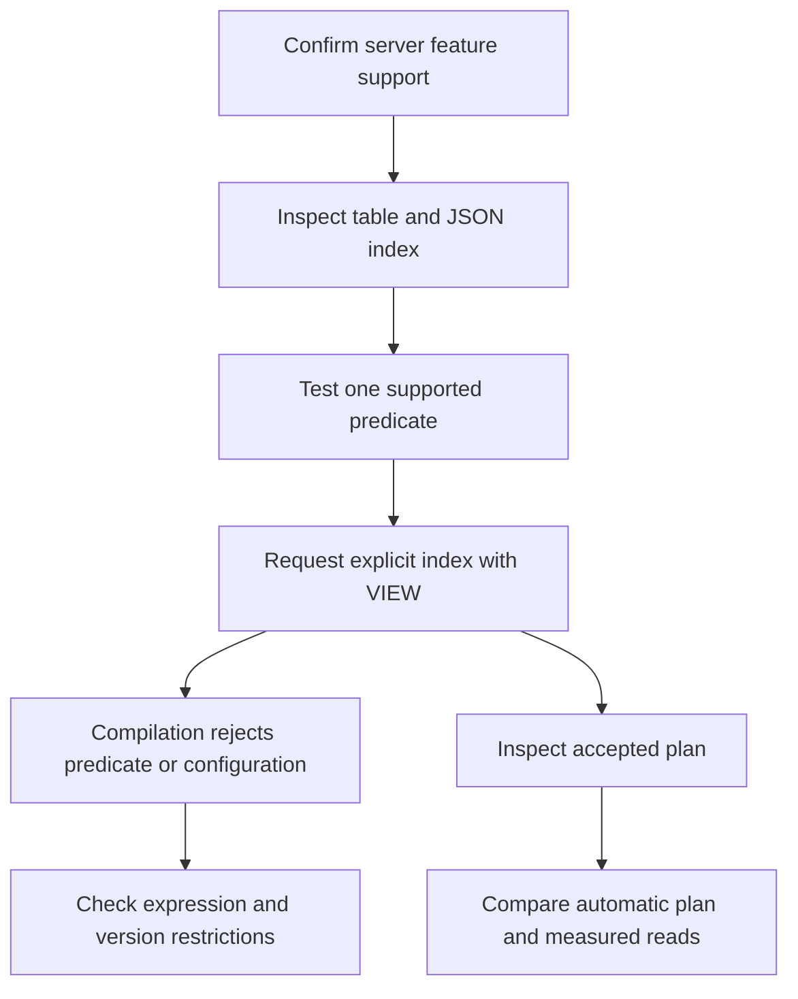

# Diagnose YDB JSON Filters That Skip a JSON Index

Author: [nawazdhandala](https://www.github.com/nawazdhandala)

Tags: Database, SQL, Performance, Troubleshooting

Description: Check YDB JSON-index availability, supported predicate shapes, return types, and actual plans before treating an unselected index as an optimizer fault.

A JSON filter returns the right rows but scans more data than expected. Having a JSON index on the table is only part of the diagnosis: the query must use a supported expression, and the optimizer may prefer another access path.

Separate three questions. Does this server support the index feature you are using? Can this predicate be evaluated through that index? If it can, is that index useful for the actual data distribution?

## Establish the version boundary

At review time, the public documentation displayed version 26.3, while the GitHub release API identified [26.2.1.16](https://github.com/ydb-platform/ydb/releases/tag/26.2.1.16) as the latest release. The JSON-index documentation file reviewed here was absent at that release tag. That does not by itself establish the capabilities of every deployed build, but it means current documentation should not be treated as a release-compatibility guarantee.

The SQL below is pinned to official documentation revision [408e1c41ed8f45ac2cbb82895d5566c10313d35b](https://github.com/ydb-platform/ydb/blob/408e1c41ed8f45ac2cbb82895d5566c10313d35b/ydb/docs/en/core/dev/json-indexes.md). Use a staging server whose build and configuration support that documented feature. No matching server binary was executed for this article.

Record the server build, table type, index definition, and full compiler error before rewriting a query. If the server does not recognize the index type, predicate tuning is premature.



## Start with a small known schema

The reviewed [JSON-index creation syntax](https://github.com/ydb-platform/ydb/blob/408e1c41ed8f45ac2cbb82895d5566c10313d35b/ydb/docs/en/core/yql/reference/syntax/create_table/json_index.md) supports a row table with one indexed JSON column:

```sql
CREATE TABLE events (
    event_id Uint64 NOT NULL,
    payload JsonDocument NOT NULL,
    INDEX payload_json GLOBAL USING json ON (payload),
    PRIMARY KEY (event_id)
);
```

Create this only in a disposable staging database. `JsonDocument` stores parsed JSON in a binary representation; `payload_json` is the index name. The example uses a single integer primary key and no additional index features to keep the diagnostic case small.

Populate four deliberately different documents:

```sql
UPSERT INTO events (event_id, payload) VALUES
    (1, JsonDocument(@@{"service":"checkout","duration_ms":140}@@)),
    (2, JsonDocument(@@{"service":"catalog","duration_ms":70}@@)),
    (3, JsonDocument(@@{"service":"checkout","duration_ms":15}@@)),
    (4, JsonDocument(@@{"duration_ms":90}@@));
```

The conversion and multiline-literal form follow the official [JSON-index quick start](https://ydb.tech/docs/en/recipes/json-search/json-index-quickstart). Row 4 intentionally lacks `service`; it helps catch accidental assumptions that every document has the same shape. Files [schema.sql](./schema.sql) and [seed.sql](./seed.sql) contain these staging statements.

## Make the scalar type explicit

Start with equality on a string field:

```sql
SELECT event_id
FROM events VIEW payload_json
WHERE JSON_VALUE(payload, '$.service' RETURNING Utf8) = 'checkout'u
ORDER BY event_id;
```

The intended result for the fixture is identifiers 1 and 3. `JSON_VALUE` extracts one scalar value, and `RETURNING Utf8` makes the comparison's string type explicit. JsonPath is the path notation used to locate that value inside the document.

The [indexed-query syntax](https://github.com/ydb-platform/ydb/blob/408e1c41ed8f45ac2cbb82895d5566c10313d35b/ydb/docs/en/core/yql/reference/syntax/select/json_index.md) requires a supported `RETURNING` type for this indexed scalar form. Do not remove it because a similar unindexed expression happens to return the expected rows.

The explicit `VIEW payload_json` is a diagnostic choice. If that access path cannot support the predicate, the documented behavior is a compilation error. Without an explicit index, another access path may execute the query successfully. Successful SQL execution alone therefore does not prove index eligibility.

## Inspect plans before changing the expression

With CLI 2.35.0, an approved staging profile, and the schema already created, request the plan for [filter.sql](./filter.sql):

```bash
ydb --profile staging sql --explain --file ./filter.sql
```

The actual CLI help confirms that `--explain` requests a plan without executing the query. It still requires server support and access to the schema. Save both the plan and any compilation issues.

Then compare a copy without `VIEW payload_json`. The documented automatic selection is rule-based and gives JSON indexes lower priority than suitable primary-key or more specific secondary-index access. A query constrained to one known `event_id` may be better served by the primary key.

Once the read is approved for staging execution, collect statistics:

```bash
ydb --profile staging sql --stats full --file ./filter.sql
```

Compare returned identifiers, read volume, and latency for identical inputs. Do not promote the forced-index variant simply because it compiled.

## Reduce a complex predicate carefully

When the original filter fails to use the index, remove conditions one at a time in a diagnostic copy. Keep the production result requirement written down so that a smaller successful expression does not become an incorrect replacement.

| Suspect expression | Diagnostic question |
| --- | --- |
| `JSON_VALUE` without `RETURNING` | Is the indexed scalar type explicit? |
| A non-null default for missing or invalid values | Does its error/empty behavior fit supported indexing rules? |
| JSON extracted from another JSON function | Can the predicate refer directly to the indexed column? |
| Comparisons involving different JSON columns | Is one index being asked to cover incompatible inputs? |
| An unsupported branch inside `OR` | Would skipping that branch lose valid matches? |

In the reviewed rules, an unsupported condition may remain a post-filter alongside an indexed `AND` condition, while an unsupported branch can prevent index use for an `OR` group. A post-filter means the database first retrieves candidates, then checks the remaining condition.

Equality can narrow candidates using a path and value together. Some range comparisons narrow by path presence and then evaluate the range afterward. If almost every document contains that path, the index can be used yet still read many candidates. Diagnose selectivity, not just the presence of an index operator.

## Preserve JSON meaning and operational constraints

Missing fields, JSON null, false, numbers, and strings are different cases. Test them explicitly before replacing one expression with another. For example, checking that a path exists is not equivalent to checking that its value is true, and a string representation of a number is not a substitute for a numeric comparison.

Also review the [feature's write limitations](https://ydb.tech/docs/en/dev/json-indexes). The documented JSON-index table restrictions include bulk-upsert, batch-modification, and TTL combinations. Adding an index can therefore affect ingestion or retention workflows even when the read improves.

Local review parsed the four JSON fixture documents and checked the intended equality matches. It verified CLI flags and shell syntax, but did not compile YQL, build an index, execute JSON functions, or measure a plan on YDB. The fixture check is not an emulator of YDB's JSON semantics.

Finish the staging test with realistic document shapes and cardinality, including malformed types and missing fields. Keep the index only when its supported behavior matches both the query's meaning and the table's write lifecycle, and measured work improves for the workload that matters.
