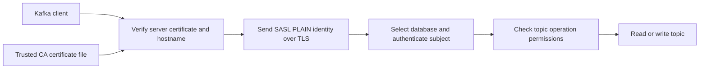

# Configure Kafka Client Authentication for YDB Topics

Author: [nawazdhandala](https://www.github.com/nawazdhandala)

Tags: Database, Kafka, Security, Python

Description: Configure a YDB Kafka client with the correct database-qualified identity, SASL credentials, TLS trust, and separate authentication and authorization checks.

A Kafka client can reach YDB's listener yet fail before it reads a topic. The missing piece may be the database path in the SASL username, a certificate trust problem, or a topic permission. Those failures occur at different stages and require different fixes.

Start by identifying the deployment's supported authentication method and exact Kafka endpoint. The gRPC endpoint used by a YDB SDK is not automatically the address a Kafka client should use.

This guide uses the self-hosted username/password mapping documented for YDB 26.2.1.16 and a Python example pinned to `confluent-kafka==2.12.0`. It separately explains the Yandex Cloud credential format rather than treating the two as interchangeable.

## Separate transport, identity, and permission

TLS encrypts the connection and verifies the server. SASL is the framework through which the client supplies authentication information. The PLAIN mechanism carries a username and password, so use it over a properly configured TLS listener when credentials cross a network.



Apache Kafka's [SASL guidance](https://kafka.apache.org/40/security/authentication-using-sasl/) explains why PLAIN should use encrypted transport. Merely selecting PLAIN does not turn on TLS. In client configuration, `SASL_SSL` selects SASL authentication over TLS, while `SASL_PLAINTEXT` does not provide that transport encryption.

The server must already expose the matching TLS-enabled Kafka listener and require authentication. A client setting cannot retrofit TLS or identity enforcement onto an anonymous plaintext endpoint.

## Construct the correct SASL identity

For self-hosted username/password authentication, the [YDB 26.2.1.16 reference](https://github.com/ydb-platform/ydb/blob/26.2.1.16/ydb/docs/en/core/reference/kafka-api/auth.md) documents:

```text
sasl.username = user-name@database-path
sasl.password = user's password
```

For a local user named `topicreader` and database `/Root/shop`, the SASL username is `topicreader@/Root/shop`. Preserve the leading slash in the database path. Do not substitute the topic name, a console display name, or the gRPC connection URL.

This combined value routes authentication to the database; it does not rename the underlying YDB user. Grant database and topic permissions to the actual user or its groups using the deployment's authorization model.

In Yandex Cloud, the documented Kafka API mapping is different: the username is `@<database-path>` and the password field carries an API key. The [cloud authentication guide](https://yandex.cloud/en/docs/data-streams/kafkaapi/auth) also specifies service-account roles and API-key scope. Follow that workflow for cloud access; do not insert a self-hosted username into its format.

## Prepare the client inputs

For the Python example, provide an approved Kafka hostname and port, the exact database path, an existing local user, and a readable PEM file containing the trusted certificate-authority chain. The server certificate must cover the hostname used by the client.

Install the pinned dependency in a dedicated environment:

```bash
python3 -m venv .venv
.venv/bin/python -m pip install 'confluent-kafka==2.12.0'
```

The package version was verified against its published release metadata. This is a reproducible example version, not a claim that it is the newest client or that every supported Kafka operation works with YDB.

Supply only non-secret connection information through these environment variables, replacing the example values:

```bash
export YDB_KAFKA_ENDPOINT='kafka.internal.example:9093'
export YDB_DATABASE='/Root/shop'
export YDB_USER='topicreader'
export YDB_KAFKA_CA='/absolute/path/to/internal-ca.pem'
```

The endpoint is illustrative; 9093 is not a requirement or a promise about your listener. Obtain the real address from the cluster configuration or operator. Use the CA that issued the Kafka listener's certificate, which may differ from the CA used by another YDB endpoint.

## Build a verified TLS configuration

The included [auth_probe.py](./auth_probe.py) separates configuration construction from the network request. Its central function is:

```python
from pathlib import Path


def make_config(endpoint, username, database, ca_file, password):
    if not endpoint or not username or not password:
        raise ValueError("Endpoint, username and password are required")
    if not database.startswith("/"):
        raise ValueError("Database must be an absolute YDB path")
    if not Path(ca_file).is_file():
        raise ValueError("CA file must exist")
    return {
        "bootstrap.servers": endpoint,
        "security.protocol": "SASL_SSL",
        "sasl.mechanism": "PLAIN",
        "sasl.username": f"{username}@{database}",
        "sasl.password": password,
        "ssl.ca.location": ca_file,
        "enable.ssl.certificate.verification": True,
        "ssl.endpoint.identification.algorithm": "https",
    }
```

These are librdkafka settings documented in its [version 2.12.0 configuration reference](https://github.com/confluentinc/librdkafka/blob/v2.12.0/CONFIGURATION.md). Certificate verification checks trust; hostname verification checks that the certificate identifies the server being contacted. Keep both enabled.

The rest of the script reads the environment variables, obtains the password through an interactive hidden prompt, and requests metadata with a ten-second timeout. Run it from a terminal:

```bash
.venv/bin/python auth_probe.py
```

The script prints only the number of brokers reported by the metadata response. It does not write the password to a configuration file or place it in the command line. For a non-interactive service, obtain credentials through its approved secret-delivery mechanism rather than copying this terminal prompt into a deployment.

## Interpret the probe's result correctly

The Python [AdminClient API](https://docs.confluent.io/platform/current/clients/confluent-kafka-python/html/index.html) exposes `list_topics` for metadata requests. The script requests general metadata without naming a potentially nonexistent topic, avoiding the documented possibility of creating an unknown topic when automatic creation is enabled.

A metadata response shows that the configured connection can perform that request. It does not prove permission to read every topic, write messages, or participate in a consumer group. Follow it with a bounded operation on an existing staging topic using the intended role.

| Failure stage | What to inspect |
| --- | --- |
| Connection refused or timeout | Listener address, network path and published/advertised addresses |
| Certificate verification | Trusted CA chain and server hostname |
| SASL authentication | Mechanism, username/database format and current credential |
| Topic authorization | Actual user/group rights and exact topic path |
| Consumer-specific operation | Consumer configuration and YDB Kafka compatibility constraints |

Avoid turning certificate verification off to discover whether credentials work. Correct the transport trust problem first. Similarly, adding broad administrator rights does not repair a misspelled database path in the SASL identity.

## Validate rotation and failure behavior

Local tests executed `make_config` with fixture values, checked the database-qualified username and both TLS verification settings, and confirmed that missing inputs, a relative database path, and a nonexistent CA file are rejected. Python syntax checks passed. No client was connected, no TLS handshake occurred, and no credentials were authenticated.

In staging, verify the intended account, a controlled invalid credential, an untrusted certificate chain, and an operation outside the account's permissions. Ensure failures are visible without dumping the configuration dictionary or password into logs.

For rotation, distribute the replacement credential through the normal secret mechanism, restart or refresh clients using their documented lifecycle, and confirm successful operations before retiring the previous credential. Test a reconnect as well as an already established connection. If the CA changes, distribute the overlapping trust chain before changing the listener certificate.

Keep the deployment-specific endpoint, identity format, trust source, and allowed operations together in the service's configuration record. That makes a later authentication failure a checkable configuration problem rather than a reason to weaken transport or grant excessive access.
