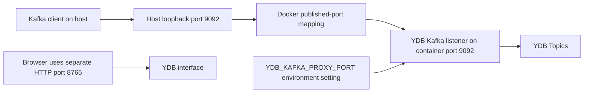

# Enable the YDB Kafka Listener and Publish Its Docker Port

Author: [nawazdhandala](https://www.github.com/nawazdhandala)

Tags: Database, Kafka, Docker, Troubleshooting

Description: Enable YDB's Kafka API in a local Docker lab, publish the matching port, and distinguish listener, networking, metadata, and authentication failures.

A Kafka client cannot connect to a YDB container even though the YDB interface opens in a browser. The browser checks the HTTP service, not the Kafka endpoint. Publishing port 9092 is also insufficient if no Kafka listener is running inside the container.

Two settings must agree: YDB must enable its Kafka API on a container port, and Docker must make that port reachable from the client. Afterward, the client still needs usable Kafka metadata and the correct authentication settings.

This guide builds a host-local disposable lab and separates those checks so that a network fix does not hide a later protocol problem.

## Understand the two boundaries

YDB's local Docker wrapper recognizes `YDB_KAFKA_PROXY_PORT`. The [Docker configuration reference](https://ydb.tech/docs/en/reference/docker/configuration) states that an empty value disables Kafka API compatibility. Setting it to 9092 enables the wrapper's Kafka endpoint configuration for that port.

Docker's `--publish` option creates a mapping from a host address and port to a container port. It does not configure the application inside the container. The [Docker port-publishing documentation](https://docs.docker.com/engine/network/port-publishing/) explains that distinction and host-address binding.



The HTTP interface can be healthy while the Kafka path is unavailable. Likewise, a Docker port mapping can exist while the container is still initializing or the intended service failed to start.

## Pin a reproducible local image

Use a working Docker installation capable of running Linux AMD64 containers, free host ports 9092 and 8765, and enough memory for a small disposable YDB instance. The example deliberately uses in-memory disks, so its data is not durable across process/container restarts.

At review time, the official [local-ydb image metadata](https://hub.docker.com/v2/repositories/ydbplatform/local-ydb/tags/latest) resolved to this Linux AMD64 digest:

```bash
YDB_LAB_IMAGE='ydbplatform/local-ydb@sha256:9e46fd45875551a75bcf34d0bb9ca0baa1d8763a4ccf2070af45f4467c4b7402'
```

A digest fixes the image content instead of following a moving `latest` tag. The registry metadata was checked, but the image was not pulled or executed during this article's review. The wrapper options were checked against the [YDB 26.2.1.16 Docker startup documentation](https://github.com/ydb-platform/ydb/blob/26.2.1.16/ydb/docs/en/core/reference/docker/start.md); the digest is an image pin, not a claim that its embedded server is that release.

On an ARM host, confirm that your Docker setup supports the requested AMD64 platform. Architecture/emulation failures occur before Kafka connectivity and should be diagnosed from container startup evidence.

## Start a clearly scoped lab

Run these commands in the same shell. Choose an unused container name if `ydb-kafka-lab` already belongs to another exercise:

```bash
docker run -d \
  --name ydb-kafka-lab \
  --hostname localhost \
  --platform linux/amd64 \
  --publish 127.0.0.1:9092:9092 \
  --publish 127.0.0.1:8765:8765 \
  --env YDB_KAFKA_PROXY_PORT=9092 \
  --env MON_PORT=8765 \
  --env YDB_USE_IN_MEMORY_PDISKS=true \
  "$YDB_LAB_IMAGE"
```

The image assignment and command are included in [start-lab.sh](./start-lab.sh). The loopback mapping is intended for a client running on this host. It avoids publishing the lab on every host interface. The two occurrences of 9092 have different jobs: one configures YDB, while the mapping makes that container port available on the host.

The example retains the container for inspection rather than automatically removing it when the process exits. It mounts no existing database directories and is not a migration or restart procedure for a populated environment.

This is the local development path, not a shared authenticated service configuration. If your image or configuration requires authentication, use its documented client credentials and transport settings; do not disable those checks to make a probe pass.

## Inspect startup and mapping separately

First read the container state and recent logs:

```bash
docker container inspect ydb-kafka-lab --format '{{.State.Status}}'
docker container logs --tail 100 ydb-kafka-lab
```

Docker documents [state inspection](https://docs.docker.com/reference/cli/docker/container/inspect/) and [bounded log output](https://docs.docker.com/reference/cli/docker/container/logs/). A `running` state means the container process exists, not that every YDB endpoint is ready. Check the logs for initialization failures, architecture problems, or configuration errors.

Then inspect only the Kafka mapping:

```bash
docker container port ydb-kafka-lab 9092/tcp
```

For this command, the expected mapping is `127.0.0.1:9092`. The [port command](https://docs.docker.com/reference/cli/docker/container/port/) reports configured publication; it does not perform a Kafka request.

If no mapping exists, changing a client timeout cannot create it. If the mapping targets a different internal port from the configured listener, correct the lab's container definition and recreate the disposable instance after retaining useful diagnostics.

## Make a Kafka-level read-only probe

With kcat 1.7.1 installed on the host, request metadata:

```bash
kcat -b localhost:9092 -L
```

The [kcat 1.7.1 documentation](https://github.com/edenhill/kcat/blob/1.7.1/README.md) defines `-L` as metadata-listing mode. A successful response demonstrates more than a TCP connection: the endpoint handled a Kafka metadata request. An empty topic list can be valid in a fresh lab.

Inspect the returned broker addresses as well. Kafka clients use metadata after contacting their initial bootstrap address. A reachable bootstrap socket does not guarantee that every address subsequently returned is reachable from that client.

The `localhost` hostname is suitable for this host-client exercise. For another container, `localhost` refers to that other container itself. For a remote machine, it refers to the remote machine. Moving the client requires a deliberate network and advertised-address design; copying the same bootstrap string is insufficient.

## Use the failure stage to choose the next check

| Observation | Next investigation |
| --- | --- |
| Container exits before readiness | Startup logs, platform support, resources and configuration |
| HTTP works but Kafka connection is refused | Kafka environment setting and matching published port |
| Metadata succeeds, later connections fail | Returned broker addresses and the client's network location |
| Authentication or authorization error | Client security configuration, identity and topic permissions |
| Reading fails after metadata succeeds | Topic/consumer setup and supported Kafka API behavior |

YDB implements Kafka API compatibility over its own topics. Consult the [YDB Kafka examples](https://ydb.tech/docs/en/reference/kafka-api/examples) for producer and consumer prerequisites rather than assuming every Apache Kafka broker feature is available. Metadata inspection is only the listener/network acceptance step, not a full message-delivery test.

Local review verified registry metadata, official configuration and command documentation, shell syntax, and the agreement between listener and published ports. No Docker executable was available in the review environment, so no container, listener, kcat request, or message flow was tested.

In your lab, retain the image digest, startup outcome, mapping, metadata result, and broker addresses. Once those agree, move on to an authenticated produce/consume check appropriate to your deployment. That progression makes each failure actionable without mixing unrelated services or network boundaries.
