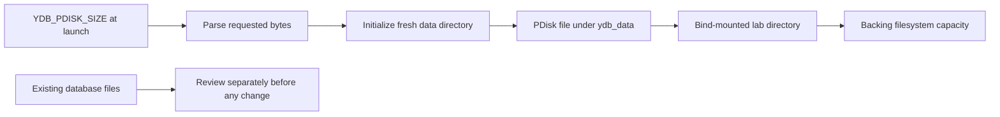

# Set YDB_PDISK_SIZE for a Fresh Local Development Container

Author: [nawazdhandala](https://www.github.com/nawazdhandala)

Tags: Database, Docker, Storage, Development

Description: Choose a local YDB disk-file size before initialization, use the supported units, and verify the fresh container without resizing or deleting existing data.

A local YDB container can need more disk space than a tiny test dataset suggests. Its storage includes a file representing a physical disk, called a **PDisk**, along with database metadata and logs. The setting `YDB_PDISK_SIZE` controls the requested disk-file size in the local development image.

Set it before initializing a new data directory. Changing an environment variable on an already initialized database is not a documented procedure for resizing its storage. This guide uses a separate, empty directory so a sizing experiment cannot alter your existing development database.

The example pins `ydbplatform/local-ydb` to release **26.2.1.16** and its published Linux AMD64 digest. Commands and storage behavior were reviewed in official documentation and tagged source. The size parser was exercised locally; the container itself was not run.

## Understand which capacity you are setting

The [Docker configuration reference](https://ydb.tech/docs/en/reference/docker/configuration) documents a default of `64GB`, an explicit byte count, and the suffixes `KB`, `MB`, and `GB`. These names need care: the [26.2.1.16 parser](https://github.com/ydb-platform/ydb/blob/26.2.1.16/ydb/tests/library/harness/kikimr_config.py) multiplies each suffix by powers of 1024.

| Input | Parsed size in bytes | Result |
| --- | ---: | --- |
| `16GB` | 17,179,869,184 | Accepted |
| `1024MB` | 1,073,741,824 | Accepted, not a sizing recommendation |
| `17179869184` | 17,179,869,184 | Accepted byte count |
| `16GiB` | N/A | Unsupported suffix in this release |
| `1.5GB` | N/A | Integer parsing fails |

In other words, the example's `16GB` requests 16 gibibytes even though the accepted suffix is spelled `GB`. A valid input is not proof that the database can operate usefully at that size. Do not select the smallest parsable number as a minimum supported deployment.

There are three different budgets to consider:

1. **YDB's disk-file size:** the setting discussed here.
2. **The backing filesystem:** it also holds other files and needs free space for growth and logs.
3. **The container runtime's resources:** CPU, memory, image storage, and, where applicable, a virtual machine's disk limit.

For Docker Desktop, inspect the relevant [resource and disk settings](https://docs.docker.com/desktop/settings-and-maintenance/settings/) as well as the storage supporting your bind-mounted directory. Increasing YDB's requested size cannot create host capacity or raise a runtime limit.

## Start with an empty, clearly named directory

Prerequisites are Docker with a local daemon, Bash, a supported x86-64 execution environment, enough free backing storage, and unused local ports 2135 and 8765. On Apple Silicon, follow YDB's [documented emulation requirements](https://ydb.tech/docs/en/reference/docker/start) for persistent disks. Switching to in-memory disks avoids persistence entirely and is not a substitute for this disk-size test.

Save the following as `start-lab.sh` and run it with Bash from a directory whose absolute path contains no commas. The comma restriction avoids ambiguity in Docker's `--mount` option.

```bash
#!/usr/bin/env bash
set -euo pipefail

lab_root="$PWD/ydb-size-16g-lab"
mkdir "$lab_root"
mkdir "$lab_root/data" "$lab_root/certs"

image='ydbplatform/local-ydb:26.2.1.16@sha256:b5ccc8fa737321094f17963193c2e4213694a3bda261742ea582cadece63bb09'

docker run -d \
  --name ydb-size-16g-lab \
  --hostname localhost \
  --platform linux/amd64 \
  --publish 127.0.0.1:2135:2135 \
  --publish 127.0.0.1:8765:8765 \
  --mount "type=bind,src=$lab_root/data,dst=/ydb_data" \
  --mount "type=bind,src=$lab_root/certs,dst=/ydb_certs" \
  --env YDB_PDISK_SIZE=16GB \
  --env YDB_USE_IN_MEMORY_PDISKS=0 \
  --env GRPC_TLS_PORT=2135 \
  --env MON_PORT=8765 \
  "$image"
```

The first `mkdir` intentionally fails if the lab already exists. Inspect a failed prior attempt before choosing another new directory and container name. The script never empties or reuses an existing data directory.

The [official image metadata](https://hub.docker.com/v2/repositories/ydbplatform/local-ydb/tags/26.2.1.16) identifies this digest as Linux AMD64. The mounts follow YDB's documented data/certificate separation. Docker's [`--mount` bind syntax](https://docs.docker.com/engine/storage/bind-mounts/) requires the source directories to exist, making accidental missing-path mistakes visible.

Only the TLS database listener and local web interface are published. The loopback address restricts ordinary published-port access to the host, as described in Docker's [port-publishing documentation](https://docs.docker.com/engine/network/port-publishing/). The generated lab certificates still need normal client trust configuration; this example does not disable TLS verification.



The separate existing-data branch is intentional. The tagged [local launcher](https://github.com/ydb-platform/ydb/blob/26.2.1.16/ydb/public/tools/lib/cmds/__init__.py) maintains initialization metadata and saved configuration. A new environment value does not establish that previously created files were safely resized.

## Verify intent, then observed storage

First check whether Docker retained the container and whether initialization reported a problem:

```bash
docker container inspect --format '{{.State.Status}}' ydb-size-16g-lab
docker container logs --tail 100 ydb-size-16g-lab
docker container inspect --format '{{json .Mounts}}' ydb-size-16g-lab
```

These [inspection](https://docs.docker.com/reference/cli/docker/container/inspect/) and [log](https://docs.docker.com/reference/cli/docker/container/logs/) commands do not modify the database. Expect the two mount destinations to match `/ydb_data` and `/ydb_certs`. A `running` status means the container process exists; inspect startup errors and the local YDB UI before calling the database ready.

Next inspect generated disk files from the same parent directory, using Python 3.14 or another supported Python 3 installation with `pathlib`:

```python
from pathlib import Path

root = Path("ydb-size-16g-lab/data/pdisks")
files = sorted(path for path in root.glob("*") if path.is_file())
if not files:
    raise SystemExit("No PDisk files found; inspect initialization and mounts.")
for path in files:
    print(path.relative_to(root), path.stat().st_size)
```

The tagged [image startup script](https://github.com/ydb-platform/ydb/blob/26.2.1.16/.github/docker/files/initialize_local_ydb) sets `YDB_PDISKS_DIRECTORY` to `/ydb_data/pdisks`; the storage generator names files there by disk number. [`Path.stat()`](https://docs.python.org/3.14/library/pathlib.html#pathlib.Path.stat) reports the logical file size; the expected requested value here is **17,179,869,184 bytes** per disk using this setting. It does not measure how many filesystem blocks are currently allocated, and it is not a database free-space measurement.

If files are missing, inspect startup progress, mount permissions, and the selected disk mode. If their size differs, preserve the output and investigate the actual image, configuration overrides, and whether the directory was truly fresh. Do not truncate a disk file to make its size match the example.

## Judge the size with your development workload

After initialization succeeds, use your normal trusted YDB client to create a small disposable table, write known rows, and read them back. Then run a representative test workload while watching database storage health and the backing filesystem. The example's 16GB is a starting value for a lab, not a capacity promise.

An application that stores 1GB of rows can require more space after indexes, metadata, changefeeds, and logs are considered. Conversely, a large logical disk file may not consume its entire apparent size immediately on every filesystem. Measure both the database's available capacity and the host's remaining capacity instead of comparing one file length with one dataset size.

If the experiment is too small, retain the evidence and create a second fresh lab with a larger setting. Move valuable data only through a supported backup/export and restore/import process. Keep the existing directory intact until recovery has been verified; filesystem deletion or manual disk-file expansion is not a sizing procedure.
