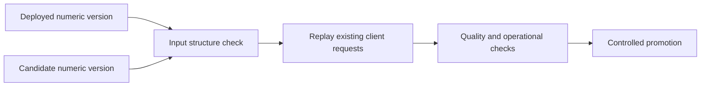

# Block Model Promotion When Input Changes Break Existing Clients

Author: [nawazdhandala](https://www.github.com/nawazdhandala)

Tags: MLflow, Model Versioning, MLOps, Python

Description: Add a promotion gate that compares model input signatures and replays existing client requests before approving a new MLflow model version.

A candidate model may score better in evaluation while rejecting every request from an existing client. For example, training starts using `region`, and the new model requires that field. The mobile application still sends only `tenure_months` and `plan`.

Catch this before promotion. Compare the candidate with the version actually serving those clients, then run representative old requests through both versions. A signature comparison catches structural changes; request replay catches implementation assumptions that the signature cannot express.

This tutorial uses **MLflow 3.18.0**, **Python 3.11**, **pandas 3.1.1**, and **NumPy 2.4.6**. The local examples cover named, scalar table columns. They are a deliberately limited compatibility policy, not a general checker for every MLflow input format.

## Start with the deployed contract

A model signature describes expected inputs, outputs, and optional prediction parameters. For column-based inputs, MLflow checks required fields and supports optional fields. This validates individual requests; it does not establish that a candidate accepts every request accepted by an earlier version. [MLflow signatures](https://mlflow.org/docs/latest/ml/model/signatures/)

Record the numeric version from the running deployment. Do not assume the registry's newest version, or even today's `champion` alias, matches what every application replica has loaded. If several versions serve different client populations, assess each supported contract.



Each arrow requires a passing result. A failed or unsupported check stops the release. The gate should not update an alias merely because it successfully downloaded a model.

## Make the compatibility policy explicit

For this service, clients submit named columns and expect one numerical score per row. Use these conservative rules:

| Candidate change | Structural decision | Reason |
|---|---|---|
| Add a required column | Reject | Old callers do not supply it |
| Make an optional column required | Reject | Previously valid omissions stop working |
| Change a column type | Reject | A possible conversion is not proof for every client |
| Remove an existing column | Reject | The feature may silently stop influencing predictions |
| Add an optional column | Continue to replay | Model code must handle its absence |
| Make a required column optional | Continue to replay | Existing callers still supply it |
| Reorder named columns | Continue to replay | This policy compares names, not positions |

Removing a field might not produce a runtime error: MLflow's column-schema validation can ignore extra input fields. This policy rejects removal because accepting a request while discarding a previously meaningful feature can still violate the application's contract. [Input validation rules](https://mlflow.org/docs/latest/ml/model/signatures/#validation-rules)

Save the following as `policy.py`. It rejects missing signatures, unnamed columns, tensors, and nested types for explicit review. Those formats need their own rules for dimensions, nesting, and ordering.

```python
from mlflow.types import ColSpec
from mlflow.types.schema import DataType

def fields(signature):
    if signature is None or signature.inputs is None or not signature.inputs.inputs:
        raise ValueError('Missing input signature requires review')
    result = {}
    for field in signature.inputs.inputs:
        if (not isinstance(field, ColSpec)
                or not isinstance(field.type, DataType)
                or not isinstance(field.name, str) or not field.name):
            raise ValueError('This policy supports named scalar columns only')
        if field.name in result:
            raise ValueError('Duplicate input name')
        result[field.name] = field
    return result

def compatibility_errors(baseline, candidate):
    old, new = fields(baseline), fields(candidate)
    errors = []
    for name, before in old.items():
        after = new.get(name)
        if after is None:
            errors.append(f'{name}: existing field removed')
            continue
        if before.type != after.type:
            errors.append(f'{name}: type changed')
        if not before.required and after.required:
            errors.append(f'{name}: optional field became required')
    for name, after in new.items():
        if name not in old and after.required:
            errors.append(f'{name}: new required field')
    return errors
```

`ColSpec` exposes each column's name, type, and required status. Restricting the type to scalar `DataType` values prevents the checker from accidentally approving complex inputs it does not understand. [MLflow 3.18.0 schema implementation](https://github.com/mlflow/mlflow/blob/v3.18.0/mlflow/types/schema.py)

This is directional compatibility: the candidate must accept existing callers. It does not require old models to accept new requests.

## Inspect fixed versions before loading them

In your test environment, install the pinned packages and the dependencies required by both trusted model artifacts. Configure `MLFLOW_TRACKING_URI` and `MLFLOW_REGISTRY_URI` through your normal environment and credential mechanism. Artifact storage must also be reachable.

Set `BASELINE_URI` and `CANDIDATE_URI` to reviewed numeric references, for example `models:/account-score/17` and `models:/account-score/23`. These names and numbers are placeholders; replace them with your deployed and proposed versions. Keep their artifact bytes retained and protected from replacement.

Save this as `gate.py` alongside `policy.py`:

```python
import os
import mlflow
from policy import compatibility_errors

mlflow.set_tracking_uri(os.environ['MLFLOW_TRACKING_URI'])
mlflow.set_registry_uri(os.environ['MLFLOW_REGISTRY_URI'])
baseline_uri = os.environ['BASELINE_URI']
candidate_uri = os.environ['CANDIDATE_URI']
baseline = mlflow.models.get_model_info(baseline_uri).signature
candidate = mlflow.models.get_model_info(candidate_uri).signature
errors = compatibility_errors(baseline, candidate)
if errors:
    raise SystemExit('\n'.join(errors))
print('Input structure passed; replay checks are still required')
```

`get_model_info` retrieves metadata, including the signature. The script exits unsuccessfully on a rejected change or an unsupported signature. Success means only that the structural policy passed. [Model metadata API](https://mlflow.org/docs/latest/api_reference/python_api/mlflow.models.html#mlflow.models.get_model_info)

## Replay the requests clients already send

Build a reviewed fixture set from sanitized client examples. Cover each supported application version, missing optional values, batch requests, realistic numeric ranges, categories, and serialization behavior. Keep personal data and credentials out of fixtures.

For this demonstration, save `requests.json`:

```json
[
  {
    "name": "existing basic account",
    "records": [{"tenure_months": 1.0, "plan": "basic"}]
  },
  {
    "name": "existing mixed batch",
    "records": [
      {"tenure_months": 4.0, "plan": "plus"},
      {"tenure_months": 8.0, "plan": "basic"}
    ]
  }
]
```

Neither request supplies `region`. That omission is essential: filling every new field in the test would hide the client breakage we want to detect.

Save this as `replay.py`:

```python
import json
import os
from pathlib import Path
import mlflow
import numpy as np
import pandas as pd

mlflow.set_tracking_uri(os.environ['MLFLOW_TRACKING_URI'])
mlflow.set_registry_uri(os.environ['MLFLOW_REGISTRY_URI'])
cases = json.loads(Path('requests.json').read_text())
if not cases:
    raise RuntimeError('No client cases supplied')
for uri in [os.environ['BASELINE_URI'], os.environ['CANDIDATE_URI']]:
    model = mlflow.pyfunc.load_model(uri)
    for case in cases:
        frame = pd.DataFrame(case['records'])
        if frame.empty:
            raise RuntimeError(f"Empty case: {case['name']}")
        scores = np.asarray(model.predict(frame), dtype=float)
        if scores.shape != (len(frame),) or not np.isfinite(scores).all():
            raise RuntimeError(f"Invalid score output: {case['name']}")
print('All supplied requests produced one finite score per row')
```

Run `python gate.py` followed by `python replay.py` in a release job that stops on either command's nonzero exit status. The replay loads both trusted artifacts using MLflow's Python prediction interface and applies the same requests. [Python function model API](https://mlflow.org/docs/latest/api_reference/python_api/mlflow.pyfunc.html)

The output assertion is specific to this scoring service: exactly one finite number per input row. Adapt it to your documented output contract. Do not require identical predictions merely to prove compatibility; improving a model normally changes some predictions. Accuracy, calibration, fairness, and acceptable score changes need separate evaluation.

This script uses pandas inputs, not a running HTTP service. If production accepts JSON over HTTP, also replay the original JSON through the actual serving adapter. Parsing, integer inference, null handling, authentication, and response serialization can fail before or after the model call.

## Verify that the gate catches real failures

Local checks with synthetic models exercised the exact policy and replay scripts. Adding required `region` failed the structural gate. Adding optional `region` passed that gate, but a model that unconditionally accessed the absent column failed replay. A candidate that handled the old requests passed both checks.

The checks also rejected missing or unsupported signatures, invalid output shape, nonfinite scores, empty request suites, and empty cases. The registry's `champion` alias remained unchanged. These tests used local SQLite and local artifacts; they did not exercise a hosted serving endpoint or production traffic.

A baseline replay failure means the test setup or captured contract needs investigation. Do not label it a candidate regression automatically. Conversely, a passing candidate on two examples does not prove compatibility with every supported caller. Track fixture coverage by client version and input behavior.

## Make promotion depend on the result

Store the baseline URI, candidate URI, policy version, fixture revision, dependency environment, and check results with the release decision. The publisher must promote the exact tested candidate. If the deployed baseline changes while testing is in progress, reassess against that contract before publishing.

Restrict alias or deployment changes to the controlled release path. A passing report is ineffective if an unrelated job can bypass it. Keep structural checks, replay checks, and broader model evaluation as separately visible requirements so a narrow compatibility pass cannot be mistaken for full release approval.

When a new required input is genuinely necessary, introduce a versioned client contract or a reviewed adapter with a justified fallback. Migrate callers deliberately, observe adoption, and retire the old contract only after its supported clients have moved.
