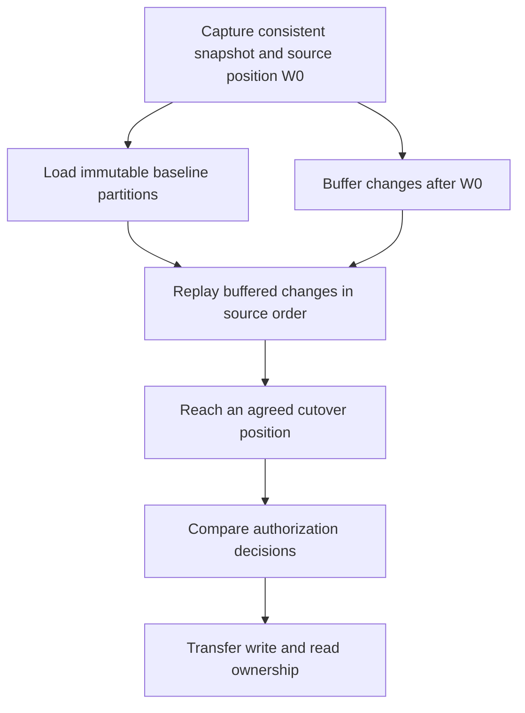

# Bootstrap Millions of SpiceDB Relationships from Legacy RBAC

Author: [nawazdhandala](https://www.github.com/nawazdhandala)

Tags: SpiceDB, RBAC, Data Migration, Authorization

Description: Plan a large RBAC migration with a tested role model, bounded import transactions, durable progress records, change capture, and authorization comparisons.

Loading several million relationships is only one part of an authorization migration. The harder questions are whether the new model preserves the old decisions, whether changes made during the export are retained, and whether a failed import can resume without restoring revoked access.

RBAC means role-based access control. A legacy system usually maps users to roles and roles to actions on resources. SpiceDB represents those links as relationships and calculates permissions from a schema. Start by preserving that meaning, then optimize the loading path. Authzed's migration guidance separates schema, relationship data, and application call-site work. [Migration overview](https://authzed.com/docs/spicedb/migrate-to-spicedb/overview)

## Preserve role membership instead of expanding every grant

Suppose a role contains 200 people and grants access to 500 projects. Expanding that role into direct user-project grants creates 100,000 relationships. Keeping 200 membership links and 500 project-role links represents the same simple membership-based policy with 700 relationships.

That arithmetic only applies if the legacy semantics actually match. Explicit denials, role precedence, expiration, tenant boundaries, and resource inheritance need their own modeling decisions. Do not infer an administrator's powers from the role's name.

This small model uses `role#member` to refer to the users belonging to a role. The role object is not itself a user. The permission unions deliberately make editors able to read and administrators able to read and edit. [Subject relations and permission unions](https://authzed.com/docs/spicedb/concepts/schema)

Save this fixture as `rbac.yaml`:

```yaml
schema: |-
  definition user {}
  definition role {
    relation member: user
  }
  definition project {
    relation viewer: role#member
    relation editor: role#member
    relation administrator: role#member
    permission read = viewer + editor + administrator
    permission edit = editor + administrator
    permission manage = administrator
  }
relationships: |-
  role:acme/developers#member@user:acme/alice
  role:acme/auditors#member@user:acme/bob
  role:acme/operators#member@user:acme/carol
  project:acme/payments#editor@role:acme/developers#member
  project:acme/payments#viewer@role:acme/auditors#member
  project:acme/payments#administrator@role:acme/operators#member
assertions:
  assertTrue:
    - project:acme/payments#edit@user:acme/alice
    - project:acme/payments#read@user:acme/bob
    - project:acme/payments#manage@user:acme/carol
  assertFalse:
    - project:acme/payments#edit@user:acme/bob
    - project:acme/payments#read@user:other/alice
```

The tenant prefix is part of this application's identifier convention. SpiceDB does not interpret `acme/` as an automatic tenant boundary; the importer and schema must prevent cross-tenant links.

## Validate the model, then test the loaded system

The examples use **SpiceDB 1.57.1** and **zed 1.2.1**. First run the fixture locally:

```bash
zed validate rbac.yaml
```

All five assertions should pass. This evaluates the fixture's relationships, not data already stored in a running server. It is a model test, not evidence that a million-row load completed correctly. [Schema validation](https://authzed.com/docs/spicedb/modeling/validation-testing-debugging)

For the small import rehearsal, use an empty, isolated permissions system. Set its authenticated gRPC address, credential, and trusted CA bundle in the environment. The schema import replaces the lab schema, so do not point this command at an existing production system.

```bash
set -euo pipefail
: "${SPICEDB_ENDPOINT:?Set the isolated gRPC address}"
: "${SPICEDB_TOKEN:?Supply the isolated system credential}"
: "${SPICEDB_CA_FILE:?Set the trusted CA bundle path}"
zed_target() {
  zed --endpoint "$SPICEDB_ENDPOINT" --token "$SPICEDB_TOKEN" \
    --certificate-path "$SPICEDB_CA_FILE" "$@"
}
zed_target import rbac.yaml --batch-size 100 --workers 1
zed_target permission check project:acme/payments edit user:acme/alice \
  --consistency-full --json
zed_target permission check project:acme/payments edit user:acme/bob \
  --consistency-full --json
```

Expect Alice to have permission and Bob not to have it. The local review ran these checks on the memory datastore with no competing writes. Do not treat `fully_consistent` as a universal production read-after-write barrier: CockroachDB-backed SpiceDB has a documented exception. Carry appropriate write tokens through your production change and verification paths. [Consistency behavior](https://authzed.com/docs/spicedb/concepts/consistency)

## Choose the actual ingestion mechanism

In **zed 1.2.1**, `zed import` parses the relationship file into memory and calls `WriteRelationships` in batches using `TOUCH`. Its `--workers` flag controls concurrent batching workers. It is useful for fixtures and bounded files, but it is not a streaming `ImportBulkRelationships` invocation. [Pinned import implementation](https://github.com/authzed/zed/blob/v1.2.1/internal/cmd/import.go)

For a large initial load, the dedicated bulk API can avoid ordinary per-request write limits and reduce ingest overhead. It has two separate sizes to tune:

| Size | What it controls |
|---|---|
| Relationships in each streamed message | Network payload and client memory pressure |
| Relationships across the whole RPC | One datastore transaction's size and retry cost |

RPC means remote procedure call. Sending many small messages through one bulk RPC does not create many small commits. The whole stream belongs to one transaction. Start with bounded transaction partitions, measure your actual database, and increase carefully instead of putting the entire migration into one stream. [Bulk ingest guidance](https://authzed.com/docs/spicedb/ops/data/bulk-operations)

The API recommends ordering relationships by resource type, resource ID, relation, subject type, subject ID, and subject relation where practical. Its successful response contains `num_loaded`; it does not contain a write token. Record that count and use the relevant API response shape rather than assuming every mutation returns identical fields. Existing relationships cause a raw bulk-import transaction to fail. [Bulk API definition](https://github.com/authzed/api/blob/e89c0a673a7e234081ed186bd91dd8a30e3e2b03/authzed/api/v1/permission_service.proto)

## Make the export resumable and auditable

Create a stable mapping from legacy identifiers to SpiceDB identifiers before exporting. Preserve that mapping across retries. Deduplicate exact relationships, reject unmapped roles, and quarantine malformed records instead of silently dropping them.

For each immutable import partition, retain its source snapshot identifier, transformation version, schema hash, file hash, expected relationship count, transaction status, and acknowledged count. Record success only after the final RPC response. Bytes sent are not a commit acknowledgment.

Partition boundaries should make operational recovery understandable, such as a tenant plus a bounded resource range. A partition must still contain manageable transactions; a large tenant is not permission to create a single unbounded transaction. Keep rejected-record reports separate from successfully imported counts.

Do not use an import retry to apply current business intent blindly. If a snapshot says “grant” but a later change says “revoke,” replaying the older snapshot after the revoke restores access.

## Preserve changes made during the baseline load

A consistent snapshot needs an associated source position. Call that position `W0`: a database log position or another durable ordering marker, not a timestamp guessed from the export machine.



Change data capture, or CDC, records source database changes for later replay. Your database-specific snapshot and CDC procedure must guarantee no gap around `W0`; this article does not prescribe a universal export command.

Keep the initial SpiceDB destination outside production authorization while the baseline is incomplete. Finish baseline imports before applying later revocations for the same resources, or use an explicitly versioned protocol that rejects obsolete baseline writes. At cutover, briefly fence writers or use a proven handoff protocol so catching up to one position does not leave a final unrecorded gap.

## Accept decisions, not just row counts

Compare old and new authorization results for ordinary users, administrators, removed memberships, cross-tenant identities, and resources with exceptional rules. Inspect mismatches by policy category. Matching totals can hide one missing grant and one extra grant.

Shadow checks can compare both engines while the legacy decision remains authoritative. Define who reviews mismatches, what blocks cutover, and how rollback handles changes accepted after the switch. Reverting the read path is unsafe if the legacy store has stopped receiving those changes.

The local review covered the six-relationship fixture, its five assertions, live permission checks, and a 2,101-relationship batched rehearsal. It did not load millions of rows or benchmark a production datastore. Use those checks to establish correctness, then measure throughput, transaction duration, retries, and impact on permission-check latency in your own representative environment.
