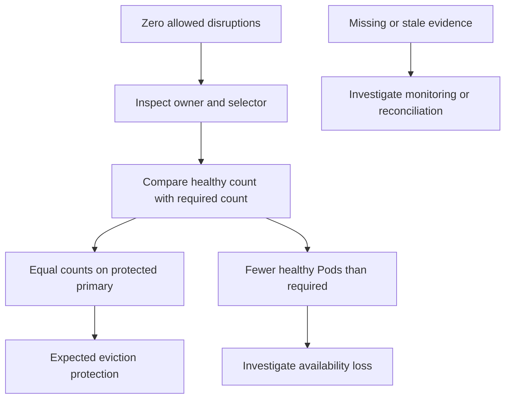

# Avoid False PDB Alerts for a Protected CloudNativePG Primary

Author: [nawazdhandala](https://www.github.com/nawazdhandala)

Tags: Kubernetes, CloudNativePG, PostgreSQL, Prometheus, PodDisruptionBudget

Description: Separate intentional primary protection from unhealthy Pods, write a tested Prometheus alert, and preserve CloudNativePG safeguards during maintenance.

Your PostgreSQL cluster has one healthy primary and two healthy replicas, yet a dashboard warns that its primary PodDisruptionBudget has “InsufficientPods.” Adding another replica does not clear the warning. The budget is protecting a different set of Pods than the dashboard seems to imply.

CloudNativePG, abbreviated CNPG, manages PostgreSQL instances and their roles. The primary accepts writes; replicas follow it. A primary-only PodDisruptionBudget, or PDB, can deliberately permit zero voluntary evictions while every instance is healthy. That is an availability policy, not sufficient evidence of an outage.

The behavior below is source-checked against **CloudNativePG 1.27.0**. The metrics use **kube-state-metrics 2.16.0**, and the rule examples were evaluated locally with **Prometheus 3.7.3 promtool**. These are reproducible reference versions, not a recommendation to downgrade an installed operator.

## Read the budget as a policy

In the pinned CNPG source, the primary budget is named `<cluster>-primary`, selects that cluster's primary role, and requires one healthy selected Pod. A separate replica budget is built for clusters with at least three instances. Its healthy floor is the instance count minus two. [CNPG 1.27 budget construction](https://github.com/cloudnative-pg/cloudnative-pg/blob/v1.27.0/pkg/specs/poddisruptionbudget.go)

For a healthy three-instance cluster, the expected steady state is:

| Budget | Selected Pods | Current healthy | Required healthy | Allowed disruptions |
|---|---:|---:|---:|---:|
| Primary | 1 | 1 | 1 | 0 |
| Replicas | 2 | 2 | 1 | 1 |

The primary meets its healthy floor exactly. Evicting it immediately would violate that floor. Its two replicas do not increase the primary budget's allowance because they do not match the primary selector.

The original upstream report shows precisely this pattern: one healthy primary, one required, and zero allowance. Its warning should not be interpreted as a demand to weaken the budget. [CloudNativePG discussion](https://github.com/cloudnative-pg/cloudnative-pg/discussions/3865)

## Confirm the warning refers to the intended object

Use an account with read access, `kubectl`, and `jq`. Replace `staging`, `databases`, and `orders` with your context, namespace, and PostgreSQL cluster name:

```bash
kubectl --context staging -n databases get pdb orders-primary -o json |
  jq '{name: .metadata.name, owners: .metadata.ownerReferences,
       generation: .metadata.generation,
       observedGeneration: .status.observedGeneration,
       selector: .spec.selector, minAvailable: .spec.minAvailable,
       currentHealthy: .status.currentHealthy,
       desiredHealthy: .status.desiredHealthy,
       disruptionsAllowed: .status.disruptionsAllowed,
       conditions: .status.conditions}'
```

Verify that the owner is the expected CNPG `Cluster`, that the selector targets the primary, and that `observedGeneration` matches `generation`. The latter comparison checks whether status reflects the current PDB specification. A dashboard may be showing an older observation; compare its timestamp with this API response.

Then inspect the database's view and Pod roles:

```bash
kubectl --context staging -n databases get cluster.postgresql.cnpg.io orders \
  -o json | jq '{primary: .status.currentPrimary,
                 ready: .status.readyInstances, phase: .status.phase}'
kubectl --context staging -n databases get pods -l cnpg.io/cluster=orders \
  -L cnpg.io/instanceRole
```

CNPG 1.27 uses `cnpg.io/instanceRole` for the primary/replica selector. Older reports may show the legacy `role` label. Inspect the actual object rather than copying the label from an old screenshot. [Pinned role labels](https://github.com/cloudnative-pg/cloudnative-pg/blob/v1.27.0/pkg/utils/labels_annotations.go)



## Alert on a healthy-Pod deficit

A generic expression that treats `disruptionsAllowed == 0` as an outage cannot distinguish the two branches above. Keep zero allowance visible as maintenance information, but use a different condition for an availability warning.

Save this as `pdb-rules.yaml`. It assumes one cluster's metrics, with the actual scrape job named `kube-state-metrics`; replace that job if yours differs. Both metrics must be collected with matching target labels.

```yaml
groups:
  - name: pdb-availability
    rules:
      - alert: PDBHealthyPodsBelowRequirement
        expr: |
          kube_poddisruptionbudget_status_current_healthy{job="kube-state-metrics"}
          <
          kube_poddisruptionbudget_status_desired_healthy{job="kube-state-metrics"}
        for: 5m
        labels:
          severity: warning
        annotations:
          summary: PDB has fewer healthy Pods than required
```

The metric names and `namespace`/`poddisruptionbudget` labels come from the pinned exporter documentation. No custom PDB label allowlist is needed for those built-in identity labels. [kube-state-metrics PDB metrics](https://github.com/kubernetes/kube-state-metrics/blob/v2.16.0/docs/metrics/policy/poddisruptionbudget-metrics.md)

For a healthy protected primary, `1 < 1` produces no matching result. For an unhealthy primary, `0 < 1` produces a result, so the alert becomes pending and fires after five minutes if the condition persists. The five-minute delay is an example noise filter, not an acceptable database outage target. Keep faster service-availability alerts where required. [Prometheus alert timing](https://prometheus.io/docs/prometheus/latest/configuration/alerting_rules/)

Use the comparison exactly as shown: adding `bool` changes it into a numeric result for false comparisons too. Alerting rules become active when the expression returns a series, even when its value is zero. [Prometheus comparison operators](https://prometheus.io/docs/prometheus/latest/querying/operators/)

If metrics are centrally collected from several clusters, preserve a cluster identity label and verify matching independently per cluster. Avoid aggregating different PostgreSQL clusters into one total, where healthy instances could hide another cluster's deficit.

## Test the expected healthy case before installing the rule

This small test proves that a protected primary does not fire. Save it beside the rule as `pdb-tests.yaml`:

```yaml
rule_files:
  - pdb-rules.yaml
evaluation_interval: 1m
tests:
  - name: healthy protected primary
    interval: 1m
    input_series:
      - series: 'kube_poddisruptionbudget_status_current_healthy{job="kube-state-metrics",namespace="databases",poddisruptionbudget="orders-primary"}'
        values: '1+0x10'
      - series: 'kube_poddisruptionbudget_status_desired_healthy{job="kube-state-metrics",namespace="databases",poddisruptionbudget="orders-primary"}'
        values: '1+0x10'
    alert_rule_test:
      - eval_time: 10m
        alertname: PDBHealthyPodsBelowRequirement
        exp_alerts: []
```

Run with the matching Prometheus tool available on your path:

```bash
promtool check rules pdb-rules.yaml
promtool test rules pdb-tests.yaml
```

Both commands should succeed. Extend the test before rollout: an unhealthy primary should fire after the delay, a short readiness dip should not, and a recovered primary should clear the alert. Also test a replica deficit and an unrelated PDB so the change does not accidentally suppress broader failures. The notation above supplies eleven identical samples at one-minute intervals. [Prometheus rule tests](https://prometheus.io/docs/prometheus/latest/configuration/unit_testing_rules/)

## Preserve coverage when changing the existing alert

Adding the new rule will not remove the old noisy alert. Update the rule that produces the warning through its configuration source. If a separate maintenance-capacity alert is still useful, give it an appropriate description and a narrowly reviewed exception for the protected primary. Do not silence every CNPG alert or every PDB ending in `-primary` without verifying ownership and policy.

An empty comparison result can also mean missing input data. Monitor scrape health and expected metric presence separately. For this specific expected budget, the following diagnostic expression detects a complete ten-minute gap in its healthy-count series:

```promql
absent_over_time(kube_poddisruptionbudget_status_current_healthy{
  job="kube-state-metrics",namespace="databases",
  poddisruptionbudget="orders-primary"
}[10m])
```

A result identifies missing telemetry or a missing object, not its cause. Check the exporter target, namespace permissions, resource filtering, and whether the budget was renamed or removed. An exporter that still responds successfully can nevertheless omit a resource. [Prometheus absence functions](https://prometheus.io/docs/prometheus/latest/querying/functions/#absent_over_time)

Finally, keep database checks separate: successful application transactions, a usable write endpoint, replication health, and operator reconciliation matter beyond Pod readiness. During node maintenance, CNPG normally coordinates a switchover before allowing the former primary to leave. A failed switchover needs investigation; disabling `enablePDB` to make a dashboard green removes protection instead of fixing the alert. [CNPG maintenance behavior](https://cloudnative-pg.io/docs/1.27/kubernetes_upgrade/)
