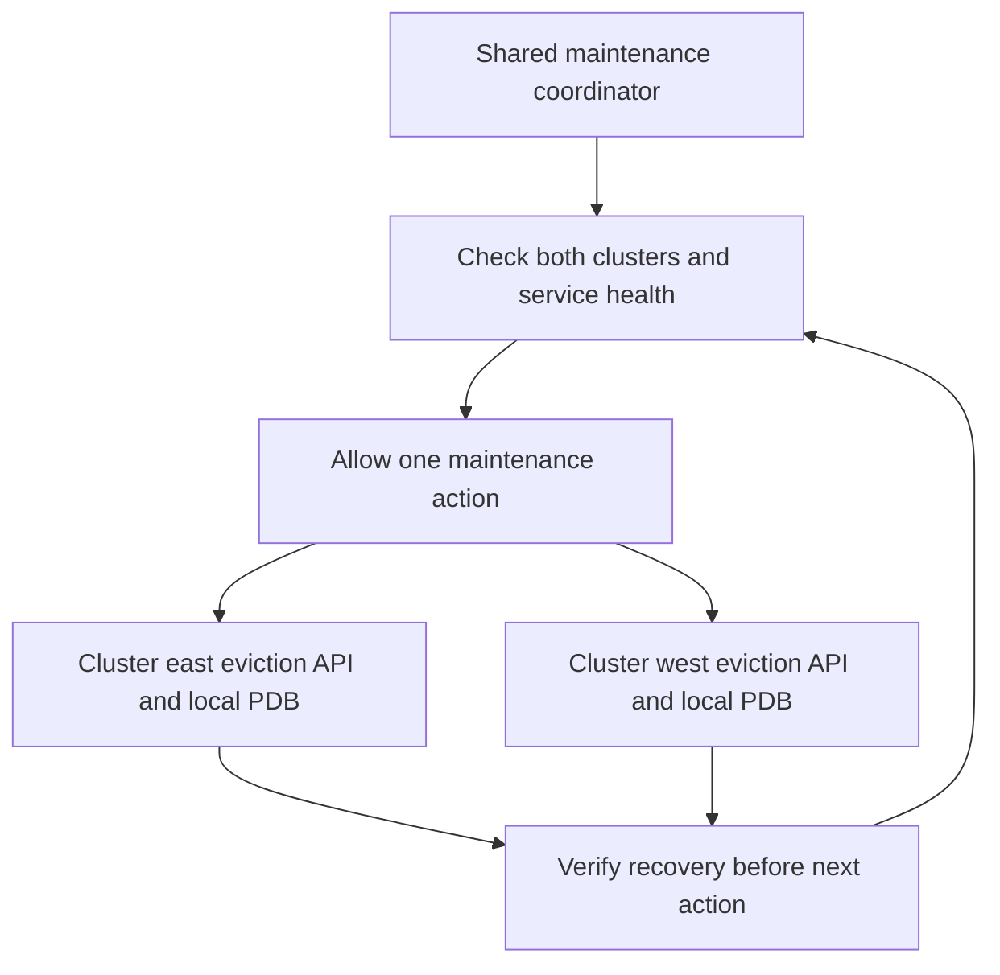

# Coordinate Maintenance Across Clusters with Local PDBs

Author: [nawazdhandala](https://www.github.com/nawazdhandala)

Tags: Kubernetes, PodDisruptionBudget, GitHub Action, Automation

Description: Combine namespace-scoped disruption budgets with shared maintenance coordination, fleet health checks, and recovery gates across Kubernetes clusters.

Two Kubernetes clusters serve the same checkout service. Each has three replicas and a PodDisruptionBudget requiring two healthy Pods. A maintenance job in each cluster asks to evict one Pod. Both local requests can be valid, yet the service falls from six healthy replicas to four.

If the service needs five replicas across its fleet to meet its load target, neither PodDisruptionBudget can enforce that requirement alone. The missing control is coordination between maintenance jobs, backed by evidence that the service can absorb each planned disruption.

A PodDisruptionBudget, or PDB, is a namespaced Kubernetes resource. Its selector identifies Pods in its namespace, and the eviction path evaluates budgets in the target Pod's namespace. It does not select Pods in another namespace or another cluster. Reusing the same PDB name or labels everywhere does not join their allowances. [PDB API scope](https://kubernetes.io/docs/reference/kubernetes-api/policy/pod-disruption-budget-v1/), [Kubernetes 1.34 eviction selection](https://github.com/kubernetes/kubernetes/blob/v1.34.0/pkg/registry/core/pod/storage/eviction.go)

## Define the service-wide safety condition

Keep each local PDB. Add a maintenance rule that describes what must remain available across the actual failure domains:

| Check | Example requirement |
|---|---|
| Local availability | Each cluster retains at least two healthy checkout Pods |
| Combined capacity | At least five of six equivalent replicas remain available during planned maintenance |
| Traffic path | Routing can reach the remaining healthy capacity |
| Shared dependencies | Database, queue, and identity services are healthy |
| Concurrent work | At most one planned checkout disruption across both clusters |

These numbers are an example, not a capacity formula. Six replicas with different sizes or traffic assignments are not necessarily interchangeable. Establish the requirement with load and failover evidence. For a replicated database, voting membership and replication lag may matter more than a total Pod count.

PDBs also cannot prevent every kind of disruption. Node failures and direct workload-controller updates need their own controls. The coordination rule governs the maintenance mechanisms that participate in it; it does not turn local PDBs into a global availability guarantee. [Kubernetes disruption boundaries](https://kubernetes.io/docs/concepts/workloads/pods/disruptions/)



Only one branch should be active for the same service at a time. Recovery is part of the coordinated operation, not an afterthought once the eviction request succeeds.

## Put participating jobs behind one coordination boundary

A practical starting point is a dedicated operations repository whose maintenance workflows share one GitHub Actions concurrency group. The group must represent the protected service, such as `checkout-production-maintenance`, rather than a particular cluster or branch.

GitHub concurrency groups operate within a repository. Setting `cancel-in-progress: false` avoids automatically canceling an active operation when another request arrives. With the default queue behavior, a newer pending run replaces an older pending run; this is not a durable work queue for every requested change. Track the approved maintenance plan separately. [GitHub concurrency behavior](https://docs.github.com/en/actions/how-tos/write-workflows/choose-when-workflows-run/control-workflow-concurrency)

A different repository, a manual terminal, or a cloud provider's autonomous upgrade process does not acquire this group. Inventory those paths and route them through the coordinator or schedule them explicitly. Two independently configured locks, one in each cluster, would allow both operators to proceed and recreate the original problem.

## Start with a read-only coordination rehearsal

The following complete workflow performs **preflight inspection only**. It does not drain nodes or evict Pods. It requires a trusted Linux runner labeled `maintenance-readonly`, Bash, `jq 1.6`, and a compatible `kubectl`; the command/API checks here use **Kubernetes 1.34.0**. Provision two verified kubeconfig contexts, `east-prod` and `west-prod`, with read permission for the `kube-system` namespace object and the `checkout` PDB in `retail`.

```yaml
name: Checkout maintenance preflight
on:
  workflow_dispatch:
permissions: {}
concurrency:
  group: checkout-production-maintenance
  cancel-in-progress: false
jobs:
  inspect:
    runs-on: [self-hosted, linux, maintenance-readonly]
    timeout-minutes: 10
    steps:
      - name: Inspect both local budgets
        shell: bash
        run: |
          set -euo pipefail
          previous_uid=''
          for context in east-prod west-prod; do
            cluster_uid=$(kubectl --context "$context" --request-timeout=10s \
              get namespace kube-system -o jsonpath='{.metadata.uid}')
            if [[ -z "$cluster_uid" || "$cluster_uid" == "$previous_uid" ]]; then
              echo "Missing cluster identity or duplicate context target" >&2
              exit 1
            fi
            previous_uid="$cluster_uid"
            budget=$(kubectl --context "$context" -n retail \
              --request-timeout=10s get pdb checkout -o json)
            jq -e '
              .status.observedGeneration == .metadata.generation and
              .status.expectedPods == 3 and
              .status.currentHealthy == 3 and
              .status.desiredHealthy == 2 and
              .status.disruptionsAllowed > 0
            ' <<<"$budget" >/dev/null
            printf '%s: current budget reports three healthy Pods\n' "$context"
          done
```

The runner label and context names are deployment-specific prerequisites. `permissions: {}` limits the workflow's GitHub token; it does not configure Kubernetes authorization. Supply Kubernetes access through your approved runner identity mechanism. [Workflow syntax and runner selection](https://docs.github.com/en/actions/reference/workflows-and-actions/workflow-syntax)

The namespace UID comparison catches the common mistake of two context names pointing at the same cluster. It is a configuration check, not cryptographic cluster attestation. The PDB check deliberately expects this exact three-replica topology; scaling the service requires reviewing the check instead of silently accepting changed assumptions.

If either API is unreachable, status is stale, or a healthy count is below three, the job fails. Expected output has one success line per context. These are sequential snapshots, not an atomic fleet transaction. A healthy preflight can become stale immediately afterward, and no allowance is reserved.

## Keep the action and recovery inside the same operation

After the rehearsal, incorporate the approved maintenance procedure into the same coordinated workflow. Do not finish the preflight workflow and launch an unrelated maintenance workflow outside its group; that would release the coordination boundary before the risky work begins.

The operational sequence should be explicit:

1. Record the change, participating clusters, local PDB identities, and target workload or node.
2. Check both clusters and the live service, including request success, latency, routing, and shared dependencies.
3. Perform one approved action in the first cluster using eviction-aware maintenance tooling.
4. Verify replacement readiness and application recovery, then observe a defined stability interval.
5. Re-evaluate the other cluster and service before permitting the next action.

Kubernetes admission remains authoritative for each eviction. If the local PDB rejects the request, preserve that protection and investigate. A global coordinator's approval does not justify a direct Pod deletion. [API-initiated eviction](https://kubernetes.io/docs/concepts/scheduling-eviction/api-eviction/)

Keep the coordination scope broad enough to include other operations that consume the same capacity. A database migration and a node upgrade might threaten the same service even though they use different workflows and touch different Kubernetes objects.

## Plan for interrupted coordination

A failed job or canceled runner does not prove that an external cloud upgrade stopped. Some operations continue after their initiating client exits. Before another run acts, reconcile the recorded operation with the actual cloud and Kubernetes state and verify recovery.

If the workflow system cannot provide that recovery discipline, use a maintenance service with durable operation state and a single authority for granting work. A lock timeout alone is insufficient: a previous worker may still be executing after its lease expires. New work must not start merely because the coordinator has stopped hearing from it.

Rehearse three failure cases before production use: the second cluster becomes unhealthy during maintenance, the runner disappears after starting an operation, and another team requests overlapping work. Success means the system stops additional disruption, preserves local budgets, identifies the unfinished operation, and resumes only after its state is understood. That is the coordination local PDBs cannot provide by themselves.
