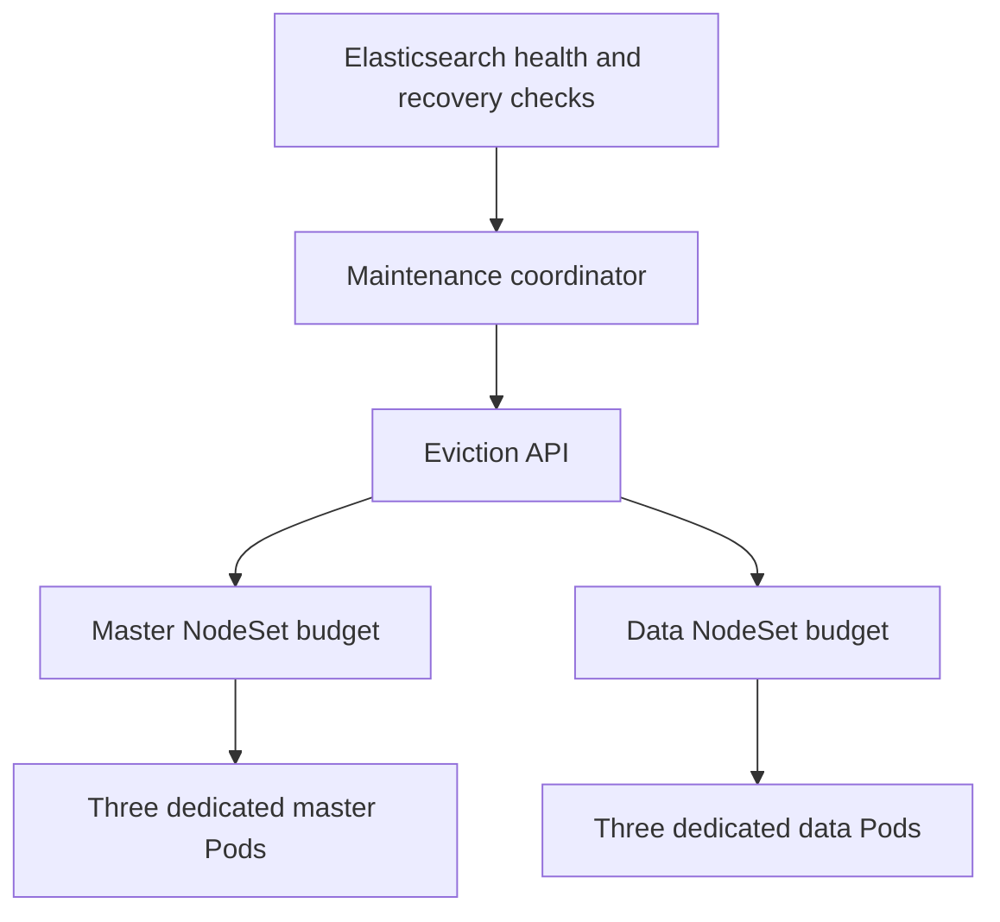

# Separate Elasticsearch Master and Data Node PDBs in ECK

Author: [nawazdhandala](https://www.github.com/nawazdhandala)

Tags: Kubernetes, ECK, Elasticsearch, PodDisruptionBudget

Description: Choose ECK-managed role budgets or separate NodeSet budgets, verify their selectors, and plan maintenance without losing sight of Elasticsearch health.

A six-Pod Elasticsearch cluster might contain three master-eligible nodes and three data nodes. Treating all six as one availability pool hides an important distinction: the masters maintain cluster coordination, while the data nodes hold shards and answer searches. Maintenance needs to protect both groups.

A PodDisruptionBudget, or PDB, limits voluntary Pod evictions. It cannot establish that Elasticsearch has enough shard copies or a functioning voting configuration. Separating budgets gives each group its own eviction allowance, but the maintenance process still needs to consider the whole cluster.

This guide follows **ECK 3.2.0**, with Kubernetes **1.34.0** API examples. Start by checking whether ECK already provides the separation you need before introducing independently managed objects.

## Choose who owns the policy

ECK 3.2 introduced Enterprise role-based budgets. The Basic policy uses one default budget; ECK 3.1 and earlier also used that single-budget model regardless of license. A custom `spec.podDisruptionBudget.spec` overrides the generated policy instead of adding another role budget. [Elastic PDB documentation](https://www.elastic.co/docs/deploy-manage/deploy/cloud-on-k8s/pod-disruption-budget)

The pinned implementation groups NodeSets by connected roles. For example, two dedicated master NodeSets share a budget. Ordinary data roles are normalized into one group; frozen data has separate handling. A NodeSet carrying both master and ordinary data roles can connect those groups, so names such as `masters` and `data` do not by themselves guarantee separation. [ECK 3.2 role grouping](https://github.com/elastic/cloud-on-k8s/blob/v3.2.0/pkg/controller/elasticsearch/pdb/reconcile_with_roles.go)

| Choice | Policy owner | Practical consequence |
|---|---|---|
| Enterprise automatic role budgets | ECK | Role grouping and observed Elasticsearch health influence allowances |
| Basic default budget | ECK | One budget covers the cluster |
| Separate external NodeSet budgets | Your configuration repository | You maintain membership, thresholds, and additional health checks |

Prefer the automatic policy when it meets your requirements. For a dedicated master group, the pinned role policy can permit one disruption at green or yellow health; ordinary data requires green. Red or unknown health blocks both. These rules do not mean that an ongoing shard incident is an appropriate time for unrelated master maintenance. [ECK 3.2 allowance calculation](https://github.com/elastic/cloud-on-k8s/blob/v3.2.0/pkg/controller/elasticsearch/pdb/reconcile_with_roles.go)

## Inspect the topology before writing selectors

The example below assumes an **existing** cluster named `search` in `observability`, with two NodeSets: `masters` has three nodes with `node.roles: ["master"]`; `data` has three with `node.roles: ["data_hot", "data_content", "ingest"]`. Elasticsearch requires appropriate data roles as well as master eligibility; add roles needed by your actual features. This is not an instruction to repurpose existing data nodes or discard their storage. [Elasticsearch node roles](https://www.elastic.co/docs/deploy-manage/distributed-architecture/clusters-nodes-shards/node-roles)

With read access, `kubectl`, and `jq` installed, replace the context and resource names in these inspections:

```bash
kubectl --context staging -n observability get elasticsearch search -o json |
  jq '{nodeSets: .spec.nodeSets, budget: .spec.podDisruptionBudget}'
kubectl --context staging -n observability get pods \
  -l elasticsearch.k8s.elastic.co/cluster-name=search \
  -L elasticsearch.k8s.elastic.co/statefulset-name
kubectl --context staging -n observability get pdb -o yaml
```

Expect three Pods labeled `search-es-masters` and three labeled `search-es-data`. Record the actual labels, all matching PDB selectors, and their owner references. An unrelated manually installed cluster-wide budget can still overlap the new objects.



The separate branches describe distinct Pod membership. They do not promise that simultaneous maintenance across both branches is safe.

## Define external budgets only when needed

For an external-policy deployment, ECK documents an empty `podDisruptionBudget` object as the way to disable its managed budgets. Set the following field in the complete Elasticsearch manifest maintained by your deployment system, preserving its other fields:

```yaml
spec:
  podDisruptionBudget: {}
```

This is a **manifest fragment**, not a standalone Elasticsearch resource. If an existing override has nested fields, ensure the resulting stored value is actually `{}`. An empty JSON merge-patch object does not necessarily remove existing nested fields. Confirm the final object before considering the handoff complete. [ECK disable behavior](https://github.com/elastic/cloud-on-k8s/blob/v3.2.0/pkg/apis/common/v1/common.go), [Kubernetes patch behavior](https://kubernetes.io/docs/tasks/manage-kubernetes-objects/update-api-object-kubectl-patch/)

Save these external objects as `role-budgets.yaml` for the verified six-Pod topology:

```yaml
apiVersion: policy/v1
kind: PodDisruptionBudget
metadata:
  name: search-masters-maintenance
  namespace: observability
spec:
  minAvailable: 2
  selector:
    matchLabels:
      elasticsearch.k8s.elastic.co/cluster-name: search
      elasticsearch.k8s.elastic.co/statefulset-name: search-es-masters
---
apiVersion: policy/v1
kind: PodDisruptionBudget
metadata:
  name: search-data-maintenance
  namespace: observability
spec:
  minAvailable: 2
  selector:
    matchLabels:
      elasticsearch.k8s.elastic.co/cluster-name: search
      elasticsearch.k8s.elastic.co/statefulset-name: search-es-data
```

Both labels must match. The cluster label identifies the Elasticsearch deployment, and the StatefulSet label identifies its NodeSet. Elastic documents these labels for separate NodeSet budgets; inspect them again after any NodeSet rename. [Documented selector example](https://www.elastic.co/docs/deploy-manage/deploy/cloud-on-k8s/pod-disruption-budget)

Each budget requires two selected Pods to remain healthy. At three healthy Pods, that normally leaves one allowance. The data threshold is an example availability floor, **not proof of shard redundancy**. With external budgets, your maintenance checks must explicitly verify shard health and recovery.

An integer `minAvailable` counts selected healthy Pods without deriving a percentage from a workload's scale. If either group later grows to six, a floor of two can permit substantially more disruption. Review thresholds whenever topology changes. [Kubernetes PDB thresholds](https://kubernetes.io/docs/tasks/run-application/configure-pdb/)

## Preview, then perform a controlled handoff

Use API-side validation before scheduling the change:

```bash
kubectl --context staging apply --dry-run=server --validate=strict \
  -f role-budgets.yaml -o yaml
```

Successful output confirms that the API accepts the proposed objects. It does not create them, test the ECK reconciliation loop, or prove that their selectors cover the intended Pods.

Treat ownership migration as maintenance itself. Pause automated drains and other voluntary eviction initiators. Keep that pause through disabling the ECK policy, observing removal of its owned budgets, and creating the external budgets through your normal deployment workflow. There is no atomic transaction across those changes: one ordering creates an unprotected interval, while the other creates temporary overlapping selectors. Neither interval is suitable for starting evictions.

After reconciliation, inspect the resulting objects and membership:

```bash
kubectl --context staging -n observability get pdb \
  search-masters-maintenance search-data-maintenance -o yaml
kubectl --context staging -n observability get pods \
  -l 'elasticsearch.k8s.elastic.co/cluster-name=search,elasticsearch.k8s.elastic.co/statefulset-name=search-es-masters' \
  -o name
kubectl --context staging -n observability get pods \
  -l 'elasticsearch.k8s.elastic.co/cluster-name=search,elasticsearch.k8s.elastic.co/statefulset-name=search-es-data' \
  -o name
```

Expect three distinct Pod names in each list, with no intersection. Also recheck **all** namespace PDBs from the first inspection: two correct new selectors do not rule out a third overlapping budget. Kubernetes' eviction implementation rejects a Pod covered by multiple PDBs. [Kubernetes 1.34 eviction implementation](https://github.com/kubernetes/kubernetes/blob/v1.34.0/pkg/registry/core/pod/storage/eviction.go)

Before resuming maintenance, require current PDB status, the expected healthy counts, stable Elasticsearch health, and available replacement capacity. Run one controlled eviction sequence first, waiting for recovery before continuing. Two independent budgets can each admit an eviction; they do not impose a cluster-wide concurrency limit. Keep that limit in the maintenance coordinator, and revisit it explicitly rather than discovering it during a drain.
