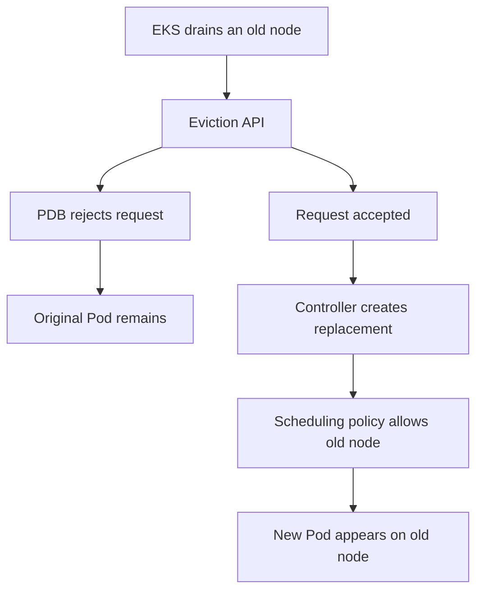

# Distinguish PDB Rejections from Broad Tolerations in EKS Upgrades

Author: [nawazdhandala](https://www.github.com/nawazdhandala)

Tags: Kubernetes, Amazon EKS, PodDisruptionBudget, Troubleshooting

Description: Use eviction responses, Pod identities, and scheduling policy to tell a blocked EKS drain from workloads returning to a retiring node.

An EKS managed node-group upgrade fails with `PodEvictionFailure`. The old node still has application Pods, so it is tempting to blame the PodDisruptionBudget immediately. But a node can stay occupied for two very different reasons: the original Pods cannot leave, or replacement Pods keep returning.

AWS documents both restrictive disruption budgets and Deployments that tolerate all taints as causes of this failure. The investigation should establish which sequence actually happened before changing either policy. [EKS upgrade failure causes](https://docs.aws.amazon.com/eks/latest/userguide/managed-node-update-behavior.html)

This guide uses Kubernetes **1.34.0** scheduler and eviction behavior as its source baseline. The AWS inspection command follows the AWS CLI v2 interface. Everything shown initially is read-only; the later YAML is a reviewed workload-template example, not an emergency patch.

## Separate eviction from scheduling

A PodDisruptionBudget, or PDB, limits voluntary evictions by requiring enough selected Pods to remain healthy. A toleration affects whether a Pod may be scheduled onto a node carrying a matching taint. A taint is a node-side scheduling restriction; a toleration allows a Pod past that particular restriction.

A toleration does not grant permission to violate a PDB. Likewise, a PDB does not stop the scheduler from placing a replacement back onto the old node.



AWS's default and minimal update strategies differ in when replacement capacity is created. Both can fail when selected nodes do not empty within the documented drain window. Record the strategy and available capacity as part of the investigation rather than assuming that spare nodes already exist. [Managed node update phases](https://docs.aws.amazon.com/eks/latest/userguide/managed-node-update-behavior.html)

## Preserve the failed-update evidence

With read-only EKS permissions and an authenticated AWS CLI, replace the example names, region, and update ID:

```bash
aws eks describe-update \
  --region us-east-1 \
  --name example-cluster \
  --nodegroup-name example-workers \
  --update-id REPLACE_WITH_UPDATE_ID \
  --query 'update.{status:status,errors:errors}' \
  --output json
```

Save the failure time, error code, message, and resource identifiers. `PodEvictionFailure` identifies the failed phase, not a complete diagnosis of every Pod. [AWS describe-update reference](https://docs.aws.amazon.com/cli/latest/reference/eks/describe-update.html)

For an affected node, use `kubectl` and `jq` with read access. Replace `old-worker` with the actual Kubernetes node name:

```bash
kubectl --context staging get node old-worker -o json |
  jq '{name: .metadata.name, unschedulable: .spec.unschedulable,
       taints: .spec.taints, labels: .metadata.labels}'
kubectl --context staging get pods -A \
  --field-selector spec.nodeName=old-worker -o json |
  jq '.items[] | {namespace: .metadata.namespace, name: .metadata.name,
       uid: .metadata.uid, created: .metadata.creationTimestamp,
       deleting: .metadata.deletionTimestamp,
       owner: .metadata.ownerReferences, phase: .status.phase}'
```

Repeat the snapshot while the controlled upgrade is active, preserving timestamps. Pod names alone are insufficient: a StatefulSet can recreate the same name with a new UID. A UID is the unique identity of that specific object. A new UID on the same node establishes replacement, but still needs scheduling evidence to explain why it returned.

## Find the branch supported by evidence

Use EKS control-plane audit logs when they were enabled for the incident. Inspect `pods/eviction` requests, response codes, target names, and budget-related status causes. Logs enabled afterward cannot reconstruct missing historical requests. Keep the original response content rather than reducing every rejection to “PDB problem.” [EKS control-plane logging](https://docs.aws.amazon.com/eks/latest/userguide/control-plane-logs.html)

| Observation | Most useful next investigation |
|---|---|
| Budget-related 429 rejection, same Pod UID persists | PDB allowance, generation, healthy counts, and matching selectors |
| Successful eviction, new Pod UID later bound to the same old node | Replacement controller, tolerations, node selection, and scheduler events |
| Eviction accepted, original Pod remains terminating | Graceful shutdown, lifecycle hooks, volumes, and finalizers |
| Replacement remains Pending elsewhere | Capacity, affinity, storage topology, and readiness recovery |

A successful request alone does not prove that termination completed. A 429 alone is also insufficient: throttling can use that status. Kubernetes' pinned eviction code distinguishes an unreconciled budget from one with no disruption allowance in its error details. [Kubernetes 1.34 eviction implementation](https://github.com/kubernetes/kubernetes/blob/v1.34.0/pkg/registry/core/pod/storage/eviction.go)

For the budget branch, inspect all selectors in the Pod's namespace, then compare `observedGeneration`, `currentHealthy`, `desiredHealthy`, and `disruptionsAllowed`. Overlapping PDBs are another configuration error. Restore missing healthy capacity or correct a mistaken policy based on workload requirements; a larger retry count does not make an impossible floor achievable.

## Inspect the actual tolerations

For the scheduling branch, inspect both the admitted Pod and the controller template. The example assumes a Deployment named `checkout`; follow owner references first because your workload may instead be a StatefulSet, DaemonSet, or operator-managed resource.

```bash
kubectl --context staging -n retail get pdb -o yaml
kubectl --context staging -n retail get pod checkout-example -o json |
  jq '{uid: .metadata.uid, node: .spec.nodeName,
       scheduler: .spec.schedulerName, tolerations: .spec.tolerations,
       nodeSelector: .spec.nodeSelector, affinity: .spec.affinity}'
kubectl --context staging -n retail get deployment checkout -o json |
  jq '.spec.template.spec | {tolerations, nodeSelector, affinity, nodeName}'
```

This fragment tolerates every taint key, value, and effect:

```yaml
tolerations:
  - operator: Exists
```

An empty key with `Exists` matches all keys; an omitted effect matches every effect. Even restricting this broad entry to `effect: NoSchedule` still permits the unschedulable-node restriction used by the default scheduler. Restricting an otherwise broad entry to `NoExecute` alone does not match that particular `NoSchedule` restriction. [Kubernetes toleration matching](https://github.com/kubernetes/kubernetes/blob/v1.34.0/staging/src/k8s.io/api/core/v1/toleration.go)

Cordon state deserves special attention. The Kubernetes 1.34 `NodeUnschedulable` plugin checks whether a Pod tolerates `node.kubernetes.io/unschedulable` with effect `NoSchedule`; such a Pod can pass that filter even when `node.spec.unschedulable` is true. Other scheduler filters still apply, so tolerating it makes placement possible rather than guaranteed. [Pinned scheduler filter](https://github.com/kubernetes/kubernetes/blob/v1.34.0/pkg/scheduler/framework/plugins/nodeunschedulable/node_unschedulable.go)

Also inspect admission-time mutations and custom schedulers. A controller that sets `nodeName` directly follows a different placement path. Do not attribute every unexpected placement to a wildcard merely because one is present. [Taints and scheduling](https://kubernetes.io/docs/concepts/scheduling-eviction/taint-and-toleration/)

## Narrow application policy with a replacement-capacity check

Suppose this application legitimately runs on nodes labeled `workload=checkout` and tainted `dedicated=checkout:NoSchedule`. The intended template fragment could be:

```yaml
spec:
  template:
    spec:
      nodeSelector:
        workload: checkout
      tolerations:
        - key: dedicated
          operator: Equal
          value: checkout
          effect: NoSchedule
```

This permits the dedicated-node taint without granting blanket permission for the unschedulable taint. The selector separately restricts placement to the labeled pool. Confirm that replacement nodes have that label, suitable storage access, and enough resources before making the change. Otherwise, narrowing a toleration can trade returning Pods for Pending Pods.

Change the owning Helm values, GitOps manifest, or operator configuration. Existing Pods do not automatically inherit a changed template; plan a controlled rollout and verify the admitted replacements. Deployment rollouts have their own availability controls, so do not assume a PDB limits every controller-driven replacement. [Kubernetes disruption boundaries](https://kubernetes.io/docs/concepts/workloads/pods/disruptions/)

Do not remove broad tolerations indiscriminately from system agents. DaemonSets have special scheduling requirements and automatically receive several tolerations, including for unschedulable nodes. Review application Deployments separately from node-level networking, storage, and monitoring agents. [DaemonSet tolerations](https://kubernetes.io/docs/concepts/workloads/controllers/daemonset/)

Retry the managed update after a staging rehearsal shows the intended behavior: original Pods leave, replacements become healthy on eligible nodes, and the old node stays empty of the application workload. Keep the PDB protection intact while verifying placement. Forcing an upgrade before establishing this sequence can conceal the original failure and turn a maintenance delay into an outage.
