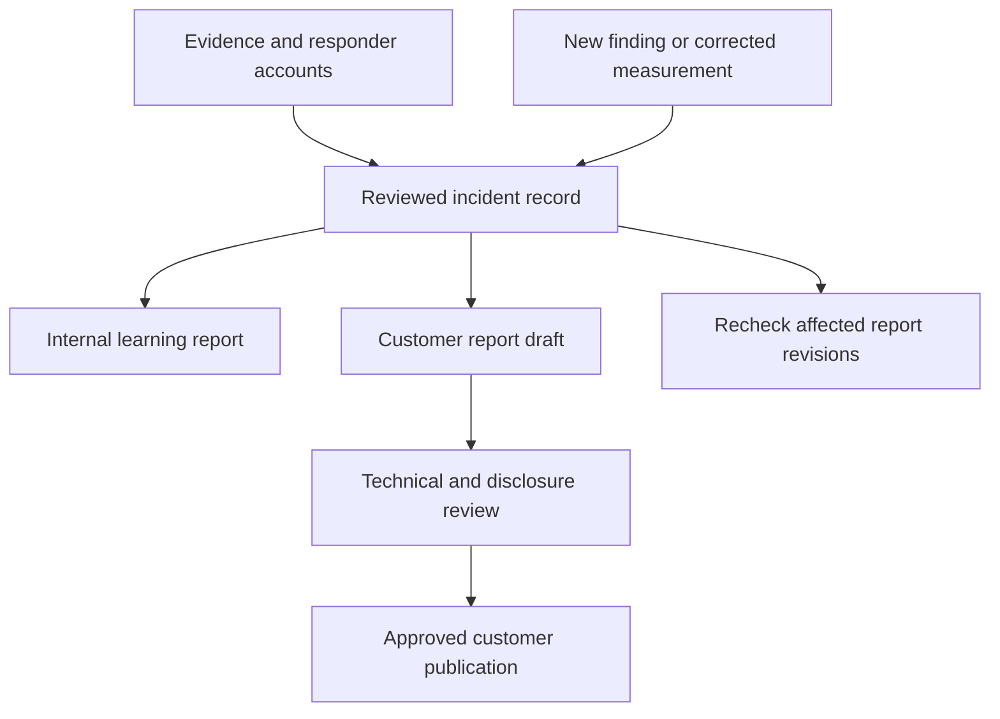

# Produce Internal and Customer Postmortems from One Incident Record

Author: [nawazdhandala](https://www.github.com/nawazdhandala)

Tags: Postmortem, Incident Management, SRE

Description: Build internal and customer-facing postmortems from a shared incident record, with consistent facts, explicit review, and traceable corrections.

An engineering postmortem says that customers experienced elevated errors for 36 minutes. The customer report says 20 minutes because its author copied the recovery time from an earlier status update. Both documents describe the same incident, but they now tell different stories.

Avoid this by maintaining one reviewed incident record and producing audience-specific reports from it. The reports can differ in detail and wording while sharing the same impact measurements, recovery milestones, causal confidence, and action status.

Atlassian describes public postmortems as commonly shortened versions of internal reports, with sensitive information removed. That makes the internal-to-external relationship explicit; it does not require publishing every internal detail. [Internal and external reports](https://www.atlassian.com/incident-management/postmortem/reports)

## Separate the record from its presentations

The incident record is the maintained account of what happened. Give it an incident identifier, revision, owner, timeline, evidence references, impact definitions, conclusions, and linked actions.

The internal report adds material needed for learning: diagnostic reasoning, alternative hypotheses, coordination problems, and detailed follow-up work. The customer report explains the affected capability, customer experience, recovery, supported cause, and improvements customers can reasonably expect.

Both are presentations of the record. Neither should become a separate source of measurements.



The review step matters even when report generation is automated. A correct measurement can still be inappropriate to disclose at account-level detail. Conversely, removing identifiers should not remove the customer impact itself.

## Define the facts that must agree

For a fictional file-export incident, establish the following shared facts before drafting either report:

| Field | Reviewed value |
|---|---|
| Incident ID and record revision | INC-EXAMPLE-17, revision 3 |
| Customer symptom | Some requested exports were delayed |
| Impact window | 09:00–09:36 UTC on 25 November |
| Measured cohort | 800 unique export jobs from 70 customer accounts |
| Recovery milestones | New jobs normal at 09:20; affected backlog complete at 09:36 |
| Supported explanation | A worker configuration change reduced processing capacity |
| Remaining uncertainty | Whether an unrelated storage slowdown increased the delay |
| Action status | Configuration reverted; capacity guardrail planned |

The customer report may omit the internal worker identifier. It must not shorten the impact window to 20 minutes or describe a suspected storage contribution as established fact.

Keep definitions beside the measurements. “800 jobs” must mean unique jobs, not retry attempts. “70 accounts” must not silently become 70 individual users. These distinctions belong in the record so every report can inherit them.

## Map details to each audience

Use a mapping table during review rather than deleting paragraphs from an internal document until it looks short enough.

| Record material | Internal presentation | Customer presentation |
|---|---|---|
| Impact measurements | Query definition, coverage, and result | Result with units and relevant coverage limits |
| Timeline | Alerts, decisions, mitigations, evidence links | Significant customer and recovery milestones |
| Cause and contributing factors | Mechanism, alternatives, confidence | Supported explanation in plain language |
| Corrective actions | Owner, ticket, acceptance test, due date | Approved commitment and current status |
| Raw evidence | Restricted references where appropriate | Usually a reviewed aggregate or explanation |

PagerDuty's guidance separates external messaging into an incident summary, an explanation of what happened, and planned improvements. Use that organization if it fits, while retaining qualifications from your own record. [External messaging guidance](https://docs.pagerduty.com/ops-guides/postmortem-best-practices/step-by-step)

## Write two versions without changing the conclusion

An internal passage for the fictional incident might say:

> Configuration revision 41 reduced the export worker pool's effective capacity. Queue age increased at 09:00 UTC. Reverting the configuration restored normal latency for new jobs at 09:20; the affected backlog completed at 09:36. Evidence E-12 supports the configuration mechanism. The possible contribution of storage latency remains unresolved.

The customer passage could say:

> Between 09:00 and 09:36 UTC on 25 November, 800 export jobs from 70 accounts were delayed. A configuration change reduced processing capacity. We reverted it, restoring normal processing for new jobs by 09:20 and completing the affected backlog by 09:36. We are still investigating whether storage performance increased the delay. A safeguard against this capacity reduction is planned.

The customer version removes internal labels and evidence identifiers while preserving the outcome, confidence, and incomplete prevention work. A separate customer communication can explain any action recipients need to take; do not invent such a requirement merely to fill a template.

## Add a small revision check to the export step

Automation is useful for detecting drift, not deciding what is safe to say. Here is a deliberately small local example using Python's standard-library JSON support. JSON is a text format for structured data. [Python JSON documentation](https://docs.python.org/3.13/library/json.html)

Save this fictional input as `incident.json` in a private working directory:

```json
{
  "incident_id": "INC-EXAMPLE-17",
  "revision": 3,
  "approved_public_revision": 3,
  "public_summary": "800 export jobs from 70 accounts were delayed.",
  "impact_start": "2026-11-25T09:00:00Z",
  "new_jobs_recovered": "2026-11-25T09:20:00Z",
  "backlog_recovered": "2026-11-25T09:36:00Z",
  "public_actions": "Capacity guardrail planned; configuration reverted.",
  "internal_notes": "Restricted evidence references belong here."
}
```

Save the following as `export_reviewed.py`. It reads that file, requires approval for the same revision, and prints only explicitly selected fields. It does not upload anything.

```python
import json
from pathlib import Path

record = json.loads(Path("incident.json").read_text(encoding="utf-8"))
revision = record["revision"]
if type(revision) is not int or revision < 1:
    raise ValueError("revision must be a positive integer")
approved = record.get("approved_public_revision")
if type(approved) is not int or approved != revision:
    raise ValueError("Public approval does not match this revision")

fields = (
    "incident_id", "revision", "public_summary", "impact_start",
    "new_jobs_recovered", "backlog_recovered", "public_actions",
)
public = {field: record[field] for field in fields}
print(json.dumps(public, indent=2))
```

Run `python3 export_reviewed.py` with Python 3.9 or later. The example was checked with Python 3.9.6. Expect the seven selected fields and no `internal_notes`. Changing `revision` to 4 without renewing approval must produce an error instead of an export.

This is an export guard, not a security boundary or secret scanner. Anyone who can edit the input can change the approval field. In a real workflow, enforce approval through access controls and recorded review, and bind it to the exact content, such as an immutable document revision or content digest. An approved field can still contain sensitive text, so humans must inspect the final artifact.

## Review and publish a specific revision

Assign a technical reviewer to compare the two reports against the same record revision. Assign the appropriate disclosure reviewers for the actual content, and have the customer communication owner check clarity and customer obligations.

Approval should identify the artifact being approved. Avoid a general “looks good” comment followed by further unreviewed edits. PagerDuty's documented process distinguishes draft, review, and reviewed states, with the customer-support handoff following review. [Review and external-message workflow](https://docs.pagerduty.com/ops-guides/incident-response-guide/postmortem-process)

Keep the publication reference, record revision, reviewer decision, and publication time together. A public status-page link is an output of this process; it should not grant access to the restricted source record.

## Correct the record and both reports together

Suppose later deduplication changes the affected job count from 800 to 780. Update the source record, explain why the count changed, increment its revision, and identify every report that used the old number.

Re-review the affected passages and publish a dated correction where appropriate. Do not silently edit only the internal version while support continues sharing the old customer report.

The durable benefit is consistency over time: readers receive the detail suitable for them, and a changed fact has one clear path through review to every affected account of the incident.
