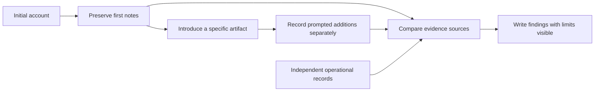

# Interview Incident Responders Without Leading Their Answers

Author: [nawazdhandala](https://www.github.com/nawazdhandala)

Tags: Postmortem, Incident Response, SRE

Description: Use neutral prompts, preserve independent accounts, and label artifact-prompted additions so an incident interview does not quietly manufacture agreement.

An interview can improve an incident timeline, but it can also make a weak explanation sound stronger. Ask “Why did you ignore the replica lag?” and the question already assumes that lag was visible, understood, and deliberately disregarded.

A useful interview recovers the responder's perspective before fitting it into the investigator's explanation. You cannot guarantee that recollections remain untouched by later conversations or documents. You can reduce leading cues and record where each statement came from.

PagerDuty's Howie Guide treats interviews as a way to discover information missing from operational records, including how people interpreted events and coordinated their work. Different accounts are valuable evidence, not merely inconsistencies to eliminate. [Interviewing incident participants](https://docs.pagerduty.com/ops-guides/howie-guide/interview)

## Prepare questions without preparing the answers

Review the incident record before the conversation. Identify moments that need clarification, but distinguish facts from assumptions in your notes.

For example, a chat message saying “checking replica B” establishes that the message was sent. It does not establish which dashboard was open, whether the replica had been selected, or whether a failover command had already run.

Prepare prompts around those gaps: what the person noticed, what they expected, which alternatives they considered, and what changed their assessment. Keep your preferred causal theory in a separate investigator note so it does not become the interview agenda by accident.

Etsy's facilitation guide recommends eliciting descriptions of work and the cues behind assessments, rather than immediately demanding explanations. This helps reveal the context that a finished timeline often compresses away. [Facilitation guidance](https://extfiles.etsy.com/DebriefingFacilitationGuide.pdf)

## Establish how the conversation will be used

At the beginning, explain the purpose, who will see the notes, and how the person can correct a misrepresentation. If recording is proposed, agree on it explicitly and explain access and retention. Do not promise confidentiality that your process cannot provide.

Give the responder room to say they do not remember, to distinguish a recollection from a later inference, or to defer a question while checking a record. Avoid rewarding confident answers over qualified ones.

A short opening might be:

> I want to understand what the incident looked like from your position. We will keep your recollections separate from what we later confirm in logs. It is useful to say when a detail is uncertain or something you learned afterward. I will send you the relevant notes to check that I represented your account accurately.

This is an example opening, not a claim that one script guarantees a reliable interview. Choose timing that allows the person to participate thoughtfully; an exhausted responder may need recovery time before a detailed discussion.

## Begin with their account before showing your timeline

Ask for a description of their involvement in their own sequence. Let them establish what mattered before displaying a polished timeline or another person's explanation.

A neutral starting prompt is: “Describe how you became involved and what you were trying to understand first.” Follow the account with brief clarifying questions. Leave room for pauses rather than supplying the next event yourself.

If the person needs help identifying the incident, provide minimal orientation such as the service and date. Record what you showed them. Do not describe the suspected root cause as part of that reminder.

Where practical, gather individual perspectives before a group discussion. This is not an attempt to keep colleagues from talking. It preserves a record of their separate viewpoints before a shared summary becomes the default story.

## Replace loaded questions with descriptive prompts

The following examples concern a fictional replica-selection incident:

| Leading question | More useful prompt |
|---|---|
| Why did you ignore the lag warning? | What information were you using to assess replica health? |
| You chose replica B because it was green, correct? | Take me through how replica B became an option. |
| Why did you wait so long to fail over? | What were you trying to learn before changing traffic? |
| Did the runbook confuse you? | How did the runbook fit the situation you were seeing? |
| Everyone else knew the data was stale, didn't they? | What had reached you about data freshness at that point? |

A neutral prompt can still be followed badly. “Are you sure?” repeated until the answer changes communicates the answer you want. If an account conflicts with evidence, identify the specific difference and invite the person to help explain it.

Ask what a phrase meant to them. “Healthy” might mean reachable, low lag, serving queries, or merely absent from the current alert list. Do not silently substitute the investigator's definition.

## Introduce artifacts deliberately and label the result

After the initial account, a dashboard snapshot or chat excerpt can help clarify a particular moment. Introduce one artifact at a time, explain its source and timestamp, and ask what the person recognizes.

For the fictional case, preserve the distinction in your notes:

| Note type | Example entry |
|---|---|
| Initial recollection | Responder recalls checking a health view before considering replica B; exact panel is uncertain |
| Artifact presented | E4: saved dashboard snapshot labeled 10:29 UTC, shown after the initial account |
| Prompted addition | After seeing E4, responder believes this may have been the panel; cannot confirm the displayed time range |
| Independent record | Chat at 10:32 UTC says “checking replica B”; command audit records a later action |
| Open question | Whether the displayed lag used the same replica and time range as the decision |

Do not rewrite the first entry as “responder confirmed E4 was used.” That would remove both the prompt and the uncertainty that shaped the later statement.

A screenshot may itself be incomplete or reconstructed. Ask whether it represents the view available during the incident, and keep that limitation attached to it.

## Keep different perspectives available for analysis

One responder may recall a failover decision as already agreed while another remembers it as a proposal. Do not resolve the difference by counting votes or choosing the more senior person's account.

Check whether they were in different channels, joined at different times, or used “decision” to mean different stages. The disagreement may reveal a coordination problem even when the command audit establishes exactly when the technical action occurred.

Etsy's guide emphasizes the value of contrasting and complementary narratives rather than forcing them into a single seamless story. Preserve material disagreements until evidence or further clarification supports a narrower conclusion. [Multiple perspectives in debriefing](https://extfiles.etsy.com/DebriefingFacilitationGuide.pdf)

Use a follow-up conversation when needed, but say what new artifact or question prompted it. An answer given after reading the draft is still useful; it should not be represented as an independent recollection collected before that draft existed.

## Preserve uncertainty when reviewing the notes

Send the relevant notes back for an accuracy check. Ask whether you captured the person's meaning, whether a quoted sentence is exact, and whether anything presented as their observation was actually learned later.

Keep additions dated. Distinguish a correction to a transcription error from a changed interpretation after new evidence. If using automated transcription, verify consequential wording against the recording where available; fluent text is not proof that it reflects the original statement.

PagerDuty's Howie Guide recommends revisiting interview notes, identifying unanswered questions, and linking supporting materials. Apply that work while preserving provenance: the source and circumstances of each statement. [After-interview work](https://docs.pagerduty.com/ops-guides/howie-guide/interview)

## Carry the evidence limits into the postmortem

Use precise attribution: “the command audit records,” “the responder recalls,” or “the reviewer infers.” Those phrases help readers distinguish recorded actions, remembered context, and analysis.

An interview succeeds when it reveals how work happened, including uncertainty, useful improvisation, and information that never reached the right person. It does not need to produce unanimous agreement or a definitive cause. Google's blameless-review guidance supports understanding the circumstances around actions and improving the systems that shape them. [Google SRE postmortem culture](https://sre.google/sre-book/postmortem-culture/)

Before closing the interview record, check that leading assumptions have not become facts, prompted additions remain identifiable, and unresolved differences have owners for follow-up. That gives the final postmortem a stronger foundation than a tidy story assembled by the interviewer.
