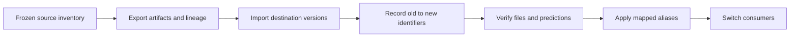

# Migrate MLflow Models Across Workspaces with Aliases and Lineage

Author: [nawazdhandala](https://www.github.com/nawazdhandala)

Tags: MLflow, Model Versioning, Data Migration, MLOps

Description: Preserve model history across MLflow environments with explicit version mappings, independently retained artifacts, provenance records, and verified alias reassignment.

Moving registered models between environments is a reference migration. You need to preserve the model files, the history that explains them, and the names consumers use to select them.

Do not assume destination version numbers or run IDs match the source. Preserve their relationship explicitly. A source version 3 can become destination version 4 without losing its meaning, provided the migration record connects them and consumers use the mapped destination reference.

This guide uses **MLflow 3.18.0** and **Python 3.11**. The executable example handles alias reassignment after a verified import. It is not a complete exporter, and the local validation used two independent SQLite-backed environments rather than managed workspaces.

## Define what must survive

Make the acceptance criteria explicit before choosing migration tooling:

| Information | Acceptance evidence |
|---|---|
| Every retained model version | Source-to-destination mapping and matching artifact content |
| Descriptions and relevant tags | Field comparison, with intentional changes documented |
| Training lineage | Original registry, model, version, run, code revision, and data references |
| Imported runs | Mapping from original run IDs to actual destination run IDs |
| Alias assignments | Each source alias points to the mapped destination version |
| Operational access | Serving identities can read the destination and its artifacts |
| Historical evidence | Retained export of metadata not recreated by the chosen tool |

Version numbers are generated by the destination registry. The MLflow Export Import project's limitations explicitly warn that preserving numbers is not an API guarantee. Gaps, existing destination versions, and import order can change the sequence. [Export/import limitations](https://github.com/mlflow/mlflow-export-import/blob/master/README_limitations.md)

Treat timestamps, notebook links, ownership, permissions, and managed-service metadata as separate migration questions. Copying a model does not automatically recreate every workspace feature.

## Choose tooling for the actual source and destination

MLflow documents `copy_model_version` for moving from the Databricks Workspace Model Registry to Unity Catalog. That supported path has its own requirements; it is not a universal command for copying between arbitrary tracking servers. [Documented registry migration path](https://mlflow.org/docs/latest/ml/model-registry/workflow/#migrating-from-the-workspace-model-registry-to-unity-catalog)

For broader transfers, review the MLflow Export Import project's bulk workflows and limitations. Pin the tool to a reviewed commit and rehearse it with your exact MLflow and workspace versions. Inspect whether it preserves the metadata you need and how it handles missing runs, aliases, logged models, and failures. Do not treat a successful process exit as the acceptance report. [Export/import project](https://github.com/mlflow/mlflow-export-import)

For a custom migration, use separate clients for source and destination. The `MlflowClient` constructor accepts explicit tracking and registry addresses. Keep destination credentials scoped appropriately and avoid changing a global address halfway through a sequence of operations. [Client API](https://mlflow.org/docs/latest/api_reference/python_api/mlflow.client.html)

## Freeze and export a consistent inventory

Pause model registration and alias changes for the final inventory, or use a documented reconciliation window that captures subsequent changes. Enumerate every retained version with pagination, including versions with no active alias.

Record the source model's aliases separately from version records. An alias is a current selection, not a historical property that should be reapplied every time an older version is imported.



Retain the source inventory and exported evidence in an access-controlled migration workspace. Review failures individually. A missing source run can affect an exporter's behavior; silently omitting that version is not a complete migration.

## Import artifacts and preserve the origin

Copy actual model files into independently retained destination storage. Registering a destination version that still points to source storage leaves the destination dependent on the old environment.

When importing training runs, use the returned destination run IDs in destination model records. Keep original IDs in provenance metadata. If you create a migration run rather than importing a training run, label it honestly; it did not perform the original training.

Preserve full metric history when required, not merely the latest displayed values. Retain data-version references, code commits, input signatures, preprocessing assets, dependency files, and relevant artifacts. Export evidence for metadata that cannot be recreated, and record the limitation instead of inventing replacement history.

The alias example below expects these application-defined origin tags on each destination model version:

- `migration.source_registry`: a stable, nonsecret source-environment label.
- `migration.source_model`: the original registered model name.
- `migration.source_version`: the original numeric version as a string.
- `migration.source_run_id`: the original run ID, or an empty string when absent.

These tags support reconciliation; they are not cryptographic proof or built-in MLflow lineage fields. Protect them and verify the copied bytes and run mappings separately.

## Apply aliases through the reviewed version map

Suppose the retained source versions are 1 and 3, while destination versions 1 and 2 already exist. Your import returns destination versions 3 and 4. Save the reviewed result as `migration.json`:

```json
{
  "source_registry_label": "source-lab",
  "source_model": "risk",
  "target_model": "risk-prod",
  "versions": [
    {"source_version": "1", "target_version": "3"},
    {"source_version": "3", "target_version": "4"}
  ],
  "source_aliases": {"champion": "3", "candidate": "1"}
}
```

All names and numbers are illustrative. Replace them with the completed import's returned identifiers. Confirm this list covers every retained source version before proceeding.

Configure `SOURCE_TRACKING_URI`, `SOURCE_REGISTRY_URI`, `TARGET_TRACKING_URI`, and `TARGET_REGISTRY_URI` in the environment. Save the following as `aliases.py`:

```python
import json
import os
from pathlib import Path
from mlflow import MlflowClient

plan = json.loads(Path('migration.json').read_text())
source = MlflowClient(tracking_uri=os.environ['SOURCE_TRACKING_URI'],
                      registry_uri=os.environ['SOURCE_REGISTRY_URI'])
target = MlflowClient(tracking_uri=os.environ['TARGET_TRACKING_URI'],
                      registry_uri=os.environ['TARGET_REGISTRY_URI'])
source_name, target_name = plan['source_model'], plan['target_model']
rows = plan['versions']
if not rows or len({row['source_version'] for row in rows}) != len(rows):
    raise RuntimeError('Missing or repeated source-version mappings')
if len({row['target_version'] for row in rows}) != len(rows):
    raise RuntimeError('Different source versions share a target version')
mapping = {}
for row in rows:
    old = source.get_model_version(source_name, row['source_version'])
    new = target.get_model_version(target_name, row['target_version'])
    expected = {'migration.source_registry': plan['source_registry_label'],
                'migration.source_model': source_name,
                'migration.source_version': str(old.version),
                'migration.source_run_id': old.run_id or ''}
    if any(new.tags.get(key) != value for key, value in expected.items()):
        raise RuntimeError('Target origin tags do not match the migration plan')
    if new.status != 'READY':
        raise RuntimeError('Target version is not ready')
    mapping[str(old.version)] = str(new.version)
observed = {key: str(value) for key, value in
            source.get_registered_model(source_name).aliases.items()}
if observed != plan['source_aliases']:
    raise RuntimeError('Source alias snapshot changed')
proposed = {alias: mapping[version] for alias, version in observed.items()}
existing = target.get_registered_model(target_name).aliases
for alias, version in proposed.items():
    if alias in existing and str(existing[alias]) != version:
        raise RuntimeError(f'Target alias already has another assignment: {alias}')
print(json.dumps({'target_model': target_name, 'proposed_aliases': proposed}))
if os.environ.get('APPLY_ALIASES') == '1':
    for alias, version in proposed.items():
        target.set_registered_model_alias(target_name, alias, version)
    confirmed = target.get_registered_model(target_name).aliases
    if any(str(confirmed.get(alias)) != version for alias, version in proposed.items()):
        raise RuntimeError('Alias readback did not match')
    print('Mapped alias assignments verified')
else:
    print('Dry run; no aliases changed')
```

Run `python aliases.py` first. The dry run should propose `champion` on destination version 4 and `candidate` on version 3 for this example. It rejects changed source aliases, conflicting destination assignments, and origin tags that disagree with the reviewed map.

After reviewing the output and passing the migration checks, run:

```bash
APPLY_ALIASES=1 python aliases.py
```

The script uses MLflow's alias APIs, then reads back the assignments. It does not create versions or copy files. [Registry alias workflow](https://mlflow.org/docs/latest/ml/model-registry/workflow/)

Keep competing alias writers paused throughout this step. The preflight and updates are not one transaction, and multiple alias assignments are not atomic. If an update fails partway through, inspect the actual destination state and retry the same approved map. Existing assignments that already match are accepted; conflicting ones require investigation.

## Validate independence before switching consumers

The local rehearsal imported synthetic source versions 1 and 3 into destination versions 3 and 4, copied artifact bytes and descriptions, and retained original run IDs in origin tags. Destination records used new migration-run IDs.

The exact alias script passed dry-run, apply, and repeat-apply checks. It rejected a missing alias target mapping, a wrong origin tag, a changed source alias snapshot, and a conflicting destination alias before making updates.

Finally, the source artifact directory was made unavailable. Both destination aliases still loaded and produced their expected predictions. This checked artifact independence in the local setup; it did not validate managed-workspace permissions or a full export/import tool.

Before production cutover, compare the complete version inventory, run mapping, artifact digests, signatures, relevant metadata, and smoke predictions. Test with the actual serving identity and an empty cache. Update consumers pinned to numeric versions as well as those using aliases, since both reference forms include environment-specific meaning.

Retain the source environment and export for the agreed recovery period. Record every skipped field or unsupported object. Finish only when each retained source version has a verified destination or an explicitly accepted archival disposition, and consumers can recover using the documented mapping.
