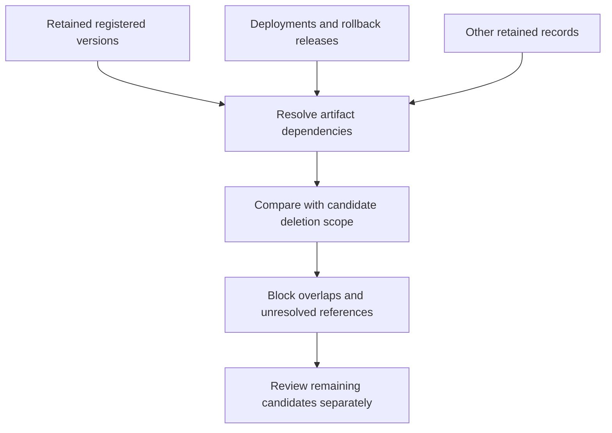

# Check Model Artifact References Before Running MLflow Garbage Collection

Author: [nawazdhandala](https://www.github.com/nawazdhandala)

Tags: MLflow, Model Versioning, MLOps, Data Management

Description: Understand why MLflow garbage collection can remove registered-model files and build a read-only reference audit that blocks known dependencies and unresolved locations.

A registered model can remain visible after its underlying files have been deleted. Registration records a reference; it does not automatically protect every referenced artifact from cleanup.

Before running `mlflow gc`, check which retained objects still depend on the proposed deletion targets. The goal is to identify reachable artifacts: files that a model version, deployment, rollback release, or other retained object can still use.

This article checks **MLflow 3.18.0**. The example is a read-only preflight for candidate run directories on a local filesystem. It deliberately does not execute garbage collection or approve deletion.

## Know what garbage collection considers

MLflow documents `gc` as permanent removal of soft-deleted resources. Its selection considers lifecycle state and deletion criteria, not registered-model references, UI pins, or protective-looking tags. A `retain=true` tag has no effect unless your own cleanup process enforces it. [MLflow garbage collection reference](https://mlflow.org/docs/latest/api_reference/cli.html#mlflow-gc)

In the pinned implementation, run cleanup obtains the run's artifact repository and deletes its artifacts before hard-deleting its metadata. That path does not perform a registry reachability analysis. [MLflow 3.18.0 cleanup implementation](https://github.com/mlflow/mlflow/blob/v3.18.0/mlflow/cli/__init__.py)

A concrete failure case is a registered version whose files live beneath a soft-deleted run's artifact directory. Removing that directory breaks later model loads even if the registry record survives.

This does not mean every modern model's weights live inside its run directory. MLflow logged models can have separate artifact locations. Inventory the actual paths and resource types instead of assuming one storage layout.

## Start from retained references, not just deletion age

Build a list of roots that must remain usable:

- All retained registered versions, including versions without an active alias.
- Deployed versions and approved rollback releases.
- Retained runs, logged models, datasets, evaluation evidence, and other artifacts.
- References from other registries, workspaces, or external systems sharing the store.

Then resolve their dependencies to the underlying storage objects. Compare those objects with the exact scope the proposed cleanup would remove.



Checking only `model.run_id == candidate_run_id` misses references whose files point into that run directory without a matching run ID. Checking only aliases misses older versions retained for recovery.

## Run a conservative local reference audit

Use an identity authorized to see all in-scope registered versions. Configure `MLFLOW_TRACKING_URI` and `MLFLOW_REGISTRY_URI` for the intended environment. Put explicit candidate run IDs in `candidate-runs.json`, for example:

```json
["REPLACE_WITH_REVIEWED_RUN_ID"]
```

The placeholder is not a real run ID. Select candidates through your retention process before running this audit; the script does not discover or soft-delete runs.

Save the following as `audit.py`. It uses **Python 3.11** and the pinned MLflow client. Its filesystem comparison assumes the stored paths describe the same local filesystem namespace visible to the auditor.

```python
import json
import os
from pathlib import Path
from urllib.parse import unquote, urlsplit
from mlflow import MlflowClient

def local_path(uri):
    parsed = urlsplit(uri)
    if parsed.scheme not in {'', 'file'} or parsed.netloc not in {'', 'localhost'}:
        raise ValueError('Needs a storage-specific resolver')
    if parsed.query or parsed.fragment:
        raise ValueError('Ambiguous filesystem URI')
    path = Path(unquote(parsed.path) if parsed.scheme == 'file' else uri)
    if not path.is_absolute():
        raise ValueError('Relative filesystem path requires review')
    return path.resolve()

def overlaps(left, right):
    return left == right or left in right.parents or right in left.parents

client = MlflowClient(tracking_uri=os.environ['MLFLOW_TRACKING_URI'],
                      registry_uri=os.environ['MLFLOW_REGISTRY_URI'])
run_ids = json.loads(Path('candidate-runs.json').read_text())
if not isinstance(run_ids, list) or not run_ids or not all(isinstance(value, str) for value in run_ids):
    raise RuntimeError('Supply explicit candidate run IDs')
versions, unresolved = [], []
token = None
while True:
    page = client.search_model_versions(max_results=100, page_token=token)
    for item in page:
        model = client.get_model_version(item.name, str(item.version))
        label = f'{model.name}/{model.version}'
        try:
            path = local_path(client.get_model_version_download_uri(
                model.name, str(model.version)))
        except Exception as error:
            unresolved.append({'model': label, 'error_type': type(error).__name__})
            path = None
        versions.append((label, model.run_id, path))
    token = page.token
    if not token:
        break
report = []
for run_id in run_ids:
    run = client.get_run(run_id)
    reasons = []
    if run.info.lifecycle_stage != 'deleted':
        reasons.append('Run is not soft-deleted')
    try:
        root = local_path(run.info.artifact_uri)
    except ValueError:
        root = None
        reasons.append('Candidate artifact location requires manual resolution')
    for label, linked_run, path in versions:
        if linked_run == run_id or (root is not None and path is not None
                                    and overlaps(root, path)):
            reasons.append(f'Registered version depends on candidate: {label}')
    decision = ('blocked' if reasons else 'manual_review' if unresolved
                else 'no_registry_reference_found')
    report.append({'run_id': run_id, 'decision': decision, 'reasons': reasons})
print(json.dumps({'visible_versions': len(versions),
                  'unresolved_versions': unresolved, 'runs': report}, indent=2))
if unresolved or any(row['decision'] != 'no_registry_reference_found' for row in report):
    raise SystemExit(2)
```

Run `python audit.py`. A known dependency produces `blocked`; unresolved registered-model locations produce `manual_review` when no more specific block was found. These outcomes return exit code 2. Other API failures also stop execution rather than producing an approval.

The script examines all visible version pages and asks the registry for each download location. Those APIs avoid guessing an artifact path from a model name. [Model-version client APIs](https://mlflow.org/docs/latest/api_reference/python_api/mlflow.client.html#mlflow.client.MlflowClient.search_model_versions)

The path comparison uses parent relationships, so `/store/run1` does not accidentally match `/store/run10`. It also treats overlapping parent directories conservatively. Python's path resolution handles filesystem paths and symbolic links within the local namespace. [Pathlib reference](https://docs.python.org/3.11/library/pathlib.html)

## Treat a clean report as limited evidence

`no_registry_reference_found` means exactly that: the visible registry scan did not identify a reference under this filesystem policy. It does not mean the candidate is safe to delete.

The scan does not enumerate every logged model, external deployment manifest, archived release, dataset, or legal retention requirement. Permissions can hide models without making the visible result look incomplete. Run the inventory across every relevant registry and workspace, and reconcile it with service owners' retained-release lists.

Filesystem aliases such as bind mounts, hard links, and platform-specific case behavior also need explicit treatment. A path comparison alone cannot prove that two differently exposed locations contain unrelated bytes. Use a consistent storage namespace and keep unresolved mappings out of an automatic deletion set.

The code intentionally sends object-store and proxy URIs to review. A cloud-aware extension must resolve the correct account, bucket or container, object key, version identity, and proxy destination. Do not apply local filesystem normalization blindly to cloud keys or compare raw URLs with a simple string prefix.

## Verify the failure mode in a disposable environment

Local validation created a temporary SQLite registry and a synthetic model inside a run artifact directory. The registered version had neither an alias nor an associated run ID, so detecting its dependency required comparing the actual artifact location.

The audit blocked that run. It left an unrelated candidate as `no_registry_reference_found`, rejected an active run, and changed an otherwise clear result to `manual_review` when an unresolved object-storage reference was introduced.

A separate destructive reproduction used only that temporary database and its synthetic files. After marking the containing run deleted, garbage collection removed the model files while its registered version remained visible. A fresh model load then failed. No production metadata, cloud objects, or user-created model artifacts were involved.

Keep such reproductions isolated. They establish behavior for the tested version and layout, not permission to clean a production store.

## Make cleanup a reviewed, stable operation

Freeze registrations and artifact-reference changes, or use a coordination mechanism that prevents new references from appearing between audit and deletion. Record the registry snapshot, candidate IDs, resolved storage scope, and audit results. Recheck them immediately before the approved cleanup window.

Review the full command's behavior for your installed version. MLflow 3.18.0 garbage collection handles runs, experiments, and logged models; do not assume a run filter alone describes every resource category considered by the command. Check its help and implementation against the intended scope. [Pinned command implementation](https://github.com/mlflow/mlflow/blob/v3.18.0/mlflow/cli/__init__.py)

Retain verified metadata and artifact backups with a tested recovery procedure. Restoration requires both the references and the bytes. A metadata backup cannot recreate deleted model weights, and an artifact copy without its provenance may not identify the correct release.

After approved cleanup, validate retained model downloads and smoke predictions from fresh processes. Preserve the audit and deletion records. If a protected reference was discovered, correct the retention process or create an independently retained artifact copy and migrate consumers before reconsidering that candidate.
