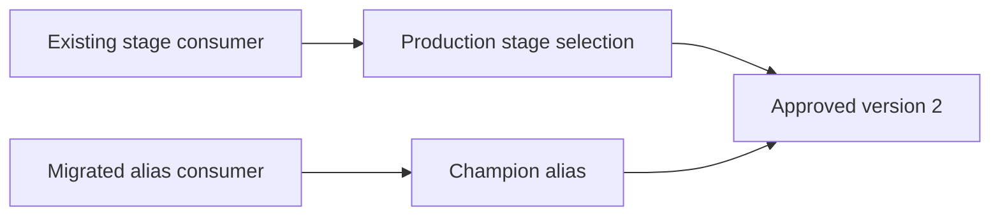

# Migrate MLflow Stages to Aliases Without Breaking Model References

Author: [nawazdhandala](https://www.github.com/nawazdhandala)

Tags: MLflow, MLOps, Model Versioning, Python

Description: Migrate MLflow Production and Staging references to aliases with a reviewed version map, a dry run, overlapping readers, and a controlled consumer cutover.

MLflow deprecated model registry stages in version 2.9.0. Its migration guidance replaces their different purposes with aliases, version tags, and separately governed registered models. Deprecation does not mean every existing stage reference has already stopped working. [Stage migration guidance](https://mlflow.org/docs/latest/ml/model-registry/workflow/#migrating-from-stages)

A safe migration preserves the selected model while changing how consumers find it. Creating an alias does not rewrite an application's configuration, move a loaded model in memory, or automatically keep the alias synchronized with a stage.

This walkthrough uses open-source MLflow **3.18.0**, with an existing registry that supports stages. It changes references within the same registered model first. Moving artifacts between environment-specific registered models is a separate migration with separate version mappings.

## Understand the reference you are replacing

A registered model is a named collection of numbered versions. An alias is a movable name pointing to one version within that collection.

| Reference | Meaning in this example |
|---|---|
| `models:/demand-forecast/Production` | Latest version currently in the Production stage |
| `models:/demand-forecast@champion` | Version assigned to the `champion` alias |
| `models:/demand-forecast/2` | Explicit version 2 |
| `models:/demand-forecast@candidate` | Version assigned to the `candidate` alias |

The `@` matters. Replacing `/Production` with `/champion` does not create an alias reference. MLflow's versioned URI resolver distinguishes numeric versions, stage suffixes, and aliases explicitly. [MLflow 3.18.0 URI resolution](https://github.com/mlflow/mlflow/blob/v3.18.0/mlflow/store/artifact/utils/models.py)

Multiple versions can occupy a stage. Inventory what the stage URI actually resolves to, rather than assuming the oldest production version or whichever row appears first in a dashboard is the active selection.

## Inventory readers and writers before changing anything

Find both consumers and promotion jobs. Include batch schedules, serving startup configuration, notebooks, deployment templates, and emergency rollback procedures.

Record each consumer's current URI, owner, client version, reload behavior, and intended replacement. A monthly batch job is easy to miss if the migration is observed for only a day.

Also record every process that changes stages or aliases. During the initial cutover, pause promotions through an agreed change window or route them through one controlled workflow. The examples below require that coordination; they are not concurrency controls.

For illustration, suppose the reviewed selection is:

| Current stage | Selected version | New alias |
|---|---|---|
| Production | 2 | champion |
| Staging | 3 | candidate |

Those numbers are examples, not recommendations. Preserve your actual mapping, including the registry endpoint, model name, artifact source, and source run where available. Keep an explicit previous-version reference for recovery.

## Prepare a pinned client and explicit connection

Use Python 3.11 in a dedicated virtual environment for this example:

```bash
python3.11 -m venv .venv
. .venv/bin/activate
python -m pip install 'mlflow==3.18.0'
```

Set `MLFLOW_TRACKING_URI` and `MLFLOW_REGISTRY_URI` to your approved endpoints, configure their authentication through your normal credential mechanism, and set `MODEL_NAME` to the registered model. The scripts require those variables so they cannot silently target an unintended default store.

Read access is sufficient for inventory. Assigning aliases requires the appropriate write permission in your backend. Validate the client and server combination in a nonproduction registry before using it for migration.

Run this read-only inventory first:

```python
import os
from mlflow import MlflowClient

client = MlflowClient(
    tracking_uri=os.environ['MLFLOW_TRACKING_URI'],
    registry_uri=os.environ['MLFLOW_REGISTRY_URI'],
)
name = os.environ['MODEL_NAME']
for stage in ['Production', 'Staging']:
    versions = client.get_latest_versions(name, stages=[stage])
    print(stage, [str(v.version) for v in versions])
print('Existing aliases:', client.get_registered_model(name).aliases)
```

For the example, expect Production `['2']` and Staging `['3']`. An empty list needs investigation. The stage-reading API emits a deprecation warning; it is used here only to identify the legacy selection during migration. [Pinned client implementation](https://github.com/mlflow/mlflow/blob/v3.18.0/mlflow/tracking/client.py)

## Add aliases without changing stage assignments

Save the following as `migrate_aliases.py`. Replace its example version numbers with the reviewed inventory. With `APPLY_ALIASES` unset, it prints the plan and performs no alias writes.

```python
import os
from mlflow import MlflowClient

client = MlflowClient(
    tracking_uri=os.environ['MLFLOW_TRACKING_URI'],
    registry_uri=os.environ['MLFLOW_REGISTRY_URI'],
)
name = os.environ['MODEL_NAME']
# Replace these example versions with your reviewed inventory.
plan = {'Production': ('champion', '2'), 'Staging': ('candidate', '3')}
apply = os.environ.get('APPLY_ALIASES') == 'yes'
aliases = client.get_registered_model(name).aliases

# Validate the entire plan before changing either alias.
for stage, (alias, expected) in plan.items():
    selected = client.get_latest_versions(name, stages=[stage])
    if len(selected) != 1 or str(selected[0].version) != expected:
        raise RuntimeError(f'{stage}: stage selection differs from reviewed plan')
    existing = aliases.get(alias)
    if existing is not None and str(existing) != expected:
        raise RuntimeError(f'{alias}: existing alias points elsewhere')
    print(f'{stage} -> {alias} -> version {expected}')

if apply:
    for alias, expected in plan.values():
        client.set_registered_model_alias(name, alias, expected)
        actual = client.get_model_version_by_alias(name, alias)
        if str(actual.version) != expected:
            raise RuntimeError(f'{alias}: readback mismatch')
    print('Aliases assigned; existing stages were not changed')
else:
    print('Dry run: no aliases changed')
```

After reviewing the dry run, `APPLY_ALIASES=yes python migrate_aliases.py` performs the writes. Existing matching aliases are accepted, while conflicting assignments stop the script. The public APIs set an alias and resolve it back to a model version. [Alias API reference](https://mlflow.org/docs/latest/api_reference/python_api/mlflow.client.html#mlflow.client.MlflowClient.set_registered_model_alias)

The two writes are not one transaction. A failure after the first write can leave a partial migration. Inspect both assignments before retrying. The preflight checks also cannot prevent another writer changing state afterward, which is why the coordinated promotion pause matters.

## Verify both paths before updating consumers

Initially, both reference styles should identify the same approved version:



For each production and staging mapping, compare the resolved version and load the model through both URIs using the actual consumer identity. Exercise representative inputs, including signature validation and required preprocessing. Identical version numbers alone do not demonstrate artifact access or dependency compatibility.

The local check for this article used MLflow 3.18.0, SQLite, and synthetic Python models. Production selected version 2 even with two versions in that stage; `/Production`, `@champion`, and `/2` produced matching predictions. This confirms the example behavior locally, not your server's permissions or serving platform.

Roll out consumer configuration changes gradually. Record the resolved numeric version in deployment evidence. A process that already loaded a model must follow its normal reload or deployment procedure; moving an alias does not rewrite that Python object.

## Finish the transition without creating two sources of truth

During overlap, keep stage and alias selections aligned through the controlled promotion workflow, or keep promotions paused. If dual writes are necessary, verify both results and treat disagreement as a failed promotion. Do not assume atomicity.

Once every consumer and rollback path uses the new references, retire stage-based promotion code. Preserve required artifacts and history; migration does not require deleting or archiving old versions immediately.

Use tags for review status, such as `validation_status=passed`, and aliases for selection. A tag is not an approval enforcement mechanism by itself. If environments need different access rules, design separate registered models and permissions deliberately rather than assuming alias names create security boundaries. [Registry concepts](https://mlflow.org/docs/latest/ml/model-registry/)

Before closing the migration, verify one normal promotion and one recovery through the new workflow in the appropriate test environment. Confirm which numeric version each consumer loads after restart. The migration is complete when references, deployment behavior, and operational ownership agree, not merely when the alias appears in the registry.
