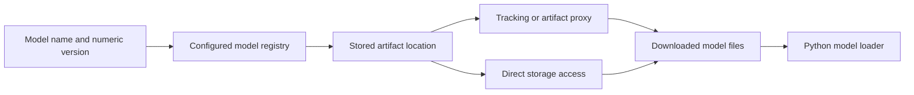

# Fix MLflow Model URIs That Work Locally but Fail in Production

Author: [nawazdhandala](https://www.github.com/nawazdhandala)

Tags: MLflow, MLOps, Troubleshooting, Python

Description: Diagnose MLflow production loading failures by separating registry lookup, tracking context, artifact access, credentials, and model runtime dependencies.

The same `models:/account-score/17` reference can work in a notebook and fail in a production container. The string identifies a registered model version, but it does not contain the registry address, storage credentials, certificate trust, or Python dependencies needed to load it.

Investigate those dependencies in order. Repeatedly changing the model URI can hide the real problem, especially when the registry lookup succeeds and the failure happens later during artifact download.

The diagnostic below targets **MLflow 3.18.0** with **Python 3.11** and a self-hosted registry. Managed services can add workspace, catalog, and authentication requirements; preserve those service-specific settings rather than assuming the self-hosted example covers them.

## Follow the resolution path

A registered-model URI first resolves through the model registry. The resulting location leads to model artifacts, potentially through a tracking run or an artifact proxy. Only after the bytes arrive does the framework load the model.



The two middle branches are alternatives determined by the stored artifact location. Reaching the registry does not prove that the process can reach the required storage path. MLflow's model artifact repository resolves registered versions to an underlying artifact repository. [MLflow 3.18.0 model URI implementation](https://github.com/mlflow/mlflow/blob/v3.18.0/mlflow/store/artifact/models_artifact_repo.py)

## Make both service addresses explicit

Configure the application process before creating clients or loading models:

```bash
export MLFLOW_TRACKING_URI='https://mlflow.example.internal'
export MLFLOW_REGISTRY_URI='https://mlflow.example.internal'
export MODEL_NAME='account-score'
export MODEL_VERSION='17'
```

Replace the example host, name, and version with approved values. The two addresses may be the same, but that is an architectural choice. Do not point production at a developer's local SQLite file or assume `localhost` reaches a server outside its container.

For ordinary non-Databricks configurations, MLflow uses the tracking URI as the registry default when no separate registry setting is provided. Explicit settings remove ambiguity from deployment manifests, notebooks, and inherited environment variables. Databricks defaults have additional behavior, so do not generalize this rule to every managed environment. [Registry URI resolution in 3.18.0](https://github.com/mlflow/mlflow/blob/v3.18.0/mlflow/tracking/_model_registry/utils.py)

Also review application calls to `set_tracking_uri` and `set_registry_uri`. A library initialization step may override the environment values you expected. Compare effective configuration inside the same container, identity, and network context as the failing application.

## Separate metadata, download, and loading

Save this as `diagnose.py`. Use the pinned MLflow version and the model's approved runtime dependencies. The script performs reads against the configured services and uses a temporary local download directory.

```python
import json
import os
import sys
import tempfile
from pathlib import Path
from urllib.parse import urlsplit
import mlflow
from mlflow import MlflowClient

def location_kind(uri):
    parsed = urlsplit(uri)
    return {'scheme': parsed.scheme or 'local-path',
            'host': parsed.hostname}

mode = sys.argv[1]
if mode not in {'metadata', 'download', 'load'}:
    raise SystemExit('Use: diagnose.py metadata | download | load')
tracking = os.environ['MLFLOW_TRACKING_URI']
registry = os.environ['MLFLOW_REGISTRY_URI']
name = os.environ['MODEL_NAME']
version = os.environ['MODEL_VERSION']
if not version.isdigit():
    raise SystemExit('Use a fixed numeric MODEL_VERSION')
mlflow.set_tracking_uri(tracking)
mlflow.set_registry_uri(registry)
print(json.dumps({'tracking': location_kind(tracking),
                  'registry': location_kind(registry)}), flush=True)
client = MlflowClient(tracking_uri=tracking, registry_uri=registry)
stage = 'registry metadata'
try:
    model = client.get_model_version(name, version)
    source = client.get_model_version_download_uri(name, version)
    print(json.dumps({'passed': stage, 'artifact': location_kind(source)}),
          flush=True)
    if model.run_id:
        stage = 'tracking run'
        run = client.get_run(model.run_id)
        print(json.dumps({'passed': stage,
                          'run_artifact': location_kind(run.info.artifact_uri)}),
              flush=True)
    if mode != 'metadata':
        stage = 'artifact download'
        with tempfile.TemporaryDirectory(prefix='mlflow-diagnose-') as directory:
            local = mlflow.artifacts.download_artifacts(
                artifact_uri=f'models:/{name}/{version}', dst_path=directory,
                tracking_uri=tracking, registry_uri=registry
            )
            if not (Path(local) / 'MLmodel').is_file():
                raise FileNotFoundError('Download did not contain MLmodel')
            print(json.dumps({'passed': stage, 'has_MLmodel': True}), flush=True)
            if mode == 'load':
                stage = 'model loading'
                mlflow.pyfunc.load_model(local)
                print(json.dumps({'passed': stage}), flush=True)
except Exception as error:
    print(json.dumps({'failed': stage, 'error_type': type(error).__name__}),
          file=sys.stderr)
    raise SystemExit(1)
```

Run the modes separately, advancing only after understanding any failure:

```bash
python diagnose.py metadata
python diagnose.py download
python diagnose.py load
```

The first mode confirms that the registry can return the version and its artifact location. When the version records a run ID, it also checks that run in the configured tracking service. That extra check verifies lineage access: some direct artifact sources can load without reading their associated run, so a failed run lookup is not proof that every possible load path requires that lookup.

The second mode downloads the artifact files without deserializing the model and requires the expected `MLmodel` metadata file. This postcondition matters: in the local test, a missing artifact directory could return an empty destination instead of raising a download exception. The third attempts to load the approved artifact with `pyfunc`; it does not run a prediction. MLflow exposes download separately from loading, which makes this boundary useful for diagnosis. [Artifact API](https://mlflow.org/docs/latest/api_reference/python_api/mlflow.artifacts.html)

The script prints only URI schemes and hosts, omitting embedded usernames, passwords, paths, and query strings. It reports the failing stage and exception class rather than dumping the full exception. Underlying libraries may still emit their own logs; keep detailed diagnostic output in an appropriately restricted location.

## Identify who needs storage credentials

There are two common arrangements:

| Stored artifact route | Client needs | Server needs |
|---|---|---|
| Proxied artifact access, such as `mlflow-artifacts:/...` | Access to the configured HTTP artifact service | Access to its backing storage |
| Direct object storage, such as `s3://...` | Storage SDK configuration, network access, and authorized identity | Metadata-service configuration; not necessarily the client's storage identity |

With direct access, a notebook's cloud profile may provide permissions that a production workload lacks. With proxy access, investigate the server's storage identity when metadata requests succeed but artifact operations fail. The client and server are different security principals. [Artifact storage configuration](https://mlflow.org/docs/latest/self-hosting/architecture/artifact-store/)

Changing the tracking server to proxy artifacts does not rewrite old experiment locations. Existing experiments created for direct storage continue to reference that arrangement. Inspect the actual stored location instead of assuming current server flags describe historical artifacts. [Tracking server artifact routing](https://mlflow.org/docs/latest/self-hosting/architecture/tracking-server/)

For S3-compatible storage, the storage endpoint is another setting distinct from the tracking URI. Check the configured endpoint, bucket, region behavior, and workload identity together. Avoid copying a developer's long-lived credentials into the serving image.

## Check HTTP identity and certificate trust separately

MLflow's HTTP client supports environment settings for a tracking token or username and password. Configure the mechanism accepted by your server through the workload's secret system. Merely setting a token variable does not make an arbitrary reverse proxy accept that token. [MLflow environment variables](https://mlflow.org/docs/latest/api_reference/python_api/mlflow.environment_variables.html)

Transport Layer Security, or TLS, verifies the server certificate independently of application authentication. A valid credential cannot fix an untrusted certificate chain. For an internal certificate authority, mount its trusted CA bundle and configure the MLflow HTTP client:

```bash
export MLFLOW_TRACKING_SERVER_CERT_PATH='/etc/company-ca/ca-bundle.pem'
```

The path is a placeholder for a readable PEM bundle installed in the actual container. Keep verification enabled and ensure the certificate matches the hostname. This setting configures MLflow's HTTP requests; direct object-storage SDKs have their own trust settings. [MLflow 3.18.0 TLS settings](https://github.com/mlflow/mlflow/blob/v3.18.0/mlflow/environment_variables.py)

## Interpret the first failing boundary

| Evidence | Likely next investigation |
|---|---|
| Registry metadata fails | Wrong registry, missing model/version, service permissions, DNS, or TLS |
| Registry succeeds, tracking run lookup fails | Wrong tracking context, missing run, or run permissions |
| Metadata succeeds, artifact download fails | Storage route, credentials, network path, missing objects, or local disk space |
| A local-file artifact location appears | Whether those exact files exist in the production process's filesystem |
| Download succeeds, model load fails | Missing package, incompatible framework, incomplete artifact, or custom loader code |
| Model loads, prediction fails | Input contract, external inference dependency, or application behavior |

These are investigation directions, not one-to-one error diagnoses. An HTTP authorization failure and a storage authorization failure may both mention access, yet require changes to different identities.

Local tests exercised the exact script against temporary SQLite stores and synthetic model files. Wrong registry and tracking settings failed at their respective metadata steps. Temporarily unavailable artifact files allowed metadata lookup but failed download. A deliberately missing model dependency allowed download but failed loading. No production endpoint, cloud authentication, or live TLS handshake was tested.

Finish by repeating the checks in a clean production-like workload with its real identity and empty artifact cache. Then run a small approved prediction fixture. Record the resolved version, runtime versions, and successful boundaries with the deployment so a warm notebook cache cannot conceal a missing production dependency.
