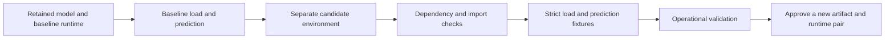

# Keep Model Loaders Compatible Across Runtime Upgrades

Author: [nawazdhandala](https://www.github.com/nawazdhandala)

Tags: Machine Learning, Model Versioning, Python, Dependency Management

Description: Test model loading across framework, Python, and operating-system changes with retained runtimes, explicit dependency checks, and fixed prediction fixtures.

A model file is not necessarily independent of the software that created it. Updating Python, a machine-learning framework, or a base operating-system image can break deserialization, custom imports, compiled extensions, or prediction behavior.

Treat the model artifact and its loader environment as a tested pair. Retain the current pair while evaluating a proposed replacement in a separate environment. Successful package installation is only the first check.

This tutorial demonstrates a framework boundary using **Python 3.11.13**, **scikit-learn 1.8.0** as the baseline, and **scikit-learn 1.9.1** as the candidate. Both test environments use **NumPy 2.4.6**, **pandas 3.1.1**, **SciPy 1.17.1**, **joblib 1.6.0**, and **threadpoolctl 3.8.0**. Python and operating-system upgrades are additional matrix entries, not changes tested by this example.

## Preserve more than a requirements file

Capture the artifact digest, Python version, framework version, complete resolved package set, application code, custom model modules, operating-system image, processor architecture, and relevant accelerator libraries.

For MLflow models, inspect the recorded environment files such as `requirements.txt`, `python_env.yaml`, and `conda.yaml`. Review custom code and prediction-time dependencies rather than assuming automatic inference captured every optional path. [MLflow dependency management](https://mlflow.org/docs/latest/ml/model/dependencies/)

A list of pinned package versions improves repeatability, but you also need retained installation artifacts or a retained runtime image. Packages can have different builds for different platforms. Pip documents progressively stronger installation approaches, including pinned dependencies and retained package archives. [Repeatable installations](https://pip.pypa.io/en/stable/topics/repeatable-installs/)

Keep the baseline environment available long enough to recover and, when supported, export a replacement artifact. An old model that only opens in an environment you discarded is difficult to migrate responsibly.

## Separate the compatibility boundaries

| Boundary | Example failure | Evidence required |
|---|---|---|
| Package resolution | Missing or conflicting dependency | Installation and dependency consistency check |
| Native imports | Compiled extension cannot load | Imports on the actual target platform |
| Model deserialization | Changed class layout or serialization behavior | Load the exact retained artifact |
| Custom application code | Module renamed or excluded | Exercise custom model and preprocessing paths |
| Prediction semantics | Different labels, shapes, or numeric output | Fixed representative request fixtures |
| Operational behavior | Increased startup time or memory | Runtime measurements in the serving topology |

A wheel's compatibility tags describe its Python implementation, binary interface, and platform. The binary interface is the agreement compiled code expects from the interpreter and system. An available wheel does not prove that an old serialized estimator is compatible with the new framework. [Python wheel compatibility tags](https://packaging.python.org/en/latest/specifications/platform-compatibility-tags/)

Test the final combined environment even when individual Python, framework, and operating-system changes passed separately. Interactions between those changes can expose a failure that isolated tests miss.



## Build an explicit framework-mismatch demonstration

Create two disposable virtual environments using Python 3.11.13. Install the versions listed above, choosing scikit-learn 1.8.0 for the baseline and 1.9.1 for the candidate. Keep their resolved package inventories separately.

From a separate record directory for each environment, run:

```bash
python -m pip check
python -m pip freeze > resolved-requirements.txt
```

`pip check` verifies installed dependency requirements. It does not load your model or compare predictions. A clean result is necessary evidence about packages, not a model compatibility certificate. [Pip check reference](https://pip.pypa.io/en/stable/cli/pip_check/)

In an empty lab directory, save this as `train.py` and run it with the baseline interpreter. It creates a small fitted pipeline and a fixed prediction fixture:

```python
import json
from pathlib import Path
import joblib
import pandas as pd
from sklearn.linear_model import LinearRegression
from sklearn.pipeline import make_pipeline
from sklearn.preprocessing import StandardScaler

training = pd.DataFrame({'x': [0.0, 1.0, 2.0, 3.0]})
model = make_pipeline(StandardScaler(), LinearRegression())
model.fit(training, [1.0, 3.0, 5.0, 7.0])
joblib.dump(model, 'bundle.joblib')
Path('cases.json').write_text(json.dumps([
    {'name': 'ordinary values', 'records': [{'x': 0.5}, {'x': 2.5}],
     'expected': [2.0, 6.0]}
], indent=2))
print('Created a synthetic model and fixed prediction cases')
```

The pipeline learns scaling and a simple relationship, `y = 2x + 1`. The expected outputs are independently specified from that relationship, rather than copied automatically from whatever the candidate happens to predict.

This demonstration loads only its own trusted synthetic joblib artifact. Native Python serialization formats are not appropriate for loading arbitrary untrusted model files. Scikit-learn also states that loading persisted models across different scikit-learn versions is unsupported. [Model persistence guidance](https://scikit-learn.org/1.9/model_persistence.html)

## Turn version warnings into a failed gate

Save this as `check_loader.py` in the same lab directory:

```python
import hashlib
import json
import platform
import warnings
from pathlib import Path
import joblib
import numpy as np
import pandas as pd
import sklearn
from sklearn.exceptions import InconsistentVersionWarning

warnings.simplefilter('error', InconsistentVersionWarning)
artifact = Path('bundle.joblib')
with artifact.open('rb') as handle:
    digest = hashlib.file_digest(handle, 'sha256').hexdigest()
model = joblib.load(artifact)
cases = json.loads(Path('cases.json').read_text())
if not cases:
    raise RuntimeError('No prediction cases supplied')
for case in cases:
    frame = pd.DataFrame(case['records'])
    if frame.empty:
        raise RuntimeError('Empty prediction case')
    actual = np.asarray(model.predict(frame), dtype=float)
    expected = np.asarray(case['expected'], dtype=float)
    if actual.shape != expected.shape or not np.isfinite(actual).all():
        raise RuntimeError(f"Invalid output for {case['name']}")
    np.testing.assert_allclose(actual, expected, rtol=1e-7, atol=1e-9)
print(json.dumps({'artifact_sha256': digest,
                  'python': platform.python_version(),
                  'platform': platform.platform(),
                  'scikit_learn': sklearn.__version__,
                  'cases_passed': len(cases)}))
```

Run `python check_loader.py` first with the baseline environment, then with the candidate environment against the same unchanged files.

The warning filter promotes `InconsistentVersionWarning` to an exception. That warning identifies an estimator being unpickled under a different scikit-learn version. Treating it as an error prevents a release job from overlooking the unsupported combination. [Version-warning reference](https://scikit-learn.org/1.9/modules/generated/sklearn.exceptions.InconsistentVersionWarning.html)

In the local test, the baseline passed. Loading its artifact under 1.9.1 failed at the promoted version warning, even though `pip check` passed in both environments. The failed loader left the artifact bytes unchanged.

The gate then succeeded for a newly trained synthetic artifact created under 1.9.1. This demonstrates rebuilding a compatible artifact/runtime pair; it does not establish that retraining a real model preserves its quality or behavior.

## Make the prediction fixtures meaningful

The example checks output shape, finite numbers, and numerical agreement with explicit tolerances. Those tolerances are illustrative for this simple regression model. Choose justified tolerances for your application and hardware; do not widen them merely to make an upgrade pass.

For classification, verify class ordering, labels, probabilities, and behavior around decision thresholds. Include missing values, known category boundaries, representative batch sizes, and custom preprocessing branches. Preserve the input schema and expected error behavior as part of the contract.

A loader that succeeds on one ordinary example can still fail on a custom transformer that imports an optional module only for certain requests. Exercise those paths before approving the candidate.

Also test the served interface, not just the estimator. Request parsing, serialization, and package-dependent data conversions can change outside the model object.

## Handle Python and operating-system changes deliberately

Build candidates on each actual target platform. Do not copy a virtual environment directory from one operating system or processor architecture and treat it as a portable deployment artifact.

Check whether required binary packages support the target Python version and operating system. If installation falls back to compiling from source, retain the compiler and native-library configuration and test the resulting build. That is another changed dependency, not a transparent installation detail.

For accelerator-backed models, include driver and runtime compatibility plus synchronized inference tests. For CPU models, validate startup, memory, thread behavior, and numerical results under the target runtime. The local example above ran on macOS ARM64 and did not perform a cross-Python, Linux, or GPU migration.

If the framework does not support loading the old native format in the candidate environment, choose a supported path: retain the compatible loader while planning its replacement, retrain under the new framework, or export through a supported interchange format from the working environment. Validate operator coverage and prediction equivalence for any conversion; changing the file format does not remove the need for testing.

## Release and retain complete pairs

Approve the artifact digest, loader dependencies, runtime image, platform, and fixture results together. Roll out gradually, observe startup and prediction failures, and keep the previous approved pair available for rollback.

Maintain a scheduled upgrade path for retained runtimes so compatibility does not become permanent dependence on obsolete packages. The useful release promise is specific: this artifact passed these checks in this environment. It is not a claim that the model file can load under any future Python or framework version.
