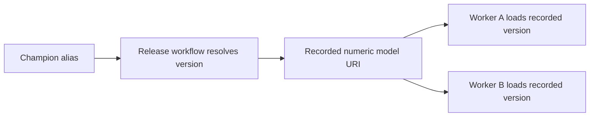

# Define Latest in a Model Registry with Versions and Aliases

Author: [nawazdhandala](https://www.github.com/nawazdhandala)

Tags: MLflow, Model Versioning, MLOps, Python

Description: Separate the newest registered model from the approved deployment choice, resolve champion once per release, and preserve artifacts behind fixed version references.

“Deploy the latest model” leaves several decisions unstated. Does latest mean the most recently registered artifact, the model trained on the newest dataset, the last candidate that passed evaluation, or the version currently selected for production?

Those choices can disagree. A training job may finish late, register a model built from an older dataset, and receive the highest registry version number. A newer candidate may also perform worse than the current deployment.

Use a numbered version to identify a particular registry entry and a named alias to express a deliberate selection. Then record which version a deployment actually loaded.

## Give each meaning its own name

Consider this fictional sequence for a demand-forecasting model:

| Registry version | Dataset snapshot | Evaluation result | Deployment decision |
|---|---|---|---|
| 11 | Monday | Approved | Existing champion |
| 12 | Tuesday | Failed a required segment check | Keep as an investigated candidate |
| 13 | Sunday, from a delayed job | Not yet evaluated | No production promotion |

Version 13 is newest by registration, but that does not make it the best available forecast or the latest data.

MLflow increments version numbers as models are added to a registered model. Its alias mechanism provides a mutable named reference to a specific version. Neither property supplies your evaluation or promotion policy. [Registry concepts](https://mlflow.org/docs/latest/ml/model-registry/)

Define the vocabulary in your operating procedure:

- **Newest registered:** highest version number within one registered model.
- **Approved candidate:** a particular version whose required checks and review passed.
- **Champion:** the version the authorized promotion workflow currently selects for the intended workload.
- **Deployed version:** the version a specific release, worker, endpoint, or batch job actually loaded.

During a gradual rollout, different deployed versions may coexist. A single champion alias does not prove that every worker has already switched.

## Understand what a latest URI does

For the concrete examples, use open-source **MLflow 3.18.0**. In that release, `models:/demand-forecast/latest` resolves to the highest registered version across stages. It does not filter by an approval tag or compare evaluation metrics. That behavior is explicit in the versioned URI resolver. [MLflow 3.18.0 model resolution](https://github.com/mlflow/mlflow/blob/v3.18.0/mlflow/store/artifact/utils/models.py)

Prefer references with a clear purpose:

| URI | Appropriate interpretation |
|---|---|
| `models:/demand-forecast/latest` | Inspect the newest registration when that is genuinely the intent |
| `models:/demand-forecast@champion` | Resolve the current deliberate selection |
| `models:/demand-forecast/11` | Load the recorded version for a specific release |

Version numbers are local to the registered model. Version 11 under a development model name is not automatically the same artifact as version 11 under a production model name.

Avoid treating a successful registration as approval. A model can be loadable and still fail accuracy, fairness, latency, schema, or business acceptance requirements.

## Resolve the alias once for each release

If every worker independently resolves `@champion` at startup, an alias change during a rollout can produce mixed versions unintentionally. Resolve it once in the release workflow and give every worker that release's fixed selection.



For a batch workload, do the same at job creation. Retrying a failed partition should normally use the job's recorded version, not whichever champion exists later.

This makes the decision boundary explicit. It does not replace a deployment controller's rollout coordination or artifact-integrity checks.

## Write a small selection manifest

A manifest is a file describing the inputs chosen for a release. The following example uses Python 3.11 and `mlflow==3.18.0` in an existing virtual environment. It requires an accessible registered model with a `champion` alias and read access to the registry.

Set `MLFLOW_TRACKING_URI`, `MLFLOW_REGISTRY_URI`, and `MODEL_NAME` through your environment. Set `REGISTRY_ID` to a stable, nonsecret identifier for that configured registry, such as `forecasting-prod`. Authentication stays in the normal credential configuration.

Run this once in a fresh release directory:

```python
import json
import os
from pathlib import Path
from mlflow import MlflowClient

client = MlflowClient(
    tracking_uri=os.environ['MLFLOW_TRACKING_URI'],
    registry_uri=os.environ['MLFLOW_REGISTRY_URI'],
)
name = os.environ['MODEL_NAME']
selected = client.get_model_version_by_alias(name, 'champion')
if selected.status != 'READY':
    raise RuntimeError('Selected model version is not ready')

version = str(selected.version)
release = {
    'schema_version': 1,
    'registry_id': os.environ['REGISTRY_ID'],
    'model_name': name,
    'model_version': version,
    'model_uri': f'models:/{name}/{version}',
    'selection_alias': 'champion',
    'source_run_id': selected.run_id,
}
with Path('release.json').open('x') as output:
    json.dump(release, output, indent=2)
    output.write('\n')
print(release['model_uri'])
```

The exclusive file mode refuses to overwrite an existing manifest. `READY` checks registry creation state, not model quality. The authorized promotion process must establish approval before selecting the champion. The alias lookup returns the version currently assigned to that name. [Client API](https://mlflow.org/docs/latest/api_reference/python_api/mlflow.client.html#mlflow.client.MlflowClient.get_model_version_by_alias)

For the fictional example, the output would be `models:/demand-forecast/11`. Retain the manifest as a protected release artifact; the file alone does not authenticate its contents or enforce registry access control.

## Load the recorded selection

Distribute the trusted manifest with the release. Configure the consumer for the same tracking and registry endpoints and its own authorized artifact access, then load the numeric URI:

```python
import json
import os
from pathlib import Path
import mlflow

release = json.loads(Path('release.json').read_text())
if release['registry_id'] != os.environ['REGISTRY_ID']:
    raise RuntimeError('Release targets a different registry')
mlflow.set_tracking_uri(os.environ['MLFLOW_TRACKING_URI'])
mlflow.set_registry_uri(os.environ['MLFLOW_REGISTRY_URI'])
model = mlflow.pyfunc.load_model(release['model_uri'])
print('Loaded', release['model_uri'])
```

The identifier check catches configuration mistakes; it is not a security boundary. The consumer no longer asks the registry which model is champion. Moving that alias afterward will not change this recorded selection.

`load_model` loads a Python model into the caller's environment. Make sure its dependencies and required runtime assets are available; a model reference is not an entire deployment environment. [Python model loading](https://mlflow.org/docs/latest/api_reference/python_api/mlflow.pyfunc.html#mlflow.pyfunc.load_model)

## Preserve the bytes behind the version

Treat released artifacts as immutable: publish changes as a new version instead of replacing files behind an old reference. A numeric registry URI does not itself make the storage immutable, prevent deletion, or preserve an external preprocessing service.

Retain the model directory, packaged preprocessing, dependency specification, deployment image, and any required data or vocabulary snapshots. Record digests for the release's actual artifacts and verify them through your release mechanism. Protect the registry entry and artifact retention for the required recovery period.

Storage controls need careful scoping. For example, Amazon S3 Object Lock protects specified object versions, but does not prevent another version being created at the same key. A reference that reads an unversioned key can therefore still observe different content. [S3 Object Lock](https://docs.aws.amazon.com/AmazonS3/latest/userguide/object-lock.html)

Do not reuse deleted model names as a substitute for preserving release history. Retained numeric references need both their registry identity and their artifacts to remain meaningful.

## Verify the policy with a deliberately newer candidate

A useful acceptance exercise creates a newer candidate without promoting it. Confirm that new releases still select the champion, and that an existing manifest still loads its recorded version after a deliberate alias move.

The local checks for this article used MLflow 3.18.0 with SQLite and synthetic Python models. The newest registration differed from champion. The manifest stayed pinned after the alias moved, while a fresh alias resolution selected the new version. No production model or hosted serving platform was tested.

For operations, record both the chosen release version and the version observed at each serving deployment. Recovery should select a retained, compatible release and follow the deployment process. An alias move alone is not proof that traffic changed or that an earlier runtime environment can be reconstructed.
