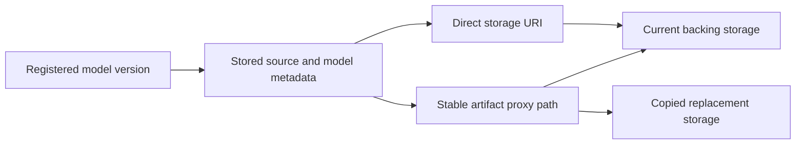

# Move an MLflow Artifact Store Without Breaking Existing Model Versions

Author: [nawazdhandala](https://www.github.com/nawazdhandala)

Tags: MLflow, Model Versioning, MLOps, Data Migration

Description: Plan an MLflow artifact-store migration around existing references, preserve proxied paths, verify copied files, and keep older model versions recoverable.

Copying model files to a new bucket or disk does not automatically move the references stored in MLflow. A registered version can remain visible in the registry while its model files become unreachable.

Start with the stored references, then choose a migration strategy. If clients use a stable artifact proxy, you may be able to move its backing storage without changing their references. If they use direct storage addresses, the old addresses remain part of the compatibility contract.

This guide uses **MLflow 3.18.0**. Its local rehearsal used **Python 3.11.13**, SQLite metadata, and an HTTP artifact proxy backed by filesystem directories. Cloud storage copying and production authentication were not tested.

## Separate metadata from artifact storage

MLflow's backend store contains metadata about runs, models, and experiments. The artifact store holds files such as model weights. Moving one does not automatically relocate the other. [Backend store architecture](https://mlflow.org/docs/latest/self-hosting/architecture/backend-store/)

A registered version may also refer to a logged-model identifier, which resolves to another artifact location. Do not treat every `source` field as a literal filesystem path. Capture both the recorded source and the resolved download location.



The proxy can provide a stable addressing boundary. A direct URI continues naming its original storage location until consumers or references are deliberately migrated.

## Inventory the versions you must preserve

Run this read-oriented inventory from an authorized migration workspace. Configure `MLFLOW_TRACKING_URI`, `MLFLOW_REGISTRY_URI`, and `MODEL_NAME`. Save the script as `inventory.py`; it writes a new local JSON file but does not modify registry metadata.

```python
import json
import os
import re
from mlflow import MlflowClient

name = os.environ['MODEL_NAME']
if not re.fullmatch(r'[A-Za-z0-9_.-]+', name):
    raise SystemExit('Adapt and review the filter for this model name')
client = MlflowClient(tracking_uri=os.environ['MLFLOW_TRACKING_URI'],
                      registry_uri=os.environ['MLFLOW_REGISTRY_URI'])
rows = []
token = None
while True:
    page = client.search_model_versions(
        filter_string=f"name = '{name}'", max_results=100, page_token=token
    )
    for item in page:
        model = client.get_model_version(name, str(item.version))
        row = {'name': name, 'version': str(model.version),
               'source': model.source, 'run_id': model.run_id,
               'aliases': list(model.aliases),
               'download_uri': client.get_model_version_download_uri(
                   name, str(model.version))}
        if model.run_id:
            row['run_artifact_uri'] = client.get_run(model.run_id).info.artifact_uri
        rows.append(row)
    token = page.token
    if not token:
        break
if not rows:
    raise SystemExit('No versions found; check registry context and permissions')
fd = os.open('model-inventory.json', os.O_WRONLY | os.O_CREAT | os.O_EXCL, 0o600)
with os.fdopen(fd, 'w') as handle:
    json.dump(sorted(rows, key=lambda row: int(row['version'])), handle, indent=2)
print(f'Saved {len(rows)} versions to model-inventory.json')
```

Run `python inventory.py`. It should report the number of versions saved. The restricted filename filter avoids interpolating unreviewed quotation characters into the search expression. Adapt it deliberately for names outside that simple character set. The output uses owner-only permissions on POSIX systems and refuses to overwrite an existing inventory.

Pagination matters: a single search response is not necessarily the complete model history. MLflow returns the next page token on its paged result. [Model-version search API](https://mlflow.org/docs/latest/api_reference/python_api/mlflow.client.html#mlflow.client.MlflowClient.search_model_versions)

Repeat the inventory for every in-scope registered model. Supplement it with experiments, runs, logged models, serving deployments, batch jobs, and retained releases that reference the old store. This script does not discover unregistered artifacts, deleted records, external consumers, or every retention requirement. It is not permission to delete unlisted files.

## Choose the route before copying

| Existing artifact address | Practical approach |
|---|---|
| Stable `mlflow-artifacts:/...` proxy path | Preserve the endpoint and relative path layout; move the proxy's backing storage |
| Explicit proxy hostname | Preserve that hostname or provide a reviewed compatibility route |
| Direct `s3://old-bucket/...` or equivalent | Keep old addresses readable, or create and validate new references while migrating consumers |
| Local filesystem path | Preserve the required mount path or migrate references; copying files elsewhere is insufficient |

Changing a server's default artifact root affects newly created experiment configuration; it does not rewrite historical experiment locations. For proxied artifacts, `--artifacts-destination` controls the backing location served by the proxy. [Tracking server artifact configuration](https://mlflow.org/docs/latest/self-hosting/architecture/tracking-server/)

Do not attempt a broad SQL string replacement across the backend database. The public `update_model_version` API updates description metadata, not the artifact source. A storage move can involve run locations and logged-model metadata as well as registered versions. [Model-version update API](https://mlflow.org/docs/latest/api_reference/python_api/mlflow.client.html#mlflow.client.MlflowClient.update_model_version)

For direct locations that cannot remain accessible, create new versions referencing verified copies and maintain an old-to-new mapping. Update deployments only after evaluation. This does not repair historical references automatically: retain the original location until its consumers and retention obligations have been handled. Copying a registry record is not a substitute for copying and retaining the artifact bytes.

## Copy from a stable state

Plan a controlled write pause. Stop new training uploads, model registration, artifact-changing jobs, and cleanup processes that could race with the copy. Let in-flight operations finish or account for them explicitly.

Back up the metadata database and record the matching artifact-copy boundary. Use the storage system's supported copy or snapshot mechanism, preserving the relative object-key or directory layout beneath the artifact root. Verify file counts, sizes, and content digests against a manifest. Do not assume an object-store ETag is always a file-content checksum. For example, a multipart S3 ETag is not the MD5 digest of the complete object. [S3 checksum documentation](https://docs.aws.amazon.com/AmazonS3/latest/userguide/checking-object-integrity-upload.html)

For a large store, an initial copy can happen before the pause, followed by a verified final delta while writers are stopped. Define how changed and deleted objects are reconciled. Keep the original copy retained; avoid a destructive synchronization option that removes files before the migration has passed acceptance checks.

Separate storage relocation from an MLflow version upgrade. Keeping the same application version makes failures easier to attribute and avoids combining artifact movement with database schema changes.

## Rehearse a proxied move in isolation

For a dedicated lab, clone the metadata and copy the artifact tree while its test server is stopped. Use the same client-facing lab address after restarting, with the new root configured. This example uses placeholders for the absolute lab paths:

```bash
mlflow server \
  --host 127.0.0.1 \
  --port 5001 \
  --workers 1 \
  --backend-store-uri 'sqlite:////absolute/lab/tracking.db' \
  --artifacts-destination '/absolute/lab/new-artifacts'
```

Run this only after the replacement directory contains the verified copy and the lab database has the intended metadata. A production deployment needs its existing network, authentication, database, and service-management settings preserved. The loopback address above is intentionally limited to the lab host.

MLflow's artifact URI implementation resolves logical proxy paths through an HTTP tracking endpoint. Preserving that endpoint and the relative artifact layout lets the underlying root change without changing each client URI. [MLflow 3.18.0 proxy URI implementation](https://github.com/mlflow/mlflow/blob/v3.18.0/mlflow/store/artifact/mlflow_artifacts_repo.py)

The local rehearsal registered a synthetic model, copied the complete stopped-server artifact directory, made the original root unavailable, and restarted the server with the replacement root. Version 1 still loaded and returned its expected result. Its inventory and alias assignment were unchanged. A newly registered version then wrote successfully to the new destination.

That demonstrates the mechanism in this local proxy arrangement. It does not prove that a cloud migration preserved encryption settings, access permissions, storage lifecycle rules, or all historical objects.

## Accept the move before resuming normal writers

Use fresh processes and empty download directories. Test several classes of references: an older numeric version, the current champion, a version whose source is a logged-model identifier, and retained rollback candidates. Download and load each model, then run its approved smoke prediction.

Compare inventory records and artifact digests before and after the move. Confirm that model versions, run links, aliases, and expected files are preserved. Test with the deployment's actual identity, since the operator who copied the data may have broader permissions.

Keep normal writers paused while testing controlled new writes to a dedicated experiment. Confirm that newly logged artifacts land in the replacement store and can be downloaded from another process. Only then resume ordinary uploads and registration.

## Preserve a rollback that includes new writes

Before any new writes, a rollback may be as simple operationally as restoring the previous proxy configuration, provided the original store and database are still coherent. Once writes reach the new destination, the old store is stale.

Pause writers again before reversing the change. Identify and reconcile newly created artifacts and their metadata references, verify both sides, and choose the authoritative destination. Pointing the server back without that work can strand the very versions created during validation or resumed traffic.

Retire old storage only after reference checks, a recovery rehearsal, and the required retention period pass. Keep the inventory, copy manifest, validation results, and cutover decision together so future recovery does not depend on remembering which directory was current.
