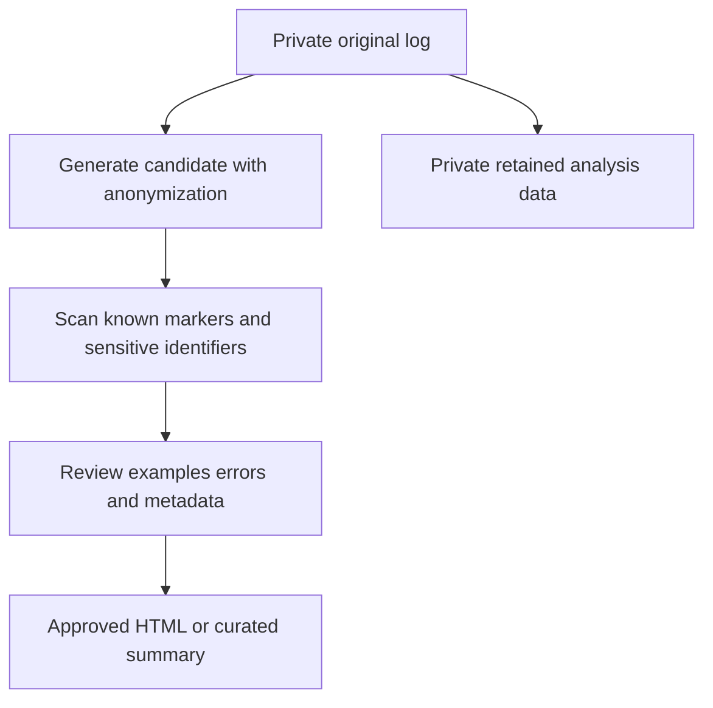

# Anonymize SQL Literals Before Sharing a pgBadger Report

Author: [nawazdhandala](https://www.github.com/nawazdhandala)

Tags: PostgreSQL, PgBadger, Data Privacy, Security

Description: Use pgBadger literal anonymization, test what remains visible, and review the final HTML without exposing raw logs, binary data, or error details.

A pgBadger report is useful to someone investigating a slow query. It can also contain customer values, internal database names, application identifiers and error messages copied from the logs. Sharing only the HTML does not automatically remove that information.

pgBadger provides `--anonymize` to obscure SQL literals. Use it as one transformation in a review workflow, then inspect the exact artifact you intend to send. This guide uses **pgBadger 13.3** and locally generated reports containing artificial markers. The tests show both successful masking and important remaining content.

## Know which parts of SQL are values

In this statement, the email address is a string literal. The table and column names are identifiers:

```sql
SELECT customer_id
FROM tenant_accounts
WHERE email = 'person@example.test';
```

Changing the literal can preserve the query's basic shape for discussion. Changing an identifier changes which object the query describes. Both can be sensitive, but they are different categories for a tool to handle.

PostgreSQL also supports several literal forms, including ordinary quoted strings, escape strings and dollar-quoted strings. A masking test that covers only `'hello'` does not establish coverage for every form. [PostgreSQL lexical structure](https://www.postgresql.org/docs/18/sql-syntax-lexical.html)

Query normalization is another separate concept. A normalized ranking can combine statements with different values, while an expandable example still shows an original execution. Reviewing only the main ranking table misses those examples.

## Generate a separate candidate for sharing

Start with a closed input log in a private location. Create a new review directory and use the prefix from your actual PostgreSQL configuration:

```bash
set -euo pipefail
umask 077
mkdir pgbadger-sharing-review

pgbadger --anonymize --nocomment -f stderr \
  -p '%m [%p]: user=%u,db=%d,app=%a,client=%h ' \
  -o pgbadger-sharing-review/report.html \
  /private/postgresql/closed-incident.log
```

Replace the input path and prefix. The example assumes standard-error text logs with timestamp, process and connection fields. `mkdir` fails if that review directory already exists, helping prevent accidental inspection of an old file under the same name.

The `--anonymize` option changes displayed query literals. `--nocomment` requests removal of SQL block comments; do not read that as a guarantee that every comment syntax or every report field disappears. These options and their behavior are described in the [tagged documentation](https://github.com/darold/pgbadger/blob/v13.3/README) and [implementation](https://github.com/darold/pgbadger/blob/v13.3/pgbadger).

Keep the original analysis archive separate. A shareable candidate should not overwrite the internal report that investigators may need for exact SQL and values.



## Test the installed release with artificial markers

Before using real incident data, put clearly fake markers into a controlled fixture covering the forms your application emits. A canary is simply a recognizable value placed there so you can check whether it survives processing.

For example, these two valid PostgreSQL expressions use different string syntaxes:

```sql
SELECT 'STRING_CANARY_ALPHA';
SELECT $$DOLLAR_CANARY_BETA$$;
```

Do not place real credentials or customer records in the test. Include fake values in comments, identifiers, connection metadata and an error detail as well as in successful statements.

Local tests of pgBadger 13.3 generated ordinary and anonymized HTML from the same synthetic standard-error log. Inspection covered decoded HTML source and extracted text:

| Artificial content | Result with `--anonymize --nocomment` |
|---|---|
| Ordinary quoted string marker | Original marker absent |
| Numeric literal marker | Original number absent |
| SQL block-comment marker | Absent |
| Dollar-quoted string marker | Still present |
| SQL line-comment marker | Still present |
| Table identifier marker | Still present |
| User, database, application and client metadata | Still present |
| Constraint name and error-detail marker | Still present |

The test establishes these concrete outcomes, not a complete inventory of every possible exposure. It also explains why “the literal in my first query changed” is an insufficient acceptance test.

If your workload uses an uncovered syntax, do not distribute the candidate on the assumption that the option handled it. Keep the full report internal or prepare a smaller summary whose SQL and identifiers have been reviewed explicitly.

## Scan both source and visible text

A simple text search can miss a marker split by HTML formatting tags. The following Python 3 helper searches decoded source and concatenated text. Save it as `check_report.py`; it uses the standard [HTMLParser](https://docs.python.org/3.11/library/html.parser.html) and [HTML entity decoder](https://docs.python.org/3.11/library/html.html).

```python
import html
import sys
from html.parser import HTMLParser
from pathlib import Path

class TextCollector(HTMLParser):
    def __init__(self):
        super().__init__(convert_charrefs=True)
        self.parts = []

    def handle_data(self, data):
        self.parts.append(data)

raw = Path(sys.argv[1]).read_text(encoding="utf-8")
patterns = [line.strip() for line in
            Path(sys.argv[2]).read_text(encoding="utf-8").splitlines()
            if line.strip()]
if not patterns:
    raise SystemExit("The review pattern list is empty")

parser = TextCollector()
parser.feed(raw)
parser.close()
searchable = (html.unescape(raw) + "\n" +
              html.unescape("".join(parser.parts))).casefold()
hits = [i for i, pattern in enumerate(patterns, 1)
        if pattern.casefold() in searchable]
if hits:
    print("Review required; matching pattern numbers:", hits)
    raise SystemExit(1)
print("No listed patterns found; manual review is still required")
```

Put one known marker or sensitive identifier per line in a private `review-patterns.txt`, then run:

```bash
python3 check_report.py \
  pgbadger-sharing-review/report.html review-patterns.txt
```

Exit status one means a listed pattern remains. The output identifies its line number rather than printing the potentially sensitive value. An empty list fails instead of producing a misleading clean result.

A successful scan means only that these exact patterns were absent. It does not discover unknown secrets, decode every JavaScript representation or inspect linked files. The helper reads one HTML file and never fetches remote resources.

In local tests, it detected markers split across tags and encoded with HTML entities. It also rejected the anonymized fixture when the list included the surviving dollar-quoted marker. A list containing only the successfully masked ordinary-string marker produced no match.

## Review the sections a search list cannot anticipate

Open the exact candidate and inspect expandable SQL examples, slowest statements, lock and temporary-file details, errors, and connection metadata. Check filenames and paths shown in the report too. A schema name can reveal a customer relationship even when no literal values remain.

Error details deserve particular attention. A unique-constraint violation can include the rejected value in its diagnostic text. That text is separate from the SQL statement, so masking the statement is not sufficient. The fixture's error-detail marker remained visible even though the statement's ordinary string marker was obscured.

Decide whether the recipient needs this entire report. A focused table of normalized query shapes, counts and durations may answer the question with much less material to review. Preserve the metrics accurately and label any edited example as illustrative rather than executable evidence from the incident.

## Share the reviewed artifact, not the working directory

The binary analysis is not the anonymized HTML. In the local test, binary output generated with `--anonymize` still contained the original ordinary-string marker. Treat binary data, raw logs, progress files and diagnostic output as private unless they undergo their own review.

Other output formats also need separate checks; a successful HTML test is not evidence about JSON or raw CSV. If you use external CSS or JavaScript assets, inventory the files required by the report instead of attaching the whole analysis directory.

After the last edit or regeneration, repeat the scan and visual review. The useful result is a specific reviewed artifact with understood limitations, not merely a command line containing an anonymization flag. All tests described here used artificial data; no production report was shared.
