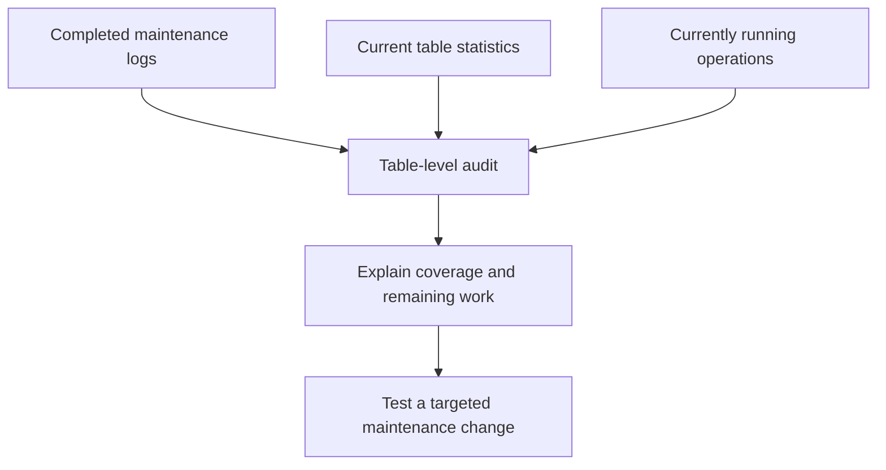

# Audit PostgreSQL Autovacuum and Autoanalyze with pgBadger

Author: [nawazdhandala](https://www.github.com/nawazdhandala)

Tags: PostgreSQL, PgBadger, Database Monitoring, Performance

Description: Audit automatic PostgreSQL maintenance with pgBadger logs, table statistics and progress views, while distinguishing missing records from missing work.

A table can have many dead row versions even though autovacuum runs regularly. Another table may have no autovacuum entries in a report because its maintenance finishes below the logging threshold. Neither situation is explained by counting log messages alone.

A useful audit combines three views: completed maintenance from logs, the table's current statistics, and any operation running now. pgBadger makes the historical view easier to review, but it does not replace the other two.

This tutorial uses **pgBadger 13.3**. The local check generated real automatic maintenance in an isolated PostgreSQL **14.17** instance and compared its logs with SQL statistics. PostgreSQL 18 documentation was reviewed separately; the older test runtime is not a deployment recommendation.

## Separate vacuuming from analyzing

Vacuuming reclaims space for reuse from row versions that are no longer needed, maintains visibility information and helps protect against transaction-ID wraparound. Analyzing collects statistics used by the query planner. A table can need one operation more urgently than the other. [Routine maintenance](https://www.postgresql.org/docs/18/routine-vacuuming.html)

For example, frequent updates may create cleanup work, while a changed data distribution may require fresh planner statistics. A large number of vacuum events does not prove that the planner has current estimates. Likewise, an analyze event does not prove that dead versions were removed.

Define the audit question before opening the report: is maintenance absent, falling behind, repeatedly blocked, or consuming substantial resources? The evidence needed for each conclusion differs.

## Establish what the logs include

Inspect the current server setting:

```sql
SHOW log_autovacuum_min_duration;
```

This controls logging of automatic vacuum and analyze actions. Zero logs all actions, a positive duration logs actions meeting that threshold, and `-1` disables this logging. With logging enabled, skipped actions can also produce messages. [Autovacuum logging](https://www.postgresql.org/docs/18/runtime-config-logging.html)

For a short approved observation period, a configuration setting of zero can provide complete action-level visibility:

```conf
log_autovacuum_min_duration = 0
```

Apply it through your normal configuration process, verify the effective value, and restore the chosen routine threshold after the observation. Consider log volume and retention. This controls observability; it does not make autovacuum run more often.

Keep the complete multiline records. They can describe pages, tuples, timing and other work. Exporting only the first line may preserve a table name while losing the reason an operation was ineffective or expensive.



## Generate the historical report

Run pgBadger against a closed log covering the audit interval. Replace the path and prefix with the actual values from the server:

```bash
pgbadger -f stderr \
  -p '%m [%p]: user=%u,db=%d,app=%a,client=%h ' \
  -o maintenance-audit.html /archive/postgresql/maintenance.log
```

The prefix must match the input. Autovacuum workers may not have the same user or application labels as ordinary clients, so begin without application filters that could discard their records. [pgBadger logging requirements](https://github.com/darold/pgbadger/blob/v13.3/README)

Review automatic vacuums and automatic analyzes separately. Compare tables within the same observation window and logging policy. Look at frequency, elapsed time and reported work rather than assuming the busiest table is unhealthy.

The local fixture inserted 2,000 rows and deleted 1,500 from one disposable table. Table-specific thresholds and a short worker wake-up interval made automatic maintenance occur promptly in the lab. pgBadger's HTML recorded one automatic vacuum and one automatic analyze for that table. Ordinary statement-duration logging was disabled throughout.

Those lab settings were chosen to trigger a small test, not proposed as a production tuning recipe. The useful result is agreement between the captured maintenance messages and the report's table-level evidence.

## Compare the report with table statistics

Connect to the database you are auditing with suitable monitoring access. This read-only query lists tables in the example `public` schema; replace the schema or remove that filter for your intended scope:

```sql
SELECT schemaname, relname, n_live_tup, n_dead_tup,
       n_mod_since_analyze, last_autovacuum, last_autoanalyze,
       autovacuum_count, autoanalyze_count
FROM pg_stat_user_tables
WHERE schemaname = 'public'
ORDER BY n_dead_tup DESC, relname
LIMIT 20;
```

The live-row, dead-row and modified-since-analyze fields are estimates. They are useful signals, not exact row counts or direct measurements of wasted disk space. The automatic-maintenance timestamps and counters are distinct from the manual vacuum/analyze fields. [Table statistics](https://www.postgresql.org/docs/18/monitoring-stats.html#MONITORING-PG-STAT-ALL-TABLES-VIEW)

In the test, the query showed an estimated 500 live rows, zero dead rows, and one automatic operation of each kind, with populated timestamps. That matched the intended fixture and logged completions.

Production counters and a bounded pgBadger report usually cover different periods. Compare snapshots over a matching interval, account for statistics resets, and avoid holding the inspection in a long transaction with an old statistics snapshot. A recent timestamp is evidence of an operation, not proof that every maintenance objective was satisfied.

## Check active work before declaring a gap

These queries show currently running vacuum and analyze operations in the connected database:

```sql
SELECT pid, relid::regclass AS table_name, phase,
       heap_blks_total, heap_blks_scanned, heap_blks_vacuumed
FROM pg_stat_progress_vacuum
WHERE datname = current_database();

SELECT pid, relid::regclass AS table_name, phase,
       sample_blks_total, sample_blks_scanned
FROM pg_stat_progress_analyze
WHERE datname = current_database();
```

`relid::regclass` displays the relation's name; `phase` identifies the current stage. Progress views can include manual operations too, so use process context when deciding whether an operation is automatic. An empty result means nothing was visible at that instant, not that maintenance never runs. [Progress reporting](https://www.postgresql.org/docs/18/progress-reporting.html)

The queries executed successfully after the lab's work completed and returned no rows. They were not tested against a long-running active phase, so the example does not promise a particular progress sequence.

## Explain discrepancies before changing thresholds

Inspect per-table options as well as server defaults:

```sql
SELECT c.oid::regclass AS table_name, c.reloptions
FROM pg_class AS c
JOIN pg_namespace AS n ON n.oid = c.relnamespace
WHERE n.nspname = 'public'
  AND c.relkind IN ('r', 'm', 'p')
ORDER BY table_name;
```

A null options value means no explicit options are stored there; it does not mean every effective setting is disabled. Table storage parameters can override automatic-maintenance behavior. [Table storage parameters](https://www.postgresql.org/docs/18/sql-createtable.html#SQL-CREATETABLE-STORAGE-PARAMETERS)

When logs report dead tuples that cannot yet be removed, investigate what is retaining visibility, including old transactions, prepared transactions and replication-related horizons. Repeatedly requesting more vacuum work will not by itself remove versions that must remain visible.

When modified-row estimates grow without fresh analyze evidence, inspect thresholds, worker availability, conflicting operations and collection coverage. For partitioned workloads, examine the actual relation names rather than treating one parent label as the entire dataset. [Automatic vacuuming controls](https://www.postgresql.org/docs/18/runtime-config-vacuum.html)

Finish with a concrete record: observation window, logging threshold, affected tables, completed work, remaining estimates and any active operation. Change one justified setting or workload behavior, then repeat the comparison. A successful audit explains whether maintenance is keeping up; merely producing more log entries is not the goal.
